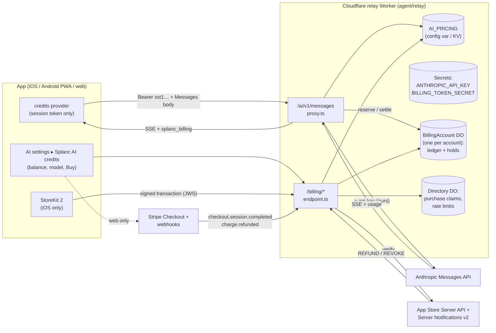

# Splanc AI credits: pay for Claude in the app

Status: design + sandbox-only scaffold (this PR). Nothing is deployed, no store
product exists, no merchant account is linked, and every route answers 503
until the owner turns it on.

Today the in-app AI (the effect editor's chat, Acid Mode) needs the user's own
Anthropic API key. Most people don't have one. With **Splanc AI credits** a
user buys a credit pack, and the app uses Claude through our server. We pay
Anthropic and charge the user Anthropic's price plus a small markup. Bringing
your own key keeps working exactly as before.

## What users see

| Platform | How they buy | What they see |
| --- | --- | --- |
| **iOS app** (App Store) | Apple In-App Purchase: consumable credit packs, at Apple's local prices | AI settings ▸ "Splanc AI credits": balance, model, "Buy credits" (the StoreKit sheet). No link to, or mention of, the web checkout. |
| **Android** (the PWA in Chrome) | Web checkout (Stripe Checkout: card, Google Pay) | The same panel, "Buy credits" opens Stripe Checkout. |
| **Web** (any browser) | Web checkout (Stripe Checkout: card, Apple Pay, Google Pay) | The same panel. |

Everywhere: one balance in **credits**, shown live in AI settings and after
each AI reply ("−2.3 credits · 351 left"); a warning below a low-balance mark;
a clear refusal when the balance runs out ("Not enough Splanc AI credit. Buy
more in AI settings."), never a silent failure. Buying is 18+: the app asks
once before the first purchase. There is no free credit; the free tier is for
trying the AI. Credits bought on one platform
work on every platform the same account signs in on. Credits never expire
(Apple requires that; it's also simpler).

One credit = **US$0.01 of Anthropic list-price usage**. The markup is in how
many credits a pack gives, which depends on where it's bought (it has to cover
Apple's commission). A US$9.99 pack in the iOS app gives 713 credits; US$10 on
the web gives 833. See [Margins](#costs-and-margins).

## Decisions

### Owner decisions (2026-11-18)

1. **Channels.** iOS uses **Apple In-App Purchase** (consumable packs). Android
   and the web use a **web checkout** (Stripe, with Apple Pay / Google Pay
   buttons). **No Google Play Billing** and no Play-distributed Android app for
   now. The iOS app never shows or links to the web purchase.
2. **Markup per channel**, in the server-side config: higher on In-App
   Purchase (to cover Apple's commission), lower on the web.
3. **Architecture:** a server-side AI proxy on the relay, a reserve-then-settle
   ledger, purchase validation, accounts. **Our Anthropic key (and any
   managed credential) never reaches a client.** The app holds only a session
   token for its credit account.
4. **BYO key is unchanged.** "Cloud ▸ Anthropic" with your own key still calls
   Anthropic straight from the browser, with the same request as before (a test
   pins the bytes).

### Owner decisions, second round (2026-11-18)

| # | Question | Decision |
| --- | --- | --- |
| 1 | Seller | **The owner's LLC** is the merchant / seller everywhere (App Store, Stripe, Anthropic). Its legal name stays out of this repo; it lives only in the private store, Stripe and Anthropic account settings. |
| 2 | Apple Small Business Program | **Enrol** → iOS markup **+40 %**. |
| 3 | Markups and packs | iOS +40 %, web +20 %; iOS packs US$4.99 / 9.99 / 19.99, web US$10 / 25. |
| 4 | Free trial | **None** (`trial_credits: 0`). The free tier (OpenRouter free models; `docs/design/ai-tiers.md`, the model-setup picker PR) covers trying the AI. |
| 5 | Web tax | **Stripe Tax, we file.** Its 0.5 % is in the web channel fee (`fee_percent: 0.034`). |
| 6 | Sign-in | **Sign in with Apple + Sign in with Google + anonymous device accounts** that can be linked later. No e-mail login. In-app account deletion stays (Apple 5.1.1(v)). |
| 7 | Minors | **18+ gate on buying credits.** |
| 8 | Retention | No prompt content; ledger / financial records as long as tax law requires; request logs 30 days. |
| 9 | Deletion with credit left | **Forfeit, with a clear warning** before confirming. |
| 10 | Models | **Claude Sonnet 5.5 (default), Claude Haiku 5.5, Claude Opus 5.5.** |
| 11 | Caps | 2,000 credits a day, 20,000 a month, 2 concurrent per account. |
| 12 | Anthropic usage tier | **Launch on the current tier**, raise it when needed. Monitoring and alerting for approaching the org spend limit, and a graceful "Splanc AI credits are busy right now. Try again later." when it is hit ([Org spend limit](#org-spend-limit)). |
| 13 | Org monthly spend limit | **US$1,000** (in the pricing config, not a secret): alert at **US$800** (80 %), graceful stop at **US$980** (98 %). |
| 14 | Where alerts go | **Grafana Cloud alerting** (as for the HITL rigs): the relay pushes billing events to Grafana Cloud Logs, and the alert rules are code ([Observability and alerts](#observability-and-alerts)). |
| 15 | Apple refund consumption requests | **Yes, with consent.** The app asks for the user's opt-in (in the purchase flow and in AI settings); with it, the relay answers Apple's CONSUMPTION_REQUEST with the pack's consumption ([Apple refund requests](#apple-refund-requests-consumption_request)). |
| 16 | Refund preference in consumption answers | **By usage:** GRANT_FULL if none of the pack was used, GRANT_PRORATED if part was, DECLINE if all was. |
| 17 | `sampleContentProvided` | **true**: the free tier counts as a sample. |

### Store rules (checked 2026-11-18)

- **Apple, App Store Review Guidelines (updated 2026-10-16)**
  ([guidelines](https://developer.apple.com/app-store/review/guidelines/)).
  - 3.1.1: digital features and "in-game currencies" sold in the app must use
    In-App Purchase. "Any credits or in-game currencies purchased via in-app
    purchase may not expire."
  - In the **US storefront**, apps may also show buttons and links to an
    external purchase (3.1.1(a), 3.1.3, after Epic v. Apple). Apple currently
    charges no commission on those. The Supreme Court is hearing Apple's appeal
    (No. 25-1311), so a fee could come back.
  - **We don't link out (owner decision 1).** That is the rule everywhere
    outside the US anyway, so it is the simplest compliant design.
  - 5.1.1(v): an app that creates accounts must offer **account deletion in
    the app**.
  - 4.8: offering Google or other social login needs an equivalent private
    login option (Sign in with Apple qualifies).
  - 5.1.2(i): disclose, and get explicit permission, when personal data is
    sent to a **third-party AI**.
  - 1.2: apps that create AI content need a content filter, a way to report
    content, and published contact details. The existing "Report" button on
    every AI reply ([agent-feedback.md](agent-feedback.md)) covers reporting.
- **Apple fees.** Small Business Program: 15 % on proceeds up to US$1 M a year
  ([program](https://developer.apple.com/app-store/small-business-program/)),
  30 % otherwise. Apple sells "as agent" and handles sales tax / VAT in most
  regions (Schedule 2), so we don't file tax for In-App Purchase sales.
  Consumables don't restore through StoreKit, so **the balance must live on
  our server, tied to an account**.
- **Google Play** (for the record: not used now). Apps on Play must use Play
  Billing for digital goods
  ([payments policy](https://support.google.com/googleplay/android-developer/answer/9858738)).
  A TWA reaches it through the Digital Goods API. In the US after Epic v.
  Google, alternative billing and links are allowed, with fees of about 10–20 %
  ([answer 15582165](https://support.google.com/googleplay/android-developer/answer/15582165)).
  Fees were restructured on 2026-06-30 (a service fee plus a 5 % billing fee).
  Because Android users run the PWA in Chrome, not a Play app, **no store rule
  applies to them**. "Google Pay" on the web is just a wallet in Stripe
  Checkout, not Play Billing.
- **Web.** No store rules. Stripe: 2.9 % + 30 ¢ per US card or wallet payment
  ([pricing](https://stripe.com/pricing)). Stripe is **not** the merchant of
  record, so sales tax / VAT is ours. Stripe Tax computes it for 0.5 %.
  Alternatives that are the merchant of record: Stripe Managed Payments
  (+3.5 %) or Paddle (5 % + 50 ¢). Lemon Squeezy is closing (no new sign-ups),
  so don't use it.

### Anthropic terms (checked 2026-11-18)

- **Allowed.** The Commercial Terms let a customer use Claude "to power
  products and services Customer makes available to its own customers and end
  users" (A.1). Nothing regulates what we charge, so a markup is fine
  ([commercial terms](https://www.anthropic.com/legal/commercial-terms)).
- **Not allowed.** Reselling the Services as such ("resell the Services except
  as expressly approved", D.4), building a competing product, and "Resell,
  proxy, or otherwise provide access to Claude through unauthorized means"
  ([Usage Policy](https://www.anthropic.com/legal/aup)).
  - **So the proxy is not a general Claude endpoint.** It accepts only the
    editor's request shape: custom tools, an allowlisted set of fields and
    models, a capped `max_tokens`. It is for Splanc's own features.
  - Keep the feature about lighting.
- **Our obligations.**
  - Our users must follow the Usage Policy, and we are "responsible for all
    activity under [our] account" (D.2, D.5). Anthropic may suspend us for a
    user's misuse (I.3).
  - So we need per-account limits and caps, a way to suspend accounts, and an
    opaque per-user id in `metadata.user_id` for Anthropic's abuse tooling.
  - Tell users that AI output may be inaccurate (D.3).
  - Disclose that users are talking to an AI (Usage Policy, consumer chatbots).
    The editor already says so.
  - Minors: products serving under-18s have extra requirements
    ([support article](https://support.claude.com/en/articles/9307344)).
    **Decided: buying credits is 18+.** The app asks once and the account
    records it (`POST /billing/age`); Buy shows only for a confirmed adult,
    and the web checkout will refuse without it.
- **Data.** Anthropic doesn't train on API content (B). It deletes inputs and
  outputs within 30 days, or keeps them up to 2 years if flagged for a policy
  violation ([retention](https://privacy.claude.com/en/articles/7996866-how-long-do-you-store-my-organization-s-data)).
  Our privacy notice names Anthropic as a sub-processor.
- **Branding.** Don't imply Anthropic endorses us ([trademark guidelines](https://www.anthropic.com/legal/trademark-guidelines)).
  Name models exactly as sent ("Claude Sonnet 5.5"), say "Powered by Claude"
  at most, and keep our own brand.
- **Limits.** Rate limits and monthly spend limits are **organization-wide**
  ([rate limits](https://platform.claude.com/docs/en/api/rate-limits)): all
  users share one pool. At the spend limit the API returns 429
  `enforced_spend_limit_reached`. The proxy maps that to "busy" and releases
  the reservation. Before launch we need a usage tier with headroom: Start is
  capped at US$500 a month, Build at US$1,000.

### Billing model

**Prepaid credits, metered per request, priced from the API's own usage
report.**

- Pack price → credits (the markup):
  `credits = floor(price_usd / (1 + channel.markup) × credits_per_usd)`,
  or a pack's explicit `credits`.
- Request → charge (no markup by default):
  `charge = max(min_request_credits, list_usd × (1 + usage_markup) × credits_per_usd)`.
- `list_usd` is a sum over the request's usage fields. Each is multiplied by
  that model's list rate for that token class
  ([pricing](https://platform.claude.com/docs/en/about-claude/pricing)):
  - `input_tokens`;
  - `output_tokens` (thinking tokens bill as output);
  - `cache_creation_input_tokens`, split into 5-minute and 1-hour writes by
    `usage.cache_creation`;
  - `cache_read_input_tokens`.
- Claude Haiku 5.5 prices a request whose prompt (input + cache reads + cache
  writes) is over 100,000 tokens at higher rates, for the **whole request**.
  The config has a `long_context` block for that.
- Every rate is per model in the config, not a multiplier. Cache reads are
  0.05× on Opus 5.5 / Sonnet 5.5 but 0.1× on Haiku 5.5, so a single
  multiplier would be wrong.

Why the markup sits on the pack, not on usage: a credit is then one unit
everywhere, so credits bought on iOS and on the web mix in one balance with no
per-lot bookkeeping. The extra the store takes is paid when the pack is bought,
on that channel. `usage_markup` stays available (default 0) if usage itself
should carry a margin (e.g. to cover infrastructure).

| Model (default config) | Input | Output | 5 m write | 1 h write | Cache read | Credits per 1 M output |
| --- | --- | --- | --- | --- | --- | --- |
| Claude Sonnet 5.5 (default) | $2 | $10 | $2.50 | $4 | $0.10 | 1,000 |
| Claude Opus 5.5 | $4 | $20 | $5 | $8 | $0.20 | 2,000 |
| Claude Haiku 5.5 (≤ 100 K prompt) | $0.10 | $0.50 | $0.125 | $0.20 | $0.01 | 50 |
| Claude Haiku 5.5 (> 100 K prompt) | $0.50 | $2.50 | $0.625 | $1 | $0.05 | 250 |

Rough size of a request (an estimate, not measured): one editor ask on Sonnet
5.5 runs about 2–4 tool rounds. Each round reads a cached system prompt of
about 6 K tokens and writes about 1–2 K output tokens (thinking included); the
first round also writes the cache. That comes to roughly **3–12 credits per
ask**, about twice that on Opus. So a US$9.99 iOS pack (713 credits) is about
60–240 asks. Measure this in the sandbox before setting pack
sizes.

**Low balance, hard stop, refunds.**

- The app warns below `low_balance_credits`.
- If the balance doesn't cover a request's worst case, the proxy first lowers
  `max_tokens` to what the balance does cover. If that would leave fewer than
  1,024 tokens, it refuses with **402** and nothing is sent to Anthropic.
- A request can still cost more than its estimate. The settle then debits up
  to `max_overdraft_credits` below zero and records the rest as `written_off`
  (our loss, which reconciliation shows). The next request is refused until
  the user tops up.
- Store refunds and chargebacks claw back the pack's credits (Apple REFUND /
  REVOKE notifications; Stripe `charge.refunded` / `charge.dispute.created`).
  The balance can go negative and stays blocked until it is topped up.
- We don't refund usage. Support can make manual adjustments (`adjust`
  entries).

**Caps and abuse** (config, per account):

- a ceiling per request;
- daily and monthly spend caps;
- concurrent streams;
- requests per minute;
- new accounts per IP (Directory rate limit);
- suspension (`status = suspended`) for misuse under the Usage Policy.

**Region and currency.** On iOS, each pack is one App Store product at a price
tier. Apple converts it to local currency and handles tax, and the credits are
the same everywhere. On the web, Stripe prices in USD to start (local-currency
prices later). The config's `price_usd` is the US reference price, used to
check margins.

## Architecture



### The AI proxy (`agent/relay/src/billing/proxy.ts`)

`POST /ai/v1/messages`. It takes a session token and an Anthropic Messages body
(the same body the BYO-key provider sends), and handles a request in these
steps:

1. **Authenticate.** Check the session token (`sst1.<account>.<exp>.<hmac>`).
2. **Allowlist the request.** Accepted fields: `model` (an enabled model in the
   config), `max_tokens` (capped by `max_output_tokens`), `system`, `messages`,
   `tools` (custom tools only), `tool_choice`, `thinking` (adaptive only),
   `output_config` (`effort` only), `cache_control`, `stream`. Everything else
   is a 400. That keeps out what `usage` doesn't meter, or that we don't want
   to pay for:
   - server tools such as web search (US$10 per 1,000 searches) and code
     execution;
   - MCP servers;
   - fast mode;
   - `inference_geo: "us"` (1.1×);
   - fallbacks, betas, batches, containers.

   The client's `metadata` is dropped. We set `metadata.user_id` to the opaque
   account id.
3. **Reserve the worst case.** Every prompt token is priced at the dearest
   input rate (the 1-hour cache write), and every allowed output token at the
   output rate. Prompt tokens are estimated as text bytes / 3, plus 5,000 per
   image. If the balance is short, the proxy lowers `max_tokens` to fit;
   below 1,024 it answers 402. The request id doubles as the reservation id:
   a client retry with the same `Idempotency-Key` finds its hold instead of
   reserving twice.
4. **Call Anthropic** with **our** key, over a header set built from scratch.
   `stream` is forced on.
5. **Stream through.** Each SSE frame is re-emitted as it arrives, after
   `redact()`. The usage meter reads `message_start` and the cumulative
   `message_delta` usage.
6. **Settle** at the actual charge and append one event to the stream:
   `event: splanc_billing` with `{charged_credits, balance_credits}`. The
   app's existing stream parser ignores unknown events, so nothing else
   changes.
   - **The app hangs up:** the proxy cancels the upstream (so we stop paying)
     and bills `message_start`'s input plus an output estimate (streamed
     bytes / 3, capped at `max_tokens`). The entry is flagged
     `estimated: true`.
   - **Anthropic rejects the request** (4xx/5xx before the stream): the hold
     is **released uncharged**, because Anthropic doesn't bill a rejected
     request.
   - **The Worker dies mid-stream:** the hold expires after 20 minutes and is
     released. The expired ids are logged for reconciliation.

**Reconciliation.**
- **Daily:** compare the sum of settled `usage` entries with Anthropic's
  Usage & Cost Admin API for the key (raw HTTP `usage_report/messages`). That
  catches estimated entries and expired holds.
- **Monthly:** compare credits sold minus credits spent with store payouts.

### Ledger (`ledger.ts`, `account.ts`)

One **BillingAccount Durable Object per account** holds that account's ledger,
so all balance changes for one account are serialised in one place, and
different accounts never contend. The `Ledger` class also serialises its own
operations, so it is race-free on any storage. The tests run 50 concurrent
reserves on a storage that yields on every call. With the lock removed, those
tests fail.

| Key | Holds |
| --- | --- |
| `acct` | `{id, created, status: active\|suspended\|closed, balance, held, seq}`, written in the same atomic put as the entry that changes it |
| `led:<seq>` | an **append-only** entry: `{seq, at, kind, amount (signed µcredits), balance, ref, pricing_version, model?, usage?, estimated?, written_off?, channel?, sku?, note?}`. `kind` is one of `trial`, `purchase`, `usage`, `refund`, `adjust`, `forfeit`. |
| `ref:<kind>:<ref>` | → seq: the idempotency index. A purchase (`apple:<txid>`), a refund, or a settle (`usage:<request id>`) applies once. |
| `hold:<id>` | an open reservation `{amount, model, created, exp}`; `available = balance − held` |
| `spend:d:<day>`, `spend:m:<month>`, `rpm:<minute>` | cap counters |

Amounts are integer **µcredits** (1 credit = 1,000,000). No float ever touches
a balance. Entries hold token counts, the model, the pricing version and an
opaque request id. **They never hold prompt or reply text.**

The **Directory** DO (the relay's existing global object) gets
`pur:<channel>:<txid>` → account, first claim wins. One store transaction
credits exactly one account, ever.

### Accounts and identity

- **Anonymous device accounts (scaffolded).** `POST /billing/account` mints
  `acct_…` and a 180-day session token, rate-limited per IP. The app stores
  the token next to its other settings. It starts with **no credit** (no
  trial).
- **Linking (decided: Apple + Google, no e-mail).** An anonymous account links
  to **Sign in with Apple** or **Sign in with Google** and keeps its balance,
  so credits follow the person across devices and survive reinstalls. Both
  are offered on every platform; Sign in with Apple satisfies 4.8 on iOS. The
  server verifies the provider's ID token (Apple's / Google's JWKS, our
  client ids as audience) and stores only the provider's opaque subject id
  (`link:<provider>:<sub>` → account). If that identity already has an
  account, the app offers to switch to it; balances are never merged
  automatically.
- **Buying is 18+ (decided).** `POST /billing/age {confirm: true}` records the
  confirmation on the account (`adult_confirmed_at`); `GET /billing/balance`
  returns `adult`; the app shows Buy only for a confirmed adult
  (`mayBuyCredits`). An Apple purchase is still credited if it somehow
  arrives without it (the user has paid); the web checkout endpoint refuses
  to start one.
- **Restore.** Consumables don't restore through StoreKit, so "restore" means
  signing in on the new device. The balance is on the server.
- **Account deletion (Apple 5.1.1(v)):** `DELETE /billing/account`, in the
  app. **Decided: any credit left is forfeited, after a clear warning**
  (`DELETE_ACCOUNT_WARNING`: "Any credits left on it are lost and are not
  refunded."). It closes the account, drops open holds and unlinks Apple /
  Google identities. Ledger entries hold no personal data and are kept as long
  as tax law requires. Apple's own refund flow stays available anyway.
- **iOS account binding.** At purchase the app passes
  `appAccountToken = accountRefFor(account_id)` (a UUID derived from the
  account id). The server checks that the signed transaction carries the same
  token, so a receipt can't be credited to another account. The code has this
  check in `applyPurchase` (`wrong_account`).

### Purchases (`purchases.ts`)

These are interfaces and fakes only in this PR (`PurchaseVerifier`,
`NotificationVerifier`, `PurchaseClaims`, `FakeStoreVerifier`).

- **Apple.**
  - The app buys with StoreKit 2 through a small Capacitor plugin
    (`web/native-plugins/storekit-bridge`, alongside camera-, speech- and
    wss-bridge).
  - It sends `Transaction.jwsRepresentation` to `POST /billing/purchase/apple`.
  - The server verifies:
    - the JWS x5c chain up to Apple Root CA G3;
    - `bundleId = dev.splanc.app`;
    - the product id, which must be an enabled pack;
    - the environment (Sandbox / Production);
    - `appAccountToken`.
  - It then credits the account, claims the transaction, and the app
    **finishes** the transaction.
  - Unfinished transactions are re-sent at app start (`Transaction.unfinished`),
    so a crash between paying and crediting heals itself.
  - App Store Server Notifications v2 arrive at `POST /billing/notify/apple`:
    REFUND and REVOKE claw back. CONSUMPTION_REQUEST is answered with the
    customer's consent ([below](#apple-refund-requests-consumption_request)).
  - Testing: the Xcode StoreKit configuration file and the Sandbox
    environment.
- **Web (Stripe):** built, see [Web checkout](#web-checkout-stripe).

### Web checkout (Stripe)

This is the web and Android channel (`stripe.ts`, `endpoint.ts`). The iOS app
never offers it: `mayShowWebCheckout()` and `startWebCheckout` refuse inside
the iOS app.

- **Buy flow (app).** A dedicated flow, one step per screen with one primary
  action each (`web/src/ui/screens/creditsFlow.ts`; the pure state machine is
  `web/src/effects/ai/creditsFlow.ts`). Entry points: Settings ▸ AI ▸ Splanc
  AI credits, the "Set up AI" sheet's credits card, and the editor's
  out-of-credits (402) / low-balance messages.
  1. **Intro** (`#/credits`): what credits are, 1 credit = US$0.01 of AI usage
     with our fee in the pack price, a typical prompt's 3–12 credits, and that
     prompts aren't stored.
  2. **Account + 18+**: an anonymous device account, created together with an
     explicit "I'm 18 or older" consent (`POST /billing/account`, then
     `POST /billing/age`).
  3. **Recovery email (optional)**: "Add email (recommended)" sends a 6-digit
     code (`POST /billing/account/email`, then `/verify`); "Continue without
     email" first shows that credits can't be recovered without one, then
     records `POST /billing/account/anonymous`.
  4. **Pack** cards from `GET /billing/pricing?channel=web` (price, credits,
     about how many prompts).
  5. **Hand-off**: explains the secure Stripe page, then
     `POST /billing/checkout {sku, return_url}` and the same tab goes to Stripe
     Checkout. Only a `https://checkout.stripe.com/` URL is ever opened.
  6. **Return** (`?checkout=success|cancel#/credits/return`): the balance is
     polled until the webhook's credit lands (success, with the balance
     counting in), or "still processing" after ~16 s; cancel says nothing was
     charged and offers the packs again.

  Settings ▸ AI shows the account: balance (low / empty), Buy more, the
  recovery email (masked; change / remove with a warning), recent activity
  (`GET /billing/statement`) and a danger zone. **Delete account** is its own
  confirmation step with the forfeit warning. A fresh device restores with
  **Restore an existing account** (`/billing/recover/start`, then `/verify`),
  which signs the account out elsewhere; any 401 offers "Restore account".
- **`POST /billing/checkout`** (session; account active; **18+ required**,
  403 `age_required`). The pack must be an enabled web pack **with a
  `stripe_price_id` in the pricing config**: price ids are config, never code,
  and test-mode and live ids differ. The relay creates a Checkout Session
  (`POST /v1/checkout/sessions`, `Stripe-Version: 2026-06-24.dahlia`) with:
  - `mode=payment` and one line item, the pack's price;
  - `client_reference_id` = the account ref;
  - `metadata` on both the session and `payment_intent_data`: `account_id`,
    `sku`, `channel` (refunds and disputes name the PaymentIntent);
  - `automatic_tax[enabled]=true` (Stripe Tax: Checkout collects the address
    tax needs);
  - success / cancel URLs back into the app. Only `splanc.io`,
    `splanc.pages.dev` and `localhost` return URLs are honoured
    (`safeReturnUrl`); anything else falls back to `BILLING_APP_URL`, default
    `https://splanc.io/app/#/settings/ai` (the app sends any `?checkout=` return
    to `#/credits/return`).

  Payment methods are Stripe's dynamic ones: cards, Apple Pay and Google Pay
  as enabled in the Dashboard. Apple Pay is registered for `splanc.io` and
  `splanc.pages.dev`. Stripe's error message is never passed through: the user
  gets a 503 "Checkout is unavailable right now", and the log gets the error
  type and code (`ai_checkout_failed`, which alerts).
- **Webhook `POST /billing/notify/web`** (the test-mode destination points at
  the relay's workers.dev address; events `checkout.session.completed`,
  `checkout.session.async_payment_succeeded`, `charge.refunded`,
  `charge.dispute.created`).
  - **Signature.** `Stripe-Signature` is verified on the **raw** body:
    HMAC-SHA256 of `<t>.<body>` with `STRIPE_WEBHOOK_SECRET`, a 5-minute
    tolerance, and any `v1` matching (secret rolls). A bad signature is a 400
    plus `ai_webhook_rejected`.
  - **Idempotency.** A processed event id is remembered for 30 days (Directory
    `sevt:<id>`), so a retried event is a 200 no-op. The credit itself is also
    idempotent on `web:<session id>`, so `completed` followed by
    `async_payment_succeeded` credits once.
  - **Credit.** Only when `payment_status=paid`. `applyPurchase` checks:
    - the environment: a live-mode event can't credit a sandbox relay;
    - that `client_reference_id` equals the account ref of
      `metadata.account_id`;
    - that the pack exists;
    - the global first claim.

    It then records PaymentIntent → (account, `web:<session>`).
  - **Claw back.** `charge.refunded` claws back the **cumulative** refunded
    fraction (`amount_refunded / amount`; partial refunds are proportional,
    and a later full refund takes the rest). `charge.dispute.created` claws
    back everything and logs `kind=chargeback` (the dispute alert pages).
  - **Errors.** A transient failure is a 500, so Stripe retries. A permanent
    problem (wrong account, unknown pack, wrong environment) is a 200 plus
    `ai_purchase_rejected` (an alert), because a retry can't fix it.
- **Modes.** `AI_BILLING=sandbox` accepts only test keys (`sk_test_` /
  `rk_test_`) and test-mode events; a live key turns the whole feature off. The
  fake web purchase route closes once Stripe is configured.
  `AI_BILLING=production` requires live keys (`sk_live_` / `rk_live_`), the
  webhook secret and `BILLING_ADMIN_TOKEN`, counts only live-mode events, and
  never uses the fake store. Sessions, account tags and the liability counter
  are per mode. The switch is
  [docs/ops/billing-go-live.md](../ops/billing-go-live.md).
- **Tests** (`agent/tests/billing_stripe.test.ts`) use a fake `api.stripe.com`
  and events signed like Stripe's: form encoding, session parameters,
  signature checks, 18+, packs, credit-once, partial and full refunds,
  disputes, wrong account, live events, the live-key guard, and no Stripe
  secret in any response or log.

### Apple refund requests (CONSUMPTION_REQUEST)

When a customer asks Apple for a refund, Apple sends CONSUMPTION_REQUEST and
asks how much of the purchase was used. The developer answers with "Send
Consumption Information" (`PUT /inApps/v2/transactions/consumption/{transactionId}`)
**within 12 hours, and only if the customer consented; without consent, it
doesn't respond at all**. Apple says the consent must be freely given,
specific, informed, opt-in and withdrawable, and must not be the App Tracking
Transparency prompt
([Send Consumption Information](https://developer.apple.com/documentation/appstoreserverapi/send-consumption-information)).
The body's fields are `customerConsented`, `consumptionPercentage` (in
milliunits), `deliveryStatus`, `refundPreference` and `sampleContentProvided`
([ConsumptionRequest](https://developer.apple.com/documentation/appstoreserverapi/consumptionrequest),
and the field set in Apple's `app-store-server-library` 3.1.0).

- **Consent (owner decision: yes).** On iOS the app shows
  `APPLE_CONSUMPTION_CONSENT_TEXT` with an explicit Yes / No, once in the
  purchase flow (before the first purchase) and as a switch in AI settings.
  The default is off.
  - `POST /billing/consent {apple_consumption: true|false}` records it on the
    account with its time.
  - Withdrawing the consent stops every later answer.
  - The App Store privacy label discloses it.
- **The answer.** Credits are one pooled balance, so the relay attributes
  usage **FIFO**: the oldest credits are spent first, and a refund ends its
  own lot (`lotConsumption` in `ledger.ts`). From that it sends:
  - `deliveryStatus: DELIVERED`: the credits were on the account and usable;
  - `consumptionPercentage`: the share of that pack's credits spent;
  - `refundPreference`: GRANT_FULL if nothing was used, GRANT_PRORATED if part
    was, DECLINE if all was (owner decision 16);
  - `sampleContentProvided: true`: the free tier counts as a sample (owner
    decision 17).
- **Failures.** If the API call fails, the relay answers the notification with
  500 so that Apple retries, and logs `ai_consumption_failed` (an alert). An
  unknown transaction, or one without consent, is logged
  `ai_consumption_skipped` and nothing is sent.
- **Scaffold.** The fake store emits signed CONSUMPTION_REQUESTs and
  `FakeConsumptionSender` records the answers. The tests check:
  - nothing is sent without consent;
  - the answer is sent with consent;
  - a withdrawn consent stops answers;
  - a failure returns 500;
  - FIFO attribution.

  The real sender signs an App Store Server API JWT with the In-App Purchase
  key (staged plan step 5).

### Pricing config (`pricing.ts`)

The relay reads one JSON document from `AI_PRICING`: a Worker variable now, a
KV key later so it can change without a deploy. It is **validated strictly on
every request**:
- unknown keys and missing keys are refused;
- model ids must look like Claude ids;
- each rate must be a number;
- any enabled pack that would keep less than `min_margin` of its net proceeds
  after the channel fee makes the whole config invalid.

An invalid config turns the feature off (503) rather than half-applying. Every
ledger entry is stamped with the config `version`.

```json
{
  "version": 1,
  "credits_per_usd": 100,
  "usage_markup": 0,
  "min_request_credits": 0.1,
  "models": {
    "claude-sonnet-5-5": { "label": "Claude Sonnet 5.5", "enabled": true,
      "input": 2, "output": 10, "cache_write_5m": 2.5, "cache_write_1h": 4, "cache_read": 0.1 },
    "claude-opus-5-5": { "label": "Claude Opus 5.5", "enabled": true,
      "input": 4, "output": 20, "cache_write_5m": 5, "cache_write_1h": 8, "cache_read": 0.2 },
    "claude-haiku-5-5": { "label": "Claude Haiku 5.5", "enabled": true,
      "input": 0.1, "output": 0.5, "cache_write_5m": 0.125, "cache_write_1h": 0.2, "cache_read": 0.01,
      "long_context": { "above_prompt_tokens": 100000,
        "rates": { "input": 0.5, "output": 2.5, "cache_write_5m": 0.625, "cache_write_1h": 1, "cache_read": 0.05 } } }
  },
  "default_model": "claude-sonnet-5-5",
  "max_output_tokens": 16000,
  "channels": {
    "apple": { "fee_percent": 0.15, "fee_fixed_usd": 0, "markup": 0.4 },
    "web": { "fee_percent": 0.034, "fee_fixed_usd": 0.3, "markup": 0.2 }
  },
  "packs": [
    { "sku": "dev.splanc.app.credits.small", "channel": "apple", "price_usd": 4.99, "enabled": true },
    { "sku": "dev.splanc.app.credits.medium", "channel": "apple", "price_usd": 9.99, "enabled": true },
    { "sku": "dev.splanc.app.credits.large", "channel": "apple", "price_usd": 19.99, "enabled": true },
    { "sku": "web.credits.10", "channel": "web", "price_usd": 10, "enabled": true },
    { "sku": "web.credits.25", "channel": "web", "price_usd": 25, "enabled": true }
  ],
  "trial_credits": 0,
  "low_balance_credits": 50,
  "max_overdraft_credits": 25,
  "caps": { "per_request_max_credits": 300, "daily_credits": 2000, "monthly_credits": 20000,
    "concurrent_requests": 2, "requests_per_minute": 20 },
  "min_margin": 0.05,
  "org": { "monthly_limit_usd": 1000, "alert_fraction": 0.8, "stop_fraction": 0.98 }
}
```

`GET /billing/pricing?channel=apple|web` returns the **public** view: model
labels, credits per million tokens, and that channel's packs with their
credits. It never includes fees, markups, margins, or a price for the iOS app
to show. StoreKit shows Apple's localized price. The iOS app asks for `apple`
only, so it never learns that web packs exist.

### API

| Route | Auth | What it does |
| --- | --- | --- |
| `POST /billing/account` | none (IP-limited) | New anonymous account → `{account_id, token, account_ref, balance_credits}` (0: no trial) |
| `POST /billing/age` | session | `{confirm: true}`: the user confirmed 18+ (buying is 18+) |
| `DELETE /billing/account` | session | Close the account (deletion) |
| `GET /billing/balance` | session | `{balance_credits, held_credits, available_credits, low, status, adult, pricing_version}` |
| `GET /billing/pricing?channel=` | none | The public pricing view |
| `GET /billing/statement` | session | The newest 50 entries (numbers only) |
| `POST /billing/purchase/<apple\|web>` | session | Proof of purchase → credit (201; a replay is 200 with the same entry) |
| `POST /billing/consent` | session | `{apple_consumption: bool}`: the opt-in to answer Apple's refund consumption requests |
| `POST /billing/notify/<apple\|web>` | store signature | Refunds / revocations → claw back; Apple CONSUMPTION_REQUEST → consumption answer (with consent) |
| `POST /billing/admin/status` | admin token (`BILLING_ADMIN_TOKEN`) | `{account, status: active\|suspended, reason?}`: abuse suspension / reinstatement |
| `POST /ai/v1/messages` | session | The metered proxy (SSE) |

Error shape: `{error, message}`. The errors are:

| Status | Meaning |
| --- | --- |
| 401 | no or invalid session |
| 402 | `insufficient_balance`, `daily_cap`, `monthly_cap`, `request_cap` |
| 403 | the account is suspended or closed |
| 409 | duplicate request id, or a receipt already claimed |
| 429 | concurrency or requests per minute |
| 503 | `not_configured`, `ai_credits_busy` (Anthropic busy, or the org spend limit near / hit: "Splanc AI credits are busy right now. Try again later."), `ai_unavailable` |

### Flows

- **Buy (iOS).** Panel ▸ Buy ▸ StoreKit sheet with Apple's price → the
  plugin returns the signed transaction → `POST /billing/purchase/apple` →
  credited → `finish()` → the balance updates. On a crash in between, the
  unfinished transaction is re-sent at the next start. The credit is
  idempotent.
- **Buy (web / Android).** Panel ▸ Buy ▸ Stripe Checkout (card, Apple Pay,
  Google Pay) → return to the app → poll the balance until the webhook has
  credited it (it usually arrives within seconds).
- **Spend.** Chat turn → proxy: reserve → Anthropic → stream → settle → the
  `splanc_billing` event → "−2.3 credits · 351 left" under the reply.
- **Low balance.** Below `low_balance_credits` the panel and the chat show a
  warning with Buy. If a request doesn't fit, the proxy first trims
  `max_tokens`, then answers 402 with the balance. The chat shows the message
  and a Buy button, never an error dump.
- **Refund.** Apple or Stripe notifies → claw back (once) → a negative balance
  blocks spending until it is topped up.
- **Restore.** Sign in on the new device. The balance is on the account.
- **BYO key.** Untouched. "Cloud ▸ Anthropic" + key calls Anthropic directly
  with the user's key. Splanc's server is never involved, and the "Splanc AI
  credits" option doesn't change that path.

### Interface with the model-setup picker (`agent/ai-tiers`)

A separate PR adds a first-run "model setup" picker with three tiers: free,
paid, and self-serve. Its "paid" tier is this feature. So that the two PRs
merge in either order, the integration surface is a few stable exports from
`web/src/effects/ai/providers/credits.ts`:

- `aiCreditsEnabled()`: the feature flag (`AI_CREDITS_FLAG` =
  `localStorage["splanc.flags.aiCredits"] === "1"`; off by default);
- `CREDITS_KIND` (`"credits"`, a `ProviderKind`) and `CREDITS_LABEL`. Select
  the tier with `updateAiConfig({ kind: CREDITS_KIND })`;
- `getCreditsSession()` / `setCreditsSession()`, `fetchCreditsBalance()`,
  `formatCredits()`, `purchaseChannel()` / `mayShowWebCheckout()`;
- `makeCreditsProvider({ model })`, which `activeProvider()` already returns
  for that kind.

### Privacy

- **Retention (decided):** no prompt content; ledger and financial records as
  long as tax law requires; request logs 30 days.
- **Default: no prompt content is retained by Splanc.**
  - The proxy streams bodies through and never stores them.
  - Ledger entries and log lines hold only ids, token counts, model, status
    and pricing version. Tests assert that the prompt text appears in neither.
- The account id sent to Anthropic as `metadata.user_id` is opaque: no
  e-mail, no device name.
- **Anthropic.** It keeps API inputs and outputs for up to 30 days (2 years if
  flagged) and doesn't train on them. The app asks for consent before the first
  credits request (Apple 5.1.2(i)) and the privacy notice says this.
- **Stores.** We keep the transaction id, sku and channel, never the receipt
  itself after verification, and never payment details (Apple and Stripe hold
  those).
- **Feedback reports** ([agent-feedback.md](agent-feedback.md)) already drop
  any AI setting named key/token/secret. The credits session token is stored
  outside the AI config, so it's never in one.

### Threat model

| # | Threat | Mitigation (where) |
| --- | --- | --- |
| **T1** | **Our Anthropic key leaks to a client** (owner requirement: never) | The key is a Worker secret, only placed in the `x-api-key` header of requests to the fixed `api.anthropic.com` URL (no env override for the URL). Upstream request headers are built from scratch, so client headers are never forwarded. Response headers are built from scratch, so upstream and request headers are never echoed. Upstream error bodies are never passed through: we send our own message with Anthropic's error `type` only. Every SSE frame and log line passes `redact()`, which masks the key and anything shaped `sk-ant-…`. `/billing/pricing` comes from a config that holds no secret. `billingReady` never says *which* secret is missing. **Tests:** a canary key that the fake upstream echoes in error bodies, headers, SSE text, ids and a mid-stream error appears in no response, header or log line of any route (`agent/tests/billing.test.ts` › secrets). |
| T2 | Someone uses our key as a free general Claude endpoint | Session tokens, per-account balances and caps, the field / tool / model allowlist, capped `max_tokens`, per-IP account creation limits. Anthropic's org-wide spend limit is the backstop. |
| T3 | Double spend / race | One DO per account plus the ledger lock; reserve-then-settle; idempotent settle and credit; concurrency tests. |
| T4 | Replayed or forged receipts | Verify the store signature; check `appAccountToken`; global first-claim on the transaction id; environment check; idempotent credit. |
| T5 | Refund after spending | Clawback can go negative and blocks spending; the overdraft cap bounds one request's overshoot. |
| T6 | Abuse / AUP violations by a user | Suspension (`status`), opaque `metadata.user_id`, rate limits, the Report button. On notice from Anthropic, suspend the account. |
| T7 | A stolen session token | Bearer token only to our relay over HTTPS; 180-day expiry plus refresh; sign-in linking (later) allows revocation (a per-account token generation). |
| T8 | A bad config loses money | Strict validation plus the `min_margin` check per pack; invalid config = feature off. |

### Org spend limit

Anthropic's rate and spend limits are per **organization**: every Splanc user
shares them. The owner launches on the current usage tier and raises it when
needed, so the relay watches the org's spend and fails gracefully:

- **Counter.** After each settle the proxy adds the request's Anthropic list
  cost (µUSD) to a month-to-date counter in the Directory DO
  (`org:spend:<YYYY-MM>`). The config's `org.monthly_limit_usd` is the
  Console's monthly limit: **US$1,000** (owner, 2026-11-18). Each `ai_settled`
  event carries `org_month_to_date_usd`.
- **Alert.** Crossing `org.alert_fraction` (80 %: **US$800**) logs
  `ai_org_spend_alert` once, with `alert: true`, and Grafana's "spend near
  limit" rule fires on `org_month_to_date_usd > 800`. That is the signal to
  raise the tier.
- **Graceful stop.** From `org.stop_fraction` (98 %: **US$980**) on, the proxy answers 503
  `ai_credits_busy` ("Splanc AI credits are busy right now. Try again later.")
  **before** calling Anthropic, so no turn dies halfway and nothing is
  charged. It logs `ai_org_spend_stop` (`alert: true`).
- **The real limit.** If Anthropic answers 429 `enforced_spend_limit_reached`
  anyway (the counter is list cost, and the Console's limit may differ), the
  proxy releases the reservation uncharged, answers the same busy message,
  and logs `ai_org_spend_limit_hit` (`alert: true`). Other 429s (rate limits)
  and 529 "overloaded" errors also answer busy, and 429s log with `alert: true`.
- **Reconciliation.** The daily job (staged plan, Ops) replaces the estimate
  with Anthropic's own cost report and alerts on drift.
- **Alerting.** Grafana Cloud alerting
  ([Observability and alerts](#observability-and-alerts)).

### Observability and alerts

**Owner decision: billing alerts go to Grafana Cloud alerting**, the same
`splanc.grafana.net` stack the HITL rigs and fx_bench dashboards use.

- **What is emitted.** Every billing event is one content-free JSON line
  (`metrics.ts` `BILLING_EVENTS`):
  - `ai_settled`, with usage, `list_usd`, `org_month_to_date_usd`, reserved,
    charged, `written_off`, `estimated` and the pricing version;
  - `ai_refused`, `ai_released`, `ai_upstream_error`,
    `ai_upstream_unreachable`, `ai_stream_error`, `ai_holds_expired`;
  - the org events `ai_org_spend_alert`, `ai_org_spend_stop`,
    `ai_org_spend_limit_hit`;
  - `ai_purchase`, and `ai_refund` with its `kind`
    (refund / revoke / chargeback);
  - `ai_consumption_sent`, `ai_consumption_skipped`, `ai_consumption_failed`;
  - `ai_account_opened`, `ai_account_closed`, `ai_account_suspended`,
    `ai_account_reinstated`;
  - `ai_reconcile_usage`, `ai_reconcile_store`;
  - `ai_billing_error`.

  Events that need a human carry `alert: true`. No prompt or reply text and
  no credential is ever in them: each line is redacted against the Anthropic
  key, the session secret, the admin token and the Loki token.
- **How the relay pushes.** `eventSink` writes each event to the Worker log
  and, when `GRAFANA_LOKI_PUSH_URL`, `GRAFANA_LOKI_USER` and the secret
  `GRAFANA_LOKI_TOKEN` (a `logs:write`-only access-policy token) are all set,
  POSTs it to Grafana Cloud Logs (Loki's JSON push API) in the background
  (`waitUntil`).
  - Streams are labelled only `service=splanc-relay`, `component=ai-billing`,
    `env=<sandbox|production>`, `event`, `alert`; the rest is in the line.
  - A push failure never touches the request.
  - Why Loki and not Prometheus remote-write: a Worker can POST JSON, while
    remote-write needs protobuf and snappy. LogQL turns the events into
    metrics (`count_over_time`, `unwrap`), so one write path covers both.
  - Without the three settings, the push is off. Nothing is configured
    in-repo.
- **Alert rules (code: `ops/grafana/business/alerts.json`, applied by
  `ops/grafana/business/sync.py`; see docs/design/ops-grafana.md, which
  supersedes this table).** Each rule is a LogQL query, reduced to its last
  value, with a threshold.

  | Rule | Query (on the billing streams) | Fires when |
  | --- | --- | --- |
  | Org spend near the limit | max `org_month_to_date_usd` (15 m) | > US$800 (80 % of US$1,000) |
  | Stopped at the org limit (page) | count of `ai_org_spend_stop`, `ai_org_spend_limit_hit` (10 m) | > 0 |
  | Anthropic rate limits / outage | count of alerting upstream errors (10 m) | > 5 for 5 m |
  | Reconciliation mismatch (page) | count of alerting `ai_reconcile_usage`, `ai_reconcile_store` (1 d) | > 0 |
  | Refund spike | count of `ai_refund` (1 h) | > 3 |
  | Chargeback / dispute (page) | count of `ai_refund` with `kind="chargeback"` (1 h) | > 0 |
  | Abuse suspension | count of `ai_account_suspended` (1 h) | > 0 |
  | Written-off usage | sum of `written_off` (1 d) | > 500 credits (US$5) |
  | Apple consumption answer failed | count of `ai_consumption_failed` (1 h) | > 0 |

  A test checks that every rule names only real events and fields
  (`agent/tests/ops.test.ts`). The org rule now reads `org_fraction` (> 0.8),
  so it follows the configured limit without a code change.
- **Reconciliation** (`reconcileUsage`, `reconcileStore`, run daily by the Ops
  job):
  - the ledger's list-price usage against Anthropic's Usage & Cost report for
    the key: beyond 2 % it alerts;
  - credited purchases against the store's and Stripe's transactions:
    `missing` (paid, never credited) or `unknown` (credited, the store doesn't
    know it) alerts.
- **Abuse suspensions.** `POST /billing/admin/status` (`BILLING_ADMIN_TOKEN`)
  suspends or reinstates an account. It takes a short admin reason label,
  never user content. It logs `ai_account_suspended`, and the suspended
  account's AI requests are refused (403).
- **Retention.** Request logs are kept **30 days** (owner decision): the
  Grafana Cloud Logs retention for these streams, and the Workers Logs
  default.
- **Dashboard** (`pi/hitl/observability/dashboards/` pattern, synced by the
  existing workflow). It shows:
  - month-to-date spend against the limit;
  - credits sold per channel (gross and net);
  - credits spent;
  - Anthropic's reported cost;
  - margin;
  - written-off and estimated totals;
  - outstanding balance (credits sold, not yet spent);
  - refunds, disputes and suspensions.

## Costs and margins

Margin = (net proceeds after the channel fee − Anthropic list cost of the
credits) / net. It assumes **all** credits get spent; unspent credits are
extra.

| Markup | Apple, Small Business 15 % (US$9.99) | Apple 30 % (US$9.99) | Web, Stripe 2.9 % + 30 ¢ + Stripe Tax 0.5 % (US$10) |
| --- | --- | --- | --- |
| 10 % | **−7.0 %** (lose $0.59) | **−29.9 %** | +2.9 % (keep $0.27) |
| 20 % (web) | +2.0 % ($0.17) | **−19.0 %** | +11.0 % ($1.03) |
| 30 % | +9.5 % ($0.81) | **−9.9 %** | +17.8 % ($1.67) |
| 40 % (iOS) | +16.0 % ($1.36) | **−2.0 %** | +23.7 % ($2.22) |
| 55 % | +24.1 % ($2.05) | +7.8 % ($0.55) | +31.1 % ($2.91) |

**A markup smaller than the store's cut loses money on In-App Purchase.**
Apple takes its 15–30 % of the *price*. A 20 % markup leaves 1.2 × 0.85 = 1.02
per 1.00 of usage before any other cost; at 30 %, 1.2 × 0.7 = 0.84, a loss. The
config validation refuses such a pack, so a fee change without a markup change
can't silently lose money.

Decided (owner, 2026-11-18):
- **iOS: +40 %** with the Small Business Program (16 % margin). Move to
  **+55 %** if proceeds ever pass US$1 M and Apple's rate becomes 30 % (8 %);
  the validator refuses +40 % at a 30 % fee.
- **Web: +20 %** (11–13 % margin on US$10–25, Stripe Tax included).
- Web packs **US$10 and US$25** (Stripe's 30 ¢ fixed fee eats a US$5 pack).
- iOS packs **US$4.99 / 9.99 / 19.99**.
- **No free trial**: the free tier covers trying the AI.

The default pack table:

| Pack | Credits | Net after fee | Usage cost | Margin |
| --- | --- | --- | --- | --- |
| iOS US$4.99 (+40 %) | 356 | $4.24 | $3.56 | 16.1 % |
| iOS US$9.99 (+40 %) | 713 | $8.49 | $7.13 | 16.0 % |
| iOS US$19.99 (+40 %) | 1,427 | $16.99 | $14.27 | 16.0 % |
| Web US$10 (+20 %) | 833 | $9.36 | $8.33 | 11.0 % |
| Web US$25 (+20 %) | 2,083 | $23.85 | $20.83 | 12.7 % |

"Net after fee" includes Stripe Tax's 0.5 % on the web. These numbers leave
out:
- the web sales tax / VAT itself, which Stripe Tax computes and we collect and
  file (US prices are tax-exclusive; VAT-inclusive prices in the EU cut the
  margin by the VAT rate unless prices are set per region);
- Cloudflare Workers Paid at US$5 a month (needed at any real volume: the free
  plan's 100 K requests a day and 10 ms CPU per request are tight for
  streaming);
- support time.

Unspent balances are a liability on the books until spent or forfeited.

## Staged plan to production

Each step is one or more small PRs. **[owner]** marks what needs the owner's
accounts or secrets; everything else is code.

1. **Done (this PR):** design; pricing config + validation; ledger
   (reserve-then-settle); the proxy against a fake upstream, with the org
   spend guard; purchase interfaces + fakes; anonymous accounts, the 18+
   record, deletion; relay routes behind `AI_BILLING=sandbox`; the client
   provider behind a flag (off).
2. **Sandbox deploy** **[owner]**:
   - create a *separate, low-limit* Anthropic API key under the owner's LLC
     org (a workspace with its own spend cap), and `wrangler secret put`
     `ANTHROPIC_API_KEY`, `BILLING_TOKEN_SECRET` (`newSessionSecret()`) and
     `AI_BILLING_FAKE_STORE_KEY`;
   - set `AI_BILLING=sandbox` and `AI_PRICING` (with `org.monthly_limit_usd`
     = the Console's limit).
   - code: bind `BillingAccount` (wrangler migration `v2`,
     `new_sqlite_classes = ["BillingAccount"]`) and forward `/ai/*` +
     `/billing/*` in `web/_worker.js`;
   - measure real credits per ask on the three models.
3. **Accounts:** Sign in with Apple + Google ID-token verification and
   linking, token refresh / revocation, the deletion UI with the forfeit
   warning, the 18+ sheet, the AI-data consent sheet (Apple 5.1.2(i)).
   **[owner]**: create the Sign in with Apple service id + key (Apple
   Developer, the owner's LLC team) and a Google OAuth client id; store the
   ids as Worker vars.
4. **Done (stacked PR): web checkout.** `POST /billing/checkout`, the Stripe
   webhook, refunds and disputes, Stripe Tax on, the Buy flow on web and
   Android, anonymous accounts and the 18+ step for the web path.
   **[owner, done in test mode]:** the webhook destination, cards / Apple Pay
   / Google Pay, the Apple Pay domains. **[owner, pending]:** the test-mode
   US$10 / US$25 prices (their ids go in the sandbox pricing config), then the
   [sandbox deploy](#sandbox-deploy-runbook). Live keys and live price ids
   come in step 8.
5. **iOS In-App Purchase:** the `storekit-bridge` plugin (StoreKit 2,
   `appAccountToken`), JWS verification (Apple Root CA G3), App Store Server
   Notifications v2 (REFUND, REVOKE, CONSUMPTION_REQUEST, with the real
   `ConsumptionSender`: an App Store Server API JWT), unfinished
   transaction replay, a StoreKit configuration file for Simulator tests.
   **[owner]**: sign the Paid Apps agreement and the banking / tax forms as
   the owner's LLC, enrol in the Small Business Program, create the three
   consumables (`dev.splanc.app.credits.small` / `.medium` / `.large` at
   US$4.99 / 9.99 / 19.99) with review screenshots, set the Server
   Notifications v2 URL (sandbox and production), create an In-App Purchase
   key for the App Store Server API, and store its key id, issuer id and
   private key as Worker secrets.
6. **UX:** live balance under replies, low-balance and 402 handling in the
   chat, the "busy, try later" state, the statement view, the model picker
   from `/billing/pricing`.
7. **Ops:**
   - KV-backed pricing config;
   - the daily reconciliation job, which needs an Anthropic Admin API key
     **[owner]**, plus the store transaction lists from step 4 / 5;
   - the dashboard JSON and a sync step for the alert rules (done:
     `ops/grafana/business/`, docs/design/ops-grafana.md);
   - the admin CLI (adjust, suspend).
   - **[owner]** in Grafana Cloud:
     - create a `logs:write`-only access-policy token for the relay, and set
       `GRAFANA_LOKI_PUSH_URL`, `GRAFANA_LOKI_USER` and the
       `GRAFANA_LOKI_TOKEN` secret;
     - a service-account token with alerting-rules write for the sync step
       (the in-repo Editor token can't);
     - the contact point and notification policy for `severity=page` /
       `warn`;
     - 30-day retention on the billing streams;
     - `BILLING_ADMIN_TOKEN`.
8. **Production:** `AI_BILLING=production` exists for the web channel (Stripe
   live mode; runbook and script: [docs/ops/billing-go-live.md](../ops/billing-go-live.md),
   `agent/relay/billing_go_live.mjs`). Apple stays off in production until step 5
   has its real verifier. Switch Stripe to live keys, the production App Store
   environment, and the production Anthropic key **[owner]**; Workers Paid
   plan **[owner]**; App Review submission with a demo account and notes;
   privacy notice update (Anthropic as sub-processor; 30-day request logs).

## Sandbox deploy runbook

The owner runs this; the code is ready in the stacked PR. Run it from the repo
root on the host, with `CLOUDFLARE_API_TOKEN` (Workers Scripts: Edit) and
`CLOUDFLARE_ACCOUNT_ID` set. Secrets are piped from files, never typed or
echoed; `tr -d '\n'` drops the files' trailing newline.

```bash
cd agent/relay
W="pnpm dlx wrangler@4"

# 1. Deploy the code: adds the BillingAccount Durable Object (migration v2).
#    Billing stays off (503) until step 3.
./deploy.sh

# 2. Secrets.
tr -d '\n' < ../../credentials/anthropic_relay_key.txt        | $W secret put ANTHROPIC_API_KEY     --config wrangler.toml
tr -d '\n' < ../../credentials/stripe_test_secret_key.txt     | $W secret put STRIPE_SECRET_KEY     --config wrangler.toml
tr -d '\n' < ../../credentials/stripe_test_webhook_secret.txt | $W secret put STRIPE_WEBHOOK_SECRET --config wrangler.toml
node -e 'process.stdout.write(require("crypto").randomBytes(32).toString("base64url"))' \
  | $W secret put BILLING_TOKEN_SECRET --config wrangler.toml
node -e 'process.stdout.write(require("crypto").randomBytes(24).toString("hex"))' \
  > ../../credentials/billing_admin_token.txt
tr -d '\n' < ../../credentials/billing_admin_token.txt        | $W secret put BILLING_ADMIN_TOKEN   --config wrangler.toml

# 3. The pricing config, with the TEST-mode price ids, then turn sandbox mode on.
jq --arg p10 price_TEST10_FROM_DASHBOARD --arg p25 price_TEST25_FROM_DASHBOARD \
  '(.packs[] | select(.sku=="web.credits.10")).stripe_price_id=$p10
   | (.packs[] | select(.sku=="web.credits.25")).stripe_price_id=$p25' \
  billing.sandbox.pricing.json > /tmp/ai_pricing.json
jq -c . /tmp/ai_pricing.json | $W secret put AI_PRICING --config wrangler.toml
printf sandbox | $W secret put AI_BILLING --config wrangler.toml

# 4. Check: pricing answers, an empty webhook is refused (bad signature).
curl -fsS https://splanc-relay.<subdomain>.workers.dev/billing/pricing?channel=web
curl -s -o /dev/null -w '%{http_code}\n' -X POST https://splanc-relay.<subdomain>.workers.dev/billing/notify/web -d '{}'   # 400
```

- **Pages forwarding** (`/billing/*` and `/ai/v1/messages` through
  `splanc.pages.dev`, used by the app) ships with the web app. After the PR
  merges and its Test run on main is green, run the **Deploy tested web app**
  workflow with that run id. The Stripe webhook doesn't need it: it calls the
  workers.dev address.
- **End to end** (`agent/relay/billing_e2e.mjs`, no Stripe CLI needed). It
  covers account, 18+, checkout, credit, one Haiku request, refund and delete:

  ```bash
  # Real Stripe test checkout: pay the printed URL with 4242 4242 4242 4242.
  RELAY=https://splanc-relay.<subdomain>.workers.dev \
  STRIPE_SECRET_KEY_FILE=credentials/stripe_test_secret_key.txt \
    node agent/relay/billing_e2e.mjs --sku web.credits.10
  # Or without a browser (a signed checkout.session.completed; tests the relay only):
  RELAY=https://splanc-relay.<subdomain>.workers.dev \
  STRIPE_WEBHOOK_SECRET_FILE=credentials/stripe_test_webhook_secret.txt \
    node agent/relay/billing_e2e.mjs --signed-webhook
  ```

  If the Stripe CLI is installed, `stripe trigger checkout.session.completed`
  also works. Its sessions carry no Splanc metadata, so the relay acknowledges
  them and credits nothing, which is the expected result.
- **In the app.** Open `https://splanc.io/app/`, run
  `localStorage.setItem("splanc.flags.aiCredits","1")` in the console, reload,
  then go to Settings ▸ AI ▸ Splanc AI credits ▸ Get Splanc AI credits.
- **Turn it off:** `$W secret delete AI_BILLING --config wrangler.toml` (every
  route answers 503 again).
- **Logs.** `[observability]` samples 5 % of requests (`head_sampling_rate`),
  so Workers Logs won't show every billing event. The Grafana Cloud Logs push
  (when configured) gets all of them.

## Risks

- **Store review.** Apple may question an AI-credits consumable. The
  mitigation is following 3.1.1 exactly: In-App Purchase, no expiry, no
  steering, plus account deletion, AI-data consent and content reporting.
- **Margin squeeze.** Anthropic prices change (usually downward), and a fee
  tier can change. Prices are config, validated against `min_margin`, and the
  ledger records the version used.
- **Estimate gaps.** Cut-off streams are billed from an estimate. Daily
  reconciliation and the `estimated` flag find drift.
- **Org-wide limits.** One user's burst can rate-limit everyone, and we
  launch on the current usage tier. Per-account caps, the org spend counter
  with its 80 % alert, and the graceful 98 % stop keep it visible and polite;
  raising the tier is the fix.
- **Policy exposure.** A user's misuse can get our Anthropic account
  suspended. That's why we have caps, suspension, the allowlist, and lighting
  scope only.
- **Tax on the web.** We collect and file it (Stripe Tax computes it):
  registration thresholds per US state / the EU need watching.
- **Free plan.** Workers Free CPU and request limits may not cover streaming
  at volume.

## Decisions for the owner

All decided (see the two decision tables above): the org limit is US$1,000,
alerts go to Grafana Cloud, and Apple's consumption requests are answered with
consent. Revisit later:

1. **Android / Play:** stays a PWA with web checkout. Revisit only if
   distribution needs a Play app; then Play Billing applies.
2. **US iOS link-out:** stays off. Revisit after the Supreme Court rules on
   No. 25-1311.

## What is in this PR

- `agent/relay/src/billing/`:
  - `pricing.ts`: config schema, validation, metering, margins;
  - `ledger.ts`: reserve-then-settle ledger;
  - `proxy.ts`: allowlist, metering, redaction;
  - `purchases.ts`: interfaces + fakes;
  - `account.ts`: the DO, sessions;
  - `endpoint.ts`: routes, off unless sandbox.
- Relay wiring:
  - `index.ts`: routes, CORS, `BillingAccount` export (not bound in
    `wrangler.toml`);
  - `directory.ts`: purchase claims, account-creation limits, the org
    month-to-date spend counter;
- `agent/relay/src/billing/metrics.ts`: the event sink, purchase money,
  reconciliation; `agent/relay/src/ops.ts`: the allowlisted Grafana Cloud Logs
  push (docs/design/ops-grafana.md);
  - `platform.ts`: env.
- `web/src/effects/ai/providers/credits.ts`: the flag-gated provider, session,
  stub balance.
- `provider.ts`: the `credits` kind, gated by the flag.
- `generate.ts`: `activeProvider`.
- `anthropic.ts`: `messagesRequestBody` shared; the BYO request is unchanged.
- `aiSettings.ts`: the panel, shown only with the flag.
- Tests:
  - `agent/tests/billing.test.ts` (`//agent:billing_test`, a light target
    without the bridge and wasm);
  - `web/tests/aiCredits.test.ts`.
