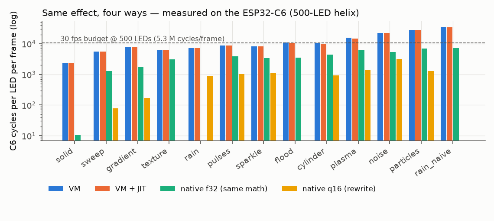
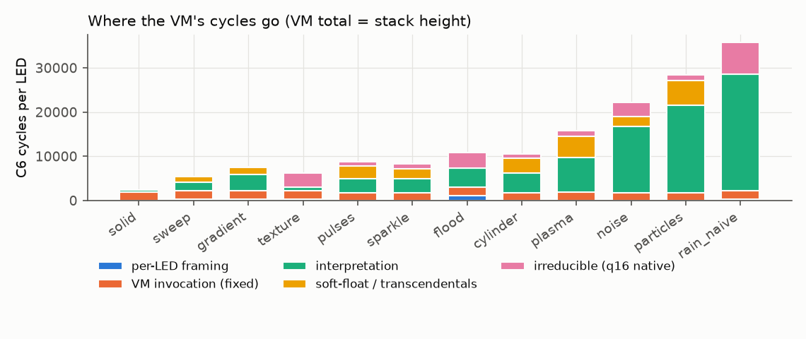
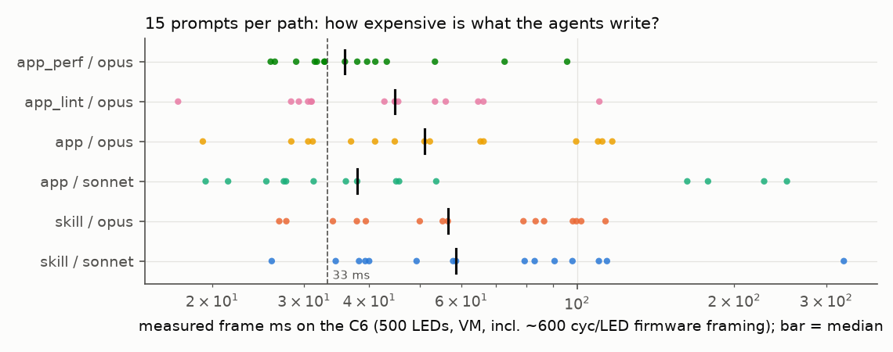
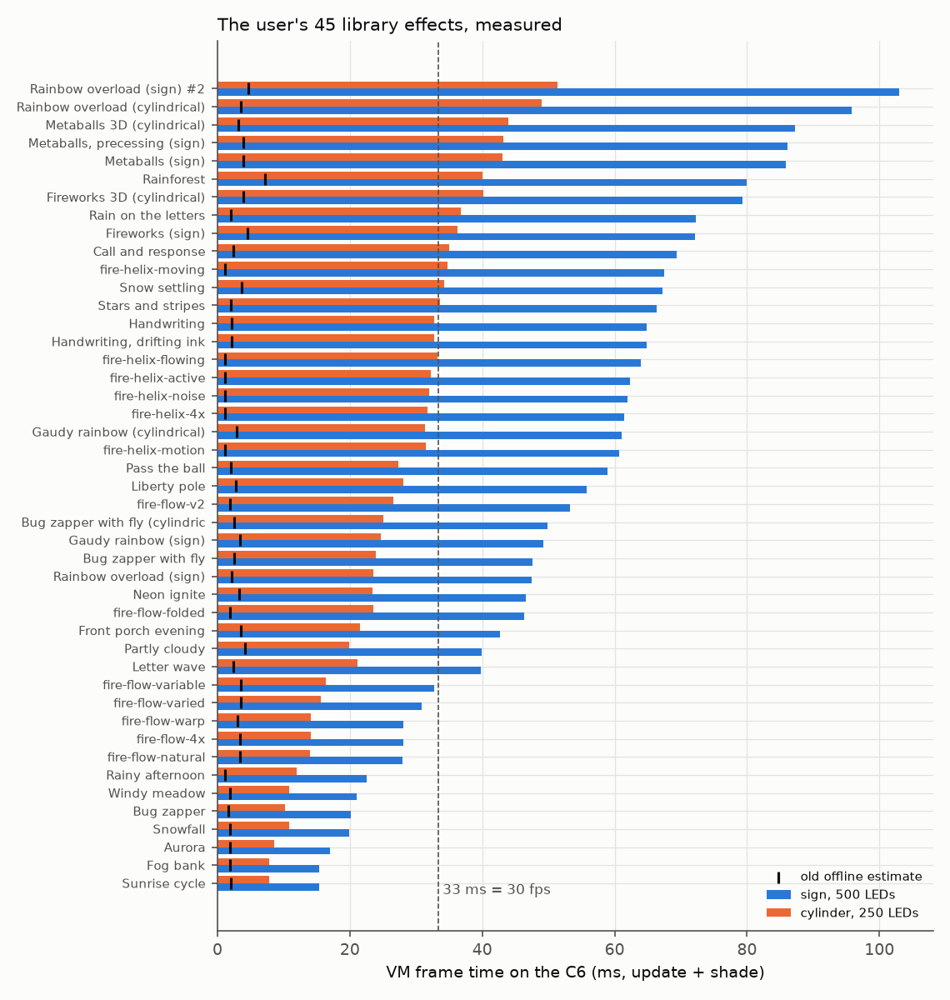
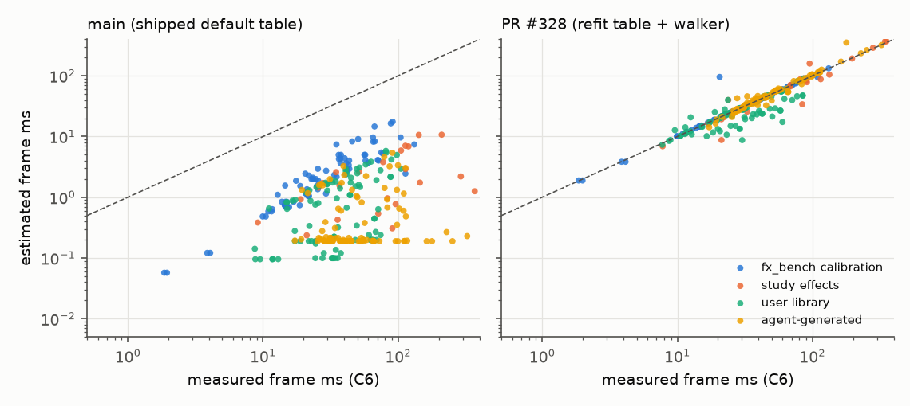

# FX engine performance study (ESP32-C6)

**Scope.** How fast is the effects engine on the ESP32-C6 (RV32IMAC, no FPU,
160 MHz) compared with what the chip can do, how well do the authoring agents
use it, how good is the offline estimator, and what should change. Every number
below was measured on a HITL C6 unless it says "estimated". The bench, the
agent-eval harness and the charts are in this PR; how to rerun them is at the
end.

**Short answers.**

1. **Native ceiling.** A native Rust version of an effect that uses the same
   float maths is **2–5× faster** than the VM. A fixed-point native rewrite is
   **7–70× faster**. At 2048 LEDs, 9 of the 13 study effects fit 30 fps natively (all under
   20 ms); through the VM none of them does. Where the VM's cycles go, in order: the operand-stack interpreter
   (about 54 cycles of dispatch per opcode, plus stack traffic, which together
   is 40–75% of a heavy effect), a fixed **1,790 cycles per LED** for each VM
   invocation, soft-float math, and the per-LED framing. The JIT saves 0–8%.
2. **Agent authoring.** The agents write expensive effects. The **MCP skill
   path never uses fixed point** (0 of 30 programs). Only 3 of 30 skill programs
   and 10 of 30 in-app programs fit 33 ms at 500 LEDs. Your 45-effect library
   needs a median of **49 ms** on the 500-LED sign and **31 ms** on the 250-LED
   lamp. Per LED, the sign effects are no more expensive than the lamp effects.
   The sign is slower because it has twice the LEDs, and that pushes 24 of its
   35 deployments past the 33 ms frame. **A 24-line prompt addendum cut the
   in-app agent's cost by 30%** (paired, same 15 prompts). Hand-optimising the
   4 worst library effects gave only **1.35–1.65×** under the VM (up to 2.2×
   with the JIT), because dispatch dominates once the floats are gone. **9 of
   the 90 generated programs hang the device**: a compiler bug makes
   `clamp(vec3, 0.0, 1.0)` underflow the VM stack. The fix is a separate PR.
3. **Estimator.** The estimate the MCP agent uses (main's default table)
   predicts **5% of the measured frame time** in the median. For agent programs
   it predicts 0.6%, and the worst case is **0.3%** (330× low). This is the
   "3 ms vs 132 ms". Two bugs cause it: the cost table prices ops at 2–14 cycles
   when they cost 54–250, and the walker stops at the first opcode numbered 70
   or above (every fixed-point op and superinstruction). **PR #328** fixes both.
   Its median is 1.00, with p10 0.59 and a worst case of 0.29 (branchy `if`
   ladders, `SampleTex`). The dashboard's "negM ≈ 1.57 M" is **cycles for one
   whole frame of 128 LEDs** (update + shade + firmware framing), from a
   program that negates a local 32 times per LED. That is 12.3 k cycles per LED,
   or ≈310 cycles per `a = -a` statement above the empty-program floor. The
   panels now say so.
4. **Architecture.** The cheapest large win is VM invocation overhead.
   Prototype P2 is bit-exact and changes about 60 lines: an integer RGB
   epilogue and an out-of-line `LoadCtx`. It cuts **1,790 → 1,031 cycles per
   LED**: −41% for a solid fill, −16% for rain, −6% median on your library.
   PR #328's memoization is orthogonal (−15% median). Moving the interpreter to
   IRAM gained <1%. A faster soft-float `fadd`/`fmul` gained nothing (the C6 ROM
   versions take ~55 cycles). The big remaining lever is **AOT native code**,
   worth 3–20× on top. It is feasible as signed, sandboxed, position-independent
   code, building on the existing JIT's W^X region and the OTA signing.



---

## Method

**The bench image** (`//firmware/fx_perf_bench:fx_perf_bench_flashbundle`) is a
C6 firmware with no radios. It boots, runs every measurement once, logs
`fxpb …` lines, and keeps re-dumping its RAM log so a late or resetting serial
reader still gets all of it. It links:

- the **real `fx_vm`** (the firmware's crate, `-c opt`, `riscv32imac`,
  `opt-level=3`), with `Led` framing reproduced from `ffi.rs fx_shade_one`. That
  framing is the per-LED soft-float uv projection when the program reads
  `led.uv`, and the Q16 mirrors when it reads fixed context;
- the **real JIT install path**, copied from `ffi.rs fx_build_jit`: the same
  2 KB PMP W^X region, the same limits (8 blocks, 64 constants, 1 KB of code),
  and the same `JitCall` patching;
- **hand-written native twins** of 13 study effects (`src/native.rs`), compiled
  the same way. `f32` twins do the VM's maths operation for operation through
  the same fx_vm helpers. They are **bit-identical to the VM on every LED** (host
  test `native_vs_vm_test`, 500 and 2048 LEDs, 3 frames), so VM − f32 is the
  interpretation cost alone. `q16` twins are fixed-point rewrites with the same
  look; their max error is 1–2/255 per channel;
- **micro-benchmarks** (`src/micro.rs`): soft-float primitives, the VM's maths
  helpers, and hand-assembled `.fxb` programs that isolate dispatch, stack
  traffic and single opcodes.

**Fixtures** (`src/fixture.rs`, synthesized):

- a **3-D helix**: 10 turns, r = 8 cm, 30 cm tall, +Y up, 8 chained topology
  segments. Used at 500 and 2048 LEDs, and at 250 LEDs to stand in for the
  cylindrical PixieLamp;
- a **planar two-row letter sign**: "CAMP / THERAPY" in a crude 29-stroke font,
  about 1 m × 0.45 m, one topology segment per stroke, 500 LEDs. It stands in for
  FugWidget. The real sign map wasn't available, so its stroke numbering is ours;
- **fx_bench's linear map**.

Frames start at t = 10 s at 30 fps. Each number is the cheapest of 3 frames
(interrupts only add cycles, as in `fx_bench`). Uniforms are set to their
defaults.

**Validation against fx_bench.** The bench re-measures 8 fx_bench programs on
fx_bench's own map and LED count (`--no-opt`), so its numbers can be tied to
the CI goldens and to the Grafana dataset's latest `main` medians:

| program | this bench, cyc/LED | fx_bench on main (Grafana, last 10) | Δ |
| --- | ---: | ---: | ---: |
| empty | 1,835 | 2,451 | −616 |
| sweep256 | 1,943 | 2,541 | −598 |
| negM | 12,514 | 12,634 | −1% |
| addM | 18,895 | 18,718 | +1% |
| sinM | 28,608 | 28,763 | −1% |
| atan2fM | 46,559 | 45,753 | +2% |
| powfM | 70,759 | 70,259 | +1% |

The heavy programs agree to ±2%. The firmware adds **≈600 cycles per LED** of
framing that the radio-less bench doesn't run: the stored-map position read and
the colour correction (`lm_map_led` + `cc_apply`). Where this doc gives a
firmware-equivalent frame time, it adds 600 × LEDs. The field data is
consistent with this. Your hand-optimised rain measures 22.6 ms here on the
500-LED sign and 23.4 ms on the rig in PR #328 (500 LEDs); FugWidget showed
25.3 ms mean. A solid colour is 7.3 ms here and 7.9 ms on FugWidget. Repeat
runs on the same DUT agreed to a median of 0.7% (max 2.8%). Two different C6
boards gave identical numbers (median Δ 0.0%).

**fx_bench measures `lavalamp` (its only "realistic" held-out effect) with every
uniform at 0.** The firmware doesn't apply manifest defaults; clients send
`set_uniforms` after a deploy, and fx_bench never does. So `waves = 0` and the
loop body never runs. The golden of 16.5 k cycles per LED is about 130 opcodes
per LED. With its defaults the same effect runs 585 opcodes and costs
**90 k cycles per LED, 5.5× the golden**. Recommendation: fx_bench should apply
the manifest defaults, and the firmware should probably apply them on load too.

---

## Q1 — the native ceiling

The table is per LED per frame on the 500-LED helix. Per-LED cost at 2048 LEDs
is the same within 1–3%, so the ms columns scale linearly. "q16 ms @2048" is
the best native version.

| effect | VM cyc/LED | JIT cyc/LED | native f32 | native q16 | VM ÷ f32 | VM ÷ q16 | VM ms @500 | VM ms @2048 | best native ms @2048 |
| --- | ---: | ---: | ---: | ---: | ---: | ---: | ---: | ---: | ---: |
| solid | 2,328 | 2,307 (no JIT) | 10 | — | (const) | — | 7.3 | 29.1 | 0.1 |
| sweep | 5,484 | 5,470 (no JIT) | 1,297 | 79 | 4.2× | 70× | 17.1 | 69.7 | 1.0 |
| gradient | 7,643 | 7,635 (no JIT) | 1,790 | 173 | 4.3× | 44× | 23.9 | 97.3 | 2.2 |
| texture | 6,140 | 6,091 | 3,110 | — | 2.0× | — | 19.2 | 75.6 | 38.9 |
| rain (yours, hand-opt.) | 7,284 | 7,227 (consts>64) | — | 881 | — | 8× | 22.8 | 88.1 | 10.3 |
| pulses | 8,768 | 8,755 (no JIT) | 3,835 | 1,035 | 2.3× | 8× | 27.4 | 111.7 | 13.2 |
| sparkle | 8,274 | 8,263 (no JIT) | 3,389 | 1,125\* | 2.4× | 7× | 25.9 | 105.4 | 14.3 |
| flood | 10,820 | 10,791 (no JIT) | 3,477 | — | 3.1× | — | 33.8 | 137.4 | 44.5 |
| cylinder (#328's) | 10,529 | 9,729 | 4,384 | 941 | 2.4× | 11× | 32.9 | 134.6 | 12.0 |
| plasma | 15,854 | 14,770 | 6,137 | 1,404 | 2.6× | 11× | 49.5 | 202.3 | 17.9 |
| noise (skill example) | 22,196 | 22,184 (no JIT) | 5,383 | 3,168 | 4.1× | 7× | 69.4 | 283.5 | 40.5 |
| particles (8 agents) | 28,384 | 28,367 | 6,861 | 1,263 | 4.1× | 22× | 88.7 | 361.2 | 16.0 |
| rain_naive† | 35,701 | 34,352 | 7,154 | — | 5.0× | — | 111.6 | 456.2 | 91.5 |

The study effects are in `firmware/fx_perf_bench/effects/`. solid, gradient,
noise and pulses are the MCP skill's own examples; cylinder and sparkle come
from PR #328's tests. † `rain_naive` is a **reconstruction**, not your file: the
straightforward all-per-LED, all-float first draft of `rain.fx`. It costs
111 ms, against the 132 ms the field report gave for the real first draft.
\* sparkle's q16 computes `x^8` exactly and differs from the VM; see "VM maths
accuracy" below. The f32 twin matches the VM bit for bit.

**Where the cycles go.** VM − native-f32 is pure interpretation, because the
maths is identical. native-f32 − native-q16 is soft-float plus the float
transcendental implementations.



| effect | per-LED framing | VM invocation (fixed) | interpretation | soft-float + transcendentals | q16 compute |
| --- | ---: | ---: | ---: | ---: | ---: |
| sweep | 353 | 1,790 | 2,044 | 1,218 | 79 |
| gradient | 346 | 1,790 | 3,718 | 1,617 | 173 |
| pulses | 24 | 1,790 | 3,118 | 2,800 | 1,035 |
| cylinder | 25 | 1,790 | 4,329 | 3,443 | 941 |
| plasma | 26 | 1,790 | 7,902 | 4,733 | 1,404 |
| noise | 24 | 1,790 | 14,999 | 2,215 | 3,168 |
| particles | 24 | 1,790 | 19,709 | 5,598 | 1,263 |

The terms, measured:

- **Dispatch: ~54 cycles per opcode**, measured with 200 `Pop 0` per LED. That
  covers the instruction-budget decrement, the counter and stack high-water
  updates, the deadline poll mask, `Op::from_u8`, and the jump-table `match`. A
  push+pop averages 83 cycles per op and a load/store-local 88. A `vecN`
  opcode adds ~10 cycles per extra lane of stack traffic. Effects spend
  **59–67% of their opcodes on plumbing** (load, store, push const, swizzle; per
  `tools/fx_agent_eval/analyze.py`). So ops × 54 is a hard floor: about 9.7 k
  of particles' 19.7 k interpretation cycles. Most of the rest is
  operand-stack moves, operand decoding and bounds checks.
- **VM invocation: 1,790 cycles per LED, even for `return vec3(0)`.** Two
  causes, both visible in the RV32 disassembly of `run()`. First, LLVM hoists
  `LoadCtx`'s loop-invariant soft-float (`1.0 − led.s`, int→f32 of
  idx/seg/frame, …) into `run()`'s prologue, so every invocation pays ~5
  soft-float calls whether or not the program reads those inputs. Second, the
  `clamp01(x) * 255 as u8` epilogue is 3 × (2 compares + mul + f32→int).
  Prototype P2 below removes ~760 cycles of it.
- **Soft-float primitives are not the problem.** Measured with precomputed
  inputs, the C6 ROM's libgcc `__addsf3` takes 57 cycles, `__mulsf3` 53,
  `__divsf3` 166, a compare 25, f32→i32 ~110 and i32→f32 87. A hand-written,
  bit-exact RV32 fast path (`src/fastfloat.rs`, checked against hardware
  floats on 4 M random pairs) took 71 and 51, no better. **The VM's maths
  helpers are where float costs pile up:** `sinf` 482 (a f32→i64 + u32→f32
  round trip to build the LUT phase), `floorf` 217, `fractf` 269, `sqrtf` 566,
  `atan2f` 900, `expf` 845, `logf` 684, `powf` 1,696, `hsv2rgb` 1,371. The
  fixed-point equivalents: `sin_fix` 86, `atan2_fix` 258, `sqrt_fix` 574 (a
  bit-by-bit sqrt), the integer `hash1` 109. Including dispatch, an `UnMath sin`
  opcode costs ~580 cycles and a `SinFix` ~146.
- **Per-LED framing.** The soft-float uv projection (`led.uv`) costs ~330
  cycles per LED. The Q16 context mirrors cost **1,100–1,500 cycles per LED**
  whenever a program reads any fixed context. They are recomputed per LED per
  frame in `fx_shade_one` (`q16_16(x)` = soft mul + f32→i32 × 7), although the
  struct comment says "at map-load". That is 20% of the hand-optimised rain.
  Caching them at map load is pure win.
- **The JIT** compiled blocks for 31 of the 45 library effects but saved a
  median of only 1.7% (best 10.8%). It never engaged for 4 of the 13 study
  effects (`consts>64` for rain, which has 73 constants; no candidate block for
  the float effects). Its IR covers only straight-line `PushConst` /
  `Load`/`Store`/`TeeLocal` / `AddI SubI MulI NegI MulFix Pop` (`fx_jit
  op_to_ir`). It does better on fixed-point code: the hand-optimised
  `rainforest` gets **2.2×** with the JIT against 1.5× without, and hits the
  8-block cap.

**VM maths accuracy (a correctness finding).** `fx_vm::logf` adds a
polynomial that approximates log₂(m) − 1 to e·ln 2. It is off by up to ~0.13
nats: `logf(1.5)` = 0.276 against ln 1.5 = 0.405. So `powf(x, 8)` (= exp(8·log
x)) is off by up to ~2.8×. sparkle's `pow(…, 8.0)` renders 12/255 where the
exact value is 102/255. A fix (`(e + p(m)) · ln 2` with a log₂ poly) changes
every pow/log effect's look, so it needs its own PR and owner sign-off.

**Native ms/frame at 2048 LEDs.** Through the VM, only solid fits 33 ms at
2048 LEDs (29 ms). Natively, 9 of the 13 study effects fit, all in under
20 ms, including the 8-agent particles at 16 ms. The four that don't are noise
(40 ms even in fixed point: 8 lattice hashes per LED) and texture, flood and
rain_naive, which have only f32 twins.

---

## Q2 — agent authoring quality

### The generated set (`tools/fx_agent_eval`)

The harness gave 15 fixed mood, scene and spatial prompts
(`prompts.json`, each with the same fixture/budget line) to `claude -p`
headless:

- `app`: the in-app system prompt, rendered from `system-prompt.ts`;
- `skill`: the MCP skill files (`SKILL.md` + `effect-language.md` + geometry
  and uniforms docs + the skill's example effects);

with **claude-opus-5-5** and **claude-sonnet-4-6**, plus two Opus-only
variants that test a fix (below). A compile-and-repair loop like the app's
(2 rounds) got 90 of 90 programs to compile. No OpenAI model was run: there is
no OpenAI key in `/workspace/credentials`. Each program ran on the C6 bench
(VM and VM+JIT, 500-LED helix). Times below include the ~600-cycle firmware
framing. The programs were measured on the bench rather than through
`fx_bench_netstack`, which is equivalent within ±2% (see Method).



| path / model | n | median ms @500 | p25–p75 ms | fits 33 ms (VM) | fits (VM+JIT) | mean cyc/LED |
| --- | ---: | ---: | ---: | ---: | ---: | ---: |
| skill / sonnet | 15 | 58.6 | 39.3–98.0 | 1/15 | 1/15 | 25,926 |
| skill / opus | 15 | 56.6 | 37.9–98.2 | 2/15 | 3/15 | 20,512 |
| app / sonnet | 15 | 37.9 | 27.4–162.6 | 6/15 | 7/15 | 24,842 |
| app / opus | 15 | 51.0 | 31.2–99.6 | 4/15 | 5/15 | 18,701 |
| app + lint round / opus | 15 | 44.8 | 30.5–56.0 | 6/15 | 7/15 | 14,243 |
| app + perf addendum / opus | 15 | 35.9 | 31.4–43.2 | 7/15 | 10/15 | 12,833 |

Static analysis (`analyze.py`: disassembly-level counts, a variance analysis
and perf-lint rules; `out/summary.md`):

- **The skill path never uses fixed point** (0 of 30 programs, against 24 of
  30 for the app path). It averages 2.6–5.1 float transcendentals per LED and
  ~38 float ops per LED. Its docs tell the model "`sin`/`cos` are cheap LUTs;
  `hash` is an integer mix (cheap)". For float arguments `sin` costs ~580
  cycles. All the skill's example effects are float.
- **Where a cheaper equivalent exists, the agents mostly don't pick it:**
  - float `sin`/`cos` in shade: 56 hits in 20 programs;
  - per-LED-invariant `atan2` / `hash(led.idx)`: 38 hits in 18;
  - frame-invariant maths left in shade: 36 hits in 28;
  - a float literal silently promoting fixed maths back to soft-float
    (`fixed x; x * 12.5`): 29 hits in 8, all from Opus with the app prompt;
  - a loop per LED: 11 hits in 10;
  - noise octaves per LED: 7 hits in 7.
- **Fixed point helps less than people think under the VM.** The median
  fixed-using program costs 13.2 k cycles per LED and the median float-only one
  17.3 k. The 54-cycle dispatch per opcode stays.
- **9 of 90 programs crash the device.** `clamp(color, 0.0, 1.0)` is
  idiomatic GLSL. The compiler emits `CLAMP 3` over 3 + 1 + 1 stack slots, the
  VM indexes below its stack (an index-out-of-bounds panic), and the player's
  panic handler is `loop {}`, so the render task hangs. 8 of the 9 are
  skill/opus programs. The compiler fix (broadcast scalar bounds, or reject
  them) is follow-up PR `agent/fx-clamp-broadcast-fix`. The VM should also never
  panic on a malformed stack (recommendation R3).
- The two prompts **contradict the compiler** in places. The in-app prompt
  says `sqrt log tan pow atan2 hsv2rgb` are float-only, but the compiler has
  fixed paths for all of them (`SqrtFix`, `Atan2Fix`, `Hsv2RgbFix`, …). It also
  promises the JIT gives "a further ~2×". The VM has `SmoothstepFix`,
  `DotFix`, `LengthFix` and `HashFix`, but the compiler never emits them:
  `smoothstep(fixed…)` and `hash(…)` always go through float.

**The tested prompt change.** `tools/fx_agent_eval/perf_addendum.txt` is 24
lines appended to the in-app prompt. It has the measured per-op cost table, six
rules (hoist; cache LED-invariant geometry in a buffer; fixed-point phases in
turns; no `pow`/`exp` per LED; `fixed()` around literals; no per-LED loops) and
one compiled fast example. On the same 15 prompts with Opus it cut the median
measured cost by **30%** (paired geometric mean 0.74×). The number that fit
33 ms went from 4 to 7 (10 of 15 with the JIT), and float transcendentals per
LED fell from 0.93 to 0. Feeding the linter's warnings back for one revision
round (`app_lint`) helped less: 0.89× median.

### Your library: 45 agent-written effects (`splanc_library.json`)

Every effect was measured on the synthetic sign at 500 LEDs and the synthetic
cylinder at 250 LEDs. The raw library isn't committed; only these derived
numbers and four rewrites are. The VM numbers below exclude the ~0.6 k-cycle
firmware framing, so on the device each ms column is about 1.9 ms (sign) or
0.9 ms (cylinder) higher.



**Why the 500-LED sign versions run "a fair bit" worse than the 250-LED lamp
ones.** It isn't the geometry. Each effect costs the same per LED on both
fixtures, within 1–4%. The sign-targeted effects are, if anything, cheaper per
LED: a median of 15.5 k cycles against 19.5 k for the lamp ones. Three things
combine:

1. Twice the LEDs gives exactly twice the frame time.
2. The frame budget is a cliff. The lamp effects run a median of 31 ms on 250
   LEDs, under the 33 ms frame. Their sign siblings run 49 ms on 500 LEDs. 24
   of the 35 sign deployments exceed 33 ms against 5 of 19 lamp ones, so on
   the sign the autoscaler drops to its 25 fps rung or parks the effect, and
   the motion looks visibly worse. A 2× cost reads as much more than 2×.
3. The firmware's ~600 cycles per LED of framing and the longer transmit both
   double as well.

The per-effect cost drivers are listed in full in the appendix; the worst ones
are:

- **Rainbow overload #2** (103 ms on the sign): **five `hsv2rgb` per LED**
  (~1.4 k cycles each), 3 hashes, 2 float sines, a per-LED `sqrt` of an
  LED-invariant radius, and 42 float ops.
- **Metaballs, 3 variants** (86–87 ms): 5 float divides and 2 `hsv2rgb` per
  LED, plus a per-LED `exp` and `smoothstep`.
- **Rainforest** (80 ms): five float sines, each with its time phase rebuilt
  per LED (24% of its cycles are hoistable), plus a per-LED `exp` whose value
  depends only on time.
- **The ten fire-\* effects** (28–68 ms): the helix family runs an `atan2` of
  `led.pos` per LED per frame (17–34% of cycles are LED-invariant) plus a float
  `fract`/`floor` value-noise hash. The flow family uses 2–3 float sines.
- **Handwriting** and **Pass the ball**: a 28-way `if` ladder in a `rank()`
  helper, run per LED. #328's memo pass doesn't reach into user functions.
- **Call and response**: 4 `exp` per LED.

Only 5 of the 45 use any fixed type (Rainy afternoon, your hand-optimised
rain, plus Windy meadow, Snowfall, Fog bank and Aurora).
All 5 are among the 7 cheapest (15–23 ms on the sign).

**Against the old estimates.** The stored estimates are 1.1–7.2 ms. Paired with
the measurement on the same fixture, they are **6–36× low** (median 14×). The
fire-helix effects were all estimated at 1.1 ms on the lamp and measure
31–35 ms there (29–32×).

**Hand-optimised rewrites** (`firmware/fx_perf_bench/optimized/`; look checked
with `fx_diff` over 60 frames):

| effect | original | rewrite (VM) | rewrite (VM+JIT) | speedup | look difference |
| --- | ---: | ---: | ---: | ---: | --- |
| Rainbow overload #2, sign 500 | 102.1 ms | 75.0 ms | 71.5 ms | 1.36× / 1.43× | 32-step hue table: mean 4.3/255, max 44 |
| Metaballs (sign), 500 | 85.1 ms | 62.6 ms | 62.6 ms | 1.36× | 16-step colour ramps, rational rim: mean 4.8/255 |
| Rainforest, sign 500 | 79.4 ms | 52.7 ms | **36.0 ms** | 1.51× / **2.21×** | none (mean 0.01/255) |
| fire-helix-moving, lamp 250 | 34.6 ms | 21.0 ms | 17.5 ms | 1.65× / 1.98× | same flame, different random field |

The techniques were: fixed-point LUT sines in turns; time phases folded into
`state` once per frame; hue and colour-ramp tables baked once instead of
`hsv2rgb` per LED; LED-invariant `atan2` and `sqrt` cached in a buffer;
a random table instead of a float hash. That is about 1.5× under the VM,
because the op count stays the same: rainforest went from 154 to 133 ops/LED,
fire-helix from 101 to 116. The same rewrites gain up to 2.2× once the JIT can
take the fixed-point blocks. The native q16 twins of comparable effects are
7–22× faster. Hand-tuning source code is not how the engine gets fast.

### Prompt and tooling recommendations (Q2)

- **Fix the false or contradictory statements in both prompts.** In the skill:
  "sin/cos cheap LUTs", "hash cheap", all-float examples. In the in-app prompt:
  the "float-only" list and "JIT ~2×". Add the measured cost table from
  `perf_addendum.txt` to both. That addendum measured −30% on its own.
- **Give the skill path fixed-point examples.** At least the addendum's
  rotating rainbow, and a fixed-point noise and plasma.
- **Close the estimate loop with the corrected cost model (#328).** Today
  `estimate_effect` says a 60 ms effect costs 0.4 ms, so the "iterate with the
  estimate" workflow can't work. Return the top 3 lint findings from
  `analyze.py`'s rules with the estimate (cheap, and it tells the model what to
  change).
- **Make the cheap form the easy form in the compiler.** Warn on a float
  literal inside fixed maths (29 hits). Wire `SmoothstepFix`, `HashFix`,
  `DotFix` and `LengthFix`. Treat `fixed x * 0.6` as fixed by default behind a
  lint (#328 lists this follow-up).

---

## Q3 — estimator accuracy and the dashboard numbers

The comparison is predicted frame cycles (update + shade, without the
estimator's modelled show term) against measured frame cycles. Bench
measurements get the +600 cycles/LED firmware framing; fx_bench goldens are
already firmware numbers. 286 programs: 72 fx_bench, 8 validation, 26 study
effect × LED-count pairs, 90 user-library × fixture pairs, 90 agent programs.



| estimator | programs | median predicted ÷ measured | p10 | p90 | worst |
| --- | ---: | ---: | ---: | ---: | ---: |
| main (what the agent and app use today) | 196 | **0.050** | 0.004 | 0.098 | 0.003 |
| main, agent set | 90 | **0.006** | 0.002 | 0.057 | 0.001 |
| PR #328 | 196 | 1.000 | 0.593 | 1.041 | 0.289 / 4.65 |
| PR #328, agent set (`--no-memo`) | 90 | 1.010 | 0.875 | 1.084 | 0.716 / 1.98 |

**Why main is 20–1,000× low.**

- The default table (`costTableStore.ts DEFAULT_COSTS`) prices
  `PushConst`/`LoadLocal` at 2–3 cycles, `Add` at 12 and `UnMath:sin` at 65.
  It has no dispatch term and `shade_fixed = 60`. The device costs 54–88 per
  op, ~110, ~580, and ~1,800 per LED (the invocation).
- The walker (`costModel.ts walkEntry`) knows opcodes only up to `ExpFix` (69).
  On the first byte above that (`AbsI`, `ClampI`, `LoadCtxFix`, `TeeLocal`,
  `IncLocalI`, `BrCmpI`, …) it **stops the walk**. The optimizer emits those
  superinstructions in almost every program, and every fixed-point program
  uses the fixed ops. That is why every fire-helix effect estimates
  **0.003×** (it reads `LoadCtxFix` almost immediately) and why the agent
  programs estimate a median of 0.006×.

**#328's remaining errors, and why.**

- **Under-estimates** (worst 0.29×):
  - Call and response 0.29×, and Handwriting and Pass the ball 0.42–0.46×.
    These are `if` ladders and user-function `rank()` chains. The walker
    prices a forward branch at the midpoint of its two arms and walks a
    structured `if` once, but a 28-way ladder executes ~14 compares per LED
    on average.
  - texture 0.41×. `SampleTex` is priced like a cheap op; the bilinear float
    sample measured ~3,800 cycles.
- **Over-estimates**:
  - rain 1.67×. Its cloud branch runs for 1/16 of the LEDs per frame
    (`mod(i, 16) == slot`), but the walker prices it as half of all LEDs.
  - lavalamp 4.6× against its golden. The estimator is right here: the golden
    was measured with all uniforms at 0 (see Method).
- Fixes: a per-op cost for `SampleTex`/`PaintTex`/`LoadBuf` (~1–4 k); a
  probability hint (or dynamic profiling in the preview, which the estimator
  already accepts as `dynamicShadeHist`) for data-dependent branches; and walk
  user functions at each call site.

### Reading the fx_bench numbers ("negM ≈ 1.57 M cycles")

How `pi/hitl/harness/fx_bench.py` produces each value:

- `compile_fx` compiles each calibration program with `--no-opt`.
- `_linear_map` submits an N-LED linear map, where N comes from the program's
  "Intended LED count" header: 128 for the `*M` programs, 16 and 256 for
  `sweep16`/`sweep256`, 200 for lavalamp.
- `set_perf FULL` is poll-only. The harness waits and reads a `PerfReport`.
- `stable_cycles()` takes **`frameCyclesMin`**, the minimum over the window of
  `perf_frame_c` in `main.cpp`: `c_frame_end − c_frame_start` around
  `lm_fx_update` + the whole shade loop (`lm_map_led` + `lm_fx_shade` +
  `cc_apply` per LED), **excluding** the LED transmit.
- `show` is the **mean** of `show_c`, the cycles inside the transmit call.
- The CI log prints `"<label>: frame=X show=Y @ N LEDs"`. `ingest_fx_bench.py`
  parses that line into the Grafana dataset as `cycles` with `metric ∈ {frame,
  show}` and `leds = N`.

So **negM = 1.57 M is the CPU cycles to render one frame of 128 LEDs** (9.8 ms
at 160 MHz). It is not a per-op cost, not a loop of M iterations, and not one
LED. `negM` is "Neg ×32": each LED runs `a = (-(a))` 32 times, which is
`LoadLocal, Neg, StoreLocal` = 96 opcodes, about 117 with the prologue. That
gives:

- 1.57 M / 128 = **12.3 k cycles per LED**, of which ≈2.3–2.45 k is the
  `empty` floor (VM invocation + firmware framing);
- ≈10 k for the 32 statements, i.e. **≈310 cycles per `a = -a`**, or
  **≈100 cycles per opcode**.

`x2M` programs repeat their operation 64 times; `(frame(x2M) − frame(xM)) /
(128 × 32)` is the cost of one extra statement with the floor cancelled.

**Dashboard changes in this PR** (`pi/hitl/observability/fxbench/gen_dashboards.py`,
regenerated `dashboards/fxbench-{drift,distribution,overview}.json`):

- every panel carries this definition as its description;
- a "What these numbers are" text panel sits at the top of each dashboard;
- titles now say "CPU cycles per frame (all LEDs)";
- the time-series y-axis is labelled "CPU cycles / frame (update + shade × LEDs)";
- the sample tables gain a derived **cycles/LED** column (Grafana
  `calculateField`, cycles ÷ leds).

The data pipeline is unchanged.

---

## Q4 — architecture

### Prototypes measured

| effect (500-LED helix) | main cyc/LED | PR #328 | P2: invocation fix | P2 + IRAM `run()` (P3) | P1 = P2 + fast soft-float |
| --- | ---: | ---: | ---: | ---: | ---: |
| solid | 2,328 | −18.7% | **−41.0%** | −41.1% | −41.4% |
| sweep | 5,484 | −12.3% | −15.0% | −15.7% | −11.5% |
| gradient | 7,643 | −16.9% | −11.5% | −12.3% | −5.7% |
| texture | 6,140 | +0.8% | −16.0% | −16.3% | −16.1% |
| rain (yours) | 7,284 | −3.5% | −16.4% | −17.1% | −16.6% |
| pulses | 8,768 | −28.9% | −9.9% | −10.1% | −4.4% |
| sparkle | 8,274 | −21.8% | −9.2% | −9.7% | −7.6% |
| flood | 10,820 | −8.4% | −8.9% | −9.1% | −6.8% |
| cylinder | 10,529 | **−41.3%** | −7.4% | −8.2% | −6.6% |
| plasma | 15,854 | −6.6% | −7.5% | −7.8% | −3.6% |
| noise | 22,196 | −3.7% | −6.1% | −6.4% | +3.6% |
| particles | 28,384 | −4.4% | −5.2% | −4.9% | +1.0% |
| rain_naive | 35,701 | −28.0% | −4.6% | −5.1% | −0.3% |
| **your library, sign 500 (median)** |  | **−15.4%** | **−6.0%** (best −21%) | −0.5% more | −1.3% |

What the prototypes are:

- **P2, VM invocation overhead.** `fx_vm` gets an out-of-line `LoadCtx`, so
  its soft-float can't be hoisted into `run()`'s prologue, and an integer RGB
  epilogue `unit_u8()`. The epilogue is bit-exact with
  `(clamp01(x) * 255.0) as u8`: it is tested on every f32 bit pattern in
  [0, 1.5] plus specials, and the fx_vm, compiler and optimizer differential
  suites pass. An empty invocation drops from **1,790 to 1,031 cycles**. P2
  should be a PR of its own; the fx_bench goldens move (empty −54%, sweep256
  −45%), so it needs a golden regeneration on a rig.
- **P3, the interpreter in IRAM** (`#[link_section = ".iram1"]` on the 37 KB
  `run()`) gains **<1%**. The flash I-cache is not the bottleneck.
- **P1, P2 plus a bit-exact fast `fadd`/`fmul`** in the Add/Sub/Mul/Scale/Mix
  arms is *worse* than P2 alone: the C6's ROM soft-float already takes ~55
  cycles. Don't pursue this.
- **PR #328** (memoization and hoisting) is orthogonal to P2. Its rows include
  2–5% from #328 being based on an older `main` (its addM is −5% with no memo
  change).

### Opportunities

The gains below are measured, or estimated from Q1's terms where marked "est.":

1. **VM invocation overhead (P2)**: −760 cycles per LED on every effect. For a
   cheap effect that is −40%; for a typical one −5 to −16%. About 60 lines,
   bit-exact. **Do first.**
2. **Cache the Q16 context mirrors and uv at map load** instead of per LED per
   frame: −1.1 to −1.5 k cycles per LED for every fixed-context program (rain
   −20%) and −330 for every uv reader (est.). It is firmware-only, and the
   struct comment already describes this design.
3. **Register-style superinstructions.** Use opcodes that read operands from
   locals and constants and write a local directly (`AddLL`, `MulFixLC`,
   `SinFixL`, `LoadCtxFixL`, …), driven by real opcode traces. That removes
   most of the 60–65% plumbing ops. Est. 1.5–2× on interpretation, which is
   −30 to −45% on heavy effects. The cost is moderate: the compiler's `opt.rs`
   already has the fusion framework and the ~7 coupled edit sites per opcode
   are documented.
4. **Leaner dispatch.** Hoist the budget, counter and stack high-water work
   out of the per-op path: count per basic block, and only on the counted
   path. Drop the `Op::from_u8` range check behind a verified-at-load
   bytecode; elide bounds checks on verified stack depth. Est. 54 → ~25 cycles
   per op (−15 to −25%). A threaded `match` doesn't exist in Rust, but a
   table-driven `fn` pointer per op plus tail calls is not reliably faster on
   RV32; measure before committing to it.
5. **Faster maths helpers.** Do the float paths at bit level: `floorf`/`fractf`
   without f32↔int round trips (217/269 → ~30), a `sinf` phase built from the
   mantissa and exponent (482 → ~120), a table `hsv2rgb` (1,371 → ~200). Fix
   `logf`. Wire the existing `*Fix` opcodes into the compiler. Est. −10 to −25%
   on float effects.
6. **JIT expansion.** Lift the 64-constant and 1 KB-code limits (rain is
   excluded today). Add the fixed ISA (`SinFix`, `ClampI`, `MinI`/`MaxI`,
   `AbsI`, `LoadCtxFix`, `LoadState`, `BrCmpI` branches inside a block), then
   calls to the soft-float helpers. Est. up to 2× on fixed-point effects (the
   rainforest rewrite got 2.2× with today's JIT once its code was fixed-point).
   Float effects gain little until the JIT emits soft-float calls with a real
   register allocator.
7. **AOT native effects** (see the next section). 3–20× on top of an optimised
   VM (Q1: VM ÷ q16 is 7–70× today). This is the only route to 2048 LEDs at 30
   fps for non-trivial effects.

### A native AOT path: feasibility

- **What runs.** The compiler emits position-independent RV32IMC (C6, C3) or
  Thumb-2 (ARMv8-M) for `shade()` and `update()`. It can do this for a whole
  effect, or for hot functions with VM fallback. Calls go only to a fixed,
  versioned helper table passed in a register (soft-float, LUTs, hash,
  buffer/texture accessors).
- **Size.** The native study effects compile to roughly 0.5–4 KB each. The JIT
  region today is 2 KB. A 16–32 KB region fits easily in the bench image, but
  on the netstack firmware it competes with TLS heap (FUG-71/133). Use a fixed
  IRAM/PMP region sized from `board_caps`, or execute from a flash partition
  through the cache. The P3 measurement shows execution from flash is not the
  bottleneck.
- **Trust.** This is executable code arriving over the network, so the loader
  must verify an **Ed25519 signature over the code segment** before mapping
  it, with the same key chain as OTA images. The device never runs unsigned
  native code; unsigned effects keep the VM.
- **Sandboxing**, even for signed code:
  - (a) memory: all loads and stores go through a base register into the
    effect's arena, masked or bounds-checked by the code generator (`and` with
    a power-of-two mask is 1 cycle), with a PMP region limiting write access to
    the arena and stack;
  - (b) control flow: no indirect jumps except returns and the helper table,
    checked by a simple loader-side verifier of the instruction stream, much as
    the JIT emits only known encodings;
  - (c) time: a per-frame cycle budget checked at loop back-edges (the VM's
    deadline flag) plus the existing wall-time watchdog.
- **Static installations** (no network trust problem) can build effects into
  the firmware image and skip all of the above.
- **Incremental plan.**
  1. Lower the VM's verified bytecode to RV32 on the host, in a
     `fx_compiler --aot`, as straight-line per-block code that reuses `fx_jit`'s
     encoder and emulator-based differential tests. Run it unsigned on the
     bench image only.
  2. Extend the helper table and buffers, and run the differential test
     against the VM.
  3. Sign it, and add a loader on the device, gated by board capability.
  4. Add a Thumb backend for future boards.

  Expected speedups come from Q1: native-f32 is 2–5× faster than today's VM,
  and native-q16 7–70×.

---

## Prioritised recommendations

| # | change | measured or estimated gain | effort | where |
| --- | --- | --- | --- | --- |
| R1 | Fix `clamp(vecN, scalar, scalar)` codegen | 9 of 90 agent programs stop hanging the device | S (done) | PR `agent/fx-clamp-broadcast-fix` |
| R2 | Land #328 (memo + refit estimator + walker ≥ 70) | estimator median 0.05 → 1.0; −15% median on the library | (exists) | #328 (needs a rebase on main) |
| R3 | VM never panics on stack underflow (saturate + `Outcome::Budget`); firmware panic handler reboots instead of `loop {}` | robustness | S | fx_vm, ffi.rs |
| R4 | P2: out-of-line `LoadCtx` + integer RGB epilogue | −760 cyc/LED: −41% solid, −16% rain, −6% library median | S (prototype done) | fx_vm + goldens |
| R5 | Cache Q16 / uv per-LED mirrors at map load | −1.1–1.5 k cyc/LED on fixed-context effects (rain −20%), −330 on uv readers | S | ffi.rs |
| R6 | Prompt fixes + cost table + fixed-point examples (both paths) | −30% measured on the app path; skill path est. more (it never uses fixed point) | S | system-prompt.ts, agent/skill |
| R7 | fx_bench applies manifest defaults (and the firmware on load) | a realistic lavalamp golden (5.5× today) | S | fx_bench.py, ffi.rs |
| R8 | Register superinstructions from opcode traces | est. −30 to −45% on heavy effects | M | fx_compiler opt.rs, fx_vm, fx_jit |
| R9 | Leaner dispatch (per-block budget, verified bytecode, no bounds checks) | est. −15 to −25% | M | fx_vm |
| R10 | Bit-level float maths helpers + wire `*Fix` ops + fix `logf` | est. −10 to −25% on float effects; correct `pow`/`log` | M | fx_vm, fx_compiler |
| R11 | JIT: no const/code caps, fixed ISA, intra-block branches | up to 2× on fixed-point effects | M | fx_jit, ffi.rs |
| R12 | Estimator follow-ups: `SampleTex`/buffer costs, branch probabilities, user functions | p10 0.59 → est. ~0.85 | S–M | costModel.ts |
| R13 | Signed native AOT effects | 3–20× over the optimised VM | L | compiler + loader + OTA keys |

Not worth doing: moving the interpreter to IRAM (<1%), a faster soft-float
`fadd`/`fmul` (the ROM's is already ~55 cycles), or more hand-optimisation
guidance beyond R6 (the VM caps the gain at ~1.5×).

## What is not verified

- **Agent effects were measured on the bench, not through
  `fx_bench_netstack`.** The bench reproduces fx_bench within ±2% plus a
  constant ~600 cycles/LED of firmware framing (validated on 8 programs). The
  framing term is an average from `empty`/`sweep256`. It differs by effect
  (colour correction is per LED; `lm_map_led` reads the stored 9-byte position).
- **Both fixtures are synthesized.** The sign is a crude stroke font with our
  own segment numbering, so the library's hard-coded `led.seg` tables (e.g.
  Handwriting's `rank()`) take different branches than on FugWidget. Per-LED
  cost is geometry-independent within 1–4% here, but a real map with unmapped
  LEDs (`seg < 0` returns early) would be cheaper.
- **`rain_naive` is a reconstruction**, not the real first draft.
- **Two natives are not exact twins.** sparkle's q16 twin computes `pow`
  exactly and differs from the VM's inaccurate `powf`. The fire-helix rewrite
  uses a different random field.
- **The #328 numbers are confounded.** They come from #328's branch as it is
  (based on an older main), so about 2–5% of its delta is base drift.
- **P2, P3 and P1 are prototypes**, measured on the bench and not on the
  netstack firmware. P2's golden shifts are predicted from the bench, not from
  an fx_bench run.
- **The "est." gains in Q4** (superinstructions, dispatch, maths helpers, JIT,
  AOT) are derived from the measured cost terms, not from implementations.
- **No OpenAI model was evaluated** (no key).

## Reproduce

```bash
# C6 bench image (study + agent + valid groups; drop the user's .fx into
# firmware/fx_perf_bench/user/ locally to include them — gitignored)
bazel build -c opt //firmware/fx_perf_bench:fx_perf_bench_flashbundle
python3 tools/fx_perf/run_bench.py --bundle bazel-bin/firmware/fx_perf_bench/fx_perf_bench_flashbundle.tar \
    --out runs/v1.log --seconds 420 --server http://hitl-rig-3:8087
python3 tools/fx_perf/parse_bench.py runs/v1.log runs/v1.json
# host checks: natives are bit-identical to the VM; look-diff two effects
bazel test //firmware/fx_perf_bench:native_vs_vm_test
bazel run -c opt //firmware/fx_perf_bench:fx_diff -- --fixture sign --leds 500 a.fx b.fx
# estimator vs measured (node >= 22; costModel.ts from any branch)
python3 tools/fx_perf/estimator_eval.py --bench runs/v1.json --est-src <dir> --fx-compile <fx_compile> --src name=path.fx ... --out est.json
# agent authoring eval (claude CLI; see tools/fx_agent_eval/README.md)
python3 tools/fx_agent_eval/gen.py && python3 tools/fx_agent_eval/analyze.py
# tables + charts in this doc
python3 tools/fx_perf/report.py --runs runs --est est --img docs/design/img/fx-perf --md /tmp/report.md
```

## Appendix: per-effect cost drivers in the user library

These come from static analysis (`analyze.py`), ordered by measured cost on the
sign. "hoistable %" is per-frame-invariant work in `shade()`; "LED-invariant %"
is work that could be cached per LED.

| effect | sign @500 ms | per-LED float heavy builtins | float ops/LED | hoistable % | LED-invariant % |
| --- | ---: | --- | ---: | ---: | ---: |
| Rainbow overload (sign) #2 | 103.0 | hsv2rgb×5, hash×3, sin×2, sqrt | 42 | 11 | 20 |
| Rainbow overload (cylindrical) | 95.9 | hsv2rgb×5, hash×3, sin×2, sqrt | 50 | 12 | 22 |
| Metaballs 3D (cylindrical) | 87.3 | hsv2rgb×2, smoothstep, exp | 55 | 1 | 0 |
| Metaballs, precessing (sign) | 86.1 | hsv2rgb×2, smoothstep, exp | 51 | 1 | 1 |
| Metaballs (sign) | 85.9 | hsv2rgb×2, smoothstep, exp | 51 | 1 | 1 |
| Rainforest | 80.0 | sin×5, smoothstep, hash, exp | 57 | 24 | 14 |
| Fireworks 3D (cylindrical) | 79.3 | sqrt×3, exp×3, hash | 50 | 1 | 1 |
| Rain on the letters | 72.3 | smoothstep×4, hash | 35 | 18 | 20 |
| Fireworks (sign) | 72.2 | sqrt×3, exp×3, hash | 41 | 1 | 2 |
| Call and response | 69.4 | exp×4 | 33 | 10 | 8 |
| fire-helix-moving | 67.5 | atan2 | 21 | 4 | 17 |
| Snow settling | 67.2 | smoothstep×3, hash×2 | 28 | 34 | 14 |
| Stars and stripes | 66.3 | sin×3, hash, sqrt, exp | 40 | 6 | 10 |
| Handwriting (+ drifting ink) | 64.8 | smoothstep×2, sin (+ 28-way if ladder) | 21 | 30 | 4 |
| fire-helix-flowing / -active / -noise / -4x / -motion | 60.6–63.9 | atan2 (+ sqrt) | 15–21 | 0–4 | 18–34 |
| Gaudy rainbow (cylindrical) | 61.1 | hsv2rgb×2, sqrt, sin, hash | 32 | 9 | 32 |
| Pass the ball | 58.9 | smoothstep×2 (+ if ladder) | 14 | 25 | 5 |
| Liberty pole | 55.7 | hash, sqrt, exp | 29 | 11 | 12 |
| fire-flow-v2 | 53.2 | — (float value-noise hash) | 18 | 2 | 15 |
| Bug zapper with fly (both) | 47.6–49.8 | smoothstep×2, hash, sqrt | 21–24 | 14–15 | 2 |
| Gaudy rainbow (sign) | 49.3 | hsv2rgb×2, sin, hash | 22 | 12 | 13 |
| Rainbow overload (sign) | 47.5 | hash, hsv2rgb | 27 | 4 | 36 |
| Neon ignite | 46.5 | hash×3, smoothstep | 17 | 13 | 23 |
| fire-flow-folded | 46.3 | — | 18 | 6 | 35 |
| Front porch evening | 42.7 | hash×3, smoothstep×2 | 26 | 17 | 33 |
| Partly cloudy | 39.8 | sin×2, smoothstep | 21 | 26 | 10 |
| Letter wave | 39.7 | smoothstep | 8 | 0 | 40 |
| fire-flow-variable / -varied / -warp / -4x / -natural | 28.0–32.7 | sin×2–3 (+ sqrt) | 17–21 | 8–25 | 15–22 |
| Rainy afternoon (your hand-opt. rain) | 22.6 | — (fixed) | 3 | 0 | 6 |
| Windy meadow | 21.0 | — (fixed) | 8 | 0 | 8 |
| Bug zapper | 20.2 | hash | 10 | 33 | 6 |
| Snowfall | 19.9 | — (fixed) | 4 | 0 | 46 |
| Aurora | 17.0 | — (fixed) | 7 | 0 | 8 |
| Fog bank | 15.4 | — (fixed) | 3 | 0 | 13 |
| Sunrise cycle | 15.3 | — | 5 | 0 | 31 |

Per-effect measured numbers for both fixtures, the old estimates and #328's
change:

| effect | written for | sign @500 ms | cylinder @250 ms | cyc/LED sign | cyc/LED cyl | ops/LED | old estimate ms (fixture) | measured ÷ estimate | #328 Δ sign |
|---|---|---:|---:|---:|---:|---:|---:|---:|---:|
| Rainbow overload (sign) #2 | sign | 103.0 | 51.4 | 32,949 | 32,870 | 178 | 4.69 (s) | 22× | −27% |
| Rainbow overload (cylindrical) | cyl | 95.9 | 48.9 | 30,675 | 31,312 | 159 | 3.49 (c) | 14× | −22% |
| Metaballs 3D (cylindrical) | cyl | 87.3 | 43.9 | 27,930 | 28,091 | 179 | 3.09 (c) | 14× | −3% |
| Metaballs, precessing (sign) | sign | 86.1 | 43.2 | 27,548 | 27,627 | 170 | 3.91 (s) | 22× | −4% |
| Metaballs (sign) | sign | 85.9 | 43.1 | 27,484 | 27,574 | 170 | 3.92 (s) | 22× | −4% |
| Rainforest | both | 80.0 | 40.1 | 25,588 | 25,645 | 154 | 7.18 (s) | 11× | −31% |
| Fireworks 3D (cylindrical) | cyl | 79.3 | 40.1 | 25,366 | 25,669 | 154 | 3.91 (c) | 10× | −4% |
| Rain on the letters | sign | 72.3 | 36.7 | 23,134 | 23,505 | 139 | 1.99 (s) | 36× | −29% |
| Fireworks (sign) | sign | 72.2 | 36.3 | 23,089 | 23,209 | 131 | 4.53 (s) | 16× | −4% |
| Call and response | sign | 69.4 | 34.9 | 22,206 | 22,363 | 147 | 2.39 (s) | 29× | −16% |
| fire-helix-moving | cyl | 67.5 | 34.8 | 21,592 | 22,242 | 101 | 1.1 (c) | 32× | −8% |
| Snow settling | sign | 67.2 | 34.2 | 21,500 | 21,901 | 139 | 3.66 (s) | 18× | −31% |
| Stars and stripes | sign | 66.3 | 33.7 | 21,225 | 21,546 | 131 | 2.02 (s) | 33× | −9% |
| Handwriting | sign | 64.8 | 32.7 | 20,750 | 20,944 | 137 | 2.19 (s) | 30× | −14% |
| Handwriting, drifting ink | sign | 64.8 | 32.7 | 20,737 | 20,910 | 137 | 2.2 (s) | 29× | −13% |
| fire-helix-flowing | both | 63.9 | 33.2 | 20,462 | 21,277 | 92 | 1.1 (c) | 30× | −7% |
| fire-helix-active | both | 62.3 | 32.3 | 19,923 | 20,661 | 90 | 1.1 (c) | 29× | −7% |
| fire-helix-noise | both | 62.0 | 32.0 | 19,841 | 20,465 | 101 | 1.1 (c) | 29× | −9% |
| fire-helix-4x | both | 61.4 | 31.7 | 19,664 | 20,316 | 88 | 1.1 (c) | 29× | −7% |
| Gaudy rainbow (cylindrical) | cyl | 61.1 | 31.4 | 19,550 | 20,081 | 107 | 2.93 (c) | 11× | −24% |
| fire-helix-motion | cyl | 60.6 | 31.4 | 19,404 | 20,111 | 86 | 1.1 (c) | 29× | −6% |
| Pass the ball | sign | 58.9 | 27.3 | 18,841 | 17,452 | 114 | 1.99 (s) | 30× | −18% |
| Liberty pole | cyl | 55.7 | 28.1 | 17,834 | 17,968 | 116 | 2.73 (c) | 10× | −19% |
| fire-flow-v2 | sign | 53.2 | 26.6 | 17,037 | 17,030 | 87 | 1.95 (s) | 27× | −10% |
| Bug zapper with fly (cylindrical) | cyl | 49.8 | 25.1 | 15,945 | 16,037 | 95 | 2.55 (c) | 10× | −15% |
| Gaudy rainbow (sign) | sign | 49.3 | 24.7 | 15,764 | 15,818 | 79 | 3.35 (s) | 15× | −20% |
| Bug zapper with fly | cyl | 47.6 | 23.9 | 15,230 | 15,314 | 86 | 2.46 (c) | 10× | −15% |
| Rainbow overload (sign) | sign | 47.5 | 23.6 | 15,200 | 15,094 | 96 | 2.09 (s) | 23× | −19% |
| Neon ignite | sign | 46.5 | 23.4 | 14,894 | 14,987 | 95 | 3.26 (s) | 14× | −26% |
| fire-flow-folded | sign | 46.3 | 23.5 | 14,826 | 15,030 | 80 | 1.95 (s) | 24× | −20% |
| Front porch evening | sign | 42.7 | 21.5 | 13,672 | 13,784 | 83 | 3.49 (s) | 12× | −45% |
| Partly cloudy | both | 39.8 | 19.9 | 12,751 | 12,750 | 68 | 4.17 (s) | 10× | −29% |
| Letter wave | sign | 39.7 | 21.1 | 12,716 | 13,499 | 79 | 2.42 (s) | 16× | −25% |
| fire-flow-variable | both | 32.7 | 16.4 | 10,461 | 10,490 | 61 | 3.57 (s) | 9× | −35% |
| fire-flow-varied | sign | 30.8 | 15.6 | 9,860 | 9,958 | 54 | 3.5 (s) | 9× | −31% |
| fire-flow-warp | sign | 28.1 | 14.1 | 8,997 | 9,035 | 52 | 3.04 (s) | 9× | −19% |
| fire-flow-4x | sign | 28.0 | 14.1 | 8,969 | 9,003 | 49 | 3.4 (s) | 8× | −32% |
| fire-flow-natural | sign | 28.0 | 14.0 | 8,961 | 8,983 | 49 | 3.4 (s) | 8× | −32% |
| Rainy afternoon | both | 22.6 | 12.0 | 7,217 | 7,693 | 36 | 1.1 (c) | 11× | −3% |
| Windy meadow | both | 21.0 | 10.9 | 6,724 | 6,948 | 31 | 1.94 (s) | 11× | −2% |
| Bug zapper | cyl | 20.2 | 10.1 | 6,455 | 6,487 | 34 | 1.65 (c) | 6× | −24% |
| Snowfall | sign | 19.9 | 10.8 | 6,378 | 6,906 | 28 | 1.94 (s) | 10× | −3% |
| Aurora | sign | 17.0 | 8.6 | 5,437 | 5,495 | 21 | 1.94 (s) | 9× | +0% |
| Fog bank | sign | 15.4 | 7.8 | 4,914 | 5,018 | 17 | 1.94 (s) | 8× | +2% |
| Sunrise cycle | sign | 15.3 | 7.8 | 4,903 | 4,971 | 21 | 2.03 (s) | 8× | −12% |
