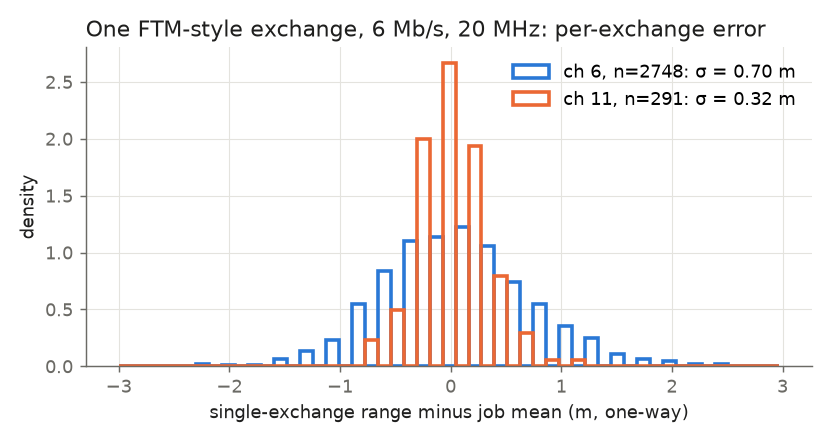
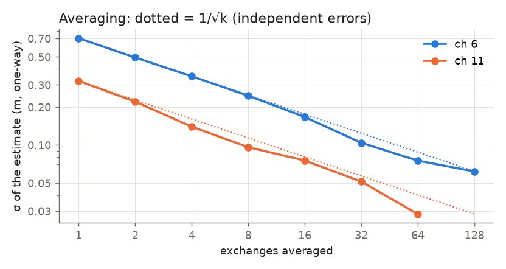
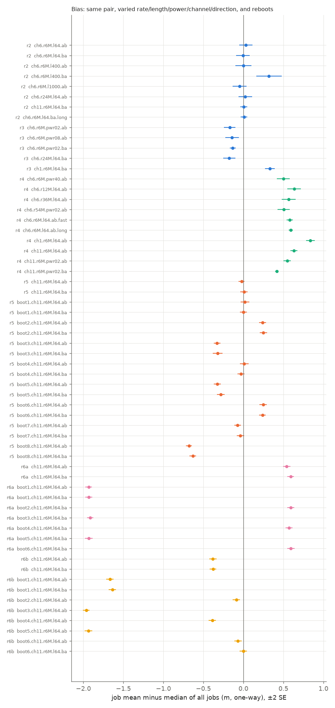

# Mesh ranging spike: FTM-style RTT on our own netstack

A spike for [mesh.md](mesh.md) §13.2: does the ESP32-C6's 802.11mc FTM timestamp hardware
work under our netstack (which replaces the vendor Wi-Fi stack), and how well does it range
between two lamps? The target is metre to sub-metre link ranges, fed to the mesh first as
link ranges and later as `range_m` on `MeshMember`.

**Verdict: conditional GO.**

- The hardware path works under our MAC, with no vendor Wi-Fi stack.
- One exchange has a σ of 0.3–0.7 m. The mean of 16 exchanges has a σ of 0.07–0.2 m.
- Rate, frame length, TX power, channel and direction move the bias by less than 0.2 m.
- One problem blocks product use: a **per-boot offset** of up to 2.6 m one-way. It follows a
  per-device clock-phase state that the device can read from its own stamps. Root-causing it
  is the next spike (S2, below).

Everything was measured on hitl-rig-1 with c6-123170 → c6-711f48, both silicon v0.2. The
boards sit on the bench at a fixed distance that nobody has measured. The images ran the
mesh spike build (`:esp32c6_netstack_meshspike`) with `MESH TX type=ftm`. Raw logs and
analyses are in `/workspace/.claude/ftm/runs/r1..r6b`.

## 1. The timestamp hardware

Found by disassembling the vendor blobs (arduino-esp32 3.3.10 = IDF 5.5): `libpp`
`hal_mac_ftm_get_t3`, `wDev_record_ftm_data_local`, `lmac_record_txtime`, and `libnet80211`
`ftm_record_t2t3_cb`, `ftm_record_t1t4_cb`, `ftm_get_phy_comp`.

Every stamp combines three parts:

- the MAC's 1 MHz counter (`0x600AD000`, the clock M4 found);
- a 7-bit sub-µs tick (0–79, 80 MHz);
- on receive, an 11-bit fine field.

The vendor converts each stamp to **raw units of 1/640 µs (1.5625 ns)**. `libnet80211`
multiplies raw units by 1562.5 to get ps. One raw unit of RTT is **0.234 m** of one-way
range.

| Stamp | Where | Decode (raw units) |
| --- | --- | --- |
| t1: frame TX (sender) | per-queue reg `W0 = 0x600A54F0 - q*0x74` (µs), `W1 = +4` bits 6:0 (tick) | `(W0*80 + tick - 640) * 8` |
| t4: ACK RX (sender) | µs = `W1[31:14] \| W2[31:18]`, `W2 = +8`: bits 6:0 tick, 17:7 fine | `us*640 - 13312 + tick*8 + fold(fine)` |
| t2: frame RX (receiver) | RX vector bytes 12–15 (µs), 11 bits 6:0 (tick), u16 @34 bits 14:4 (fine) | `us*640 - 13312 + tick*8 + fold(fine)` |
| t3: our ACK's TX (receiver) | RX vector bytes 76–79 (µs), 80 bits 6:0 (tick) | `(us*80 + tick - 640) * 8` |

`fold(x) = x if x <= 1023 else 2048 - x` is the blob's own treatment. On silicon, the fine
field sits around −176 (signed) and the RTT regresses on it with coefficient 1.0, so the
fold is right.

The per-queue words are the end of the queue's existing status block (`TXQ_STATUS_BASE`
`0x600A54E0`, PMD `0x54E8`). The hardware latches them whenever a queued frame gets its ACK.
No enable bit was needed. The receiver's MAC writes t3 back into the RX vector of the frame
it ACKed. The vendor waits 50 µs before reading it, and our reap is always later than that.

Other findings:

- **Effective resolution:** RX ticks are always even and TX ticks always odd. Sampling runs
  at 40 MHz (25 ns = 16 raw), and the fine field interpolates within that.
- **Vendor calibration:** `ftm_get_phy_comp` adds a constant to t3 (608–786 raw, set by
  bandwidth and channel group). `phy_ftm_comp` returns 151/199/253 by bandwidth. Both are
  static, so we calibrate our own constant instead.
- **Silicon revisions:** WIFI-9686 bars rev ≤ v0.1 as vendor FTM *initiators*. Most bench
  boards are v0.2: 123170, 711130, 711f48, 003f08, fa0324, 71081c, 71226c. c6-2ce684 is
  v0.1. The erratum is about the vendor stack's initiator. Under our own exchange both sides
  only latch stamps, so whether v0.1 behaves the same is untested.

## 2. The exchange

1. A sends a unicast ACKed frame (a sealed link probe, 64-byte body).
2. A reads t1 and t4 from its queue's registers after the completion.
3. B logs its RX vector, which holds t2 and t3.
4. The host joins the two logs by sequence number.

The formula is the FTM one: `RTT = (t4 − t1) − (t3 − t2)`.

**Clock drift dominates if left uncorrected.** The two crystals differ by 49 ppm. The
turnaround (t3 − t2: frame airtime plus SIFS, 207 µs at 6 Mb/s for 64 bytes) is timed on
B's clock, so the raw RTT moves by 10 raw (2.4 m) per 1000-byte frame. The ratio comes from
the same stamps: the slope of (t2 − t1) across the exchanges. That needs no extra traffic,
and its σ is about 0.1 ppm over 3 s. Correcting the turnaround by it makes the RTT
independent of length and rate (§3).

## 3. Measured

### Precision

| Condition | σ, one exchange | σ, mean of 16 | σ, mean of 64 |
| --- | --- | --- | --- |
| ch 11 / ch 1, 6 Mb/s | 0.32–0.44 m | 0.06–0.11 m | 0.01–0.06 m |
| ch 6 (busier), 6–54 Mb/s | 0.56–0.76 m | 0.13–0.23 m | 0.03–0.16 m |
| ch 11, low TX power, B→A | 0.17 m | 0.04 m | 0.02 m |

- To reach 0.25 m, an estimate needs about 2–3 exchanges on a clean channel and about 8 on
  ch 6. To reach 0.1 m, it needs about 14 and about 50.
- Averaging follows 1/√k out to 64 exchanges.
- About 3 % of exchanges are one-sided ±2.6 µs outliers, which a 5-MAD cut removes.
- About 3 % of first attempts get no ACK (st=5); those are simply not exchanges.
- DSSS (1 and 11 Mb/s) is unusable, with σ around 90 m. Its stamps carry no fine timing.
  Ranging uses OFDM only, as FTM does.

### Bias stability within one boot

Over these conditions, the drift-corrected RTT stays within ±0.15 m:

- frame length 64, 400 and 1000 bytes;
- rates 6, 12, 24, 36 and 54 Mb/s;
- RSSI from −9 to −42 dBm;
- A→B and B→A.

Channel 1 reads about 0.3–0.4 m longer than channels 6 and 11, a small channel term like
the vendor's.

### The per-boot offset

Across reboots, the pair's constant moved over 11 raw (2.6 m one-way). Within each boot,
A→B and B→A agreed to 0.05 m.

| Run | What rebooted | Pair constant (raw), per boot |
| --- | --- | --- |
| r5 | both, 9× | 1415.8, 1415.9, 1416.8, 1414.4, 1415.7, 1414.5, 1416.8, 1415.6, 1413.0 |
| r6a | A only, 7× | 1418.2, 1407.6, 1418.4, 1407.7, 1418.2, 1407.6, 1418.4 |
| r6b | B only, 7× | 1414.2, 1408.7, 1415.4, 1407.4, 1414.1, 1407.5, 1415.7 |

The offset tracks a per-device state that the responder can read from its own stamps:
`(t3 tick − t2 tick) mod 80` is **39 or 41** for a whole boot.

- With both devices in state 39, the constant was 1407.5 ± 0.15 in all 6 such boots (r6a
  and r6b).
- A device in state 41 adds 7–11 raw.
- In r5 (both rebooted together), the two devices always came up in opposite states.

The likely mechanism is a TX/RX clock-domain crossing whose divider phase is random at boot.
Changing channel does not re-roll it.

## 4. Go / no-go

**Go:**

- The hardware gives FTM-grade stamps under our MAC.
- The exchange uses frames we already send (ACKed unicast).
- Precision beats the brief's target by several times.
- Drift is handled from the same stamps.

**Not yet product-accurate:**

- The per-boot offset makes absolute ranges wrong by up to 2.6 m until it is fixed.
- Absolute calibration needs a known distance.
- Indoor multipath bias (typically 1–2 m for FTM) is unmeasured, because the rig boards are
  close together with line of sight.

### S2 (next spike)

1. **Find the register behind the 39/41 state** and either force it at bring-up or re-roll
   it without a reboot. A reboot is not acceptable: effects must keep running. Mitigation if
   it can't be fixed: each device reports its state, and either the mesh solves one offset
   per state per device, or it uses only state-39 pairs for absolute range.
2. **Measure ground truth:**
   - known distances, 0.5–10 m, with the boards moved by a human or on the mesh rig
     (#578/#598);
   - coax with known lengths through attenuators, for the conducted case;
   - room multipath.
3. **Try HT20/HT40 frames.** Our TX path sends legacy OFDM only. A 40 MHz bandwidth should
   halve σ, and the vendor's `phy_ftm_comp` already has a per-bandwidth constant.

## 5. Product plan (after S2)

**Where it lives.**

- The netstack's P2P TX completion (`WifiP2p::last_tx`, `TxStamp`) gains `t1` and `t4`,
  read from the queue's three registers when an ACKed unicast completes. That is three MMIO
  reads in the path that already polls the PMD.
- `RxVector` gains `t2` and `t3`.
- A `ranging` module in `firmware/mesh` (next to `meshtime.rs`) keeps a small table per
  neighbour:
  - the last K (seq, t2, t3) for frames we received from it;
  - the last K (seq, t1, t4) for frames we sent it.
- Nothing is in C++. The mesh FFI is untouched apart from a getter.

**Protocol.**

- Every ACKed unicast mesh frame is a free half-exchange.
- The receiver ships its (seq, t2, t3) pairs back in a link TLV on its next frame to that
  neighbour, or in its time beacon:
  - each pair takes 1 byte of seq plus two 5-byte stamps;
  - 16 pairs take about 180 bytes.
- When traffic is idle, a member that wants a range sends a burst of K small ACKed probes:
  - 64 bytes at 24 Mb/s, about 110 µs each including the ACK;
  - 16 probes plus one report take **about 2 ms of airtime per link estimate**.
- For 6 fixtures (15 links) refreshed every 10 s, that is about 30 ms in 10 s, or **0.3 %
  of airtime**.

**Drift.** The relative clock rate comes from the same stamps, or from M4's per-neighbour
mesh-time fit, which already estimates it.

**Render isolation.**

- Ranging runs in the netstack loop, below render priority (#371). Its added cost is the
  register reads plus the TLV, a few µs per frame.
- The spike's busy-wait for TX completion is not the product path. Bursts go through the
  backhaul's normal async TX queue and its airtime pacing, so a burst never holds the CPU.
- A burst is at most ~2 ms of radio time, shorter than a BLE event, and is scheduled like a
  time beacon (jittered), never back to back with an effect upload.

**API to the mesh.**

- Each neighbour entry gets a `LinkRange { range_m, sigma_m, n, age_ms, state }`
  (`MESH NB`).
- Ranges are gossiped one hop in the time beacon. The gateway's `get_mesh` exposes
  `MeshMember.range_m` per link.
- The app's room solver (`web/src/geom/multiFixture.ts`) uses them as constraints (§12).
- `state` carries the 39/41 phase bit, so consumers can drop or offset-correct until S2
  lands.

**Costs.**

- RAM: 6 neighbours × 2 × 16 pairs × 11 B ≈ 2.1 KB.
- Flash: a few KB.
- No new radio modes and no channel changes.
