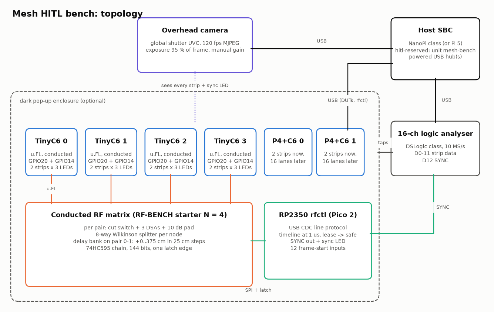
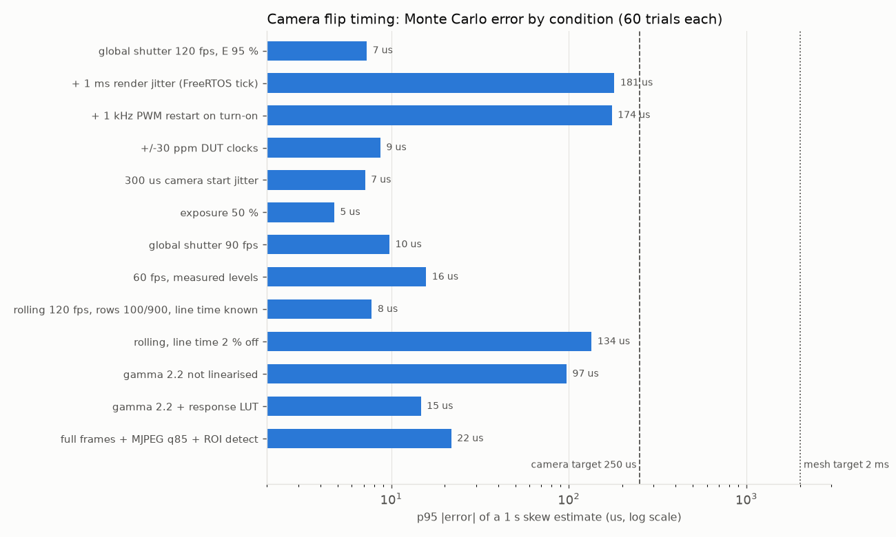

# Mesh HITL rig: conducted RF, real display flip timing

Status: proposed, software built (desk D-92). The hardware is still arriving. Everything below
that names a part number is a recommendation or a question for the owner (§11).

**Revision 2 (2026-11-20): one attenuator per DUT.** The owner overrode desk D-241: no PE4302 step
attenuators. The owner's five Jeanoko 0–6 GHz digital attenuators (0–31.75 dB in 0.25 dB steps,
UART text commands, OLED and buttons) go **one per DUT**, each calibrated per unit on the owner's
VNA. The pair chains keep only the HMC849 cut switch and a fixed pad; the HMC7992 delay bank is
unchanged. This revision reworks the path-loss and isolation budget (§2.1), the controller (§3.3,
§5), the sequencing rules (§5.4), the calibration (§5.8) and what the scenarios can still do
(§6.1). The board-level delta for the rfctl-host PCB is in `.claude/rigorder/rfctl-host-followup.md`
(outside the repo).

This rig extends the conducted RF bench (`/workspace/.claude/rfbench/RF-BENCH.md`, the "starter
N = 4" purchase) into a reservable HITL unit that measures what the mesh is for: **every fixture
showing the same frame at the same instant, while links come and go and change length.** The M4
gate (`mesh_apply_at_skew`) measured apply skew against AP beacons, because rig-1 has no
analyser on its strips. This rig measures the light itself, with an overhead camera, and the
data wires, with a 16-channel analyser.

What is in this PR:

| Piece | Where | State |
| --- | --- | --- |
| RP2350 RF controller firmware: line protocol, µs timeline, lease watchdog, safe state, frame-start timestamps, PIO UART attenuators | `pi/hitl/meshbench/rfctl/` | builds with pico-sdk 2.1.1 (`rfctl.uf2`, 101 KB); core unit-tested under Bazel |
| Controller simulator (the shipped core behind a simulated HAL) | `rfctl/sim/sim_main.c` | used by every Python test |
| Host driver | `rfctl.py` | tested against the simulator |
| Attenuator calibration files, VNA sweep, direct USB driver | `atten_cal.py`, `jeanoko.py` | tested on synthetic sweeps; the VNA's SCPI commands are unverified |
| RF scenarios (link flap, chain re-route, partition/heal, delay-line steps, walking fades, meshsim replay) | `scenarios.py` | compile and play on the simulator |
| Display pattern | `meshFlipClock.fx` | not yet run on a device |
| Camera flip timing | `flip_cv.py` (+ `camsim.py`, `accuracy.py`) | 21 tests; Monte Carlo in §7.5 |
| Analyser flip timing | `la_phase.py` | 9 tests |
| Results, HITL metrics, verdict | `bench_core.py` | schema v1 `HITL_METRIC` records |
| Harness + rig agent | `hitl_mesh_bench.py`, `meshbench_rig.py` | `--simulate` runs end to end; hardware path untested |
| HITL catalog entry | `pi/hitl/reserve/catalog-meshbench.json` | placeholders; checked by the PR-24/PR-30 catalog tests |

## 1. Summary

- **Topology.** A host SBC runs `hitl-reserved` with one pin-only composite unit, `mesh-bench-1`.
  The unit holds the RP2350 controller, 4 TinyC6 u.FL DUTs on the conducted matrix, 2 P4+C6
  boards, the camera and the analyser. Each DUT strip has 3 LEDs. The camera looks down on all
  strips and on a sync LED that the controller drives. The analyser taps 11 strip data lines and
  the controller's SYNC line. 
- **Links come and go** through the matrix's cut switches (one per pair) and **one attenuator per
  DUT**, so a pair's loss is the sum of its two DUTs' settings plus a fixed part (§2.1). **Links
  change length** through the delay bank on pair 0–1: 16 lengths from 0 to 375 cm of cable. A
  scenario is a timeline played by the controller on its own clock. Every switch step is one latch
  edge, accurate to about 1 µs. The attenuators are UART units: their commands start on the latch
  edge and land milliseconds later, so the compiler sequences them around the switches (§5.4).
- **Display flip timing.** Each strip shows a three-scale clock of its own show time. A camera frame
  that integrates a flip gives the flip's instant to a fraction of the exposure. Fits over 1 s windows
  give each fixture's display offset. The spread across fixtures is the measurement.
- **Accuracy targets.**

  | Instrument | Target |
  | --- | --- |
  | Controller | steps within ±1 µs; a step later than 50 µs is a fault |
  | Analyser | per flip 0.1 µs at 10 MS/s; skew between fixtures ≤ 1 µs |
  | Camera | 1 s window skew p95 ≤ 250 µs on the rig. The simulated ideal is 7 µs; the budget leaves room for line-time, linearity and LED-stage systematics |

  The camera is validated against the analyser on the tapped strips: they must agree to 0.3 ms.
  The things checked are the mesh's own target, a 2 ms spread across 3 hops, and the HITL gate,
  p99 below 10 ms + one frame (`docs/design/mesh.md` §6.1, §14). Both are at least 8× above the
  camera target.
- **Results** land in the HITL performance dashboards as `HITL_METRIC` lines under gate
  `mesh_bench`, following the hitlmetrics schema v1.

## 2. Topology

| Block | Role | Connects to |
| --- | --- | --- |
| Host SBC (NanoPi-class, Q1) | `hitl-reserved` + catalog-meshbench; reservation containers; Tailscale | USB: hub(s) with DUTs + controller, camera, analyser |
| RP2350 controller (rfctl-host PCB, bare RP2350A) | Every RF switch via a 74HC595 chain; one PIO UART per attenuator; SYNC out; sync LED; 12 frame-start inputs | USB CDC to the host; chain + UART headers to the RF enclosure; SYNC to analyser D12 |
| Conducted matrix (RF-BENCH starter) | Per DUT: a Jeanoko attenuator between its pigtail and its node splitter. Per pair: HMC849 cut switch + 30 dB pad (20 + 10). Per node: 8-way Wilkinson splitter. Delay bank in series on pair 0–1 | u.FL pigtails from the 4 TinyC6 |
| 4 × TinyC6 u.FL | Conducted mesh nodes 0–3 | matrix node i; USB; 2 strips each |
| 2 × P4+C6 | The P4 renders, the C6 is the radio (`docs/design/p4-c6-split.md`). Over the air unless their C6 has a connector (Q3) | USB; 2 strips now, 16 lanes later |
| Camera | Light-output timing of every strip + sync LED | USB (its own controller, §4) |
| 16-ch analyser | Wire timing of 11 strip lines + SYNC | USB (its own controller, §4) |
| Enclosure | Steady darkness; no 100/120 Hz room-light flicker in the camera | — |

Each P4 board sits in the same mesh over the air at reduced TX power. It needs no matrix port. If
its C6 has an antenna connector, it can take the matrix's AUX port on a node splitter (RF-BENCH §2).
A conducted P4 needs its own attenuator, which takes the spare unit.

### 2.1 Path loss and isolation with one attenuator per DUT

Each DUT's Jeanoko sits between its u.FL pigtail cable and its node splitter's common port. The
pair chains keep the cut switch and a fixed pad. For pair i–j, with the cut switch through:

  **L_ij = F_ij + A_i + A_j**

- F_ij is the fixed part: both node sides (pigtail, 1 m RG400, the splitter's through loss) plus the
  pair chain (2 × 50 cm RG400, the HMC849, the pad).
- A_i is DUT i's unit: its insertion loss plus its setting (0–31.75 dB), from its VNA table (§5.8).

**The new limitation: a detour skips the relay's attenuator.** A cut pair i–k with a live common
neighbour j still leaks: i's splitter → chain i–j → **port to port across j's splitter** → chain j–k
→ k's splitter. That path never passes j's common port, so it never passes A_j. Relative to the
pair's own through loss, the detour costs one extra pair chain plus the splitter isolation:

  **detour_ik|j = (L_ik if it were through) + c + I**, with c = the pair-chain loss, I ≈ 20 dB.

In the old design every detour crossed two pair chains' DSAs, so a cut was about L_ij + L_jk deep.
Now a cut is only **c + I** deeper than the same pair through. The fixed **pair pad is the only lever**
on that margin, so this revision raises it from 10 dB (the cart as first written) to 30 dB (the
bought 10 dB pad stacked on a 20 dB pad). TX power compensates for the higher fixed loss: link
edges move with TX (RF-BENCH §1).

Element losses at 2.44 GHz (per side or per chain):

| Element | Loss (dB) | Source |
| --- | --- | --- |
| Node side: u.FL pigtail 0.3 + 1 m RG400 1.5 + 8-way Wilkinson through 10.5 | 12.3 | RF-BENCH §1 |
| Pair chain: 2 × 50 cm RG400 1.5 + HMC849 on 1.0 + pad | 2.5 + pad | to-buy line 13 |
| Jeanoko at 0 dB (insertion loss) | **1.5–6** | listing: ≤ 1.5 dB "(greater at the high end)"; Silicon Chip measured ~6 dB at 2.5 GHz on the same module family. **The VNA decides** |
| Jeanoko range | 0–31.75 in 0.25 steps | listing: ±0.25 dB accuracy (unverified) |
| HMC849 isolation − IL | 55 | 56 dB isolation, 1.0 dB IL |
| Wilkinson port-to-port isolation | ~20 | owner's atopile 1×8; measure |
| Delay bank on pair 0–1 (4 × HMC7992 0.7 + RG402 arms) | +2.8 to +4.5 | calibrated per state |

The budget per pair (N = 4, 2.44 GHz). The 30 dB column is the recommendation:

| | Pad 10 dB (as bought) | Pad 20 dB | **Pad 30 dB (20 + 10)** |
| --- | --- | --- | --- |
| F_ij (no attenuators) | 37.1 | 47.1 | **57.1** |
| Min path loss (both units at 0; IL 1.5 … 6 each) | 40.1 … 49.1 | 50.1 … 59.1 | **60.1 … 69.1** |
| Max path loss (both units at 31.75) | 103.6 … 112.6 | 113.6 … 122.6 | **123.6 … 132.6** |
| Span on one pair | 63.5 | 63.5 | **63.5** (was 94.5 with 3 DSAs) |
| Span between two pairs sharing a node | 31.75 | 31.75 | **31.75** |
| Span between two disjoint pairs | 63.5 | 63.5 | **63.5** |
| Detour margin, cut vs through (c + I) | 32.5 | 42.5 | **52.5** |
| `link_flap` cut in a full mesh at L (2 detours + the open switch) | L + 29.6 | L + 39.4 | **L + 48.5** |
| Cut with no live common neighbour (partition): through + switch | L + 55 | L + 55 | **L + 55** (both ends' detours cross an open switch too) |
| 1M / 6M / MCS7 edges at TX +2 dBm: 101 / 96 / 77 dB | all inside, 1M by only 2.6 dB at IL 1.5 | all inside | **all inside** |
| … at TX +20 dBm: 119 / 114 / 95 dB | MCS7 only | MCS7; 6M and 1M only at high IL | **all inside** |
| RX at min loss, TX +20 dBm | −20 … −29 dBm | −30 … −39 | **−40 … −49** (ceiling −10 ✔) |

- **Cut depth.** A cut is the power sum of its direct path (L + 55 dB through the open HMC849) and
  every detour. With a live common neighbour, the detour dominates: L + c + I, minus 3 dB for two
  neighbours. For example, `link_flap` in a full mesh at 70 dB cuts pair 0–1 to **118.5 dB** with
  30 dB pads; with 10 dB pads, at 60 dB, only to 89.6 dB, which a 1M receiver at +2 dBm still hears.
  `scenarios.Bench.path_loss` models all of this, and `compile()` warns when a cut stays under
  100 dB.
- **Radiated leakage** still caps every cut (no shield boxes, RF-BENCH §5). The rule stands:
  TX_bench ≤ L_leak − 109 dBm, measured in assembly step 14.
- **The monitor tap** sits on the node splitter, after the unit, so the sniffer sees each DUT
  through its own attenuator plus 30 dB. The fifth unit (`attx`, header U6) is a calibrated spare.
  It can also go in the monitor path if the HackRF needs level control.
- **N = 6** needs six units: one more than owned with no spare, two with a spare (§11.2 Q12).

## 3. Wiring and GPIO maps

### 3.1 Strips

Every strip is 3 LEDs of the same part and reel on every board, so LED-stage latency is common
(§7.4). The pattern lights **green only**, at most 20 mA per LED. Wiring from each strip drive pin:
330 Ω series resistor at the board, then data, 5 V and GND, with 20 cm leads. Use a 74AHCT125
buffer per board if the strips are fed at 5 V (WS2812B VIH = 0.7 VDD is marginal at 3.3 V). The
analyser and the frame-start inputs tap the **3.3 V side**, through 1 kΩ.

**TinyC6 u.FL** (C6 firmware: 2 channels, `firmware/player_app/led_caps.bzl`):

| Board | Strip | GPIO | Analyser | FSTI |
| --- | --- | --- | --- | --- |
| c6-0 … c6-3 | s0 | GPIO20 (firmware default ch0) | D0, D2, D4, D6 | 0, 2, 4, 6 |
| c6-0 … c6-3 | s1 | GPIO14 (firmware default ch1) | D1, D3, D5, D7 | 1, 3, 5, 7 |

That is every strip-drive output the C6 firmware has. Check that the TinyC6 brings GPIO20 and
GPIO14 to its pads (Q4). If not, pick two `PIN_SAFETY_RECOMMENDED` pins from
`board_caps.textproto` (0–3, 10, 11, 21–23) and set them with `set_hardware_config`.

**P4+C6 (Waveshare ESP32-P4-WIFI6 class, `board_caps_p4.textproto`).** The firmware drives 2
PARLIO lanes today. The planned encoder drives 16. Wire all 16 now, so the rig doesn't change when
the encoder lands:

| Lane | 0 | 1 | 2 | 3 | 4 | 5 | 6 | 7 | 8 | 9 | 10 | 11 | 12 | 13 | 14 | 15 |
| --- | --- | --- | --- | --- | --- | --- | --- | --- | --- | --- | --- | --- | --- | --- | --- | --- |
| GPIO | 20 | 21 | 22 | 23 | 26 | 27 | 32 | 33 | 46 | 47 | 48 | 2 | 3 | 5 | 28* | 29* |

\* Free only with Ethernet off (IP101 RMII). The SDIO pins 14–19, C6 reset 54, USB 24/25 and
UART0 37/38 are never used.

Analyser taps on the P4 boards:

| Analyser | Board | Lane |
| --- | --- | --- |
| D8 | p4-0 | 0 |
| D9 | p4-1 | 0 |
| D10 | p4-0 | 1 |
| D11 | p4-0 | 15 |

D10 and D11 against D8 measure PARLIO lane skew. FSTI 8–11 mirror D8–D11.

### 3.2 Analyser channels

| Channels | Signal |
| --- | --- |
| D0–D7 | c6-0…3 s0/s1 |
| D8, D9 | p4-0 lane 0, p4-1 lane 0 |
| D10, D11 | p4-0 lanes 1 and 15 |
| D12 | controller SYNC (GP7) |
| D13 | camera strobe, if the camera has one (gives exposure timing directly) |
| D14, D15 | spare (a DUT debug pin for render-vs-output splits) |

GND goes to the controller, which shares ground with the hub. The map lives in the catalog
(`HITL_LA_MAP`).

### 3.3 Controller (rfctl-host PCB, bare RP2350A)

| Pin | Function |
| --- | --- |
| GP2 / GP3 / GP4 | SPI0 SCK → all 595 SRCLK / TX → chip 0 SER / RX ← last chip QH' (selftest loopback) |
| GP22, GP26, GP27, GP28 | UART TX to attenuators `att0`–`att3` (headers ATT U0–U3), one PIO state machine each, 115200 8N1 |
| GP23, GP24 | UART TX to `att4`, `att5` (U4, U5) at N = 6. These are internal on a Pico 2 module: on a module build, move them to GP0/GP1 in the board table |
| GP29 | UART TX to `attx`, the spare or monitor unit (U6) |
| GP9 | shared acknowledge line (UART1 RX): each unit's TX through a Schottky diode, wired-AND, with a 4.7 kΩ pull-up. Only `attcheck` reads it |
| GP5 | RCLK (latch), all chips |
| GP6 | /OE, all chips, **4.7 kΩ pull-up**: outputs hi-Z until the safe vector is latched |
| GP7 | SYNC out (toggles at every commit) → analyser D12 |
| GP8 | sync LED (board device `syncled`), in the camera's view, through a transistor + 330 Ω |
| GP10–GP21 | FSTI 0–11, frame-start timestamp inputs (pull-down; taps through 1 kΩ) |
| GP25 | on-board LED: blinks 2 Hz idle, 10 Hz playing, solid on a fault |

The chain is **6 × 74HC595, 48 bits** (`rfctl/board_default.c`, board `jeanoko-n4`):

| Bits | Device | Lines |
| --- | --- | --- |
| 0–5 | `dlyA`: bank A in switch, out switch | V1, V2, EN each |
| 6–11 | `dlyB`: bank B in, out | V1, V2, EN each |
| 12–23 | `cut01 cut02 cut03 cut12 cut13 cut23` (pair p at 12 + 2p) | VCTL, EN |
| 24–41 | N = 6 growth: `cut04 cut05 cut14 cut15 cut24 cut25 cut34 cut35 cut45` (board `jeanoko-n6`) | VCTL, EN |
| 42–47 | spare | — |

N = 4 uses 24 bits (3 chips). The PCB fits all 6 chips, so N = 6 needs no expander board. Every line
has a pull-up, and the firmware drives the bits no device owns high too (`spare_high`). With all
lines high, every HMC849 has EN high (both throws isolated) and every HMC7992 has EN high (all off).
The lines then sit safe while /OE is high. The legacy 144-bit three-DSA table stays in the tree as
board `pe4302` (`rfctl/board_pe4302.c`), for the simulator and the tests.

## 4. USB and power budget

| Load | Current (5 V) | Notes |
| --- | --- | --- |
| TinyC6, radio on, 2 strips green | ≤ 0.35 A peak (TX), 0.12 A typical + 0.12 A strips | × 4 → 1.9 A peak |
| P4+C6 board, 16 strips green | ≈ 0.5 A board + 16 × 60 mA = 1.5 A | × 2 → 3.0 A: **strips on a separate 5 V supply**, not USB |
| rfctl-host (RP2350A + 6 × 595) + 6 HMC849 + 4 HMC7992 modules | ≈ 0.2 A | own 5 V supply; USB data only |
| 5 Jeanoko units (7 at N = 6) | ≈ 0.1 A each (MCU + OLED, estimate: meter one) | 5 V from the rfctl-host's USB-A power ports (power only), not the host's USB |
| Camera (UVC) | 0.25–0.5 A | own controller |
| Analyser (DSLogic class) | 0.3–0.5 A | own controller |

Lessons from rig-1/2/3 (memories `hitl-rig-usb-power-budget`, `hitl-rig-hardware-constraints`):

- Hubs are **self-powered** (≥ 5 V 4 A). The host's own USB budget must never feed DUTs.
- The camera's MJPEG stream (15–30 MB/s at 1280×800, 120 fps) and the analyser's stream
  (16 ch × 10 MS/s = 20 MB/s) **must not share a USB 2 controller**, with each other or with the DUT
  hub. Plan three independent controllers: the DUT hub, the camera, and the analyser. Pi 5 has two
  xHCI controllers on RP1, so it fits only with the analyser on the USB 3 port of one and the
  camera on the other's. This decides the host (Q1).
- After assembly, check `journalctl -k | grep -c 'over-current'` stays flat through a run.

## 5. RF controller (rfctl)

### 5.1 Why an RP2350 and this design

The controller plays the scenario on its own clock, so USB and host jitter never reach the RF
timing. An RP2350 with no radio cannot leak into the bench. The 595 chain makes every switch line
one latch edge: all switches of a step change in the same instant. SYNC and the sync LED mark that
instant for the analyser and the camera. The attenuators can't join that instant: each Jeanoko has
its own MCU that takes a text command. The controller starts every attenuator command of a step
on that step's latch edge, in parallel on PIO UARTs, and the compiler moves the step earlier or
later so the RF change lands where the scenario needs it (§5.4).

### 5.2 Device model

`list` reports the board table. The host never hard-codes it. Each device is one of three kinds:

| Kind | Value | Example |
| --- | --- | --- |
| `switch` | an index into a code table of raw line patterns (any truth table, including "all off") | `cut01` (0 = cut, 1 = through), `dlyA` (0–3 = arm, 4 = off), `syncled` |
| `atten_uart` | UART text-command unit (Jeanoko), value in dB (0–31.75, 0.25 steps); one TX GPIO, a PIO state machine per unit | `att0`–`att3`, `attx` (default board) |
| `atten` | parallel DSA, value in dB (0–31.5, 0.5 steps), line i = bit i | `att01a`, `att01b`, `att01c` (legacy `pe4302` board) |
| `atten_serial` | PE4302 serial (CLK, DATA, LE on direct GPIOs) | none |

Three board tables build into the core: `jeanoko-n4` (the default and the firmware's), `jeanoko-n6`
(the same bench grown to 6 nodes: 15 cuts, `att0`–`att5`, `attx`) and `pe4302` (the revision 1 table,
3 DSAs per pair). The simulator takes `--board`. The protocol is unchanged (`proto=1`). New fields
are appended, so an older host still parses every reply.

**The Jeanoko command set** (Silicon Chip Nov 2021 and PE Dec 2024 reviews of this module family,
and `github.com/emptemp/att6000_control`). The Amazon listing (B0FHSZ6N8G) names no interface;
**confirm on the units that arrive** (desk D-152):

| | |
| --- | --- |
| Port | micro-USB (power + serial). A 4-pin header next to the OLED is "provision for a separate serial interface". It is untested in the reviews; it is probably the MCU's 3.3 V UART |
| Framing | 115200 8N1, LF line end |
| Set | `wv0XXYY\n` sets XX.YY dB (`wv02375` = 23.75 dB); the unit answers `ok\r\n` (one review saw `OK`) and shows the value on its OLED |
| Power-up | 0.00 dB |
| MCU | probably an STM32F103; attenuator chip HMC1119 or PE43713 (7 bits, 0.25 dB) |

The firmware's command is 8 bytes: 694 µs on the wire.

**The switch codes are provisional** (HMC7992-class: V1, V2, and an all-off line). They must be
checked against the switches that arrive before first power-up (Q2). The safe state is only safe if
these codes are right.

### 5.3 Protocol (USB CDC, one line per command, ≤ 255 bytes)

An optional `@tag` prefix is echoed on every line of the reply. A reply ends with `ok …` or
`err <code> <text>`, where code is one of `unknown_cmd`, `bad_arg`, `unknown_dev`, `range`, `busy`,
`order`, `full`, `line_too_long`.

| Command | Effect |
| --- | --- |
| `hello` | `ok rfctl proto=1 board=jeanoko-n4 devices=14 chain=48 timeline_cap=8192 edge_lines=16 uart=5` |
| `list` / `state` / `get <dev>` | the device table / every value + chain hex / one value |
| `set <dev> <v> [<dev> <v>…]` | immediate, all pairs in **one latch**; refused while playing |
| `safe` | stop the timeline, every device to its safe value |
| `at <t_rel_us> <dev> <v> […]` | append a timeline entry. Times must not decrease. Entries with the same time form one step |
| `clear` / `play <t0_us>`\|`+<delay_us>` / `stop` | manage and run the timeline. `play` refuses a first step less than 400 µs away |
| `status` | playing, next/n, now, t0, steps, late_last/max, faults, lease left, sync count, FSTI state, `uart_sent`, `uart_deferred` |
| `attcheck [<dev>…]` | re-send each UART attenuator's value, one unit at a time, and wait (≤ 50 ms) for its `ok` on the acknowledge line: `att <dev> ok\|timeout\|stuck_low\|absent value=… latency_us=…`. Refused while playing |
| `log [n]` | the last steps: scheduled vs actual commit µs |
| `lease <ms>` | watchdog: no command for ms → timeline stopped + safe state + fault |
| `cap <mask> [holdoff_us]` / `capread [n]` | frame-start timestamps: the first rising edge after holdoff, per FSTI line |
| `time` / `ping` | controller µs (the host fits a clock map from ping midpoints) |
| `selftest` | shifts a pattern through the chain twice and compares QH'; outputs never move |
| `latelimit <us>` / `clearfaults` / `bootsel` / `reset` | — |

Faults: 0x01 lease, 0x02 late step, 0x04 chain selftest, 0x08 frame-start overflow, **0x10 a UART
command had to wait** for its unit (it went out later, from the main loop).

### 5.4 Timing

**Switches (cuts, delay bank, sync LED): unchanged.** The main loop stages a step 400 µs early: it
shifts the chain in while outputs are unchanged. A hardware alarm fires 20 µs before the step. The
handler spins to the exact µs with interrupts off, then raises RCLK, sets the direct GPIOs and
toggles SYNC in one SIO write.

- Expected lateness: ≤ 1 µs. It is measured (`log`) and faulted above `latelimit` (50 µs).
- Minimum step spacing: 50 µs. 48 bits at 10 MHz SPI take 5 µs.
- The SP4T switches settle in about 0.1–1 µs. During a delay-bank change the path is open for under
  1 µs: a link changes length without being cut for longer.

**Attenuators: milliseconds, after the latch.** In the same handler, right after the latch edge,
the firmware loads each changed unit's 8-byte command into that unit's PIO TX FIFO. All the units
of a step start within a few µs of RCLK, in parallel. Then, per unit:

| Phase | Time | Known? |
| --- | --- | --- |
| Command on the wire, 8 bytes at 115200 | 0.69 ms | exact |
| The unit's MCU parses it and writes its DSA chip | t_proc | **unknown: measure** (§5.8 step 6) |
| The DSA chip settles | ~1 µs | datasheet |
| **Landing: T_land = T_issue + 0.69 ms + t_proc** | default 3 ms until measured | `latency_us` in the calibration |

A unit takes one command at a time. A command for a unit that is still sending waits in the
firmware (`uart_deferred`, fault 0x10) and goes out from the main loop as soon as the FIFO has room.
The compiler keeps commands for one unit ≥ 1 ms apart, so a played scenario never defers. Fading
runs at up to ~300 Hz per unit at a 3 ms latency. `walk_fade` uses 100 Hz.

**Sequencing rules (`scenarios.compile`).** A scenario step at time T is split. Its switches stay
on T's latch edge. Its attenuator changes move:

| The step… | Attenuator commands start at | So that |
| --- | --- | --- |
| **closes** any cut (a link appears) | T − latency − 2 ms guard | every unit has landed before the link opens: make-before |
| only **opens** cuts (links go away) | T, on the same latch edge | the links are already gone when the units move: break-before |
| changes attenuators only (fades, replays) | T − latency | the RF lands on T, ± the unit's latency jitter |

- The event instant, its mark and the sync-LED toggle stay at T, the switch edge.
- A UART-only step that lands within 50 µs of another step joins that step.
- `Compiled.uart` lists (t_issue, t_land, device, value) for every attenuator change. The results
  can then put error bars on attenuator-only events.
- **Never rely on two units moving together.** Each pair loss depends on two units, so during the
  ~ms between two landings a link passes through an intermediate value. Anything that has to be
  simultaneous (a link appearing or vanishing) is done with the cut switches.
- A changed unit also changes **every live link of its DUT**, not just the pair named in the step
  (§6.1).

### 5.5 Safe default

- **Power-up.** /OE is high, so the 595 outputs are hi-Z and the pull resistors hold the lines safe:
  every cut open and the delay bank all-off. The firmware shifts in and latches the safe vector:
  every cut open, the delay bank at arm 0 (pair 0–1 is cut anyway), the sync LED off. Only then does
  it drive /OE low. It also sends 31.75 dB to every attenuator.
- **The attenuators power up at 0 dB**, and may boot after the controller (OLED init). So the cut
  switches carry the safe state on their own: a cut is in series with every pair. The firmware
  re-sends every unit's value every 0.5 s for 5 s after power-up and after every `safe` or lease
  expiry. `attcheck` confirms each unit.
- A hardware watchdog (500 ms) resets a hung loop back into that state.
- The `lease` covers a dead host or agent. The rig agent always takes one.
- `safe` and `stop` work while playing. `safe` opens every cut on one latch edge (µs), then the
  attenuators follow to 31.75 dB (ms).

### 5.6 Build and flash

```sh
nix shell nixpkgs#cmake nixpkgs#gcc-arm-embedded nixpkgs#python3 \
  --command pi/hitl/meshbench/rfctl/pico/build.sh /tmp/rfctl-build   # -> out/rfctl.uf2
```

Flash by holding BOOTSEL (or sending `bootsel`) and copying the UF2, or with `picotool load -x`.
The core, the board table, the unit test and the simulator build under Bazel
(`//pi/hitl/meshbench/rfctl:{rfctl_core_test,rfctl_sim}`). pico-sdk's own Bazel support would pull
an ARM toolchain and picotool into the root module for one target, so the firmware stays on
pico-sdk CMake. The CMake flow is verified to build (revision 2: `rfctl.uf2` 101 KB, `-Werror`, with
the PIO UART transmitters). The PIO program is pico-examples' `uart_tx`, hand-assembled into
`pico/main.c`, so the build needs no `pioasm` step.

### 5.7 Fallback: the units on USB

If a unit's header turns out not to be a usable UART, its micro-USB port is (both reviews drove it
that way). Then:

- the units hang off a powered USB hub on the bench host (one of the two Atolla hubs owned);
- `jeanoko.py` drives each unit directly (`Jeanoko(port).set(dB)`, which waits for `ok`);
- the harness, not the controller, times the attenuator changes. Host and USB jitter add about
  1–10 ms on top of t_proc. The rules in §5.4 still apply, with a larger guard;
- the lease no longer covers the attenuators. The cuts still carry the safe state;
- every unit is another USB cable into the RF enclosure (a leak path: clip a ferrite on each) and
  another `/dev/serial/by-id` entry. Identical units may share a USB serial number, so the
  catalog must name them by hub port path.

The rfctl-host design keeps both paths open: UART headers for the controller, and power-only USB-A
ports that also fit the units' own cables.

### 5.8 Attenuator calibration (per unit, on the VNA)

Each unit gets its own table: S21 at all 128 settings at the mesh channels. The table follows the
unit (label each one, J1–J7) and is copied into the bench file for its slot. Tooling:
`atten_cal.py` (`//pi/hitl/meshbench:atten_cal`).

1. **VNA set-up.** The owner's 28 GHz VNA. Use 2.40–2.50 GHz, 201 points (plus 2412/2437/2462 MHz,
   Wi-Fi channels 1, 6 and 11), IF bandwidth 1 kHz, port power −10 dBm (the units take < 1 W). Do a
   full 2-port SOLT calibration at the ends of the two test cables (GSS405 50 cm). Check it with a
   thru: |S21| < 0.05 dB.
2. **Drive the unit** from the controller on its ATT header (`--rfctl … --dev att0`), or over its
   own USB (`--jeanoko /dev/ttyUSB0`). Let it boot for 5 s. Confirm `attcheck` → ok.
3. **Sweep:** `atten_cal.py sweep --unit J1 … --scpi <vna>:5025 --out J1.csv`. It steps 0 → 31.75 dB,
   waits 50 ms per step, reads one sweep, and repeats 0 dB at the end. That is about a minute per
   unit. The default SCPI commands (`INIT:IMM;*OPC?`, `CALC:DATA:FDAT?`, `SENS:FREQ:DATA?`) suit most
   SCPI VNAs. Check them against the owner's VNA manual. With no SCPI, export one Touchstone file
   per setting and write the CSV (`setting_db,freq_mhz,s21_db`) by hand.
4. **Repeat and reverse** once per unit (31.75 → 0). The two runs agree to ≤ 0.1 dB rms, or the unit
   is suspect. Record the 0 dB drift between the start and the end.
5. **Return loss:** S11 and S22 ≤ −14 dB (VSWR 1.5) at 0, 15 and 31.75 dB. The listing claims ≤ 1.4.
6. **Latency** (t_proc, §5.4): use the VNA in CW zero-span mode at 2437 MHz, if it has one, or the
   HackRF on a 20 dB pad. Toggle 0 ↔ 20 dB with `set` 20 times, and time the RF step from the
   controller's SYNC edge (analyser D12, or the VNA's trigger input). Store the median plus
   2 × the spread as `latency_us`. `attcheck`'s `latency_us` (command end → `ok`) is a lower bound
   to compare it with.
7. **Unit file:** `atten_cal.py unit --unit J1 --csv J1.csv --latency-us 2600 --out J1.json`, then
   `atten_cal.py check J1.json`: insertion loss, range, worst step error, monotonicity.
8. **Bench file**, after assembly (§12 step 15): measure each pair end to end at both units' 0 dB
   (cut through, delay bank at 0 cm), then
   `atten_cal.py bench --channel 2462 --map att0=J1.json,… --pairs 01=…,02=… --out bench_cal.json`.
   Put it on the rig host and point `HITL_MESHBENCH_CAL_JSON` at it.

**Unit file** (`meshbench.atten_cal/1`):

```json
{
  "schema": "meshbench.atten_cal/1",
  "unit": "J1",
  "model": "Jeanoko 0-6 GHz digital attenuator (B0FHSZ6N8G)",
  "measured_at": "2026-11-21T10:00:00Z",
  "vna": "<model>, SOLT at the GSS405 cable ends, -10 dBm, 1 kHz IFBW",
  "freqs_mhz": [2412, 2437, 2462],
  "settings_db": [0.0, 0.25, "... 128 values ...", 31.75],
  "s21_db": [["128 values at 2412 MHz"], ["… 2437"], ["… 2462"]],
  "latency_us": 2600
}
```

**Bench file** (`meshbench.bench_cal/1`), which `scenarios.Bench(..., cal=atten_cal.load(path))`
loads:

```json
{
  "schema": "meshbench.bench_cal/1",
  "channel_mhz": 2462,
  "units": {"att0": "J1", "att1": "J2", "att2": "J3", "att3": "J4", "attx": "J5"},
  "atten": {"att0": {"unit": "J1", "loss_db": ["128 values: -S21 at the channel"], "latency_us": 2600}},
  "pair_fixed_db": {"01": 57.4, "02": 57.9, "03": 58.1, "12": 57.0, "13": 57.6, "23": 57.2},
  "node_side_db": 12.3,
  "splitter_isolation_db": 20.0,
  "cut_isolation_db": 55.0
}
```

- `loss_db[k]` is the unit's loss at setting k × 0.25 dB, **insertion loss included**, interpolated
  to the bench channel.
- `pair_fixed_db` is F_ij: the end-to-end measurement minus the two units' `loss_db[0]`.
- The compiler picks, for each unit, the setting whose calibrated loss is nearest the fit's target.
  Each unit's `latency_us` replaces the 3 ms default in the sequencing (§5.4).
- `node_side_db` and the two isolations feed the leak model (§2.1). Replace them with the measured
  values when they exist (Wilkinson port to port on the VNA; RF-BENCH §5 for the switch).

## 6. Scenarios: links that come and go and change length

`scenarios.py` builds on the board's device names. It picks the **node model** when the board has
`att<i>` units (the default) and the **pair model** for the legacy three-DSA table. `compile()`:

- merges steps;
- drops values that didn't change;
- prepends the sync-LED start code (toggles at 0, 80, 160, 400, 480 and 800 ms, an unambiguous
  pattern for the camera);
- toggles the LED at every labelled event;
- **sequences the UART attenuators** around each step's latch edge (§5.4) and spaces each unit's
  commands ≥ 1 ms apart;
- checks spacing, capacity (8192 entries) and **leak paths**.

A cut pair whose effective loss is under 100 dB is flagged, because there the "cut" is not real.
In the node model the effective loss is the power sum of the direct path through the open switch
and every one-hop detour (§2.1). The pair model keeps the revision 1 check (L_ij + L_jk).

**Node model API.** `Bench.topology({pair: dB})` closes the listed pairs, opens the rest, and
**fits** the node units by least squares (0–31.75 dB each, then the nearest calibrated step). Nodes
with no live link go to 31.75 dB. Every pair it misses by more than 1 dB becomes a compile
warning. `Bench.loss(pair, dB, state)` moves the higher-numbered node's unit and keeps the other
one. `Bench.link(pair, up)` only switches; the link's loss is what its units give.

| Scenario | What happens | Timing | Expected mesh behaviour |
| --- | --- | --- | --- |
| `baseline` | full mesh at 60 dB | 30 s | spread at the floor |
| `link_flap` | pair 01 cut for 3 s every 10 s, 6 cycles | step-exact | full mesh: no re-route needed, spread unchanged |
| `chain_reroute` | chain 0-1-2-3 plus a weak 0-2 backup (85 dB); 1-2 cut at 10 s, healed at 25 s | step-exact | 3 now reached via 0-2: delivery holds, spread holds |
| `partition_heal` | {0,1} \| {2,3} for 20 s | step-exact | islands drift apart (ungated), then converge after the heal (gated: < 2 ms within 30 s) |
| `length_steps` | pair 01 through 0…375 cm, 4 s each | sub-µs switch-over | **no change**: delay is ns against µs MAC timing |
| `walk_fade` | 8 Hz Doppler fading (30 dB deep) + 3–15 dB body dips on pair 01 | 100 Hz updates | rate adaptation without spread excursions |
| `from_meshsim` | replay `meshsim --export-bench` (t, i, j, PL); shift by TX_sim − TX_bench; cut past the edge | as exported | sim and bench agree |

Untested on hardware: whether the starter matrix's real isolation is good enough for "cut" to mean
cut without shield boxes (RF-BENCH §5). Measure it in assembly step 14. Until then, run at reduced
TX power.

### 6.1 What one attenuator per DUT can and can't do

With N units for N(N−1)/2 pairs, the live pair losses are not independent. For any four distinct
nodes, L_ij + L_kl = L_ik + L_jl (after the fixed parts). N = 4 has 6 pairs and 4 knobs, so 2
constraints. The cut switches remove any pair from the matrix, so the constraints bind only among
live pairs. What follows, with 30 dB pads (§2.1):

| Scenario | Node model | Notes |
| --- | --- | --- |
| `baseline` | ✔ exact | every unit at (L − F_ij)/2 − IL; needs L ≥ min loss (60–69 dB) |
| `link_flap` | ✔ | the cut is the switch. In a full mesh at L the cut pair still has 2 detours: **L + 48.5 dB** (118.5 dB at 70). With per-pair DSAs it was 2L − 1 dB (119 dB at 60) |
| `chain_reroute` | ⚠ re-parameterised | 3 chain links + 4 knobs: exact. A backup **weaker** than the chain links it joins is impossible (L_02 − L_01 = A_2 − A_1 ≤ L_12 − F). Default now: an **equal-strength** backup. A weak backup needs a heavier fixed pad on that chain (+20 dB on pair 0–2), entered in `pair_fixed_db` |
| `partition_heal` | ✔ best case | every cross pair's paths cross an open switch: ≈ L + 55 dB. Unchanged in effect |
| `length_steps` | ✔ unchanged | delay bank only |
| `walk_fade` | ⚠ becomes a node fade | the fade moves one DUT's unit, so **all of that DUT's links fade together**, like a person standing beside that fixture. Depth ≤ the unit's headroom (31.75 dB − its base setting). The default base loss is the bench minimum + 4 dB (each unit at 2 dB), which leaves 29.75 dB; deeper Rayleigh nulls clip (warned). A fade on one link alone is impossible |
| `from_meshsim` | ⚠ approximate | each export instant is fitted (least squares over the live pairs; pairs past the edge are cut). Misses over 3 dB are warned per instant. Validate against the **achieved** losses (`Bench.path_loss`), not the sim's targets. Movement where one node walks away from the others fits well; independent per-pair fading doesn't |
| hidden terminal (A and C hear B, not each other) | ✔ | B low, A and C high, cut A–C: margin c + I = 52.5 dB (via B) |
| asymmetric spans | limit | pairs sharing a node differ by ≤ 31.75 dB; disjoint pairs by ≤ 63.5 dB |

**Mapping proposal.** Express scenarios as **node attenuation + a cut set** where possible.
- Node attenuation stands for "how far this fixture is from everything" or "a body near this
  fixture".
- The cut set stands for "which links exist".

Pair-specific losses come from the fit, which says what it missed. A scenario that needs a fixed
per-pair geometry (one pair always weaker) uses heavier pads on those chains. That is an assembly
option, recorded in `bench_cal.json`. Anything more needs per-pair attenuators again (the
revision 1 design).

## 7. Camera flip timing

### 7.1 Camera

Recommended (Q5): a **global-shutter UVC camera** with manual exposure up to the frame period, at
120 fps: an OV9281 (mono) or OV9782 (colour) USB board, about $60–90. Mono is enough, because the
pattern is brightness only.

Global shutter removes the row offset. A rolling shutter works too (Pi Camera Module 3 at
120 fps), but the line time must then be known to 0.5 % (§7.5). Its readout must also fit the frame
(about 8 µs per row at 120 fps).

Optics:

- Mount the camera about 1 m above a 60 × 40 cm strip area. That gives about 1.8 px/mm, and
  WS2812 LEDs 16 mm apart land about 30 px apart.
- Use a black, non-reflective background and a 1 cm black foam baffle between strips, so one LED's
  light doesn't spill into another's region.
- Fit an ND filter or stop down until a full-on LED sits at about 80 % of full scale with gain at
  minimum.
- Turn off auto-exposure, auto white balance, power-line compensation and dynamic frame rate
  (the rig agent does this).

### 7.2 The pattern (`meshFlipClock.fx`)

With m = floor(time · 80 + 0.01), the 80 fps frame index of the shared show time:

| LED | On while | Duty | Role |
| --- | --- | --- | --- |
| 0 | m mod 5 < 2 | 25 ms of every 62.5 ms | fine phase |
| 1 | ⌊m/16⌋ even | 200 of 400 ms | unwraps LED 0 |
| 2 | ⌊m/128⌋ + ev even | 1.6 of 3.2 s | unwraps LED 1 |

Offsets between fixtures are therefore unambiguous within ±1.6 s.

`ev` is a uniform. A `set_uniforms{apply_at_ms}` that flips it inverts LED 2 off its grid. That
edge is the apply instant on that fixture, so apply skew is measured on the light, not on a log
line.

Why 2-on/3-off rather than a square wave: a 120 fps camera is commensurate with the 80 fps render
grid (25 ms = 3 frames). A 25 ms square wave would put every flip at one exposure phase, possibly
in the inter-frame gap. The 2/3 split puts flips on both grid parities, which is two phases 4.17 ms
apart. At most one of them can be in a gap of under 0.5 ms (test `test_short_exposure_*`).

### 7.3 Estimator (`flip_cv.py`)

1. **Regions.** Each LED's region comes from the assembly layout (boxes for each strip and for the
   sync LED). Or detect them: the temporal-range image goes through a threshold and connected
   components, the idea of `web/src/cv/diffuseDetect.ts` applied to blinking.
2. **Series.** Take the region's mean per frame, linearised by the camera response LUT (§7.4).
   Normalise to x ∈ [0, 1] with plateau levels: the medians of the bottom and top 8 % bands, or
   levels measured in calibration. Note that 2-means fails at 60 fps, where every third frame is a
   partial.
3. **Flips.** Between two plateau frames of opposite state:
   - One partial frame k gives the flip instant directly: rising t = s_k + E(1 − x_k), falling
     t = s_k + E·x_k. Here s_k is the exposure start of that region's row, which includes the
     rolling-shutter offset row·line_time.
   - With no partial frame, the flip was at an exposure edge, and a plateau frame still holds a share
     above 5σ: use that share.
   - Otherwise the flip was in the gap. It is timestamped at the gap middle and excluded from fits.
4. **Offsets.** Each flip gives (t − pattern time) mod period (rising = 0, falling = on-time). A Huber
   line fit over the window gives the offset at the window centre, the drift (DUT clock against
   camera clock), the residual RMS (render jitter + noise) and the standard error.
   - A window is **untrusted** if fewer than 25 % of its flips were timed inside an exposure. That
     is the commensurate-gap trap; untrusted windows are excluded and counted, never silently used.
5. **Skews.** Per-LED differences are unwrapped coarse to fine. Per-flip skews pair each flip with
   the other fixture's nearest flip of the same polarity, so the gate gets a distribution, not a
   mean.
6. **Camera time → controller time.** Fit the sync-LED flips to the controller's toggle instants
   (`bench_core.fit_sync`: tries ±4 index shifts with polarity matching, so a late camera start is
   fine). V4L2 timestamps are used only to number frames, which catches drops. Frame starts are a
   line fit of timestamp against frame number, so host timestamp jitter does not enter.

Camera clock errors common to all regions cancel in skews: start jitter, exposure-length error,
clock offset and rate (test `test_common_camera_jitter_cancels`). Errors that don't cancel are the
row offset, response non-linearity, and per-LED latency.

### 7.4 Calibration (once per assembly, and on any optics change)

1. **Layout.** Light each DUT's strips in turn. `detect_rois` proposes boxes and the operator names
   them. The result is stored as `HITL_MESHBENCH_LAYOUT_JSON` in the catalog.
2. **Response.** Exposure sweep (10 steps, 5–100 % of the frame) with every LED held on → LUT
   (`Response.from_sweep`). Without it, gamma 2.2 costs about 100 µs at a 4 ms skew (the error is
   about (g′ − 1) × skew). With it, the error is 15 µs.
3. **Levels.** Hold all LEDs on, then off, for 1 s each. This is required below 100 fps.
4. **Rolling shutter only.** Line time from one strip laid across 400+ rows. Its 3 LEDs latch at
   the same reset, so their apparent offsets fall on a line whose slope is the line time.
5. **LED stage.** Camera offset minus analyser offset on the tapped strips. That is the data time
   plus the latch time plus the PWM restart, constant per LED part. With mixed parts or reels it
   becomes a per-LED correction.
6. **Zero check.** Two strips of the same C6 (one RMT/PARLIO frame) must read 0 ± 50 µs apart.

### 7.5 Accuracy

Monte Carlo (`accuracy.py`, 60 trials per condition, random true skews within ±4 ms, the estimator
run exactly as on the rig):



| Condition | 1 s window: bias / sd / p95 abs (µs) | 10 s capture p95 abs (µs) | one flip in an exposure, p95 abs (µs) | flips in a gap | untrusted windows |
| --- | --- | --- | --- | --- | --- |
| global shutter 120 fps, E 95 % | -0.2 / 3.8 / 7.3 | 2.8 | 29 | 10 % | 0 % |
| + 1 ms render jitter (FreeRTOS tick) | -6.0 / 89 / 181 | 100 | - | - | 0 % |
| + 1 kHz PWM restart on turn-on | -6.0 / 85 / 174 | 125 | - | - | 0 % |
| ±30 ppm DUT clocks | 1.6 / 4.0 / 8.7 | 4.7 | 29 | 9 % | 0 % |
| 300 µs camera start jitter | 0.0 / 3.6 / 7.1 | 2.3 | 28 | 9 % | 0 % |
| exposure 50 % | 0.1 / 2.5 / 4.8 | 16 | 15 | 52 % | 8 % |
| global shutter 90 fps | -0.1 / 4.9 / 9.8 | 2.5 | 40 | 9 % | 0 % |
| 60 fps, measured levels | 0.4 / 7.7 / 16 | 4.6 | 44 | 17 % | 0 % |
| rolling 120 fps, rows 100/900, line time known | -0.3 / 3.9 / 7.8 | 3.1 | 29 | 8 % | 0 % |
| rolling, line time 2 % off | 128 / 3.9 / 134 | 130 | 40 | 8 % | 0 % |
| gamma 2.2 not linearised | 0.6 / 57 / 97 | 99 | 1315 | 8 % | 0 % |
| gamma 2.2 + response LUT | -1.0 / 13 / 15 | 4.2 | 32 | 5 % | 0 % |
| full frames + MJPEG q85 + ROI detect | -2.7 / 11 / 22 | 16 | - | - | 0 % |

How to read it:

- **Measurement noise is about 4 µs per 1 s window.** The rows with render jitter or PWM are the
  *device's real* frame-to-frame jitter, averaged over a window's 32 flips. The per-flip skew
  distribution keeps the jitter itself, so the p99 gate sees it.
- **The systematics to control are line time** (2 % error costs 128 µs over 800 rows) **and
  linearity.** Both have a calibration step.
- **Stated accuracy:** 1 s skew p95 ≤ 25 µs measurement-limited with the §7.4 calibration. The rig
  target is ≤ 250 µs, which leaves 10× for what the model leaves out:
  - region crosstalk;
  - LED parts that differ;
  - real MJPEG on a real sensor;
  - an exposure that isn't a perfect box.

  The real-recording test (`test_real_recordings`, skipped until a recording with matching analyser
  data is committed) holds camera against analyser to 0.3 ms.
- Not covered by the model: ambient flicker. Use the enclosure.

### 7.6 Tests

`test_flip_cv.py` covers:

- flip instants, and skews across the full ±1.6 s range;
- a step tracked by windows;
- jitter shown in the RMS, not in the mean;
- the commensurate-gap trap flagged, and an incommensurate rate that is fine;
- rolling shutter, with and without the line-time correction;
- 60 fps with measured levels;
- gamma with and without the response LUT;
- common camera jitter cancelling;
- the LED 2 event flip;
- full frames with detection;
- **an MJPEG AVI round trip through OpenCV's decoder** (the recorded-video path);
- the CLI on a recorded file.

A real-camera recording slot is `testdata/recorded/<name>/{video.avi, meta.json, expect.json}`.
Commit the first one from the rig together with its analyser skew.

## 8. Analyser phase (`la_phase.py`)

- **Signals.** The WS2812 data lines (§3.2) plus SYNC. The analyser measures the *wire*: when each
  fixture's frame data starts. The camera measures the *light*. Their difference is the LED stage
  (§7.4 step 5).
- **Sample rate.** 10 MS/s: WS2812 bits are 1.25 µs; T0H 0.4 µs and T1H 0.8 µs are 4 and 8 samples,
  so decoding is clean. Timestamps have 0.1 µs resolution. 4 MS/s still gives frame starts, but
  decoding is marginal.
- **Decode.** Edges → frames (split at idle-low > 50 µs) → the first 3 LEDs' GRB → the pattern state
  of each frame → flips at the frame start. This feeds the same `fit_offset` as the camera, so
  camera and analyser skews are the same quantity.
- **Correlation with controller and mesh time.** SYNC toggles once per commit. The analyser starts
  before `play`, with no commit in between, so its edges pair in order with the steps. A line fit
  maps analyser time onto controller µs (rms < 1 µs in tests).
- **Show time.** Each fixture's pattern encodes its show time, so its offset is display time minus
  shared show time. Relative to one fixture this is the skew. Against the controller it is absolute,
  once the harness logs the epoch the app set in controller time (via the clock map).
- **Also reported:** frame periods (median, max) per channel, which catch render stalls; PARLIO lane
  skew (D10 and D11 against D8).
- **Frame-start inputs (FSTI).** 12 RP2350 inputs record the first rising edge per frame, with a
  2 ms holdoff, at µs resolution on the controller's own clock. That gives always-on frame-start
  timing with no analyser. It has no data decode, so it can't tell which frame is which by itself.

## 9. Host software

### 9.1 Results and metrics (`bench_core.py`)

**Windows.** Each instrument produces 1 s windows of per-fixture offsets on the controller clock.
The scenario's marks split them into phases (`full`, `down`, `up`, `partition`, `heal`, `len`, …).

**Per phase:** p50, p95, p99 and max of the **spread** (max − min offset across fixtures).

**Per recovery event** (`up`, `heal`, `len`, `full`, `chain`): the time until the spread stays
under 2 ms for 3 windows. Down and partition events report their peak only. Partition islands keep
their own time by design (mesh.md §6.2), so the `partition` phase is reported and not gated.

**Metrics:** `HITL_METRIC` lines and the `"metrics"` array, schema v1, gate `mesh_bench`:

| Metric | Unit | Phase | Stat | Limit |
| --- | --- | --- | --- | --- |
| `flip_spread` (camera) / `flip_spread_la` | ms | `<scenario>:<phase>` | p50 / p95 / p99 / max | p99 ≤ 22.5 (10 ms + one frame), not on ungated phases |
| `reconverge_time` / `_la` | s | event kind | — | ≤ 30 |
| `untrusted_windows` / `_la` | pct | — | — | telemetry |
| `switch_late` | us | — | max | ≤ 50 |

**Verdict:**

- **SKIP** (infra, never FAIL) when there is no controller, when there is neither camera nor
  analyser, or when no window is trusted (no flips at all: mesh down or LEDs dark).
- **FAIL** when a gated p99 exceeds its limit, a recovery doesn't converge, a controller step is
  late, or a DUT resets.
- **PASS** otherwise.

A `RESULT gate=mesh_bench … verdict=…` line closes the log.

### 9.2 Harness and rig agent

`hitl_mesh_bench.py` runs these steps in order:

1. Reserve `mesh-bench` (atomic, pin-only).
2. Probe the instruments: SKIP if they are missing.
3. Read the device table from the controller and compile the scenario.
4. Optional `--gate-cmd`: start the DUT workload and wait for `MESHBENCH READY`.
5. `meshbench_rig.py run` in the container:
   - safe state, a lease, and a selftest;
   - load the timeline and fit the clock map;
   - start ffmpeg (MJPEG copy, no re-encode) and sigrok-cli;
   - `play +500 ms`, renewing the lease while it plays;
   - drain the FSTI, read the log, return to safe.
6. Fetch the video, frame timestamps, VCD and controller JSON.
7. Analyse, then write `results.json` and the metrics.

The controller is left safe on every exit path.

### 9.3 Simulation (`--simulate`, `benchsim.py`)

The same pipeline runs with no hardware:

- the real controller core (`rfctl_sim --virtual`) plays the scenario;
- a toy mesh-time model reacts to link states:
  - cut-off nodes drift at their ppm;
  - they slew back at 0.5 ms/s on reconnect;
- camsim renders the camera series (render jitter, a camera clock at +35 ppm, the sync LED);
- synthetic WS2812 wires feed the analyser path;
- the real analysis and verdict run on the result.

`test_end_to_end_simulation` runs `link_flap` and `partition_heal` this way. In the latter, nodes 2
and 3 drift more than 3 ms apart while cut off and reconverge 2–15 s after the heal. The analyser
taps nodes 0 and 1, which never lost each other, and stays under 1.5 ms. This is the template for a
real run and its regression test.

### 9.4 DUT workload: what is still missing

The M3–M5 gates (`mesh_smoke`, `mesh_apply_at_skew`, `mesh_gateway`) are on PR branches (#565–#567).
They hold one reservation per DUT and load their own effects. To run under the bench, they need a
small follow-up after they merge:

- accept a held composite reservation, where DUT i is `--dut i` in one container;
- load `meshFlipClock.fx`;
- print `MESHBENCH READY` after `sync`.

`mesh_apply_at_skew` should then also flip `ev` with `apply_at_ms`, so its apply skew is measured on
the light (camera) and on the wire (analyser) next to its AP-beacon reference. Until then, the
DUTs are meshed by an operator, or by any command passed as `--gate-cmd`.

## 10. HITL registration

`pi/hitl/reserve/catalog-meshbench.json` defines one unit:

- **Name and type.** `mesh-bench-1`, type `mesh-bench`, **pin_only** (the `c6-sdr` pattern): caps-only
  netstack jobs can never land on conducted DUTs.
- **Components.** `c6-0…3` (esp32c6, env `HITL_TTY[_N]` / `HITL_ADAPTER_SERIAL[_N]`), `p4-0/1`
  (`_4`, `_5`), `rfctl-0` (`HITL_RFCTL_TTY`, `HITL_MESHBENCH_FIXED_DB`), `cam-0` (`HITL_CAMERA_DEV`,
  `HITL_CAMERA_LINE_TIME`, `HITL_MESHBENCH_LAYOUT_JSON`), and `la-0` (`HITL_LA_DRIVER`,
  `HITL_LA_MAP`).
- **Placeholders.** Board serials are `00:00:00:00:C6:0n` and `00:00:00:00:F4:0n`, and the
  instruments are `SERIAL_*`. Assembly step 21 replaces them.
- **Checks.** The catalog joins the PR-24 isolation and PR-30 stable-identity tests as its own host
  (`mesh-rig`).

**No hitl-reserve engine feature is needed** for the unit itself: composites, per-component env and
pin_only already exist. Host-side follow-ups, through `pi/hitl/nix` (the allowed route), are all
genuinely missing HITL features:

1. a board target for the host (NanoPi needs a new sbc-deploy board; a Pi 5 needs none, Q1);
2. container toolbox additions:
   - `ffmpeg`, `v4l2-ctl` and `sigrok-cli` with the DSLogic firmware;
   - `picotool`, so `bootsel` + load can reflash rfctl from a reservation;
3. `hitl-devices` lists only DUTs 0–2: extend it to N;
4. the privileged single-unit environment that `c6-sdr` uses, for the raw-USB analyser.

**Owner rules.**

- Tests change only DUTs and the bench's own instruments, never the host.
- The pattern is an ordinary effect that never parks.
- The bench sends no frames itself. The matrix monitor tap (RF-BENCH §2) lets a sniffer check the
  mesh frames for an Espressif OUI.
- Untrusted windows are counted and reported, never retried away.

## 11. Hardware reconciliation

### 11.1 BOM delta against the starter purchase (nothing bought)

| Item | Delta | Why |
| --- | --- | --- |
| Step attenuators | **no PE4302** (D-241 overridden). 5 owned Jeanoko units, one per DUT + 1 spare; **+1–2 for N = 6** (B0FHSZ6N8G, $42.29, in stock 2026-11-20) | §2.1, Q12 |
| Pair pads | 30 dB per pair = the bought 10 dB + a 20 dB: **+3 BECEN 20 dB 2-packs** for N = 4 (to-buy line 4: 2 → 5 packs, +$60) | §2.1, Q13 |
| Controller | the rfctl-host PCB (bare RP2350A, 6 × 74HC595 for 48 bits, pulls, 7 UART attenuator headers, 7 power-only USB-A ports); see the follow-up to the atopile prompt | §3.3, Q11 |
| 74AHCT125 | 1 per DUT board (6) | 3.3 → 5 V strip data |
| WS2812B/SK6812 strips | 6 × (2 × 3 LEDs) C6 + 2 × (16 × 3) P4 = 132 LEDs, one reel | strips on every drive pin |
| 5 V 5 A supply | +1 | P4 strip power off USB |
| Camera | global-shutter UVC 120 fps (Q5) | §7.1 |
| Lens ND filter / black foam / black background | new | §7.1 |
| 16-ch analyser | Q6 | §8 |
| Second powered hub, or a host with 3 controllers | Q1 | §4 |
| Enclosure (black photo tent, about 80 × 80 × 120 cm, matte inside) | Q7 | ambient flicker |
| Shield boxes | still out (owner decision) | isolation measured in step 14 |

### 11.2 Questions for the owner

Each is one decision with options; ★ marks the recommendation.

- **Q1 — Host.**
  - A: one of the NanoPi boards in a metal case (which model?). This needs a new sbc-deploy board
    target, and only works if it has ≥ 3 independent USB controllers.
  - ★ B: a Raspberry Pi 5 (known deploy path, 2 controllers + a second hub).
  - C: the NanoPi, with the analyser and camera on a USB 3 hub (risky for bandwidth).
- **Q2 — What arrived.** Which RF switches (part, SPST/SP4T, absorptive?, control lines and truth
  table, logic level), which delay-line lengths and cable type, and, on one Jeanoko: a photo of
  the 4-pin header by the OLED (pin labels), the logic level on it (meter the TX pin at idle), and
  whether `wv01000` sent to that header sets 10 dB.
  - ★ A: send photos or links, and I fill the board table and safe codes before power-up.
  - B: use HMC849 / HMC7992 as assumed, and the units over USB (§5.7) until the header is checked.
- **Q3 — P4+C6 boards and RF.**
  - ★ A: over the air at reduced TX, near the matrix.
  - B: conducted, if their C6 has a u.FL/IPEX (needs an AUX port per board).
  - C: shield them out, render-only nodes.
- **Q4 — TinyC6 strip pins.**
  - ★ A: GPIO20 + GPIO14 (firmware defaults), if the TinyC6 exposes them.
  - B: two other recommended pins via `set_hardware_config`.
- **Q5 — Camera.**
  - ★ A: OV9281 global-shutter USB UVC (mono, 120 fps at 1280×800, about $60–90).
  - B: OV9782 colour version.
  - C: Raspberry Pi Global Shutter camera (CSI; needs a Pi 5 host; raw, no MJPEG).
  - D: Camera Module 3 (rolling, cheap; needs line-time calibration).
- **Q6 — Analyser** (check sigrok's 16-channel streaming rate before buying).
  - ★ A: DreamSourceLab DSLogic Plus/U2Basic class (sigrok `dreamsourcelab-dslogic`).
  - B: Kingst LA2016 (sigrok `kingst-la2016`, 16 ch).
  - C: only the RP2350 frame-start inputs, no analyser yet (no data decode).
- **Q7 — Enclosure.**
  - ★ A: black photo tent (matte inside).
  - B: a dark room, no enclosure (room lights must be off: 100/120 Hz flicker).
  - C: a grow tent (reflective inside: no, unless lined).
- **Q8 — Strip part.**
  - ★ A: WS2812B-V5 or SK6812, one reel for all boards.
  - B: whatever is on hand (camera-vs-analyser calibration per LED becomes mandatory).
- **Q9 — VNA.** Does the owner's NanoVNA reach 2.6 GHz or more (H/H4 stop at 1.5 GHz)?
  - ★ A: yes, use it.
  - B: no: a LiteVNA-64 (about $300) is needed for delay-bank and DSA calibration.
- **Q10 — Gate integration.**
  - ★ A: after M3–M5 merge, a follow-up PR adds `--bench` to the mesh gates (§9.4).
  - B: keep the bench standalone with `--gate-cmd`.
- **Q11 — How the controller reaches the attenuators.**
  - ★ A: 3.3 V UART headers on the rfctl-host, from PIO TX pins, with a shared acknowledge line
    (§3.3), plus power-only USB-A ports. The changes stay on the controller clock and under its
    lease. USB (§5.7) remains a fallback with no board change.
  - B: a USB hub to the units' micro-USB ports, timed by the host (no board change, ms jitter, no
    lease, 5–7 more USB cables into the enclosure).
- **Q12 — More units for N = 6** (B0FHSZ6N8G, $42.29 each).
  - ★ A: buy 2 now: 7 = 6 DUTs + 1 spare, all calibrated in one VNA session.
  - B: buy 1 now: 6, no spare.
  - C: buy at the N = 6 build.
- **Q13 — Pair pad.**
  - ★ A: 30 dB per pair (the bought 10 dB + a 20 dB): cut margin 52.5 dB, and every link edge is
    reachable at full TX power.
  - B: 20 dB: margin 42.5 dB; `link_flap` cuts at ~L + 39 dB.
  - C: 10 dB as bought: margin 32.5 dB. Cuts in a full mesh stay audible at TX ≥ 0 dBm.

## 12. Assembly checklist (owner)

1. Unpack and photograph the switches, the Jeanoko units (and the header by the OLED) and the delay
   lines. Answer Q2. Label the units J1–J5. Don't power any RF part yet.
2. VNA every delay cable (one-way delay) and label it. **Calibrate every Jeanoko** (§5.8 steps 1–7)
   → `J1.json` … `J5.json`.
3. Fit the controller: the rfctl-host PCB (bare RP2350A, 6 × 74HC595, pulls; see the follow-up),
   on a 5 V supply.
4. Flash `rfctl.uf2` (§5.6). Check `hello`, `selftest` → `chain=pass`, and `state` (all safe). Probe
   a switch EN line: high. Plug one unit into ATT U0 and its USB-A power port: its OLED shows 31.75
   within 5 s, and `attcheck att0` → ok.
5. Wire the switches to the chain per `board_default.c` and the units to ATT U0–U3 (U6 = the
   spare). Toggle each device with `set <dev> <v>` and check its lines with a meter or the analyser
   (or the unit's OLED). Fix any wrong code in the table.
6. Assemble the matrix in the aluminium enclosure (RF-BENCH §2): pair chains (cut switch + 30 dB pad),
   one unit between each DUT cable and its node splitter, splitters, the delay bank on pair 0–1, 50 Ω
   on every unused port, SMA torqued.
7. Fit TinyC6 u.FL pigtails (mate once). Connect nodes 0–3. Terminate the node AUX and monitor ports.
8. Wire the strips: 3 LEDs, 330 Ω, a 74AHCT125 buffer, green-only test with any effect. Use GPIO20
   and GPIO14 on each TinyC6 and the 16 lanes on each P4 (§3.1). Strip 5 V comes from the separate
   supply on the P4s.
9. Tap the analyser (D0–D11 on the 3.3 V side through 1 kΩ, D12 = GP7 SYNC, common GND) and the
   FSTI inputs (GP10–GP21, same taps).
10. Mount the sync LED (GP8) in a corner of the camera's view.
11. Mount the camera about 1 m over the strips. Add the black background, baffles and ND filter.
    Close the enclosure.
12. Host: Pi 5 or NanoPi (Q1). Put the DUT hub, camera and analyser on separate USB controllers
    (§4). Use powered hubs.
13. Power-check: `journalctl -k | grep -c over-current` stays flat while all DUTs transmit.
14. Isolation (RF-BENCH §5): per pair with its cables unplugged, a CW tone at max power from one
    DUT, raw RSSI on the other. Record L_leak. Set the bench TX power rule
    (TX ≤ L_leak − 99 − 10 dBm).
15. Path-loss calibration: every pair end to end with both its units at 0 dB → `atten_cal.py bench`
    → `bench_cal.json` on the rig host, `HITL_MESHBENCH_CAL_JSON` (§5.8 step 8). Spot-check 3 random
    unit states per pair against `Bench.path_loss`: ≤ 0.5 dB.
16. Camera calibration (§7.4): layout boxes → `HITL_MESHBENCH_LAYOUT_JSON`; exposure-sweep response
    LUT; on/off levels.
17. Zero check: two strips of one C6 read 0 ± 50 µs on camera and analyser.
18. Camera against analyser on the tapped strips (`baseline`, 30 s): agreement within 0.3 ms.
    Commit that recording as `testdata/recorded/first/`.
19. Dry run: `mesh_bench --scenario baseline` with DUTs meshed by an operator (or `--gate-cmd`).
20. Run every scenario once and look at `results.json` and the plots.
21. Fill the real USB serials into `catalog-meshbench.json` (replacing the placeholders) and deploy
    the host (follow-ups 1–4 in §10).
22. Add `mesh_bench` to the HITL lane (manual first, then periodic).

## 13. Risks and open items

- **Isolation without shield boxes** may cap "cut" at 100–110 dB (RF-BENCH §5). Run at low TX
  power and measure first.
- **Detours bypass the relay's unit** (§2.1). A cut beside a live common neighbour is only c + I
  (52.5 dB with 30 dB pads) below the same pair through. The pad sets it; measure the Wilkinson
  port-to-port isolation, which is half of it.
- **The Jeanoko interface is from reviews of the same module family, not from this listing.** The
  header pinout and level, `wv0XXYY`, `ok` and t_proc are unconfirmed until the units arrive (Q2).
  USB (§5.7) is the fallback.
- **Jeanoko insertion loss at 2.44 GHz** is 1.5 dB on the listing and ~6 dB in the review. That
  moves the min loss by 9 dB per pair. The VNA decides.
- **The switch truth table** decides the safe state (Q2).
- **The `time` precision in the VM.** If effect time is float32 seconds, its step at 600 s of show
  time is 61 µs. The workload should re-base the time base at each run start; check it on the
  first device run.
- **The host's USB topology** (Q1) is the most likely source of flakes, as on rig-3.
- **The P4 16-lane encoder** isn't merged. Until it is, lanes 2–15 stay dark (their strips are wired
  anyway).
- The camera estimator is validated only on synthetic and MJPEG-round-trip video until step 18.
