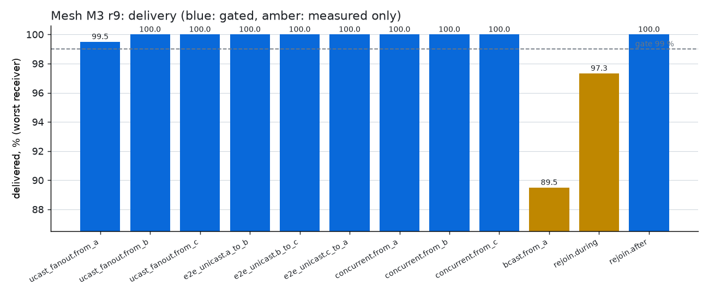
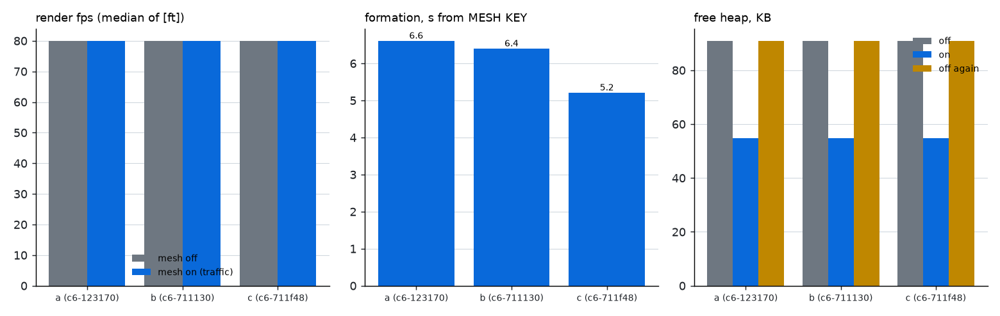

# Mesh M3: the 802.11 backhaul in the mainline player (AP-anchored)

M3 of [mesh.md](mesh.md) §15: the `wifi_p2p` backhaul on our netstack MAC under the M2
`MeshStack`. It is compiled into every netstack player, off by default, and costs no RAM
while off (owner, desk #68). It is AP-anchored (desk #66): fixtures stay on the AP and send
mesh frames on its channel. Mesh-only mode (`kModeMesh`) is the next PR; this one leaves
the seam for it.

Measured with `//pi/hitl/harness:mesh_smoke` on hitl-rig-1 (desk #69): three C6 players
(c6-123170, c6-711130, c6-711f48) on the rig AP (channel 1), each playing a mapped effect
(`plasmaHueFixed`, 60 LEDs, 80 fps). Runs r1–r9 are on 2026-11-19; full logs and JSON are
under `/workspace/.claude/mesh/m3/runs/`.

## Results (r9: PASS)

| Gate | Result |
| --- | --- |
| Mesh forms (every DUT lists every other as a member: link table + advert) | **5.2–6.6 s** from the key (5 s of it is the membership search) |
| Data to everyone, ACKed unicast fan-out (desk #70 default), 200 × 100 B at 50 Hz from each | **99.5–100 %** at both receivers, from all three (one packet lost at each receiver, from a) |
| End-to-end unicast (mesh `want_ack`) a→b, b→c, c→a | **100 %** (200/200 each, every packet acked) |
| All three streaming at once | **100 %** |
| Envelope: a node with the wrong site secret | gets **0** packets, never becomes a member, its frames fail the MIC at the others |
| Envelope: a replayed frame (same envelope, same counter) | 4 replays → **7–8 rejections** at each receiver (0 in an equal window without them), **0** delivered |
| Rejoin: B leaves the AP for 8 s, then rejoins it while A streams 1 500 packets | lease **5.0 s** after the join, back in every table **5.3 s**; **97.3 %** delivered *during* (no reboot), **100 %** after |
| Render with the mesh on (under all of the above) vs off | **80 fps = 80 fps** on all three; worst render interval 12.2–13.1 ms on vs 12.1–15.0 ms off |
| No reset | none in any run since r4; no silent boot in 27 flashes (M3a's one-in-six did not recur; bootfail capture kept) |

Measured, not gated: data as **one broadcast** (`MESH POLICY bcast`) **89.5 %** (r9; 83.5–89.5 % over r7–r9), against
100 % for the ACKed fan-out. This is desk #70's question: the BLE advertising window
(M3a) plus collisions with the mesh's own relays.

Link counters over a run (r9, per DUT): 3 100–9 300 unicast attempts, 12–21 % ACK timeouts
recovered by retries, 15–54 given up (0.2–2 %; the flood's other copies cover them), 0–14
fallbacks to 1 Mb/s, relays cancelled 159–702 times, 28–57 relays dropped for queue room.
RSSI between the boards: −8 to −26 dBm. r8 passed the same gates (its replay check was the
harness's bug: it replayed a beacon); r7 the same but for a lost console marker.

## RAM (desk #68)

Default image (`:esp32c6_netstack`) against its parent commit, from the ELFs:

| | parent | M3 |
| --- | --- | --- |
| `.dram0.data` | 71 504 | **71 504** |
| `.dram0.bss` | 159 280 | **159 280** |
| `.iram0.text` | 100 650 | 100 650 |
| RAM-resident symbols | 213 640 B | 213 644 B: `g_mesh` (4 B, inside existing alignment padding) |
| `.flash.text` / `.flash.rodata` | | **+123 686 / +7 096 B** (+130.8 KB; app bin 2 424 640 B) |

Everything else the mesh uses is in one heap block that `MESH ON` allocates and `MESH OFF`
frees: **36 956 B** of free heap while on (93 112 → 56 156; the state is 22 480 B, the tick's
own stack 14 KB), back to 93 112 after `OFF`. Building it takes a short-lived 26 KB task
stack (22.5 KB used), so the heap's minimum dips to ~30 KB once at `ON`. The dev-only key's
entry point (`ns_mesh_dev_provision`) is not in the default image.

The flash cost is real even when off. On top of the size diet (#569, -267 KB), the default
app with M3 is **2 158 096 B**: `//firmware/loader:layout_test` passes with 135 664 B under its
64 KiB margin (desk D-86: the mesh in every C6 player, off by default). The dev-only site key
stays out of it: only `_meshdev` (the HITL image, never published) has `MESH KEY`, and CI fails
if the shipping ELF links `ns_mesh_dev_provision`.

## What changed

- **`firmware/mesh/src/wifi_p2p.rs`**: the backhaul over a `Radio` trait (pure, host tested):
  - TX is a non-blocking state machine: one frame in flight, never armed over another TX
    path's frame, held for its airtime at the real rate plus the ACK exchange.
  - Unicasts expect the peer's ACK and are retried in software (Retry bit, same sequence
    number, 2/4/6 ms + jitter backoff, 4 attempts).
  - **Unicasts at 6 Mb/s OFDM**: at 1 Mb/s the fan-out and the flood's relays saturated
    the air at 50 Hz (r6: 35 % ACK timeouts, 91–99 % delivery). A neighbour whose unicasts
    are given up 3 times in a row gets 1 Mb/s for 10 s. Broadcasts stay at 1 Mb/s.
  - **Group policy, one switch (desk #70):** data to everyone goes as one ACKed unicast per
    live neighbour (default) or as one broadcast. Discovery is always a broadcast.
    `Backhaul::send_class` carries the hint; its default forwards to `send`.
  - RX: Splanc mesh frames are taken before the STA path, **trimmed to the RX vector's
    `sig_len`** (see below), and the neighbour is learned (MAC, node id from the envelope's
    clear header, RSSI). MAC-retry copies are dropped. Unicasts to other neighbours go to
    the mesh too, because the flood's relay cancellation depends on them.
  - The RX timestamp is mapped onto the node's clock (`RxClock`).
  - `ChannelRule` (§4.2): the mesh is on the AP's channel and follows it on a rejoin or a
    move, announced in the adverts. Mesh TX pauses while a background sweep has the radio
    elsewhere. `Camp` (unassociated, adverts announce another channel) is the `kModeMesh`
    seam; this PR only reports it.
- **`MeshStack::init_in` / `Node::init_in`**: in-place construction; `new` / `with_guard`
  are defined through them. By value, `MeshStack::new` plus `NetOf::new` plus the caller's
  copies took ~53 KB of stack (r2/r3 overflowed 40 and 30 KB). In place: 19.6 KB.
- **`firmware/player_app/mesh_ffi.rs` + `mesh_glue.h`**: the stack in one heap block. The
  console (`MESH ON|OFF|INFO|NB|STATS|POLICY|RATE|TRIES|PWR|TEST|TESTRX|REPLAY`;
  `MESH KEY` only in `:esp32c6_netstack_meshdev`). The RX hook. A per-loop tick that runs
  **on its own stack in the mesh block** (`esp_execute_shared_stack_function`): the tick's
  worst path is 10.75 KB (the swarm's settings-bundle HMAC), and on loopTask that made
  `netstack_loop` 12.6 KB, over its 12 KB. The STA path settles an in-flight mesh frame
  before it arms queue 0.
- **The frame counter's mark** goes to littlefs (`/lfs/mesh_ctr.bin`, temp + fsync +
  rename) before the envelope uses it (§7.5), so a reboot never reuses a nonce.
- **STA TX pacing on the real rate**: the direct path sends at 1 Mb/s (M3a), but
  `tx_pace_after` assumed 6 Mb/s and capped at 4 ms. It now uses 1 Mb/s airtime + SIFS +
  ACK, capped at 16 ms.
- **HITL**: `//pi/hitl/harness:mesh_smoke` is new. M3a's spike harness is now `:mesh_spike`.
  A failing phase is recorded and the run goes on; every DUT's counters are snapshotted
  after each phase, and the full serial logs are kept.

## Found on the way

- **The reaped RX length is rounded up to 4 bytes.** Up to 3 junk bytes follow the MPDU,
  which the envelope's MIC and the exact-length membership messages don't survive. In r5,
  every advert was "malformed" and every frame whose length was not a multiple of 4 failed
  the MIC. M3a's fixed 256-byte probes never showed it. The RX vector's `sig_len` (MPDU +
  FCS) is exact; the backhaul trims to it.
- **`//tools/stack_bound` under-counts long calls** (`auipc` + `jalr`): it reported
  `ns_mesh_create` at 22.7 KB and the mesh tick at 2.8 KB, while the call graph gives
  ~53 KB and 10.75 KB. The firmware's other bounds may be low for the same reason. Not
  fixed here.

## What M4 (mesh time) needs from M3

- **RX time**: `RxMeta::rx_us` is the RX vector's hardware timestamp mapped onto
  `esp_timer`, with the offset taken as the floor of the reap lag over 10 s windows
  (`ts_off_us` ≈ 688 ms on these boards). M4 should fit the hardware clock against
  `esp_timer` (offset and drift) instead of the floor, which follows the drift only by
  window.
- **TX time**: there is no hardware TX timestamp. The backhaul knows when a frame was
  armed and when the MAC reported it done (polled; the pump spins up to 3 ms per loop).
  Under BLE the MAC can hold an armed frame ~10 ms. So a time beacon stamped at seal time
  is wrong by up to the queue + hold time. M4 needs one of:
  - a two-step stamp (the completion time in a follow-up);
  - two-way exchanges on unicasts, using both RX timestamps and the peer's turnaround;
  - the probable ACK-TX timestamp in the RX vector (bytes 76–79, M3a).

  The backhaul should expose `(armed_us, done_us)` per frame. Time beacons must be
  broadcasts (no retries: a retry carries the first attempt's stamp).
- **The beacon itself**: §6.2 re-stamps time in each node's `BEACON` (Summary + time).
  `TIME_BASE` is an admin-class port: the show clock needs an unlocked gateway session (M5)
  or a non-admin time field in the beacon.

## Open (owner)

- **Desk #70**: unicast fan-out 99.5–100 %, one broadcast 83.5–89.5 % (with the mesh's own relay
  traffic). The fan-out costs one frame per neighbour: fine for a few fixtures, to be
  revisited with the tree/relay work for many.
- **Desk #73**: +130.8 KB flash in the default image.
- **AP channel change**: the rig AP is the host's, and there is no API to move it (a host
  change would go upstream in hitl-reserve). The test drives a rejoin instead. The follow
  logic is host tested.
- **Unicast rate**: 6 Mb/s by default with a 1 Mb/s fallback (design §4.6's adaptation
  in its simplest form). Range through the radiolarian enclosures is still R0's.
