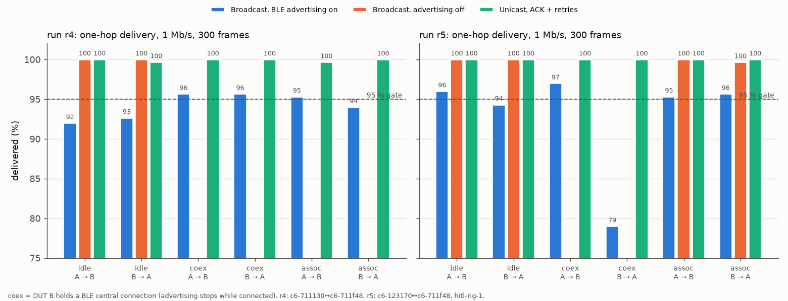
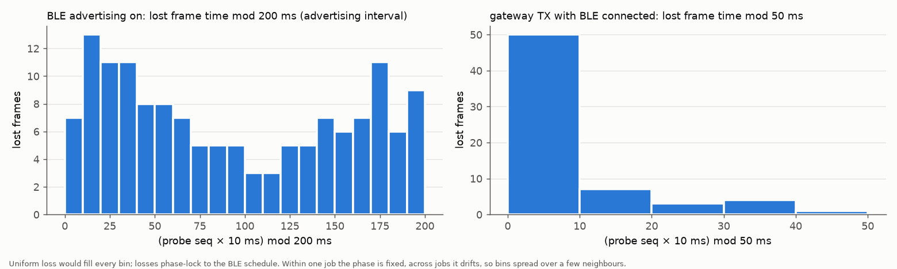
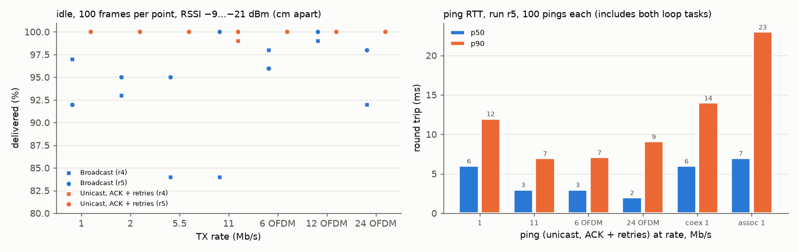

# Mesh spike M3a: Splanc frames on our netstack (results)

The spike that gates M3 (docs/design/mesh.md §4.4, PR #516). Two ESP32-C6 DUTs on hitl-rig-1
run **our** netstack (`//firmware/player_app:esp32c6_netstack_meshspike`, no vendor Wi-Fi
on the mesh path) and exchange Splanc Public Action frames: category 4, action 9, the
Splanc CID `0A:5C:4D`, kind `0xF3` (link probe, test-only), each carrying an **M2 envelope**
(AES-128-CCM, long header, 64-bit counter, MIC 8, replay window) under a dev-only key.
No Espressif OUI and no ESP-NOW framing anywhere.

Measured by `//pi/hitl/harness:mesh_smoke` (runs r4 and r5, 2026-11-19; full logs and JSON
under `/workspace/.claude/mesh/m3a/runs/`). The boards sit centimetres apart (RSSI −8 to
−22 dBm), so these numbers say what the radio path does, not what range it has (that is R0).

## §4.4 exit criteria

| Criterion | Result |
| --- | --- |
| Frames both ways, associated (rig AP, its channel 1) | **Unicast with ACK + retries 99.7–100 %**; broadcast 94–96 % with BLE advertising, **99.7–100 %** without |
| Frames both ways, not associated (radio up, channel 6) | **Unicast 99.7–100 %**; broadcast 92–96 % with BLE advertising, **100 %** without |
| Association survives mesh traffic | Yes: no deauth/disassoc, lease kept through ~1 900 mesh frames per run |
| Unicast MAC retries on our TX path | **Work** (software retries, see below): to a MAC nobody answers, every MPDU went out 4× (113–117 ACK timeouts of 120 attempts), the copies after the first with the Retry bit, all seen by the overhearing peer |
| RSSI from the RX vector | Byte 0 (signed dBm). Moves with TX power exactly as expected (−19 → −29 → −39 dBm for power bytes 0x14 → 0x0C → 0x04) |
| RX timestamp from the RX vector | **Found**: bytes 12–15, a 1 MHz clock a constant ~0.70 s behind `esp_timer` (offset stable to ~2 ms over minutes) |
| TX timestamp | No hardware TX timestamp for our own frames; completion is polled (µs-resolution software stamp). The receiver's vector does carry a **probable ACK-TX timestamp** (bytes 76–79, present only on unicast to us: RX ts + 2 130 µs for a 260-byte 1 Mb/s frame) |
| Loss with BLE active | Gateway (BLE central connected) **receives** broadcast 96–97 %; **transmits** broadcast 79–96 %; unicast both ways 100 % |

`mesh_smoke`'s gate: ≥ 95 % both ways, idle and associated, for unicast and for broadcast
with advertising off; timestamp validated; no DUT reset. **r5: PASS.**

## What the spike found

**Our direct TX path sent everything at 1 Mb/s with "no ACK expected".** PLCP1's rate
field (bits 12–16) was always 0, and PLCP0's ack-type field (bits 24–26) 0. With ack-type 0
the MAC never waits for an ACK, so there was no completion status and no possibility of a
retry. M3a adds `TxRing::set_rate_ex` / `arm_ex` (ack-type 1) and the completion poll
(`TXQ_STATE_B` bit q, the PMD word's status nibble: 0 OK, 5 ACK timeout).

**Retries are software on the C6** (`lmacProcessTxComplete` in the blob): the MAC reports
one attempt; the driver re-arms. The spike retries up to 4 attempts with the Retry bit, the
same sequence number, and a growing backoff (2, 4, 6 ms + jitter). Without the backoff, all
4 attempts could land inside the same BLE event and the frame was lost (r3: 94–99.5 %); with it,
100 %. The receiver's replay window drops the duplicates a lost ACK produces before any AES.

**The rate encoding is the vendor's `wifi_phy_rate_t`** (read off silicon by
`//firmware/netstack:wifi_tx_rate_probe`, the vendor stack as an oracle): PLCP1 =
rate << 12 | (length + 4); RESP_DUR carries the response rate (6, 12 or 24 Mb/s for OFDM).
6, 12 and 24 Mb/s OFDM and 2/5.5/11 Mb/s CCK all go out on our path; the receiver's RX vector
reports the same code. Golden words are in `p2p.rs` tests.

**BLE advertising costs broadcast ~4–8 %.** The player advertises every 200 ms; each event
blinds the receiver for one 1 Mb/s frame. Lost probes fall ~20 apart at 10 ms spacing, and
with advertising stopped (`MESH BLEADV 0`) broadcast is 100 %. A BLE *connection* stops
advertising, so a gateway with a phone attached receives better (96–97 %) but transmits worse:
with a 50 ms connection interval, every frame armed inside the BLE window was lost (79 %,
r5; r4 96 %, interval not captured). Unicast retries recover both cases.

**High rates saturate at centimetre range.** 11 and 24 Mb/s broadcasts lost up to 24 % at
power byte 0x14 and RSSI −16 dBm; at 0x0C/0x04 (−24 to −39 dBm) they delivered 97–99 %. The
field kit's 24 Mb/s numbers at short range carry the same effect.

**Latency.** Ping (unicast, ACK + retries) RTT p50 6 ms at 1 Mb/s, 2–3 ms at 11/6/24 Mb/s;
p90 7–12 ms idle, 14 ms with BLE connected, 23 ms associated. The estimated one-way (RTT minus
the peer's turnaround, halved) is 0.5–3 ms. Both loop tasks are inside these numbers.

**Crypto.** Seal 0.23 ms, open 0.22 ms per 200-byte body (`ccmp.rs`, HW AES).

## RX vector (92 bytes, `RX_VECTOR_HDR`)

It is the vendor's `esp_wifi_rxctrl_t` for MAC v2 in size; the fields that are filled in by
hardware, checked on silicon:

| Bytes | Field | Evidence |
| --- | --- | --- |
| 0 | RSSI, int8 dBm | tracks TX power; byte 21 repeats it |
| 1 bits 0–4 | rate code (`wifi_phy_rate_t`) | 0/1/2/3 for 1/2/5.5/11, 0xB/0xA/0x9 for 6/12/24 |
| 2–3 bits 0–11 | MPDU length incl. FCS | = sig_len |
| 12–15 | RX timestamp, µs | Δ matches the sender's spacing; constant offset to `esp_timer` |
| 20 | noise floor, int8 dBm | −96 / −97 |
| 39 bits 0–3 | PPDU format | 0 = 11b, 1 = 11g |
| 76–79 | ACK TX timestamp? | only on unicast to us; RX ts + 2 130 µs |
| 84–85 | sig_len (MPDU + FCS) | = frame + 4 |
| 86–87 | "dump_len" | = frame + 8 (not frame, as the vendor header says) |

Not in the hardware vector: the channel (byte 21 is the RSSI again) and the group bit
(byte 11 varies frame to frame); the vendor fills those in software. M3 takes the channel
from its own tuning and group-ness from A1.

## RAM and the enable switch (owner, desk #68)

The default player image has **none** of this code (no `mesh_spike`/`ns_mesh_`/`ns_p2p_`
symbols; `.bss` identical). In the spike image every buffer lives in one 5 720-byte heap
block that `MESH ON` allocates and `MESH OFF` frees (free heap 87.7 KB on, 93.3 KB off); the
transport only holds the pointer, and with it null both RX paths reap exactly as before. M3
moves that switch into mainline as is.

## Follow-ups for M3

- **Unicast with ACK + retries + backoff** for anything that must arrive (replies to the
  gateway, effect blobs). Done in the spike; move to the backhaul.
- **Broadcast vs BLE**: pick one (owner): slower or paused advertising while meshing, mesh
  TX scheduled outside the gateway's BLE windows (§4.3, M3b), or flood redundancy so one
  missed frame per 200 ms does not matter.
- **Power control** for short-range installs at high rates (the 0x54ac power byte).
- Pacing in `tx_pace_after` must use the real rate (the old 6 Mb/s assumption was wrong for
  every direct-path frame, which went at 1 Mb/s).
- One boot in five runs printed the bootloader banner after a flash, then nothing, with
  its USB port gone until a reset; `mesh_smoke` records it (`bootfail-*.log`) and resets.
  Not reproduced since; root cause open.
