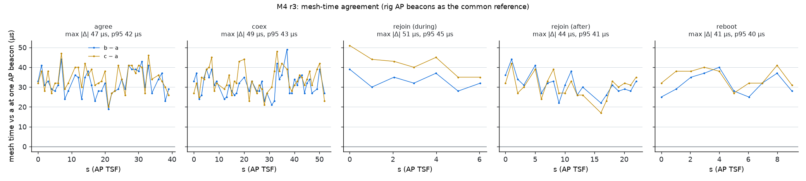
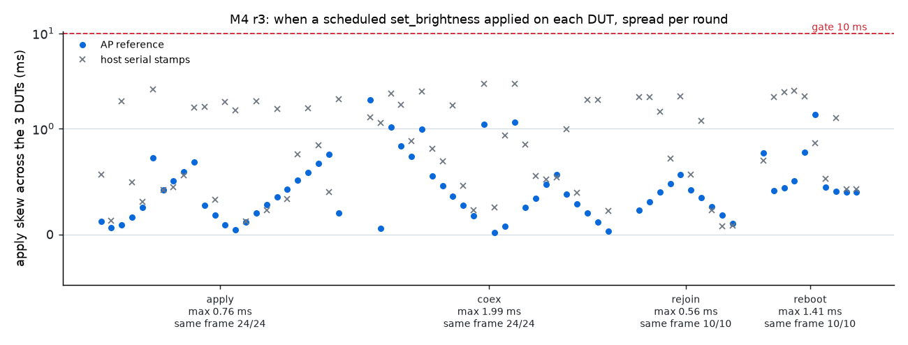

# Mesh M4: mesh time and apply_at across the mesh

M4 of [mesh.md](mesh.md) §15: mesh time from time beacons (§6.2), the show epoch mapped onto
each member's existing time base (§6.3), so a change scheduled with `apply_at_ms` lands on
every member at the same instant. Stacked on [M3](mesh-m3.md) (#565). Gate: **skew < 10 ms**.

Measured with `//pi/hitl/harness:mesh_apply_at_skew` on hitl-rig-1 (desk #69): three C6
players (c6-123170, c6-711130, c6-711f48) on the rig AP, each playing `plasmaHueFixed`
(60 LEDs, 80 fps), built as `:esp32c6_netstack_meshdev` (the default image plus the dev-only `MESH KEY`). Logs and JSON:
`/workspace/.claude/mesh/m4/runs/`.

## Results

Run r3 (2026-11-19, PASS; r1 and r2 also PASS, below). "Skew" is the spread across the three
DUTs of when a scheduled `set_brightness{apply_at_ms}` applied, against the AP reference.

| | Result (r3) |
| --- | --- |
| **Apply skew**, effect at 80 fps, 24 rounds | median **0.28 ms**, p95 0.72 ms, max **0.76 ms**; every round on the same frame on all three (24/24) |
| Apply skew, DUT b holding a BLE central (75 s, never dropped), 24 rounds | median 0.37 ms, p95 1.16 ms, max **1.99 ms**; 24/24 same frame |
| Apply skew after b left the AP for 8 s and rejoined (lease 6.2 s), 10 rounds | median 0.33 ms, max **0.57 ms**; 10/10 same frame |
| Apply skew after c rebooted (USB reset; MESH ON + key again), 10 rounds | median 0.44 ms, max **1.41 ms**; 10/10 same frame |
| **Mesh-time agreement** at 38 AP beacons, after settling | \|b−a\|, \|c−a\| median 32 µs, p95 42 µs, max **47 µs** (b−c within ~10 µs) |
| Agreement under BLE coex / during the rejoin / after it / after the reboot | max 49 / 51 / 44 / 41 µs |
| Formation → mesh time synced | members 5.6 s after the key, synced 6.7-6.8 s (a 1.5 s listen, then founding) |
| Reboot | c **joined** the running mesh time (never founded a second one), synced 5.0 s after its key |
| Render | **80 fps** on every DUT in every phase, as with the mesh off; worst frame interval 16.0 ms (off: 15.0 ms). The one dip is c's own boot after the reset (45 fps, first second) |
| Resets | none outside the deliberate one |
| Reference error (`oracle_rms_us`) | 0.44-0.56 µs per DUT (r3); host-serial cross-check median 0.66 ms, max 2.6 ms (USB jitter) |

Earlier runs (same firmware but the RX clock): r1/r2 mapped RX stamps through M3's reap-lag
floor (the hardware counter wasn't found yet): agreement max 169 / 221 µs, apply skew max
1.60 / 1.33 ms; r2 found the counter (below). r1's coex phase had the BLE central dropped
after 7.5 s (the firmware drops a central when a new wss client appears); from r2 the
harness opens its sockets before the BLE hold.

**Budget left.** Of the 10 ms gate, mesh time uses ~0.05 ms. The rest of the measured skew
(0.3-2 ms) is each member's frame start: render sleeps in 1 ms FreeRTOS ticks, so its frames
land within a tick of the grid point, and under BLE coex or a busy loop a frame can start
a tick or two late. A sub-tick wake (an esp_timer one-shot) would take it to ~0.1 ms; not
needed for the gate.

## How the skew is measured

The rig has no logic analyser on the C6 strips (its analyser's one channel is on
pi-ledmapper-1), so the reference is the rig **AP's beacons**. Every member hears each beacon
at the same instant (± propagation, nanoseconds). Once per AP-TSF second each member logs the
AP's TSF, the beacon's hardware RX time on its own clock (the RX vector's stamp, mapped onto
`esp_timer` the way mesh time maps every frame), and its mesh time at that instant:

- **Agreement** is the difference of the members' `mesh` values for one beacon: their
  disagreement at that instant, with nothing in between.
- **Apply skew**: each member logs `esp_timer` at the start of the frame that applied the
  change; that instant maps onto the AP's TSF through the member's own (rx, tsf) pairs
  (linear between the two bracketing beacons, so its crystal's drift against the AP is
  taken out). The spread across members, per round, is the skew. Mesh time is not used.
- **Error bars of the reference**: the scatter of each member's (rx, tsf) pairs about a line
  (`oracle_rms_us`), which contains the RX-stamp jitter, the RX-stamp-to-`esp_timer`
  mapping's wobble and the AP's own beacon timing. Agreement and skew are good to about
  that much (tens of µs).
- **Cross-check without the radio**: the serial bridge stamps every console line with the
  rig's `CLOCK_MONOTONIC` (all three reservation containers share it). The apply lines'
  stamps give the skew through USB serial (latency jitter ~1-4 ms): an upper bound that
  agrees with the AP reference to within that jitter.
- **What "applied" means**: the start of the render frame that applied the change. The
  LEDs show that frame after its compute and its transmit (60 LEDs), the same work on every
  member, so the visible skew is the frame-start skew plus the members' compute-time
  jitter (sub-ms on this effect; not separately measured: the rig has no analyser on the
  C6 strips).

## Design

### TX stamp: two-step (M3 handoff)

The C6 has no hardware TX timestamp and its MAC can hold an armed frame ~10 ms while BLE has
the radio, so a stamp taken at seal time is wrong by the queue and the hold. Of M3's three
options:

- **Two-step (chosen).** The backhaul brackets each time beacon's *completion*: it reads
  `esp_timer` before every MAC poll, so the completion lies between the last poll that saw
  the frame in flight and the poll that saw it done; the midpoint is the stamp, half the
  bracket its error. The next beacon carries it. Receivers drop stamps with a bracket over
  150 µs (the poll was preempted, or the MAC reported late). Broadcast, never retried.
- Two-way unicast exchanges (NTP-style) still need TX times on both ends and are O(n²)
  unicasts; a retried unicast carries the first attempt's stamp.
- The probable ACK-TX timestamp (RX-vector bytes 76-79) times the ACK *we* send for a frame
  we received; it says nothing about when our own beacon left. Not used.

**Two-way over broadcasts.** Each beacon also carries the sender's current fit of each
neighbour. The two directions sum to `-2L` (L: the constant delay from "done" to the
receiver's RX stamp: airtime, the RX vector's reference point, the poll), so `L` drops out
of the offset without knowing what the RX vector stamps.

The backhaul exposes every frame's `(armed_us, done_us)` (`WifiP2p::last_tx`, `TxStamp`) and
its worst hold (`hold_max_us`).

### RX clock: the MAC's µs counter

The RX vector's 1 MHz stamp is **not** the TSF counter at `0x600AD020`: on our netstack that
register reads frozen (≈1.4 s, the MAC's start) raw and after the vendor latch sequence
(r1, `tsf probe`). A scan of the MAC blocks (`MESH REG`, dev image, r2) found the clock at
**`0x600AD000`**: it advances 1 µs per µs and runs a constant 0.688 s behind `esp_timer`,
exactly the RX stamps' offset. The transport reads it next to `esp_timer` every loop pass
(`RxClock::anchor`, reads with a bracket over 6 µs skipped), and every RX stamp maps exactly:
in r3 all frames mapped through it, the smallest reap lag was +142 µs (so the stamps are this
clock), the counter's drift against `esp_timer` −14 ppb (the same crystal) and no jumps. M3's
reap-lag floor stays as the per-frame fallback for an implausible mapping. Agreement went from
max 169-221 µs (floor, r1/r2) to 47 µs (r3).

### Mesh time (`firmware/mesh/src/meshtime.rs`)

- **Beacons**: link `FRAME_TYPE_TIME` (swarm_wire.proto, new), one hop, sealed in the mesh
  envelope (members only; replays fail its counter window), every 500 ms (jittered).
- **Per-neighbour fit**: a least-squares line (offset and drift) over the last 12 samples,
  outliers (> 5 MADs) dropped, reset after 3 outliers in a row (the neighbour rebooted).
- **States**: *unsynced* joins the synced neighbours' aggregate; if none is synced after
  1.5 s it *founds* mesh time at the latest clock it hears (nobody's time steps back);
  *forming* (10 s): founders converge on the latest, a synced neighbourhood wins;
  *synced*: `timesync`'s Marzullo over itself and its neighbours, then the inverse-variance
  mean of the agreeing sources; steps need a quorum, slews ≤ 500 ppm.
- No root, no leader: every member is one source among its neighbours (§6.2).

### The show epoch: a time field outside the admin port

`TIME_BASE` is an admin-class port, which needs M5's unlocked gateway session. M4 carries
the epoch in the time beacon instead: `(generation, origin, epoch in mesh µs | cleared)`,
gossiped by every member, newest generation wins. On each member, `mesh_ffi.rs` maps it onto
the player's time base (`player().set_time_base_ms`, main.cpp `lm_mesh_tb`, a try-lock so
the mesh never waits on a frame) and re-maps it as mesh time slews, moving the queued
`apply_at` changes by the same amount so they keep their frames. A `set_time_base` the app
sends to *this* device originates the next generation (`MeshStack::originate_epoch`): that
is the seam M5 restricts to the gateway's admin session.

### Frames on the grid

Without more, a member applies a change at its first frame start after the due time, and
frame phases are independent: at 80 fps two members would differ by up to 12.5 ms. While the
mesh's time base is set:

- render paces its frames onto `epoch + k·period` (at most a quarter period of correction
  per frame, so the cadence never jumps);
- a scheduled change applies on grid frame `ceil(apply_at / period)`: the due time is
  compared with the frame's grid instant, not with `millis()`, so a frame start that
  jitters by a tick still applies on the same frame on every member.

So every member changes on the same frame index (24/24 rounds in r1), and what remains is
mesh-time disagreement plus each member's 1 ms tick phase.

## Cost

- **RAM, default image** (`:esp32c6_netstack` vs M3): `.dram0.data` and `.dram0.bss`
  byte-identical. The one new static (`g_tb_align`, 1 B) sits in existing padding.
- **Heap while on**: **40 460 B** (93 112 → 52 652; the block is 40 336 B: M3's state + 14 KB
  tick stack + mesh time 2.6 KB + a 1 KB log), against M3's 36 956 B; back to 93 112 after
  `MESH OFF`. The create task still dips the heap minimum to 25.6 KB once at `ON`.
- **Flash**: +28.4 KB text, +2.4 KB rodata over M3 (+31.1 KB; with #569's size diet the
  default app is 2 189 088 B, 104 672 B under `layout_test`'s 64 KiB margin; desk D-86). About a third is the console reports
  and logs; the clock fit, aggregation and beacon codec are the rest (i64 only: no 128-bit
  division linked).
- **Stack** (call graph over the ELF, `auipc`+`jalr` long calls resolved, M3's method):
  `ns_mesh_create` 22.6 KB (unchanged, 26 KB task), `ns_mesh_tick` 8.4 KB (M3: 8.6 KB with the
  same walk; its own 14 KB stack), `lm_mesh::service` frame 496 B (+32 B).

## Open

- **A ~32 µs constant offset of DUT a** against b and c (b and c agree within ~10 µs) in
  every r3 phase. The two-way estimate cancels a *symmetric* delay; this is an asymmetric one
  on a's links (most likely its done-poll latency: a's pump loop differs, e.g. it held the
  app's session). Harmless at this gate; the next step if anyone needs < 10 µs.
- **Coarse stamps**: 14-17 % of completion brackets exceed 150 µs (BLE holds up to 18 ms,
  loop preemption) and are not used; one beacon in six then carries no sample.
- **Who may originate a show epoch**: any member today (closed mode: every member holds the
  site secret). M5 gates `originate_epoch` on the gateway's admin session; locked/open modes
  need a signed epoch (the admin `TIME_BASE` port).
- **Two synced meshes merging** with clocks seconds apart and equal sizes have no quorum to
  step, so they converge only at the 500 ppm slew. Not reachable AP-anchored on one site;
  revisit with partitions (M10).
- `stack::mesh_time_s` (grant expiry) still runs on the local clock.
- `//tools/stack_bound` is not fixed here (M3's finding); the numbers above are the call-graph
  walk.

## What M5 (gateway fan-out from the phone) needs from M4

- **Time base**: nothing new. The phone's `set_time_base` on the gateway already originates
  the mesh epoch; members apply it. M5 decides who may originate (gate
  `MeshStack::originate_epoch` behind the gateway's session) and may move the epoch onto the
  admin `TIME_BASE` port for locked/open modes (signed epochs).
- **Relayed control with `apply_at_ms`**: dispatch `Event::Control`'s inner `ClientMessage`
  through `lm_player_handle` as if it came from the app; the member's time base is already
  the mesh's, so `apply_at_ms` means the same instant everywhere. Lead: ≥ 150 ms one hop.
- **Mesh time API**: `MeshStack::time.mesh_us(local)` / `local_us(mesh)` / `synced()`, for
  `send_live` keyframes (`interp`) and `MeshStatus` (state, offset, error, peers).
- **Grants**: `stack::mesh_time_s` still runs on the local clock (TODO(M4) kept): switch it
  to mesh time when M5 validates grant expiry across members.
