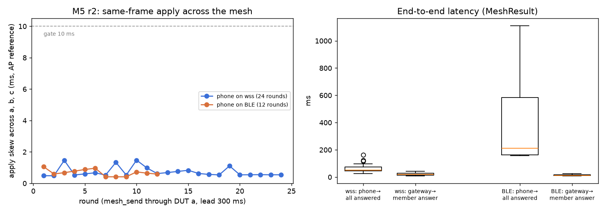
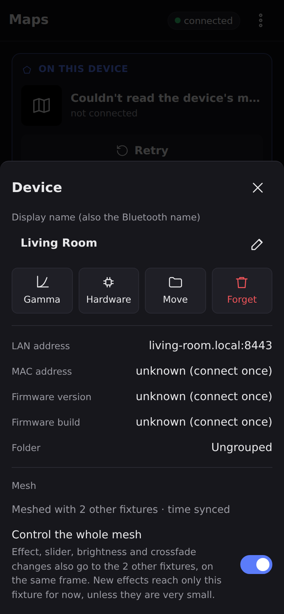

# Mesh M5: gateway fan-out from the phone

M5 of [mesh.md](mesh.md) §15: the protocol arms (`mesh_send`, `get_mesh`, one `mesh` reply
arm), gateway fan-out and aggregation, the member's relay allow-list, member status, and the
`mesh_gateway` HITL. Stacked on [M4](mesh-m4.md) (#566). This is the last step of the spike
goal (desk #63): a phone connected to one fixture changes the effect and sliders on all of
them.

Measured with `//pi/hitl/harness:mesh_gateway` on hitl-rig-1 (desk #69): three C6 players
(c6-123170, c6-711130, c6-711f48) on the rig AP, built as `:esp32c6_netstack_meshdev`
(desk #76). Logs and JSON: `/workspace/.claude/mesh/m5/runs/`.

## Results

Run r2 (2026-11-19, **PASS**; r1 identical but for the gate below). The client is the HITL
driver; on wss it holds one socket to DUT a only, on BLE the rig's adapter is the "phone"
(`mesh_ble_gateway.py` in a's reservation container). b and c are never addressed directly.

| | Result (r2) |
| --- | --- |
| **Apply skew**, phone on wss: 24 rounds of `mesh_send` (brightness, crossfade A↔B, slider), lead 300 ms | median **0.59 ms**, p95 1.46 ms, max **1.48 ms**; 24/24 rounds applied on all three, all on the same frame |
| **Apply skew**, phone on BLE: 12 rounds of `mesh_send{set_brightness}` | median **0.66 ms**, max **1.06 ms**; 12/12, same frame |
| Per-member results (pushed `MeshResult`) | **every member OK in 24/24** (wss) and **12/12** (BLE) |
| End-to-end, phone → every member answered | wss median **52 ms**, p95 122 ms, max 163 ms; BLE median 211 ms, p95 862 ms (the BLE link's write-with-response and connection interval, not the mesh) |
| Gateway → member answer (ACKed unicast both ways) | median 19.5 ms, max 44 ms (wss phase); 11.5 / 24 ms (BLE phase) |
| Gateway's own reply (as without the mesh) | median 26 ms |
| **Effect deploy through the gateway**: `submit_effect` (`meshHue`, 71 B fxb, 89 B inner) onto deck B | both members OK, **45 ms** to every answer; the crossfade rounds then switch every fixture between the two effects on one frame |
| Live fader drag: 60 seq'd `set_uniforms` at 20 Hz, on arrival | 60/60 acked by the gateway, **60/60 dispatched by each member** |
| **Refused on members** (relayed raw, `MESH CTL`): rename (27), time base (38), OTA begin (70), Wi-Fi policy (90), kiosk unlock (94) | **each refused by both members**, none dispatched; the gateway refuses a `mesh_send` carrying one (`MESH_SEND_NOT_ALLOWED`) |
| Desk #79: DUT b's own app sets a time base | refused (`[mt] epoch refused`), b keeps following; a's session starts gen 1 and b, c map it |
| Render | **80 fps** on all three in every mesh phase (baseline 80, c 75 in one baseline window); see the deploy note |
| Heap with the mesh on | free 49 292 B (93 112 → 49 292: **43 820 B**, M4 40 460 B); back to 93 112 after `MESH OFF` (a: 93 012) |
| Resets | none |

r1 failed one gate only: its control phase began with the fps autoscaler's restart after
the deck B upload (`ffi.rs` `FPS_GEN`: any change to what renders, mesh or not, restarts the
search at 30 fps and climbs to 80 over ~6 s; the setup's direct upload shows the same ramp).
r2 waits it out inside the deploy phase (`fps_exempt`), so every control phase measures the
mesh. All r1 numbers match r2 (skew max 1.57 / 1.44 ms, 24/24 and 12/12 OK, refusals).

The app's switch (device sheet, phone width; desktop and the off state in the PR):

## What a phone can do through one fixture now

| | Works now | Waits for |
| --- | --- | --- |
| Brightness, crossfade (deck A ↔ B: the visible effect changes), sliders (`set_uniforms`), keypoint blends | yes: on every member, on the same frame (`lead_ms` on the show clock) | |
| Live fader drags (seq'd `set_uniforms`, commit off) | yes: on arrival, no reply traffic | M6/M8: coalesced `send_live` with member-side interpolation (§6.4) |
| A new effect program | if its `submit_effect` fits one mesh packet (~170 B: an effect with no uniforms, e.g. the 71 B `meshHue`); bigger ones reach the connected fixture only | **M6** (blob distribution) |
| `set_effect` by id | toggles a deck on every member (on the C6 a deck holds one effect, so "switch effect" is a crossfade to the other deck) | M6 (effect store by blob id) |
| Member list, targets (one fixture, a group) | `get_mesh` lists the members (RSSI, fps, heap, sync, last error); `MeshTargets.nodes` / `group` work on the wire | **M8** (app list and target picker) |

## Design

### Protocol (ledmapper.proto)

- `ClientMessage.mesh_send = 99`: `MeshSend{op_id, targets{nodes, group, skip_gateway},
  inner (one encoded ClientMessage), want_reply, timeout_ms, lead_ms}`.
- `ClientMessage.get_mesh = 100`: reply `mesh.state`.
- `ServerMessage.mesh = 55`: `MeshInfo{oneof result | state}`. One reply arm, not two:
  each server arm grows the by-value `ServerMessage` decode frame in the debug host builds
  (the fx_debug lesson; `//firmware/ota:wire_test` passes).
- The firmware profile (gen_main.rs) skips every variable-size field of these messages: the
  netstack player encodes them by hand in `mesh_gw.rs`, and the player core answers both arms
  `error{unsupported}` (as every non-mesh player does). A golden frame is shared by the Rust
  and the web tests.
- Additive and backward compatible. The C6 players (the mesh is in every one, off by
  default) advertise `"mesh"` in `welcome.features`; the app sends `get_mesh` and shows the
  mesh UI only to those players, and only when `get_mesh` lists members. Players without the
  mesh (the P4, the C3, firmware before it) never get a mesh arm from the app, and answer one
  with an error (`unsupported`, or `bad_message` before the arms existed). With the mesh off,
  a C6 player answers `get_mesh` with `state{on: false}` and `mesh_send` with
  `result{error: NO_MESH}` (`mesh_gw.rs` `ns_mesh_app_off`).

**The direct reply to `mesh_send` is the gateway's own reply to `inner`** (`playback_state`,
`welcome`, `control_ack`, `result_ready`), exactly as if the app had sent `inner` alone, so
every existing request/response path in the app keeps working with whole-mesh control on.
Only a refusal (`MeshResult.error`) or `skip_gateway` answers with `mesh.result`. With
`want_reply`, the aggregated `MeshResult` is pushed when every expected member answered or
`timeout_ms` passed.

### Gateway (any fixture an app connection opened a session on)

`lm_ws_dispatch` (main.cpp), after the kiosk gate, hands `mesh_send` / `get_mesh` to
`ns_mesh_app` (mesh_gw.rs) with the connection (0 wss, 1 BLE):

1. **Session.** On a mesh with no admin key (the dev site key, desk #67), the first mesh arm
   on a connection opens the gateway's admin session for it (`MeshStack::open_gateway`); it
   ends when that connection drops or is replaced (`ns_mesh_conns`, polled each loop pass).
2. **Allow-list** (`splanc_mesh::gateway::relay_arm`): `submit_effect` (one packet),
   `set_effect`, `set_uniforms`, `set_brightness`, `set_crossfade`, `blend_keypoints`.
   Anything else is refused before it is sent (`MESH_SEND_NOT_ALLOWED`): no firmware
   update, rename, Wi-Fi credentials or policy, kiosk unlock, time base or trust.
3. **Scheduling.** With `lead_ms`, the gateway stamps `apply_at_ms = now − epoch + lead` (its
   time base is the mesh's show epoch, M4) into `inner` (`with_apply_at`), so it and every
   member apply it on the same grid frame. No epoch yet: the session starts one (desk #79)
   and that first message goes on arrival.
4. **Fan-out.** One flood of `CONTROL` (`op_id ‖ flags ‖ targets ‖ inner`); the backhaul sends
   data-to-everyone as ACKed unicasts per neighbour (desk #70).
5. **Local dispatch.** Unless `skip_gateway`, `inner` comes back to the C++ and is dispatched
   here through the same path an app message takes (the live mailbox or the shared handler).
6. **Aggregation** (`Fanout`): the gateway's member table (adverts, status, replies) gives
   the expected set; each member's `ReplyMsg` (op, status, arm, code) fills it in; the
   `MeshResult` is pushed to the connection when complete or timed out.

### Member

Relayed control arrives as `Event::Control` in the mesh tick (on the tick's own stack). The
member checks the allow-list itself (never trusting the gateway's check): a refused arm is
logged (`[mesh] ctl refused`) and answered `REFUSED`. Allowed ones wait in a two-slot inbox
in the mesh block until the transport, back on loopTask's stack, dispatches them through
`lm_mesh_member_dispatch` exactly like an app message (minus the kiosk gate and the transport
reply); the outcome goes back as a `ReplyMsg` (ACKed unicast) when the gateway asked.

Every member broadcasts a 27-byte `StatusMsg` on `STATUS` every 10 s and on a change
(firmware hash, uptime, heap, fps, brightness, mesh-time state and error, last error): what
`get_mesh` lists.

### Trust in M5: the envelope (dev site key)

The admin-class `CONTROL` port was designed for M7's signed sessions (per-receiver MACs under
pairwise ECDH keys, §7.9). On the C6 the device key is still M2's placeholder (no ECDH) and
the app cannot sign grants yet, so M5 adds **envelope trust**: a mesh provisioned with no
admin public key (the dev site key, desk #67) accepts admin-class packets framed for session
0 on the strength of the mesh envelope alone, i.e. from any member. A mesh that holds an
admin key refuses that framing (`RouteReject::Untrusted`), so M7's sessions slot in behind
the same `send_admin` / `Router::route` seam with no protocol change. Until then the insider
caveat of §7.9's first draft applies to dev meshes: a member holding the site secret could
forge control. Members still refuse everything off the allow-list.

### Who may start a show epoch (desk #79, pending)

Built as the recommended option: **only the gateway, through its admin session**.
`MeshStack::originate_epoch(EpochSource, ..)` checks `EPOCH_POLICY`
(`EpochPolicy::GatewaySession`): an app's `set_time_base` starts a new epoch only when it
came over the connection holding this fixture's gateway session (main.cpp notes the arm,
`ns_mesh_app_time_base`); a member's own `set_time_base` is refused (`[mt] epoch refused`)
and its time base goes back to the mesh's. The console (`MESH EPOCH`, physical access) may.
The other answer (any member) is the one-line change `EPOCH_POLICY = EpochPolicy::AnyMember`.

### Grants on mesh time

`stack::mesh_time_s` is gone: grant expiry, renewal and session checks use
`MeshStack::mesh_s`, mesh time once synced (the local clock before).

### BLE and wss

The firmware drops a connected BLE central when a **new wss client** connects
(netstack_transport.cpp, deliberate: the post-provision BLE link would otherwise steal
coex airtime during the TLS handshake, and wss needs BLE's heap). It does not drop wss for
BLE. So the demo works with the phone on either transport as long as one phone holds one
transport to the gateway: on BLE, nothing may open wss to that same fixture. The HITL runs
the wss phase, closes it, then the BLE phase.

## Cost

- **RAM, default image** vs M4: `.dram0.data` 71 504 and `.dram0.bss` 159 280, byte-identical
  (desk #68). The transport's buffers for relayed control, results and the console live in
  the mesh block (`ns_mesh_xfer`, 512 B); session edges and the status timer too.
- **Heap while on**: 43 820 B (+3.4 KB over M4: the member table and pending ops for 16
  members, the two-slot inbox, the rescheduled inner and the transport buffer). The heap's
  minimum dips to 22.3 KB once, at `MESH ON` (the create task's stack), as before.
- **Flash** (default image): **+28.4 KB text, +2.1 KB rodata** over M4 (`.flash.text`
  2 036 872 B). Mostly the gateway path inlined into `ns_mesh_app` (7.4 KB with the hand
  protobuf encoders), the stack's fan-out/aggregation and the member status. With #569's size
  diet the default app is **2 220 432 B**: `//firmware/loader:layout_test` passes with
  73 328 B under its 64 KiB margin (138 864 B left in `ota_0`; desk D-86).
- **Stack** (call-graph walk over the ELF, long calls resolved): `ns_mesh_tick` 9.0 KB of its
  14 KB (M4 8.4 KB; the copied relayed controls), `ns_mesh_app` 2.8 KB on loopTask, returning
  before the inner is dispatched (that dispatch is the ordinary app path). Measured: loopTask
  free never below 4 204 B in r1/r2 (M4 4 424 B).

## Open

- **Insider forgery on dev meshes** (envelope trust, above) until M7 provisions the admin key
  and the C6 `DeviceKey` (ECDH) lands; nothing to decide unless the owner wants M7 earlier.
- **Desk #79** is built as recommended; the other answer is `EPOCH_POLICY = AnyMember`.
- **Effects bigger than one packet** (anything with a uniform: its manifest alone is ~250 B)
  reach only the connected fixture: M6. The app says so under the switch.
- **Live moves** go one `mesh_send` per move, on arrival, unacknowledged by members; the
  gateway's `send_live` coalescing and member interpolation (§6.4) are not wired to the app
  yet. Fine at 20 Hz on three fixtures (60/60).
- **App (M8)**: one switch per connected fixture; no member list, no targets, no per-member
  failure UI (the pushed results go to `onMeshResult` subscribers only).
- **BLE vs wss on one fixture**: a new wss client drops a BLE central (deliberate, coex and
  heap). A phone on BLE and a bridge on wss to the same gateway would fight; the bridge path
  is M8b.
- `MeshStatus` carries a hash of the firmware version, not the version string.
