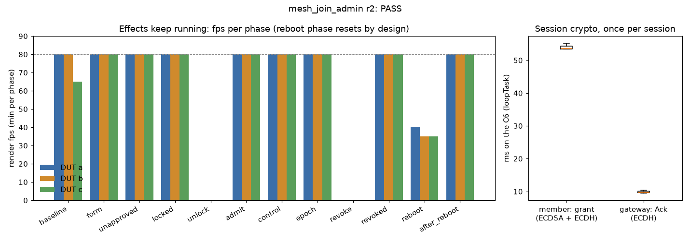

# Mesh M7: real membership and signed admin sessions

M7 of [mesh.md](mesh.md) §15, brought forward ahead of M6 (owner desk D-81): closed-mode
membership from a site secret, approval joins, the kiosk-style admin secret with
`mesh_unlock` and signed session grants, per-receiver MACs, revocation and rotation that
survive a reboot, groups, and the `mesh_join_admin` HITL. Stacked on [M5](mesh-m5.md)
(#567). M2 (#529, #530) already had the state machines as host-tested code; M7 puts them in
the firmware and in the protocol.

Measured with `//pi/hitl/harness:mesh_join_admin` on hitl-rig-1: three C6 players
(c6-123170 = a, c6-711130 = b, c6-711f48 = c) on the rig AP, built as
`:esp32c6_netstack_meshdev` (membership is the shipping code; the dev image adds only the
insider's `MESH FORGE`). The admin side is `//firmware/mesh:mesh_admin_tool`, standing in for
the app (M8). Logs and JSON: `/workspace/.claude/mesh/m7/runs/`.

## Results

Runs r1, r2 and r3 (2026-11-20), all **PASS**; numbers from r2 (r1 and r3 within a few %).

| Phase | What happened |
| --- | --- |
| **Form** | `provision{mesh id, site secret, admin key}` to a and b over wss: both members of a closed mesh **5.8 s** later (the 5 s search, then the epoch-1 key from the secret). Persisted, device key = the TLS key (`devkey=1`) |
| **Unapproved** | c gets `provision{mesh id, admin key}`, no site secret: after 20 s it is still **joining, with no key**; a lists it as pending under c's device-key hash |
| **Locked** (before a grant) | a refuses `mesh_send` (`LOCKED`) and `admit` (`LOCKED`); a grant signed by another admin secret is refused (`BAD_GRANT`, then 2 s lockout); b's own `mesh_send` is refused (`LOCKED`: a member without the grant); b forges envelope-framed control (`MESH FORGE CTL`): a refuses it as **untrusted (1)**, dispatches **nothing** (desk D-81) |
| **Unlock** | the signed grant (a's device key, session S, T = mesh s + 1 h) unlocks a's connection; b verifies it once and syncs (Ack/Confirm) |
| **Admit** | `admit{c, key hash}` through a: c **joined 1.5 s** later (its key wrapped for it by ECDH), received the admin key in the wrap, synced the session |
| **Control** | 8 rounds of `mesh_send{set_brightness}` through a: **b and c OK in 8/8**, results in 36–58 ms |
| **Epoch** (desk #79) | b's own `set_time_base`: **refused**. b forges a later epoch into its beacons (`MESH FORGE EPOCH`): **taken by nobody** (a ignored 11 unsigned beacon epochs). a's `set_time_base` on its unlocked connection: a originates, b and c map it from the signed `TIME_BASE` |
| **Revoke** | `revoke{signed order, new mesh key, new site secret, exclude c}`: a and b on **epoch 2**, c not |
| **Revoked** (after the 60 s overlap) | 8/8 rounds: **b OK, c absent**; c's rejoins refused **37** times (revocation list) |
| **Reboot** | a, b and c reset: a and b **came back from `/lfs/mesh.bin` on epoch 2 with c revoked** (mesh on at boot, no re-provisioning); c came back on epoch 1 and asked to join |
| **After the reboot** | a fresh grant; b syncs; 8/8 rounds **b OK, c absent**; c's rejoins still refused (5) |
| **Leave** | every DUT `MESH LEAVE`: state erased, mesh off (the rig left as found) |
| **Render** | **80 fps** on all three in every mesh phase (baseline 65–80 in its first windows: the autoscaler after the effect load, as in M5); resets only in the reboot phase (by design) |
| **Session crypto on the C6** | member's grant (ECDSA-P256 verify + ECDH): **53–55 ms**; gateway's Ack (ECDH): **9.6–10.4 ms**; once per session, on loopTask between frames |

meshsim (`join_admin_closed_mesh`) runs the same script on the simulated air, plus groups
and an eject, and checks the revocation through the persisted bytes.

## How a person adds a fixture to a closed mesh

The app holds three secrets per installation: the **mesh id**, the **site secret** (32 B) and
the **admin secret** (16 B). Fixtures never see the admin secret; they get its public key.

| Situation | What the person does | What happens |
| --- | --- | --- |
| A new installation | "Create mesh" on the first fixture | The app makes the three secrets and sends `mesh_admin.provision{mesh id, site secret, admin public key}` over the fixture's connection (wss or BLE). The fixture turns its mesh on, persists it and starts beaconing. |
| Another fixture of their own | "Add to mesh" on that fixture | The same `provision`. With the site secret the fixture derives the mesh key itself and joins within ~5 s (self-configuring formation, §7.9): no tap on any other fixture. |
| A fixture that should not get the site secret (a loaner, a friend's) | "Add to mesh" without the secret, then "Admit" | `provision{mesh id, admin key}` only. The fixture asks to join; every member forwards the request to the gateway; the app shows "New fixture nearby: admit?" (`MeshState.pending`, by device-key hash). One tap (`mesh_admin.admit`) and the fixture gets the mesh key, wrapped for it alone (ECDH of the two device keys). |
| Remove a fixture for good | "Remove" | `mesh_admin.revoke`: the app signs a rotation to a new mesh key and site secret and puts the fixture's device key on the revocation list. Every other member gets the new keys; the removed one keeps the old key, which stops working 60 s after the switch, and its rejoins are refused. Survives reboots (littlefs). |
| Let a fixture go (to connect to it directly, issue #571) | "Eject" | `mesh_admin.eject`: that fixture leaves the mesh and turns its mesh off. Not a removal: it may rejoin with the site secret. |

Administering (admit, revoke, eject, groups, mesh-wide control and the show clock) needs the
connection unlocked: the app signs a grant for the fixture it is connected to and sends
`mesh_admin.unlock{grant}`. A fixture that holds an admin key also refuses re-provisioning
and `leave` without a grant, so nobody on the network can pull it out of its mesh; physical
access (`MESH LEAVE` on the USB console) is the recovery when the admin secret is lost.

## Design

### Protocol (ledmapper.proto)

- `ClientMessage.mesh_admin = 101`: `MeshAdmin{oneof op: provision, unlock, admit, revoke,
  leave, groups, eject}`.
- Replies stay in the one mesh reply arm, `ServerMessage.mesh = 55`: `MeshInfo.admin = 3`,
  `MeshAdminResult{op, error, value}` (the fx_debug lesson: every server arm grows the
  by-value decode frame in the debug host builds).
- The status read is `get_mesh`: `MeshState` gains fields 13–25 (mode, phase, key epoch,
  admin key / site secret held, this fixture's device key, the connection's session and its
  roster, pending joins, revocations, groups, synced sessions, mesh seconds: what a grant's
  expiry is in).
- The firmware profile (gen_main.rs) skips every variable-size field of these messages; the
  netstack player parses and encodes them by hand (mesh_gw.rs). Additive and backward
  compatible: only players advertising `"mesh"` (#567) are sent a mesh arm; with the mesh
  off a C6 still answers its own arms (`provision` and `leave` turn the mesh on first; the
  rest answer `NO_MESH`).

### Firmware

- **Device key.** The mesh's `DeviceKey` is the per-device TLS key (P-256,
  per-device-cert.md), already parsed into MbedTLS for the TLS server; the mesh holds only
  its public half, and ECDH runs in MbedTLS on loopTask (mesh_glue.h `lm_mesh_ecdh`). No
  copy of the private key.
- **Persistence.** The membership (`MeshState`, 803 B: mesh id, mode, key epoch and mesh
  key, site secret, admin public key, revocations, groups, allow-list) is one littlefs file,
  `/lfs/mesh.bin`, written through the power-loss-safe writer (temp + fsync + rename; memory
  `firmware-littlefs-powerloss`) only when membership changes: provision, join, rotation,
  groups; erased on leave or eject. The dev key (`MESH KEY`, desk #67) is never persisted.
- **On at boot.** A fixture whose state is stored turns its mesh on as soon as its device
  key is installed (`lm_mesh::boot` from `tls_install_identity`); every other fixture keeps
  it off and allocates nothing (D-68/D-86).
- **Crypto never delays a frame (PR-40, desk D-323).** A grant's ECDSA verify plus its ECDH
  (member) and an Ack's ECDH (gateway) are queued by the stack and run one job per loop pass
  from the transport (`ns_mesh_crypto`), on the tick's stack, on loopTask: never on the
  render task, never per command. loopTask is not always below render, though: while a
  client is on a settled link it shares render's priority (#371), and a 10-55 ms ECDSA or
  ECDH there round-robins with frames. So every mesh pass (tick: joins' ECDH, rotation
  orders' ECDSA; the crypto job; persistence), every `mesh_admin` (the gateway's grant and
  rotation-order verifies) and building the mesh run strictly below render
  (`lm_prio_below_render` / `lm_prio_restore`, main.cpp): render preempts them the moment a
  frame is due. None of them holds a lock render takes. The firmware reports every late
  frame (`[late] n= max= ago_ms=`: a render-start interval over 1.5 periods), and the HITL
  gate fails on any outside the effect's start and the reboot.
- **Provisioner token (D-324).** `provision` answers with a 16-byte token
  (`MeshAdminResult.provisioner_token`), to that connection only; it is persisted after the
  state in `/lfs/mesh.bin` and erased with it. Presenting it (`provision.provisioner_token`,
  `leave.provisioner_token`) lets the user who provisioned the fixture leave or re-provision
  it without an admin grant, even when it holds an admin key: device-local admin rights.
  Mesh-wide commands (admit, revoke, eject, groups, control) still need the admin key's
  signed session, since members verify those themselves. A re-provision with the token keeps
  it; any other provision issues a new one.
- **Grant lifetime (D-328).** A gateway refuses grants that run more than 12 h (+5 min of
  slack) past its mesh time (`admin::MAX_GRANT_S`); the app renews in the background (M8).
- **Signed epochs (desk #79 bound to the session).** On a mesh with an admin key the show
  epoch is the admin session's: only a connection holding a grant may start one (the
  console too needs a session), the gateway sends it as the session's `TIME_BASE` command
  (per-receiver MACs), and members take an epoch only from that command; any other epoch
  in beacon gossip is ignored (`MeshTime::authorise`, `stats.unsigned`). The gateway
  re-sends it with every grant broadcast, for members that joined or rebooted since.
- **D-81: envelope trust only without an admin key.** As M5 built it: a mesh with an admin
  key refuses session-0 framing (`RouteReject::Untrusted`), so relayed control needs the
  grant's per-receiver MACs. M7 adds the provisioning that gives meshes an admin key.
- **Eject seam (#571).** `Command::Eject{node, key hash}` on the `MEMBERSHIP` port (admin
  session): the named fixture forgets its mesh state and the firmware turns the mesh off.
  Making it connectable again (BLE advertising, D-70) is #571's.
- **Groups.** `mesh_admin.groups` → `AssignGroups` (persisted on the member); `MeshTargets.group`
  already targets them (M5).

### Owner rules kept

- No Espressif OUI in mesh frames (unchanged framing).
- Effects keep running: crypto, joins and persistence happen on loopTask, not the render task.
- Never reboot to change membership: provision, admit, revoke, leave and eject act live.

## Cost

- **Flash** (default image, both built from this tree's base): `.flash.text` **+30.1 KB**,
  `.flash.rodata` +2.6 KB, `.eh_frame` +0.4 KB: the app image **2 220 432 → 2 253 536 B
  (+33 104 B)**. `//firmware/loader:layout_test` passes with **40 224 B** of its headroom
  left (73 328 after M5). By symbol: the gateway side of `mesh_admin` and the status read
  (`ns_mesh_app`, the hand protobuf, the `MESH INFO` membership lines) 10.8 KB; the stack's
  sessions, rotation and signed epochs now reached from firmware 4.7 KB plus the admin
  sessions 2.3 KB; restore, persistence and crypto glue 3.9 KB; the persisted state's codec
  3.4 KB; the C++ glue (ECDH, persistence, boot) 1.9 KB; the proto views for the new
  messages 1.9 KB; signed epochs in mesh time 0.7 KB.
- **RAM, default image**: `.dram0.data` and `.dram0.bss` **byte-identical** to M5 (no new
  statics in C++ or Rust; the persistence buffer is a transient heap allocation): off costs
  nothing (D-68, D-86).
- **Heap while on**: 43 932 B (M5 43 820 B; the mesh block grew by 112 B: the signed-epoch and
  persistence fields). Back to the starting value after `MESH OFF` / leave.
- **Stack** (call-graph walk over the ELF, long calls resolved): `ns_mesh_tick` 9.1 KB of its
  14 KB (M5 9.0 KB); `ns_mesh_crypto` 2.6 KB plus MbedTLS's ROM frames; the painted tick
  stack's measured high water across ticks, joins and crypto: **5.2 KB of 14 KB**.
  `ns_mesh_app` 3.8 KB on loopTask (M5 2.8 KB: the revoke's order check); measured loopTask
  free never below **4 192 B** (M5 4 204 B). `ns_mesh_create` unchanged (22.7 KB used of 26).
- **Flash wear**: `/lfs/mesh.bin` (803 B) is written only when membership changes.

## What M6 and M8 now need

**M6 (effect sharing).** Scene commits and effect blob announcements are admin-class
(`SCENE`): send them through the session with `send_admin` (per-receiver MACs), as `TIME_BASE`
now is, and re-announce the current scene to members that join or reboot (the gateway does
this for the epoch with every grant broadcast). Blob pages can stay on `BULK` (non-admin):
the signed scene names the blob by hash. On a mesh with an admin key, members must take a
scene only from the session, never from gossip.

**M8 (app).**
- The admin secret (16 B), the site secret (32 B) and the mesh id per installation, in the
  app's site data and its backup (`splanc.meshAdmin.v1`; export: copy, QR, file).
- P-256 in TS: the admin signing key from the secret (HKDF-SHA256(mesh id, secret,
  "splanc mesh admin sign" ‖ ctr) → scalar, as `host_keys::AdminSigner`), and ECDSA over
  the grant's 87 signed bytes (`"SMgrant1" ‖ mesh id ‖ session ‖ gateway ‖ gateway key ‖
  not_after`) and the rotation order's. WebCrypto cannot derive a public key from a raw
  scalar: a small BigInt P-256 (or `@noble/curves`). `mesh_admin_tool` is the reference.
- The flows in the table above: create mesh, add fixture (with or without the secret),
  "New fixture nearby: admit?" from `MeshState.pending`, remove (revoke), eject, groups.
- Unlock on connect (sign a grant for `MeshState.device_key`, expiry `mesh_s` + TTL) and
  renew in the background: the gateway logs `GrantRenewalDue` 10 min before expiry; M8
  should get it pushed (a `mesh.state` push, or a field the app polls).

## Open

- **The dev key** (`MESH KEY`, desk #67) is still in `_meshdev` (never in the shipping image)
  for the older HITLs (smoke, apply_at_skew, gateway). D-327: retire it; a follow-up PR moves
  them to `mesh_admin` provisioning and deletes `MESH KEY`.
- **Late members and the show epoch** get it only while an admin session is open (it is
  re-sent with each grant broadcast). With no session, a rebooted member renders on its own
  clock until the next unlock.
- **Locked mode** (allow-list) works on the wire (`provision{mode: LOCKED}`), but closed ↔
  locked transitions and their rotation are M7c's.
- **Open mode** (guests) is M7b: `provision{mode: OPEN}` answers `UNSUPPORTED`.
