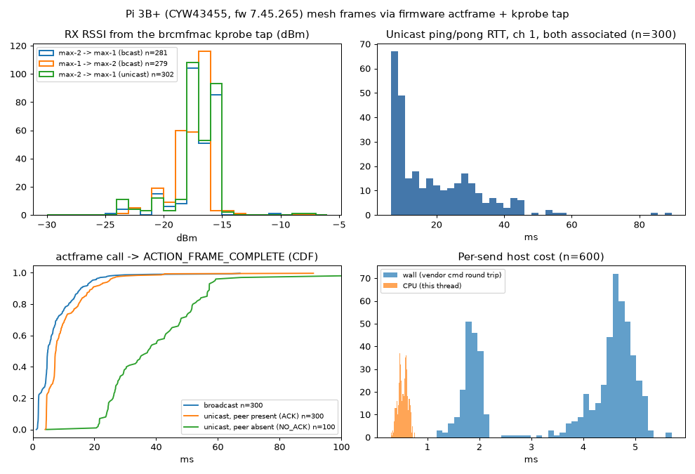
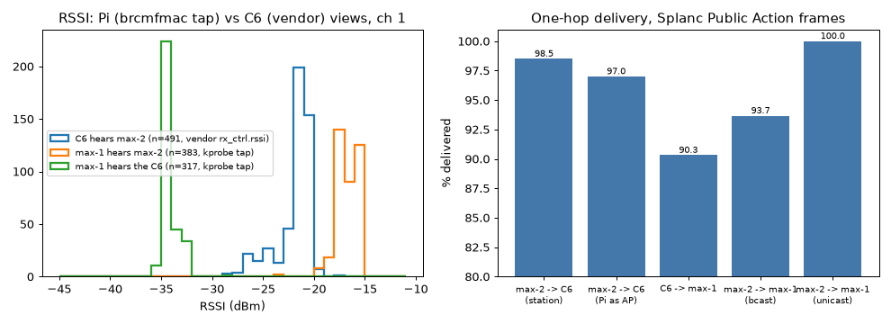

# Mesh on a Raspberry Pi: the radio transport

Status: research + prototype (PR #533 on `agent/mesh-m1`). Companion to
[mesh.md](mesh.md): §3.2 (the `Backhaul` seam), §4 (the 802.11 backhaul: framing, channels,
BLE coex), §5 (envelope, MTU), §10 and §15 (M10, the IP backhaul). The Pi as a high-capacity
custodian (RAM, storage) is modelled separately; this document covers how a Pi gets Splanc
mesh frames on and off the air.

## 1. Summary

**Question.** How does a Pi (the bridge `pi/bridge`, the Pi player `pi/player_rs`, a HITL
rig) send and receive the mesh's 802.11 frames on the same channel as the C6s, ideally while
it stays associated to Wi-Fi, and with what latency, airtime and reliability?

**Owner decisions (2026-11-17), after the first round:** Pis mesh **without extra hardware**,
on their own Broadcom radio through the firmware passthrough; the USB C6 coprocessor and USB
adapters are secondary. The mesh frame becomes **Public Action (category 4, action 9)**
(mesh.md §4.1, §3 here). Wi-Fi power save is off on mesh Pis. "No RSSI, no ACK status" was
not accepted without digging below the driver; this round did that.

**Answer, measured on two Pi 3B+ (CYW43455, stock firmware 7.45.265, kernel 6.12.87):**

1. **TX: the firmware's `actframe` iovar, reached through brcmfmac's vendor DCMD command.**
   The normal nl80211 path is closed: cfg80211 refuses category 127 from a station
   (`ENOTCONN`), and brcmfmac's `mgmt_tx` drops every action frame that is not P2P or GAS,
   **category 4/9 included** ("Unknown Frame", measured). The passthrough sends our exact frame
   on any channel, associated or as an AP.
2. **RSSI and ACK status: kprobes on the driver's own event handlers, from userspace.** On SDIO
   the firmware's events never reach a socket (the driver consumes them), and the driver drops
   the RSSI it is given. But the values are in the handlers' arguments, and tracefs kprobes
   read them with no kernel patch: **RSSI per frame** (−18 dBm median between the two Pis),
   the firmware's µs receive time, and **ACK / no-ACK for every unicast**. Measured: 300/300
   unicasts to the peer ACKed, 100/100 to an absent MAC reported NO_ACK.
3. **Delivery and latency** (both Pis associated to the rig AP on ch 1): broadcast **93.5 %**
   per hop (281/300, 279/300); unicast **100 %** of 300 exchanges; ping/pong RTT p50
   **15 ms**, p90 36 ms; `actframe` → on-air completion p50 **4.8 ms** (broadcast),
   **7.5 ms** (unicast incl. ACK), **37 ms** when the peer is absent (the firmware's retries).
4. **Per-send host cost: 0.3–0.5 ms of CPU.** Wall time is 1.1–1.5 ms when the SDIO bus is
   busy and ~4.4 ms when it has clocked down (the driver idles the bus after ~10 ms, hard-coded);
   sending only the used bytes of the iovar saves ~0.3 ms. A TX thread hides the wall time.
5. **AP mode works for RX and TX**: a Pi hosting the AP on the mesh channel (the bridge at a
   site without Wi-Fi) received 182/200 broadcasts with RSSI and got 100/100 unicasts ACKed.
   Its frames were not passed up by a Pi associated to a *different* AP (§4.3).
6. **Pi ↔ C6, over the air**: a rig C6 running a vendor-stack probe received **394/400**
   frames from a Pi (and parsed them as Splanc frames: the reference bytes hold); a Pi received
   **317/351** of the C6's. The Pi's firmware sends action frames at **1 Mb/s DSSS**.
7. **IP backhaul (M10)**: the same frames in UDP multicast, 200/200, RTT p50 1.86 ms between
   the Pis over Ethernet.

**Recommendation.** The Pi's own radio, through `actframe` + the kprobe tap, is the primary Pi
transport: it delivers what the C6s do (frames, RSSI, ACK status) at a few ms of latency, with
no hardware and no kernel change. Add the IP backhaul wherever Pis share a LAN. Keep the USB C6
coprocessor (the owner has C6s) for a Pi whose own radio must stay on another channel. Buy one
**AR9271** adapter only for a sniffer/debug role (§2.2).

## 2. Options

### 2.1 The Pi's own radio (brcmfmac): primary

All Pis with Wi-Fi use a Broadcom/Cypress (now Infineon) FullMAC chip behind brcmfmac:
BCM43438/CYW43438 (Pi 3B, Zero W), CYW43436 (Zero 2 W), CYW43455 (Pi 3B+, 4, 5, CM4). The
firmware runs the 802.11 MAC; Linux sees an Ethernet-like device plus control iovars.

**TX through nl80211 (`NL80211_CMD_FRAME`): closed.**

- **cfg80211 (every driver).** `cfg80211_mlme_mgmt_tx` (net/wireless/mlme.c) checks every
  action frame whose category is not Public (4): a station may only address its own AP
  (`-ENOTCONN`). Measured on the Pi: `ENOTCONN` for every category-127 frame. Public Action
  passes this check.
- **brcmfmac (`brcmf_cfg80211_mgmt_tx` → `brcmf_p2p_send_action_frame`, p2p.c).** It
  classifies the body: P2P public action (4/9 with the WFA OUI and type 9), GAS, or P2P action
  (127 with the WFA OUI). Anything else logs "Unknown Frame" and reports no-ACK without
  sending. Same code upstream and in rpi-6.12.y. Measured: our 4/9 frame passes cfg80211 and is
  dropped here (`Unknown Frame: category 0x4, action 0x9`). The Pis' logs show
  wpa_supplicant's own radio-measurement and WNM frames dropped the same way.

**TX through the firmware's `actframe` iovar: works.** brcmfmac registers one vendor command,
`BROADCOM_OUI`/`BRCMF_VNDR_CMDS_DCMD` (vendor.c), which passes a buffer to
`brcmf_fil_cmd_data_set/get`: any firmware ioctl or iovar, from userspace, with
`CAP_NET_ADMIN`. `actframe` takes `brcmf_fil_af_params_le` (channel, dwell, BSSID, then DA,
length, packet id, up to 1800 bytes of body). The firmware builds the header (A1 = DA, A2 = own
MAC, A3 = the BSSID passed), picks the rate and transmits, off-channel if asked. Two handler
details: `brcmf_cfg80211_vndr_cmds_dcmd_handler` uses the header's `len` as the set length, so
it must cover the iovar buffer; the body need not be padded to 1800 bytes (measured).

**RSSI, receive time and ACK status: the kprobe tap (`ktap.rs`).** What the firmware gives
and where it goes:

| Firmware event (fweh.h) | Payload | What brcmfmac does with it |
| --- | --- | --- |
| `ACTION_FRAME_RX` (75) | `brcmf_rx_mgmt_data` {be16 version, be16 chanspec, **be32 rssi**, **be32 mactime**, be32 rate} + body | `brcmf_p2p_notify_action_frame_rx`: rebuilds a header (A1 := own MAC), calls `cfg80211_rx_mgmt(..., sig_dbm = 0, ...)`: **RSSI dropped** |
| `ACTION_FRAME_COMPLETE` (60) | `e->status`: 0 SUCCESS, 5 **NO_ACK** | `brcmf_p2p_notify_action_tx_complete`: used only for frames the driver itself sent; ours are ignored |
| `ACTION_FRAME_OFF_CHAN_COMPLETE` (70) | | same |

Where the events could reach userspace:

- **A packet socket on ethertype 0x886c**: brcmfmac does pass event frames up the netdev for
  the bcdc data path (`brcmf_rx_frame` → `brcmf_netif_rx`), but on SDIO this firmware sends
  events on the bus's event channel, which goes to `brcmf_rx_event` and is freed. Measured: no
  event frames on wlan0.
- **nl80211 vendor events**: brcmfmac defines none.
- **Firmware counters/iovars** (`counters`, `pktcnt`, `rssi`, `sta_info`): aggregate or per-AP
  only, a 0.8 ms ioctl each; not per frame.
- **tracefs kprobes on the two handlers (used).** The values are in the handlers' arguments.
  Two `kprobe_events` lines (in `ktap.rs`) fetch `rssi`, `mactime`, `chanspec`, the sender
  (`e->addr`), the body (as `x32[64]`, 256 bytes: the 6-byte prefix plus a 250-byte mesh
  frame) and `e->status`, in a private tracefs instance with the `mono` clock. Needs root,
  `CONFIG_KPROBE_EVENTS` (on in the NixOS and Raspberry Pi OS kernels) and the brcmfmac symbols
  (present: both handlers are in kallsyms). It is removed on exit. The tap is matched to the
  nl80211 copy of each frame by sender and body; when nl80211 registration is impossible (AP
  mode, §4.3) the tap's body *is* the RX path.

**The kernel fix (prepared for upstream, owner's decision: keep the tap meanwhile).** A
four-patch series for brcmfmac on wireless-next makes the plain nl80211 path work: (1) pass
`rxframe->rssi` to cfg80211; (2) complete action frames sent without a dwell time on
ACTION_FRAME_COMPLETE (the firmware sends no OFF_CHAN_COMPLETE for them, so each waited the
2 s `P2P_AF_MAX_WAIT_TIME`); (3) count NO_ACK on a group-addressed frame as sent instead of
retrying it; (4) send other action frames with the caller's dwell time instead of "Unknown
Frame" (the P2P default of 200 ms makes the firmware answer `BCME_BUSY` to the next frame).
Tested on the DUT Pis with brcmfmac rebuilt for their 6.12.87 kernel: `NL80211_CMD_FRAME`
unicast 100/100 ACKed, absent peer 20/20 NO_ACK, broadcast 100/100 reported sent (94/100
distinct received), `NL80211_CMD_REGISTER_FRAME` 92/100 received with
`NL80211_ATTR_RX_SIGNAL_DBM`. Two limits remain: ~50 ms per send (the driver's 40 ms
`P2P_AF_RETRY_DELAY_TIME` sleep before the first attempt, left alone), and the 6.12 trees lack
upstream's mgmt_tx channel fix (f2d7c3c380bf): without it, `NL80211_CMD_FRAME` without a
frequency sends with a bogus channel and the firmware answers `BCME_BUSY`. So the passthrough
stays faster (~1–5 ms) and stays the Pi path until a kernel with the series ships. Patches,
cover letter and `git send-email` steps: `/workspace/.claude/pimesh/upstream/` (not sent).

**Per-send cost** (measured, §4.2): 0.3–0.5 ms CPU per `actframe`. Wall time is dominated by
the SDIO control round trip: ~1.1–1.5 ms when the bus is awake, ~4.4 ms when it has clocked
down. `sdio.c` sets `bus->idletime = BRCMF_IDLE_INTERVAL` (one ~10 ms watchdog tick) with no
module parameter, so at a 50 ms send interval every send pays the wake-up. Mitigations: send
from a dedicated thread (the mesh loop never waits), send unpadded iovars (−0.3 ms), and let
traffic keep the bus awake. One `actframe` is in flight at a time: back to back, the firmware
answers `EBADE` (busy), which the backhaul reports as back-pressure; ~320 frames/s accepted.

**Retry limit and rate.** `brcmf_fil_af_params_le` has no rate or retry field; the firmware
picks the rate and uses its management-frame retry policy. Measured: a unicast to an absent
peer completes with NO_ACK after a median 37 ms (p99 98 ms), consistent with the short retry
limit of 7 reported by `iw` at a low basic rate. Not changed in this round.

**Gotchas found on the bench:**

- **Power save must be off.** With PS on, the receiver caught 3 of 40 broadcasts (it sleeps
  between AP beacons; nobody buffers mesh frames for it). Now in both Pi images
  (`pi/bridge/image/nix/bridge.nix` already had it; `pi/provisioning/nix/mesh.nix` adds it to
  the player).
- **Pass the channel explicitly.** `actframe` with channel 0 delivered 1–18 %; the backhaul
  resolves 0 to the interface's channel.
- **One registration per prefix per interface.** A second process registering the same match
  gets `EALREADY`; the backhaul then uses the tap's bodies.

**nexmon** (patched firmware for monitor mode and injection): not needed. Stock firmware
already sends and receives our frames, and the tap gives RSSI and timestamps. nexmon's patched
binaries cannot be redistributed (Cypress's licence covers the unmodified file), are tied to
one firmware build and kernel, and injection on the 43455C0 has broken across firmware updates.

### 2.2 USB Wi-Fi adapters (mac80211): secondary

A SoftMAC adapter under mac80211 builds frames in Linux, so the host controls everything.
With Public Action, managed-mode nl80211 now works for TX and RX, associated or not (§3).

| Path | TX | RX | Notes |
| --- | --- | --- | --- |
| **nl80211 in managed mode** (`radio::Nl80211Mgmt`) | Public Action, on-channel or remain-on-channel | Registration; RSSI in `RX_SIGNAL_DBM` | Per-frame TX status from mac80211; no monitor mode |
| **Monitor vif, radiotap injection** (`radio::Monitor`) | Any frame; rate and retries from radiotap | AF_PACKET + radiotap: RSSI, **hardware TSF** | Next to the managed vif on mt76/ath9k; sees all channel traffic |

**Which to buy, and why.** The Pi's own radio now covers the transport, so an adapter earns
its place only where it adds something:

- **One AR9271 adapter** (ath9k_htc; Alfa AWUS036NHA, or TP-Link TL-WN722N **v1**): a mesh
  **sniffer and reference receiver** for HITL. It gives hardware TSF timestamps and RSSI for
  every frame on the channel (radiotap), honours injected retry counts, is 2.4 GHz-only (the
  mesh's band), draws little USB current, and its firmware is open. Use: debugging, per-frame
  airtime and retry analysis, and a time-sync reference for M4.
- A second radio for a **Pi that must stay on a 5 GHz venue AP** while meshing on 2.4 GHz.
  `actframe` can send off-channel, but the Pi hears the mesh only during the dwell after each
  send. A USB C6 does this job equally well and the owner has C6s, so no adapter is needed for it.

Not recommended: MT7921AU (power-hungry on Pi USB budgets, no gain for 2.4 GHz), rtl8xxxu and
rtw88 USB (weak injection).

### 2.3 A USB-attached ESP32-C6 as the radio coprocessor: secondary

The C6 runs the netstack and M3's 802.11 backhaul and passes whole Splanc frames to the Pi
over USB-Serial/JTAG (SLIP, `serial.rs`): TX, CHANNEL, RX (rssi, C6 timestamp, frame),
TX_DONE (acked / not), HELLO (MAC). The host side and its tests are in this PR; the C6 bridge
task follows M3. Use it for a Pi whose own radio must stay on another channel or band. It is
also the reference implementation of the mesh radio.

### 2.4 BLE

BLE is the app's way into a gateway (GATT; mesh.md §4.3, §10.2) and Improv provisioning; not
a mesh backhaul (a C6 would have to scan, taking radio time from Wi-Fi). A Pi can be a BLE
gateway with BlueZ; nothing here depends on it.

### 2.5 The IP backhaul (M10)

The same Splanc 802.11 frames in UDP (`udp.rs`): multicast 239.83.77.1:47811 for broadcast,
the learned peer address for unicast, MTU 1400. Needs UDP 47811 open in the NixOS firewall
(closed today) and LAN multicast (use `udp::Fanout::Peers` across routed networks).

## 3. Category 4 (Public Action), checked in source

The owner switched the frame to Public Action, conditional on this check (Linux 6.12):

| Path | Category 127 | Category 4, action 9 |
| --- | --- | --- |
| cfg80211 TX from a station (`cfg80211_mlme_mgmt_tx`) | Only to its own AP (`ENOTCONN`, measured) | Any destination, associated or not |
| mac80211 TX (`ieee80211_mgmt_tx`) | — | On-channel when associated; remain-on-channel otherwise. In AP mode, non-Public action frames to unknown stations are `ENOLINK` |
| mac80211 RX (`ieee80211_rx_h_action`) | **Dropped** from senders without a station entry (`RX_DROP_U_ACTION_UNKNOWN_SRC`), before userspace | Passed to registrations; `ieee80211_accept_frame` accepts Public Action even with a foreign BSSID |
| wpa_supplicant station registrations | `7f 50 6f 9a 09`, `7e 50 6f 9a 1a`: no overlap | `04 09 50 6f 9a 09/1a`, `04 0a`…`04 0e`: no overlap with `04 09 0a 5c 4d 01` (measured: registration succeeds next to wpa_supplicant) |
| hostapd / wpa_supplicant **AP mode** | Registers all of `7f` | Registers all of `04` (measured: `EALREADY` for both) |
| brcmfmac `mgmt_tx` | Dropped | Dropped (needs the P2P OUI) |
| brcmfmac `actframe` / tap | Works | Works |

Action code 9 is the standard vendor-specific Public Action; the Wi-Fi Alliance's uses of 4/9
(P2P, DPP, NAN) are keyed by its OUI 50:6F:9A, so a CID cannot collide. **So category 4 buys
mac80211 adapters full managed-mode TX and RX; it does not change brcmfmac**, where the
passthrough stays (or the kernel patch of §2.1).

Changes made: `frame.rs` defaults to `Category::PublicVendor`, the reference vector is now
`d0 00 … 04 09 0a 5c 4d 01 …` (`golden_public_vendor_frame`), category 127 still parses;
mesh.md §4.1 updated on `agent/mesh-design`. **M1 (#520) needs no change**: its `link`
module encodes the `LinkFrame` only and leaves the 802.11 framing to M3.

## 4. Measurements

Bench: two Pi 3B+ DUTs on hitl-rig-1's LAN, reserved through the HITL daemon for every run and
restored afterwards (home AP, power save, firewall, `/tmp`, tracefs). Rig hosts not touched.
Probe: `pimesh` (this PR), a static aarch64 binary copied to `/tmp`. Raw CSVs and logs:
`/workspace/.claude/pimesh/data/`.

### 4.1 Radio inventory (DUT Pis)

| Host | Board | Wi-Fi chip, bus | Driver | Firmware | Interface modes | USB Wi-Fi |
| --- | --- | --- | --- | --- | --- | --- |
| splanc-max-2 (pi-ledmapper-1) | Pi 3 Model B Plus Rev 1.4 | CYW43455, SDIO 02D0:A9A6 | brcmfmac, kernel 6.12.87 aarch64 | `BCM4345/6 wl0: Aug 29 2023 version 7.45.265 (28bca26 CY) FWID 01-b677b91b` (cyfmac43455-sdio) | IBSS, managed, AP, P2P-client/GO/device; **no monitor** | none |
| splanc-max-1 (pi-ledmapper-2) | Pi 3 Model B Plus Rev 1.4 | CYW43455, SDIO 02D0:A9A6 | same | same | same | none |

Both advertise the Broadcom DCMD vendor command `(0x001018, 1)` and remain-on-channel; neither
has `MGMT_TX_RANDOM_TA`. kprobe events, BTF and the brcmfmac handler symbols are available.

### 4.2 Results

Round 1 (category 127, nl80211 RX, no tap):

| # | Test | Result |
| --- | --- | --- |
| 1 | nl80211 `CMD_FRAME`, category 127 | `ENOTCONN` (cfg80211) |
| 2 | nl80211 `CMD_FRAME`, category 4/9 | cfg80211 accepts; brcmfmac drops ("Unknown Frame"), TX status not-acked |
| 3–4 | `actframe` across channels (sender on 5 GHz ch 40, receiver on ch 1) | PS on: 3/40; **PS off: 96/100** |
| 6 | Ping/pong across channels | 50/50; RTT p50 18.6 ms (the sender hears the pong only during its post-TX dwell) |
| 7 | `actframe` channel 0 | 1–18 %: always pass the channel |
| 8–10 | Both on ch 1: broadcast / unicast ping-pong | 93.5–94 % / 199 of 200 |
| 13–14 | Two real `splanc_mesh::Node`s, 30 s | app 279/290 and 262/290, `rx_rejected` 0; the AP links unharmed |
| 15 | IP backhaul, UDP | 200/200, RTT p50 1.86 ms |

Round 2 (category 4, kprobe tap; both Pis associated to the rig AP on ch 1, PS off; 250-byte
mesh frames at 20 Hz unless noted):

| Test | Result |
| --- | --- |
| Broadcast max-2 → max-1 / max-1 → max-2 | 281/300, 279/300; **RSSI p10/p50/p90 −20/−18/−16 dBm** (Pis ~1 m apart) |
| Unicast max-2 → max-1 | **300/300 ACK** (tap status 0); 302 received (2 retransmissions); completion p50 7.5 ms, p90 19 ms, p99 42 ms |
| Unicast to an absent MAC | **100/100 NO_ACK** (status 5); completion p50 37 ms, p99 98 ms |
| Broadcast completion | status NO_ACK by definition; p50 4.8 ms, p90 15.5 ms |
| Unicast ping/pong, 64 B | 300/300 (+4 duplicates dropped); RTT p50 15.0 ms, p90 36 ms, p99 56 ms; all 602 unicasts ACKed |
| Per send, idle bus (50 ms interval) | wall p50 4.4 ms, CPU 0.48 ms; unpadded: wall 4.1 ms, CPU 0.36 ms |
| Per send, busy bus (10 ms interval) | wall p50 1.46 ms (unpadded 1.13 ms), CPU 0.33–0.39 ms |
| Plain iovar get (`ver`) | 0.83 ms p50 |
| AP mode: Pi hosts an AP on ch 1, a station Pi sends | **182/200 received by the AP via the tap** (registration is held by the AP daemon), RSSI −18 dBm |
| AP mode: the AP Pi sends | unicast to the station: **100/100 ACK**; the station (associated to the rig AP) passed **0** of them up |

### 4.4 Pi ↔ C6

A rig C6 DUT (c6-123170, reserved) ran `//firmware/netstack:mesh_frame_probe` (vendor stack,
promiscuous on ch 1, TX of the reference frame every 100 ms) while max-2 sent 400 frames
(station mode, then 100 as an AP) and max-1 listened.

| Link | Delivered | RSSI (p50) | Notes |
| --- | --- | --- | --- |
| max-2 → C6 (both on ch 1, max-2 associated) | **394/400 (98.5 %)** | −22 dBm (C6's `rx_ctrl.rssi`) | C6 rate code 0: **1 Mb/s DSSS**; A1 = A3 = ff:ff:…; prefix `04 09 0a 5c 4d 01` matched |
| max-2 as an AP → C6 | 97/100 | | **A3 = the AP's BSSID** (b8:27:eb:6e:e0:40), not ff:ff:…: the firmware overrides the BSSID we pass in AP mode |
| C6 → max-1 (associated) | **317/351 (90.3 %)** | −35 dBm (tap) | the C6's vendor TX; max-1 is further from the C6 |
| max-2 → max-1, same run | 383 | −17 dBm (tap) | the same transmitter as the first row, a different receiver |

The tap's RSSI and the C6's agree on the shape of the link (a stable, narrow distribution);
absolute values differ by receiver position and antenna, as expected. The A3 finding explains
§4.3's AP-mode result: a Pi associated to another AP filters frames carrying a foreign BSSID,
while the C6 (promiscuous) takes them. The mesh's C6 receive path (mesh.md §4.1) matches on
the action body, not A3, so it is unaffected.

### 4.3 What it means

- **Delivery.** ~94 % per broadcast hop, 100 % for unicast with the firmware's retries; the
  tap now tells the backhaul which unicasts failed. Against M3a's ≥ 95 % one-hop target,
  broadcast is just under; the flood's redundancy and want-ack cover it.
- **Latency.** One hop is ~7 ms each way; most of it is the SDIO control path, not air time.
  Fine for control; `apply_at` hides it.
- **Time.** The tap gives the firmware's µs receive time (`mactime`) per frame: a usable
  hardware RX timestamp for M4's time sync (its relation to the Pi's clock is still to be
  calibrated, e.g. against the beacon TSF).
- **AP-hosting.** A Pi hosting the AP sits on the mesh channel for good, which solves the "Pi
  unassociated" gap: it receives everything and its unicasts are ACKed. The station Pi not
  passing the AP's frames up looks like the firmware filtering frames whose A3 is another
  BSS's BSSID: in AP mode the firmware stamps its own BSSID into A3 (confirmed by the C6, §4.4).
  Every C6 member matches on the action body (mesh.md §4.1), so it is unaffected; only a Pi
  member associated to a *different* AP misses an AP-hosting Pi's frames.
- **Rate.** The Pi's firmware sends action frames at 1 Mb/s: a 250-byte mesh frame is ~2.3 ms
  of air. Fine at mesh.md §10.3's rates; the firmware's `actframe` has no rate field, so a
  faster rate would need the firmware's management-rate iovars (not tried).

## 5. Prototype (this PR)

`//pi/mesh_radio` (crate `splanc_mesh_linux`, std, Linux, **no new crates**).

| File | What |
| --- | --- |
| `frame.rs` | The Splanc 802.11 action frame (Public Action default; 127 parses); reference bytes; airtime model |
| `radiotap.rs` | TX header for injection; RX parse (TSF, RSSI, FCS) |
| `nl80211.rs` | Generic netlink: family lookup, `REGISTER_FRAME`, `FRAME`, TX status, vendor commands, wiphy capabilities |
| `ktap.rs` | The brcmfmac kprobe tap: RSSI, mactime, sender, body; TX completion status |
| `radio.rs` | `RawRadio`: `BrcmActframe` (DCMD `actframe` + tap, unpadded iovars, `EBADE` = busy, per-send records), `Nl80211Mgmt`, `Monitor` |
| `udp.rs`, `serial.rs` | IP backhaul; USB C6 coprocessor (SLIP) |
| `wifi.rs` | `WifiBackhaul<R>`: the mesh `Backhaul` over any radio |
| `bin/pimesh.rs` | `caps`, `send`, `listen`, `ping`, `pong`, `node`, `iovar`; `--csv` per-sample output |

`//firmware/netstack:mesh_frame_probe` (C6, vendor stack): promiscuous RX of Splanc frames
with RSSI and A1/A3, and periodic TX of the reference frame, for the Pi ↔ C6 bench until M3's
netstack backhaul exists. It turns its radio off after 150 s.

Tests: `bazel test //pi/mesh_radio:mesh_radio_test` (codecs incl. the Public Action reference
vector, DCMD layout, kprobe trace-line parsing, SLIP, real `Node`s over UDP and a fake C6
link, receive filters, pacing). mac80211_hwsim needs a kernel with modules (§6).

## 6. Hardware test plan (remaining)

1. **Pi ↔ C6 with M3's netstack backhaul** once it exists (the reference bytes are the
   contract); today's oracle is the vendor-stack probe.
2. **Pi 4/5 and Zero 2 W**: repeat §4.2 (the 43455 firmware on Pi 5, the 43436 on Zero 2 W).
3. **Soak**: 1 h of `pimesh node` traffic at mesh.md §10.3's rates; AP links and C6 DUT health.
4. **AR9271** (to buy): sniffer/reference receiver; airtime and retry analysis.
5. **mac80211_hwsim** in a NixOS VM test (CI): the nl80211 managed path with Public Action.
6. **Management-frame rate**: try the firmware's rate iovars to send action frames at 6 Mb/s
   OFDM (a sixth of the airtime).

## 7. Running the mesh stack on Linux

The mesh crates are `no_std` and build unchanged for the host. A Pi node is
`splanc_mesh::Node<WifiBackhaul<BrcmActframe>, P>`, driven every ≤ 5 ms; `actframe` sends
should move to a TX thread so the loop never waits on SDIO. Needs root (or `CAP_NET_ADMIN` for
the vendor command and registration, plus tracefs access for the tap). No kernel module.

## 8. Decisions for the owner

1. **Kernel patch**: decided (keep the tap, send the series upstream). The series is ready for
   the owner to sign off and send (§2.1).
2. **Buy one AR9271 adapter** (~$15–35) for a HITL mesh sniffer. Nothing else is needed.
3. **Open UDP 47811** in the Pi images when the IP backhaul ships (M10).

## 9. Sources

- Linux v6.12 and raspberrypi/linux rpi-6.12.y: `net/wireless/mlme.c`
  (`cfg80211_mlme_mgmt_tx`, `cfg80211_mlme_register_mgmt`), `net/mac80211/offchannel.c`
  (`ieee80211_mgmt_tx`), `net/mac80211/rx.c` (`ieee80211_rx_h_action`,
  `ieee80211_accept_frame`, handler order), brcmfmac `cfg80211.c`, `p2p.c`, `vendor.c`,
  `fweh.h`, `fwil_types.h` (`brcmf_rx_mgmt_data`, `brcmf_fil_af_params_le`), `core.c`
  (`brcmf_rx_frame`, `brcmf_rx_event`), `sdio.c` (event channel, `idletime`).
- hostap `src/drivers/driver_nl80211.c` (`nl80211_action_subscribe_ap`,
  `nl80211_mgmt_subscribe_non_ap`).
- seemoo-lab/nexmon (supported chips, firmware patching model).
