# Mesh networking: one app connection manages every fixture

Status: design (this document). Nothing is implemented yet. Phase 1 (the
application backhaul) is the critical path for the radiolarians install.

## Owner's request

> "It's time to start building mesh networking :) We should support two mesh backhauls. One is
> UWB and the other is ESP-NOW style P2P. Since we have our custom C6 netstack, we should build
> ESP-NOW (or something like it) in the netstack. This mesh backhaul should enable distributing
> uniforms and effects programs, such that a single connection (BLE or WiFi) from the app can
> allow management of all devices in the mesh. The mesh networking needs to support assigning
> devices to groups and freezing membership, in addition to free association (devices arriving
> at an existing mesh and being automatically peered in)."

Follow-up directions from the owner, folded into this design:

1. The UWB mesh in `fughilli/indoor_localization` (the "swarm") is the basis. Splanc adopts its
   model, frame formats and transport. The 802.11 backhaul carries the same mesh layer.
2. Realtime localization (IMU + ranging fusion, as in indoor_localization) comes later.
3. BLE ranging on the C6 should be evaluated, including a self-built Channel Sounding-like
   ranging on top of our own radio work.
4. **Priority: the application backhaul ships first**, for the radiolarians deployment. Their
   fixtures are heavy and static, so the existing room localization is enough to provision the
   install. Ranging, fusion and channel sounding are later, independent tracks.
5. Owner answers: up to 6 radiolarians, each a P4 + C6 driving WLEDs over DDP; BLE → mesh for
   sites without Wi-Fi; three membership modes (open, closed, locked).
6. The swarm code is ported into Splanc (indoor_localization is public), not shared as a
   dependency.
7. Radiolarians details: WLEDs on the P4's Ethernet; fixtures a few metres apart in metal
   enclosures; they self-configure; admin over BLE, Wi-Fi or the bridge; per-device Wi-Fi OTA
   is enough; a closed mesh unlocked with a kiosk-style admin secret; any fixture is a gateway;
   Splanc's own frame format, no Espressif OUI.

## Contents

1. [Summary](#1-summary)
2. [What exists today](#2-what-exists-today)
3. [Architecture](#3-architecture)
4. [The 802.11 P2P backhaul in the netstack](#4-the-80211-p2p-backhaul-in-the-netstack)
5. [Protocol](#5-protocol)
6. [Time sync and apply_at across the mesh](#6-time-sync-and-apply_at-across-the-mesh)
7. [Membership, groups and security](#7-membership-groups-and-security)
8. [Gateway: one connection, the whole mesh](#8-gateway-one-connection-the-whole-mesh)
9. [App and bridge UX](#9-app-and-bridge-ux)
10. [The radiolarians deployment: sizing](#10-the-radiolarians-deployment-sizing)
11. [UWB backhaul (later)](#11-uwb-backhaul-later)
12. [Ranging and realtime localization (later)](#12-ranging-and-realtime-localization-later)
13. [Ranging over the C6's own radio (research track)](#13-ranging-over-the-c6s-own-radio-research-track)
14. [Testing](#14-testing)
15. [Staged PR plan](#15-staged-pr-plan)
16. [Risks](#16-risks)
17. [Open questions for the owner](#17-open-questions-for-the-owner)
18. [Sources](#18-sources)

## 1. Summary

- **One mesh layer, several backhauls.** The mesh layer is the swarm's `swarm_net` crate
  (`swarm/net` in indoor_localization): managed flooding with dedup and TTL, want-ack unicast,
  authenticated generation-numbered state, and a Deluge-style page protocol for blobs. Splanc
  adds a security envelope, membership and groups, and Splanc ports on top. Backhauls plug in
  under a small `Backhaul` trait.
- **Phase 1 backhaul: 802.11 vendor action frames in our netstack**, with Splanc's own framing
  (a Splanc CID, no Espressif OUI). The
  netstack already sends raw management frames (`ns_mac_send`) and receives every frame on the
  channel. Mesh frames share the AP's channel when associated, and a fixed mesh channel when
  not.
- **The gateway** is whichever fixture the app (or bridge) is connected to, over BLE or wss. It
  relays wrapped `ClientMessage`s to any member, group or the whole mesh, and aggregates acks
  and status.
- **Effects** (`.fxb`, at most 4 KiB, `FX_MAX_BYTES` in `firmware/player_app/ffi.rs`) travel as
  content-addressed blobs over the page protocol. Uniforms, brightness and crossfade travel as
  small flooded packets.
- **Mesh time** is disciplined from beacons. The app's `SetTimeBase` epoch is mapped into mesh
  time, so `apply_at_ms` (`docs/design/synced-show.md`) lands a relayed change on the same
  frame on every member.
- **Membership:** a mesh has an id, a key and an epoch, and one of three modes set from the
  app. **Open**: any Splanc device can follow the show (time, scenes, effects) as a guest, with
  no secret, but can never manage it. **Closed**: devices holding the site secret from
  provisioning join as members. **Locked**: only devices the owner approved; removal rotates
  the key. Groups target messages. Administration is unlocked per connection with a
  kiosk-style **admin secret** kept in the app and exportable to other admins.
- **BLE or Wi-Fi in.** Sites without Wi-Fi are first-class: the phone connects over BLE to any
  fixture, which gateways to a mesh running in a radio-up, no-AP mode.
- **Radiolarians** (up to 6 P4 + C6 fixtures driving WLEDs over DDP): the C6 front end is the
  mesh node and gateway, the P4 the endpoint.
- **Later tracks:** UWB (a hardware revision: no current Splanc board has UWB), ranging plus
  IMU fusion, and a research track on CS-like phase ranging using the C6's undocumented raw I/Q
  capture.

## 2. What exists today

### 2.1 Splanc

| Piece                       | Where                                                                                                      | What matters for the mesh                                                                                                                            |
| --------------------------- | ---------------------------------------------------------------------------------------------------------- | ---------------------------------------------------------------------------------------------------------------------------------------------------- |
| Heapless 802.11 + BLE stack | `firmware/netstack/` (`DESIGN.md`), driven from `firmware/player_app/netstack_transport.cpp`               | Our own MAC TX (`ns_mac_send`, direct submission), our own RX ring (`ns_mac_rx_install`, `ns_mac_recv`); every frame on the channel reaches the ring |
| RX vector                   | `firmware/netstack/src/mac.rs` `RX_VECTOR_HDR = 92`                                                        | 92 bytes of hardware RX metadata precede each frame. We strip them today. RSSI and the RX timestamp are in there, not yet decoded                    |
| TX pacing                   | `tx_pace_before/after` in `netstack_transport.cpp`                                                         | No TX completion signal; frames are paced on worst-case airtime (#358)                                                                               |
| Channel handling            | `g_chan`, `scan_latch_ap`, `ChannelHop` in `firmware/player_app/wifi_scan.h` (channels 1–13, 120 ms dwell) | Background sweeps leave the channel for ~1.6 s                                                                                                       |
| Wi-Fi policy                | `kModeAuto/Fixed/Manual/Offline` in `wifi_scan.h`; `docs/design/wifi-rejoin-policy.md`                     | No "radio up, not associated" mode yet                                                                                                               |
| Coexistence                 | `firmware/netstack/src/coex.rs`, `coex_timer_cb`                                                           | BLE and Wi-Fi share one antenna; the arbiter lends the radio to BLE                                                                                  |
| BLE host                    | `firmware/blehost/blehost.cpp` (our host over the vendor controller's HCI)                                 | The app's BLE link to the gateway                                                                                                                    |
| Protocol                    | `shared/protocol/proto/ledmapper.proto` `ClientMessage` / `ServerMessage`                                  | Arms 99+ are free for mesh arms                                                                                                                      |
| Dispatch seam               | `lm_ws_dispatch` (`netstack_transport.h`) → `lm_player_handle` (`player_ffi.h`)                            | The gateway and members dispatch relayed messages through the same seam                                                                              |
| Scheduled changes           | `firmware/player/src/apply_queue.rs` (`SCHED`: 8 frames in 512 B on the C6)                                | `apply_at_ms` on `SetUniforms`, `SetEffect`, `SetCrossfade`, `SetBrightness`                                                                         |
| Time discipline             | `agent/src/timesync.ts` (`TimeDiscipline`, `DriftEstimator`)                                               | Bridge-side drift fit. Its method ports to the mesh                                                                                                  |
| Multi-socket limit          | `web/src/net/connectionRegistry.ts`                                                                        | The player serves TLS from two slots. The app holds one device at a time                                                                             |
| P4 front end                | `firmware/player_app/frontend_link.cpp`, `docs/design/p4-c6-split.md`                                      | The C6 already forwards player messages to another processor and waits for a reply. A gateway is the same pattern over the air                       |
| Device trust                | `web/src/net/deviceTrust.ts`, `agent/src/trust.ts`                                                         | TOFU pin of each device's P-256 certificate, keyed by MAC                                                                                            |
| Room localization           | `docs/design/multi-fixture-localization.md`, `web/src/geom/multiFixture.ts`                                | One phone capture places several fixtures; enough for static installs                                                                                |
| Heap                        | `docs/design/ram-budget.md`                                                                                | 24 KB floor at the 2048-LED max config; every KB of mesh state counts                                                                                |

### 2.2 indoor_localization (the swarm)

Read at `master` `5a906e78` (2026-11-10). The repo is the owner's. Its root `LICENSE` is GPL-3.0
because `libs/dw3000` derives from CircuitDigest's driver; `swarm/` is the owner's own code.

| Piece                 | Where                                                                                                                                              | Status                                                                     |
| --------------------- | -------------------------------------------------------------------------------------------------------------------------------------------------- | -------------------------------------------------------------------------- |
| Spec                  | `docs/swarm-network.md` (Layers, Mesh packets, Authentication, Live settings, Firmware update), `docs/swarm-wire.md` (budgets)                     | Design + implementation, deployed on 4 boards                              |
| Wire format           | `swarm/proto/swarm_wire.proto` (`swarm.v1`): `LinkFrame`, `MeshPacket`, `Summary`, `Manifest`, `FwRequest`, `FwData`, settings `Bundle`/`Override` | Protobuf; worst cases asserted at compile time (`swarm/net/src/budget.rs`) |
| Mesh layer            | `swarm/net` (`swarm_net`, 4.2 k lines, `no_std`, no alloc)                                                                                         | ~50 host tests incl. golden vectors                                        |
| Radio + TDMA + DS-TWR | `apps/common/radio.cpp`, `protocol.h`, `libs/dw3000` (C++)                                                                                         | 5 ms slots, 6 per 30 ms superframe                                         |
| Fusion                | `swarm/core` (ESKF: `predict`, `update_range`, `update_aoa`, …), `swarm/core` `coop`                                                               | Sim 6–14 cm RMSE; hardware walks still tuning range bias and NLOS          |
| Hardware              | Classic ESP32 + Qorvo DWM3000 (DW3110), SPI at 8 MHz; MPU-6050 + QMC5883L                                                                          | No C6 port, no AoA (single antenna)                                        |

The parts Splanc adopts:

- **`MeshPacket`** header (≤ 24 B): origin u16, id u16, dest (absent = broadcast), hop_limit,
  hop_start, flags (want-ack, is-ack), attempt, port, payload (≤ 88 B on UWB).
- **Managed flooding** (`swarm/net/src/mesh.rs` `MeshConfig`): hop limit 3; dedup on
  (origin, id, attempt) over a 64-entry ring; relay after 0–3 of the node's own slots, sooner
  the weaker the RSSI; cancel a pending relay on overhearing it; want-ack unicast retried 3 times,
  1 s apart.
- **Generations and catch-up** ("Live settings"): every swarm-wide change carries a host
  generation; `Summary.generation` in each node's beacon lets a late joiner fetch what it missed.
- **Page protocol** (`swarm/net/src/update.rs`): 4 KB pages, 96 B chunks, NACK bitmaps to the
  most advanced neighbour, overheard-request suppression, the canary rule.
- **Seam**: `Net::on_mesh(t_us, bytes, rssi, flash)`, `Net::on_my_slot()`, `Net::poll(t_us)`,
  `Net::next_tx(t_us, out, flash) -> Option<(FrameKind, usize)>`, `Net::send(dest, port,
payload, want_ack)`, plus `trait Flash`. There is no radio trait yet. Splanc adds one (§3.2).

What does **not** carry over as is:

- The swarm authenticates only settings (4-byte truncated HMAC-SHA256) and firmware (ECDSA).
  Reports and acks are unauthenticated. Lights in someone's home need every control frame
  authenticated (§7.5).
- Membership is implicit (a node's slot is its rank among heard ids). There is no join, no
  groups, no modes (§7).
- Time sync is coarse (superframes align to the lowest id's POLL). Splanc needs ms-level shared
  time for `apply_at` (§6).
- The 88 B payload is a UWB budget. The 802.11 backhaul allows more (§5.2).

## 3. Architecture

```text
 app / bridge ──BLE or wss──▶ gateway fixture
                                  │  MeshSend{targets, ClientMessage bytes}
                                  ▼
 ┌─────────────────────────── firmware/mesh (Splanc) ─────────────────────────────┐
 │ ports: control · reply · status · membership · scene · blobs · time            │
 │ membership: mesh id, key epoch, members, groups, open / closed / locked        │
 │ security envelope: AES-128-CCM, per-source replay window                       │
 ├──────────────────────────── swarm_net (ported) ─────────────────────────────────┤
 │ MeshPacket flood + dedup + TTL · want-ack · generations · page protocol         │
 ├──────────────────────────── Backhaul trait ─────────────────────────────────────┤
 │ wifi_p2p (netstack action frames) │ ip (UDP on the LAN, later) │ uwb (later)    │
 └─────────────────────────────────────────────────────────────────────────────────┘
                                  │
                                  ▼  each member: lm_player_handle (same as wss/BLE)
```

### 3.1 Where the code lives: port the swarm into Splanc

The owner's call: **port `swarm/net` and `swarm/proto` into Splanc** as Splanc code. No shared
repo, no Bazel dependency on indoor_localization (which is public now).

- **Where**: `firmware/mesh/swarm/` (the ported `swarm_net` crate, kept close to upstream) and
  `firmware/mesh/` (the Splanc layer on top: backhauls, envelope, membership, ports). The proto
  goes to `shared/protocol/proto/swarm_wire.proto` next to `ledmapper.proto`, generated with
  Splanc's existing protobuf tooling (micropb on firmware; pbview is already in `oss/pbview`).
- **Provenance**: a header comment in each ported file and a `firmware/mesh/swarm/PROVENANCE.md`
  naming the source (`fughilli/indoor_localization`, `swarm/net` and `swarm/proto` at
  `5a906e7823f2d1c13af30dfa2a3b1b887616d0f1`) and listing what Splanc changed.
- **License**: `swarm/` is the owner's own code, so it comes in under Splanc's AGPL-3.0. (Even
  taken as GPL-3.0 from the repo root, GPL-3.0 §13 allows combining it with AGPL-3.0 code.) The
  GPL-derived DW3000 driver (`libs/dw3000`) is not ported; a UWB driver is a later, separate
  question (§11).
- **From then on Splanc owns its copy.** Fixes worth sharing go back to indoor_localization by
  hand; the golden vectors (`swarm/proto/testdata`) come along so the wire format stays checkable
  against the swarm's.

Changes made while porting (M1 unless noted):

1. A `Backhaul`-friendly entry point: `on_rx(t_us, frame, RxMeta)` and a slot tick that a
   backhaul without TDMA can drive from a timer.
2. A per-instance `MAX_PAYLOAD` (88 on UWB, larger on 802.11; §5.2) instead of one constant.
3. Blob kinds on the page protocol: `Summary`/`FwRequest`/`FwData` gain a `kind` (firmware,
   effect) and a content id, so the same `Updater` serves effects (§5.5). This can wait for M6.
4. A hook for the security envelope (§7.5) around `LinkFrame`.
5. Builds for riscv32imac (C6) and the P4 target, plus the host tests, in Splanc's CI. The crate
   is already `no_std`; its crypto backend switches to Splanc's (the netstack's AES, mbedTLS for
   SHA-256 and P-256).

### 3.2 The backhaul seam

```rust
/// One radio (or link) that carries mesh frames. Implementations own framing,
/// channel, rate and pacing; the mesh layer sees opaque frames.
pub trait Backhaul {
    /// Largest mesh frame (after the security envelope) this backhaul carries.
    fn mtu(&self) -> usize;
    /// Queue a frame. `dst = None` broadcasts. Never blocks; Busy is back-pressure.
    fn send(&mut self, frame: &[u8], dst: Option<NodeId>) -> Result<(), Busy>;
    /// Next received frame, with its metadata.
    fn recv(&mut self, buf: &mut [u8]) -> Option<RxMeta>;
    /// Whether this node may transmit now (TDMA slot on UWB, always on 802.11).
    fn may_send(&self, now_us: i64) -> bool;
}

pub struct RxMeta {
    pub len: usize,
    pub rssi_dbm: i8,
    pub rx_us: i64,          // hardware RX timestamp on this node's clock
    pub src_mac: [u8; 6],    // link address, for unicast replies
    pub backhaul: BackhaulId,
}
```

The mesh layer drives `swarm_net` from these calls. On UWB, `on_my_slot` comes from the TDMA
schedule. On 802.11 there is no TDMA: a 5 ms virtual slot timer drives the relay delays, and
the MAC's CSMA handles collisions.

A node with two backhauls relays across them. The dedup ring makes that safe: a packet seen on
both is relayed once per backhaul at most.

### 3.3 Addressing

- **Node id**: u16, derived from the factory MAC like the swarm's `IdFromMac()`. Collisions are
  possible (16 bits of a 48-bit MAC). The gateway detects them from the members' full MACs in
  `MeshStatus` (§5.4) and the app reassigns one id, persisted on the device.
- **Device id** in the app stays the MAC (`welcome` MAC, `deviceTrust.ts`). The app maps MAC to
  node id from status reports.
- **Targets**: one node, a list of up to 8 nodes, a group (u8), or all.

## 4. The 802.11 P2P backhaul in the netstack

### 4.1 Frames: Splanc's own framing

The owner's call: **no Espressif OUI and no ESP-NOW framing.** Splanc defines its own frame.

**Options considered:**

| Option                                                                   | Receive filtering in our netstack                                          | While associated to an AP                                                                                                                                       | Linux hosts (a Pi, a USB adapter; `mesh-pi-transport.md` §3)                                                                                                                               | Verdict                                                  |
| ------------------------------------------------------------------------ | -------------------------------------------------------------------------- | --------------------------------------------------------------------------------------------------------------------------------------------------------------- | ------------------------------------------------------------------------------------------------------------------------------------------------------------------------------------------ | -------------------------------------------------------- |
| **Public Action frame (category 4), action 9 (vendor-specific), with a Splanc identifier** | One compare: FC `0xd0`, category 4, action 9, 3-byte id, before any STA processing | Fine: a non-BSS management frame with wildcard A3, the class P2P, DPP and NAN discovery use; the AP ignores it. Public Action is not a robust action, so PMF (802.11w) doesn't apply | **Sent and received through plain nl80211 on a managed interface, associated or not**: cfg80211 and mac80211 let Public Action through from peers that are not in the BSS | **Chosen** (owner, 2026-11-17)                          |
| Vendor-specific Action frame (category 127) with a Splanc identifier      | Same cost                                                                  | Fine                                                                                                                                                            | cfg80211 refuses to send it from a station except to its own AP (`ENOTCONN`), and mac80211 drops it on receive from a sender that is not an associated station: monitor mode only | No (the first draft's choice)                            |
| Data frames to a Splanc group address, LLC/SNAP + an EtherType           | Same cost                                                                  | ToDS = FromDS = 0 data frames outside an IBSS are non-standard; some APs and wireless IDSs flag them as rogue ad-hoc traffic                                    | Stacks filtering by BSSID drop them; the only EtherTypes free to use are the IEEE "local experimental" 0x88B5/0x88B6, which aren't unique                                                 | No                                                       |

Why Public Action (verified in Linux 6.12, `net/wireless/mlme.c` and `net/mac80211/`):

- **TX.** `cfg80211_mlme_mgmt_tx` skips its per-interface checks only for category 4; for any
  other category a station may address nothing but its own AP. mac80211's `ieee80211_mgmt_tx`
  then sends on-channel when associated, or off-channel (remain-on-channel) when not.
- **RX.** `ieee80211_rx_h_action` drops every non-Public, non-self-protected action frame
  whose sender has no station entry (`RX_DROP_U_ACTION_UNKNOWN_SRC`) before userspace can see
  it; `ieee80211_accept_frame` explicitly accepts Public Action even when the BSSID doesn't
  match ("used for P2P and location updates").
- **Action code 9** is the standard vendor-specific Public Action. The Wi-Fi Alliance's users
  of 4/9 (P2P, DPP, NAN) are keyed by its OUI 50:6F:9A, so our CID cannot collide, and none of
  wpa_supplicant's station-mode registrations is a prefix of ours. In AP mode hostapd
  registers all of category 4 (and all of 127), so a host that runs hostapd on the same
  interface receives mesh frames another way (a monitor interface, or the brcmfmac path in
  `mesh-pi-transport.md`); the category does not change that.
- **brcmfmac** (the Pi's own radio) refuses both categories on the normal path and accepts
  both through its firmware passthrough, so it does not decide the question.

**The identifier.** A vendor-specific action frame starts with an OUI or a **CID** (an IEEE
Company ID: 24 bits with the local, "X", bit set, so a CID never collides with any assigned OUI).

- **Ship with a registered CID.** IEEE RA sells CIDs for a modest fee; registering one before the
  first install is the clean answer (an open question for the owner, §17).
- **Until then**, use a CID-format placeholder (`0x0A 0x5C 0x4D`, local bit set): it cannot
  collide with an OUI-assigned company. A later CID swap is one constant plus a version bump.

```text
802.11 header (24 B)
  FC 0xd0 0x00 (Action), duration, A1 = ff:ff:ff:ff:ff:ff or the peer's MAC,
  A2 = own MAC, A3 = ff:ff:ff:ff:ff:ff (no BSS), sequence (our SeqCounter)
Action body
  category 4 (Public Action), action 9 (vendor-specific)
  Splanc CID (3 B)
  frame kind (1 B): 0x01 = mesh v1          (room for other Splanc frame kinds later)
  mesh envelope (§5.1)
FCS (hardware)
```

- **TX**: `ns_mac_send(frame, len, queue)` already submits unprotected management frames (Auth,
  Assoc use it). Mesh frames go through the same path, after `tx_pace_before()`, so they never
  arm on top of a frame still on air. Broadcast frames get no ACK; unicast frames to a peer's
  MAC get the peer's hardware auto-ACK (`mac_own_bssid` keeps own-MAC valid).
- **RX**: `netstack_loop` drains `ns_mac_recv`. A mesh frame is identified before the BSSID
  gate: `rx[0] == 0xd0`, category 4, action 9, the Splanc CID, kind 0x01, then the envelope magic. It is
  handed to the mesh layer and never to the STA path.
- **RX metadata**: decode RSSI and the RX timestamp from the 92-byte RX vector
  (`RX_VECTOR_HDR`). The layout is undocumented. Spike M3a finds the fields on silicon by
  comparing against the vendor `wifi_pkt_rx_ctrl_t` in promiscuous mode.
- **Rate**: start with 1 Mb/s DSSS for broadcast (robust, longest range) and measure 6 Mb/s
  OFDM. A 250-byte frame is ~2.2 ms at 1 Mb/s and ~0.4 ms at 6 Mb/s. The pacing formula in
  `tx_pace_after` must use the rate actually sent.
- **Reference bytes**: `pi/mesh_radio/src/frame.rs` (`golden_public_vendor_frame`) is the
  exact frame the netstack must emit for a given header and envelope; the Pi transport
  (PR #533) is built against it.
- **Size**: 802.11 allows management frames up to 2304 B. We start with 250 B bodies (short
  airtime at 1 Mb/s, fits every buffer on the path) and raise it only if measurements say it
  pays (M14).

### 4.2 Channels

The mesh needs every member on one channel. Our netstack has one radio, tuned to one channel.

| Situation                                                                  | Mesh channel                                     | What members do                                                                                                                                                                               |
| -------------------------------------------------------------------------- | ------------------------------------------------ | --------------------------------------------------------------------------------------------------------------------------------------------------------------------------------------------- |
| **AP-anchored** (the usual home/venue case): the gateway is on the site AP | The AP's channel                                 | Associated members are there already. Members that can't reach the AP camp on the channel the mesh beacons announce                                                                           |
| **AP-less** (no Wi-Fi at the site; app over BLE)                           | Chosen at mesh creation (1, 6 or 11, least busy) | Every member camps on it, radio up, not associated                                                                                                                                            |
| **Several APs on different channels** (an ESS)                             | The anchor AP's channel                          | Members prefer a BSSID on the mesh channel when latching (`scan_latch_ap`). A member that must use another channel is an IP **island**: reachable by IP, bridged by the IP backhaul (Phase 2) |
| **The AP changes channel** (auto-channel)                                  | Follows the AP                                   | Associated members rejoin (existing rejoin path) and flood a `ChannelMove` first if they can. Members that lose mesh beacons for 10 s sweep (`ChannelHop`) for mesh beacons                   |

Rules that keep effects running (`effects-must-keep-running`): a member never reboots to find the
mesh, and a sweep happens in place, like today's background rescan.

New Wi-Fi mode, **Phase 1**: **`kModeMesh`**, radio up, MAC awake, no association, fixed
channel. Sites without Wi-Fi depend on it (the phone reaches the mesh over BLE). Offline mode
stays fully radio-off.

Background sweeps take a member off-channel for ~1.6 s (13 channels × 120 ms). While mesh
peers are healthy, a member skips scheduled sweeps unless the rejoin policy needs one. Before
leaving it floods `Away{ms}`; relays don't count it missing, and on return it catches up through
generations (§5.3).

### 4.3 Coexistence with BLE

The BLE gateway (the app on BLE, the fixture relaying to the mesh) is a Phase 1 path: sites
without Wi-Fi have no other way in. So the gateway's one radio must serve a BLE connection and
the mesh channel at once.

How the C6 shares the radio today (`coex_timer_cb` in `netstack_transport.cpp`): while a BLE
central is connected, the MAC sleeps for a **±7 ms window around each predicted connection
event** and is awake (Wi-Fi) the rest of the time. Without a phase lock it gives BLE 4 ms in
every 16 ms. The budget that follows:

| BLE connection interval                            | BLE window | Wi-Fi (mesh) share at the gateway |
| -------------------------------------------------- | ---------- | --------------------------------- |
| 15 ms (the minimum the code phase-locks, 12 units) | 14 ms      | ~7 % (unusable)                   |
| 30 ms                                              | 14 ms      | ~53 %                             |
| 50 ms                                              | 14 ms      | ~72 %                             |
| 100 ms                                             | 14 ms      | ~86 %                             |

Rules for the BLE gateway:

- **Ask for a ≥ 50 ms connection interval** once the GATT session is up and the mesh is active
  (an L2CAP connection parameter update from the peripheral). Phones usually accept it. Control
  traffic from the app is small, so 50 ms costs it nothing visible; `apply_at` hides the extra
  latency.
- **Narrow the window.** ±7 ms is generous for a connection event that carries one or two
  packets (~1–3 ms of air). Measure, then try ±3 ms: at 50 ms that is ~88 % for the mesh.
- **Send mesh frames outside the BLE window.** The gateway knows the window (the same phase
  math as `coex_timer_cb`), so it queues mesh TX until the Wi-Fi phase. A relay waiting 0–3
  virtual slots of 5 ms fits between windows.
- **Only the gateway pays.** Other members have no BLE connection and listen full time. A
  broadcast the gateway misses during a BLE window is relayed by others; replies to the gateway
  are unicast, so the sender's MAC retries them (M3a checks that retries work on our TX path).
- Mesh traffic is light (§10.3), so it does not starve BLE.

On P4 + C6 boards the C6 front end owns BLE (`docs/design/p4-c6-split.md` §2.1) and has no
render task, so the gateway logic runs at full priority there.

### 4.4 Spike before committing (M3a)

Two C6s on a rig, with and without an AP:

1. Broadcast a vendor action frame from one netstack image; receive it on the other while that
   one is associated to the rig AP. Confirms the RX path and that the AP association survives.
2. Unicast with hardware ACK: check retries on a missed ACK, and whether the MAC retries
   management frames at all on the direct-submission path.
3. Decode RSSI and the RX timestamp from the RX vector.
4. Measure delivery while the gateway holds a BLE connection.

Exit: frames flow both ways in both cases with ≥ 95 % delivery at one hop, and the RX
timestamp is found.

### 4.5 Antennas and metal enclosures

The radiolarians sit a few metres apart with clear line of sight, but **inside metal
enclosures**, with people walking between them. A closed metal box is close to a Faraday cage:
a module's PCB antenna inside it can lose tens of dB, and the loss depends on seams, holes and
where the antenna sits. The same antenna serves the mesh and the phone's BLE link.

**Hardware options:**

| Option                                                                                                                           | Notes                                                                                                            |
| -------------------------------------------------------------------------------------------------------------------------------- | ---------------------------------------------------------------------------------------------------------------- |
| Module with a PCB antenna (ESP32-C6-WROOM-1, -MINI-1) inside the enclosure                                                       | Only works if the antenna faces a non-metal window (a plastic panel or cap) with the module's keep-out respected |
| **Module with a u.FL/IPEX connector** (ESP32-C6-WROOM-1U, -MINI-1U) and a pigtail to a bulkhead RP-SMA, a 2.4 GHz dipole outside | Predictable; +2–3 dBi antenna, minus ~0.5–1 dB of cable and connector loss. The usual answer for metal boxes     |
| A flat external antenna stuck to the outside, fed through a grommet                                                              | Less visible; check its gain pattern against the fixture's orientation                                           |

**Radiolarians (owner, 2026-11-17):** their C6 has **both a chip antenna and a u.FL
connector**, so an external antenna is available. The enclosures have **windows through the
metal**. The plan is to test first with the antenna **inside** the enclosure, radiating through
the windows. An external antenna on the u.FL is the fallback if R0 fails.

**Link budget at 2.4 GHz** (rough; the measurement below replaces it):

| Term                                    | Value                                                                                                                           |
| --------------------------------------- | ------------------------------------------------------------------------------------------------------------------------------- |
| C6 TX power, 802.11b 1 Mb/s             | up to +21 dBm (datasheet); +18 dBm assumed                                                                                      |
| Antennas                                | +2 dBi each side (external dipoles), −1 dB cable each side                                                                      |
| Free-space path loss                    | 40 dB at 1 m, 54 dB at 5 m, 60 dB at 10 m                                                                                       |
| People between fixtures                 | 3–20 dB per body (shadowing at 2.4 GHz); budget 20 dB                                                                           |
| RX sensitivity, 1 Mb/s                  | about −98 dBm for this class of chip (confirm in the WROOM-1/1U datasheet's RX sensitivity table); about −90 dBm at 6 Mb/s OFDM |
| Received at 5 m with a body in the way  | 18 + 2 − 1 − 54 − 20 + 2 − 1 ≈ **−54 dBm**: ~40 dB of margin at 6 Mb/s                                                          |
| Same, PCB antenna in a closed metal box | the enclosure's loss comes straight off that margin: it may be 20–40 dB, so it must be measured                                 |

The phone's BLE link has the same geometry plus the phone's lower TX power (often 0 to +10 dBm),
so it is the weaker of the two links.

**Measure it in the real enclosure: an early, explicit task for the radiolarians (R0, §15).**
It needs no mesh code: stock firmware on the radiolarian's C6 is enough.

1. Two radiolarians (or one plus a reference C6 with a known antenna) at 1, 3 and 5 m, enclosures
   closed. Log the received RSSI both ways: a Wi-Fi beacon or probe from one, scanned by the
   other (the vendor scan reports RSSI), and the phone's view of the BLE advertisement (any BLE
   scanner app). Repeat with the enclosure open, then with an external antenna on the u.FL (the fallback).
   With the antenna inside, note where the chip antenna sits relative to the windows.
2. Ten minutes with people walking between them: log the minimum and the 1st percentile.
3. Rotate each fixture through 4 orientations (the antenna pattern through the enclosure).
4. Pass: the 1st-percentile RSSI with people moving is at least 20 dB above the 6 Mb/s
   sensitivity (≥ −70 dBm), on the mesh link and on the phone's BLE link. If not, fit external
   antennas before the install.

Once the mesh runs, `MeshStatus` reports each member's best-neighbour RSSI and the app shows
it, so an installer sees a weak link on site. HITL can't reproduce the enclosure; the bench
measurement is the check.

### 4.6 PHY rate: adapted per node, gated by measurement

The owner does not pick a rate: the measurements decide (Q12). Every node adapts its broadcast
rate on its own, and R0 and the HITL scenarios gate what ships.

**Adaptation** (modelled in `meshsim`, `RateCtl`; firmware in M3):

- **Ladder**: 1 Mb/s DSSS → 6 → 12 → 24 Mb/s OFDM. A node starts at the most robust rate.
- **Feedback** is the share of its frames that its *solid* neighbours still receive. On
  hardware this comes from per-neighbour heard counts in their adverts (up to 8 neighbours,
  ~16 B) and from MAC ACKs on unicasts.
  - A neighbour is solid when the most robust rate reaches it with a 10 dB margin.
  - Marginal neighbours are left to relays: holding the whole mesh at 1 Mb/s for them costs
    more airtime than it saves.
- **Rules**, per 1 s window:
  - Step **up** after two windows at ≥ 90 %.
  - Step **down** below 80 %.
  - A failed probe doubles the hold-off before the next one (up to 32 s).
  - On a **busy channel** (> 50 % of the window sensed busy), poor delivery means collisions,
    not range, so step **up** (shorter frames).
- Live control is never paused for adaptation: a rate change takes effect on the next frame.

Measured in meshsim. 30 Hz live control, grid, enclosure losses spread 5–25 dB, 5 % random
loss, with and without people walking (links shadowed 12 dB for 1–3 s at random):

| Nodes | 1 Mb/s | 6 Mb/s | 12 Mb/s | 24 Mb/s | **Adaptive** (mean rate)       |
| ----- | ------ | ------ | ------- | ------- | ------------------------------ |
| 6     | 99.6 % | 97.3 % | 79 %    | 71 %    | **98.4 %** (3.8 Mb/s)          |
| 6, walking | 99.6 % | 98.7 % | 87 % | 71 %   | **97.3 %** (4.3 Mb/s)          |
| 16    | 100 %  | 98.4 % | 96 %    | 90 %    | **99.6 %** (4.9 Mb/s)          |
| 16, walking | 100 % | 94.3 % | 97 % | 86 %   | **99.2 %** (2.9 Mb/s)          |
| 32    | 61 %   | 96.6 % | 91 %    | 80 %    | **96.1 %** (4.4 Mb/s)          |
| 32, walking | 53 % | 95.9 % | 89 % | 77 %   | **93.1 %** (2.5 Mb/s)          |

- Adaptation lands within a few percent of the best fixed rate without knowing it in
  advance, and never collapses the way 1 Mb/s does at 32 nodes.
- In a 6-fixture room with strong links it climbs to 24 Mb/s (meshsim scenario).
- **Known shortfall**: at 32 nodes under heavy live load it settles below 6 Mb/s. M3 tunes
  the congestion rule against the node's own offered load, or adds a 6 Mb/s floor once every
  solid neighbour is reached.

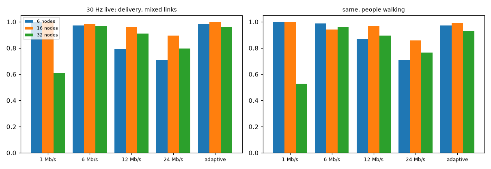

**Pass criteria** (the gate, not a number picked up front):

| Gate                       | Test                                                                         | Pass                                                                                     |
| -------------------------- | ---------------------------------------------------------------------------- | ---------------------------------------------------------------------------------------- |
| R0, enclosure link budget  | §4.5: RSSI both ways at 1/3/5 m, people walking, 4 orientations              | Every fixture-to-fixture link ≥ the 6 Mb/s sensitivity + 10 dB at the 1st percentile (−78 dBm); otherwise the install runs adaptive with a 1 Mb/s floor and fewer live Hz |
| Convergence                | `mesh_smoke` HITL, 2 DUTs, then all bench DUTs                               | Settles within 5 s of a change; no more than one rate change per 10 s per node when nothing moves |
| Live control               | `mesh_gateway` HITL at the target rate for the install (§6.4)                 | ≥ 99 % of live updates delivered, p99 latency < 50 ms                                    |
| Walking                    | `mesh_soak` with people (or an attenuator ladder) between DUTs               | Live delivery stays ≥ 97 %; no node stuck below 6 Mb/s once the obstruction clears       |
| Bulk                       | `mesh_effect`                                                                | Blob to all members, no rate-induced retries beyond 10 %                                 |


## 5. Protocol

### 5.1 Envelope

Every mesh frame, on every backhaul (implemented in `firmware/mesh/src/envelope.rs`):

| Field          | Size                | Notes                                                                                    |
| -------------- | ------------------- | ---------------------------------------------------------------------------------------- |
| magic          | 2                   | `"SM"` (short header) or `"SL"` (long header)                                            |
| version        | 1                   | 1. Unknown versions are dropped and counted                                              |
| mesh id        | 4                   | Random at creation                                                                       |
| key epoch      | 1                   | 0 = plain (join traffic), 0xFF = open follow stream, 1..=254 = mesh key epoch (§7.5)     |
| source node id | 2                   | For the nonce and the replay window                                                      |
| frame counter  | 4 (short), 8 (long) | The low 32 bits, or all 64, of the sender's 64-bit counter (§7.5)                        |
| ciphertext     | n                   | A `swarm.v1` `LinkFrame`, AES-128-CCM encrypted                                          |
| MIC            | 8 (802.11), 4 (UWB) | CCM tag over the header (the AAD) and the ciphertext                                     |

Overhead: 14 B + MIC (22 B on 802.11) for the short header, which almost every frame uses. A
sender puts its full counter in a long header (18 B) at least once a second, when the frame has
the 4 bytes to spare, so receivers without state for it learn the high bits. Packets are sized
for the short header, so the long one costs no payload.

The CCM nonce is source (2) ‖ counter (8, all 64 bits) ‖ epoch ‖ version ‖ MIC length = 13 B.
The mesh id is in the key derivation and the AAD, so the nonce does not need it.

Join requests, adverts and guest hellos (§7.3) use the short header with epoch 0 and no
encryption. They carry only membership payloads and never enter the flood. The open-mode
follow stream uses epoch 0xFF and the public open key (§7.4).

### 5.2 MTU per backhaul

| Backhaul                           | Frame        | Envelope | MeshPacket header | App payload                                   |
| ---------------------------------- | ------------ | -------- | ----------------- | --------------------------------------------- |
| UWB (DW3000, standard PHR)         | 125 B        | 18 B     | 24 B              | ~80 B (the swarm's 88 less the envelope; §11) |
| 802.11 Splanc action frame         | 250 B        | 22 B     | 24 B              | **200 B** (LinkFrame tags take a few bytes)   |
| 802.11, larger bodies (later, M14) | up to 1400 B | 22 B     | 24 B              | ~1300 B                                       |
| IP / UDP (later)                   | 1400 B       | 22 B     | 24 B              | ~1300 B                                       |

A mixed mesh uses the smallest MTU of the backhauls in use; the mesh beacon advertises it.
Messages larger than the payload are fragmented at the port layer (like the swarm's
`BundleFragment`), not in the mesh layer.

### 5.3 Ports

`PORT_APP = 16` and up are the application's (`swarm/net/src/net.rs`). Splanc's:

| Port  | Name         | Flood                                                   | Payload                                                             |
| ----- | ------------ | ------------------------------------------------------- | ------------------------------------------------------------------- |
| 16    | `CONTROL`    | to targets (broadcast with a target filter, or unicast) | `MeshControl{op_id, targets, apply_at?, inner ClientMessage bytes}` |
| 17    | `REPLY`      | unicast to the gateway                                  | `MeshReply{op_id, status, small ServerMessage bytes}`               |
| 18    | `STATUS`     | broadcast, every 10 s and on change                     | `MeshStatus` (§5.4)                                                 |
| 19    | `MEMBERSHIP` | broadcast or unicast                                    | join, admit, assign groups, mode, rekey (§7)                        |
| 20    | `SCENE`      | broadcast                                               | per-group scene generation and its state (§5.6)                     |
| 21    | `TIME_BASE`  | broadcast                                               | the show epoch in mesh time (§6.3)                                  |
| 22    | `FRESHNESS`  | unicast or broadcast                                    | session grants, acks, confirms, rekeys (§7.6, §7.9); own auth       |
| 23    | `BULK`       | broadcast                                               | bulk transfers (blob catch-up, M6); lowest relay priority (§10.6)   |
| 24–31 | reserved     |                                                         |                                                                     |

Link frame types beyond the swarm's (new `FrameType` values in the ported proto):

| Type     | Purpose                                                                                                             |
| -------- | ------------------------------------------------------------------------------------------------------------------- |
| `BEACON` | Every second: mesh id, channel, MTU, the swarm `Summary` (generations, blob progress), member count, mesh time (§6) |
| `BLOB_*` | The page protocol for blobs (generalised `FW_REQUEST`/`FW_DATA`/`FW_MANIFEST`, §5.5)                                |

Time beacons are not flooded through the managed flood (its random relay delay ruins
timestamps). Each node re-stamps and re-broadcasts the time in its own `BEACON` (§6.2).

### 5.4 What the mesh carries

Relayed control (`CONTROL` port), an allow-list of `ClientMessage` arms dispatched on members
through `lm_player_handle`, exactly as if they arrived over wss:

| Arm                                                                      | Size (typical) | Notes                                                                    |
| ------------------------------------------------------------------------ | -------------- | ------------------------------------------------------------------------ |
| `set_uniforms`                                                           | 20–150 B       | `seq` and `commit` work as today; `apply_at_ms` keeps its meaning (§6.3) |
| `set_effect`, `set_crossfade`, `set_brightness`                          | 10–30 B        | with `apply_at_ms`                                                       |
| `blend_keypoints`, `save_keypoint`, `delete_keypoint`                    | 20–200 B       |                                                                          |
| `set_device_name`, `set_fixture_pose`, `set_color_correction`, `set_fps` | 10–80 B        |                                                                          |
| `get_status`, `get_effect_uniforms`, `list_effects`, `list_keypoints`    | small          | the reply must fit one `REPLY` (§8.2)                                    |

Not relayed: mapping capture, `set_texture` (video), `fx_debug_*`, stored-map download, TLS
info, Wi-Fi policy for another member (dangerous over the mesh; per-device only), and OTA in
Phase 1. A member answers anything else with `error{unsupported_over_mesh}`.

`MeshStatus` (one packet, ~60 B): node id, full MAC, firmware version, uptime, active effect
content id per deck, brightness, scene generation per group, free and min heap, fps, the
parent it hears best (id + RSSI), time-sync error estimate, Wi-Fi state (associated / mesh-only),
the hash of its certificate (8 B prefix; full pin on request).

### 5.5 Effect programs: content-addressed blobs

1. The app sends `SubmitEffect` to the gateway as today (BLE uses `UploadChunk` reassembly).
2. The gateway stores it (existing path), computes `blob_id = SHA-256(fxb)[0..8]` and starts
   serving it on the page protocol (`swarm/net/src/update.rs`, generalised with a blob kind).
   A 4 KiB effect is **one page** of up to 43 chunks of 96 B (on 802.11, fewer and larger
   chunks fit one 200 B payload).
3. A `MeshControl{set_effect by blob_id, apply_at}` tells targets what to load. A target that
   lacks the blob requests its missing chunks (NACK bitmap) from the most advanced neighbour.
   It writes chunks into the effect store under `effect_id` (littlefs), not into RAM.
4. Once complete and the SHA-256 matches, the member loads it. A scheduled `set_effect`
   applies at its `apply_at`; one that arrives before the blob is complete is held until it
   completes (a late member then starts late, as on wss today).

The canary rule (serve only what you validated) maps to: serve only blobs whose hash checks.

### 5.6 Scene state and late joiners

The swarm's "late joiners catch up" rule, applied to looks. Each group has a **scene**: active
effect blob id per deck, committed uniforms, brightness, crossfade, with a generation the
gateway increments on every committed change. Members put `(group, generation)` pairs in their
`BEACON` summary. A member that hears a newer generation for one of its groups asks that
neighbour for the scene (a few packets) and applies it. A fixture powered on after the show
started is showing the room's look within seconds.

Live (uncommitted) moves such as a fader drag are not part of the scene; the final committed
value is.

### 5.7 Versioning

- Envelope `version` for the frame format; `LinkFrame.ver` for the swarm wire format.
- Mesh features are advertised in `welcome.features` (`mesh`, `mesh_gateway`) and in
  `MeshStatus`. The gateway does not send a member an arm its firmware version lacks.
- A member with an unknown envelope version is reported in the gateway's list as
  "incompatible", so the app can offer an update over a direct connection.

### 5.8 Two-tier distribution tree: UWB to relays, 802.11 to fixtures

**The owner's direction.** There will be two backhauls (UWB and 802.11), and every device's
position is known. Build a spanning distribution structure:
- the gateway sends over UWB to N L2 relays;
- each relay sends over 802.11 to M L3 fixtures, with N × M ≥ the mesh;
- the cooperative algorithm that builds it must survive moving scatterers (people) and moving
  fixtures.

The flood stays as the bootstrap and the fallback. Code: `firmware/mesh/src/tree.rs` (state
and decisions) and `firmware/mesh/meshsim/src/dist.rs` (the packet-level comparison).

**Choice: an RPL-style DODAG with a two-tier objective function.**

| Family                          | Fit                                                                                                                                       | Verdict                                       |
| ------------------------------- | ----------------------------------------------------------------------------------------------------------------------------------------- | --------------------------------------------- |
| Connected dominating sets (CDS) | Minimal relay sets, but building and repairing them needs 2-hop neighbourhood exchanges, and one moving node can invalidate the set far away | No: control traffic and fragility under churn |
| LEACH                           | Random rotating cluster heads; ignores link quality and capacity; assumes the heads reach the sink directly                              | No                                            |
| HEED                            | Cluster heads by a primary metric (capacity) and a secondary one (cost to join)                                                          | Kept: consolidation onto existing relays      |
| CTP (collection tree)           | ETX gradient, link-estimator table management, datapath validation; built for convergecast                                                | Kept: ETX estimation and table admission      |
| **RPL DODAG (MRHOF, ETX)**      | Rank-based parent choice with hysteresis, local repair, loop avoidance by rank, any node as root                                         | **Chosen**, with the objective below          |

**Objective.** A node's rank is `rank(parent) + w(radio) · ETX(link)`.
- **Radio weight.** UWB links weigh 0.5 and 802.11 links 1.0. The root's UWB neighbours
  therefore become the L2 tier on their own. Where neither end has UWB, the same rule builds a
  two-tier 802.11 tree.
- **Consolidation.** Joining a parent that is still a leaf costs +0.5, as in HEED. Fixtures
  prefer existing relays, so N stays small.
- **Child cap.** A parent advertises its child cap M: C6 8, P4 and Pi 12. Those are the class
  targets of 8/16/32, clamped so that the children plus 4 candidate parents fit in the 16-slot
  neighbour table.
- **The cap is soft.** Joiners skip a parent that is full. Joiners that race on a stale count
  can overshoot, and children with no other eligible parent stay. Measured: the worst excess
  is 4, and with the full-MAC data plane (below) a relay's child count costs no airtime.
- **No shedding.** Shedding excess children was tried and removed: at 32 fixtures it raised
  parent changes from 1.7–5.3 to 4.3–7.4 per node-minute without bounding the excess.

**Links and the neighbour table.**
- **ETX** is kept per neighbour and per radio, from advert reception (1 s windows, EWMA ¼).
  802.11 adverts come once a second, as do UWB beacons (one TDMA slot per node per second).
- **Position priors.** Localization gives a prior ETX for a link with under 3 windows of
  history: 802.11 good within ~8 m, UWB within ~15 m line of sight. A neighbour that moved
  more than 2 m has its history reset.
- **Table admission (CTP-style).** The parent, children and the root are never evicted. A
  newcomer takes a free slot, or displaces the worst-ranked unprotected entry, but only if it
  names us as parent or ranks better than that entry. Otherwise it is ignored.
- **Why admission is needed.** The first version admitted everyone by evicting the stalest
  entry. From 32 fixtures more neighbours were audible than the table holds, and it
  evicted about 2,000 entries per node-minute. Every parent loss in that version was an
  eviction.

**Stability and repair.**
- **Hysteresis.** A node switches parent only for a gain of ≥ 0.5 ETX, and at most once per 5 s.
- **Lost parent.** A parent is lost after 3 s of silence, or after 2 s of advertising no
  route. The 2 s hold-down stops a relay's brief repair from cascading through its subtree.
- **Local repair.** A lost parent resets the node's rank, so any non-child neighbour can
  take over. A neighbour that names us as parent is never chosen (no 2-cycles); otherwise
  loops are avoided by rank.
- **A defect the tests caught.** Before the rank reset, a node whose only alternative had
  its own old rank stayed on a parent without a route indefinitely.

**Data plane.**
- **Root.** The root sends each update on UWB (its data slot every 4 ms; 80-byte frames, so a
  packet is fragmented and every fragment must arrive) and on 802.11.
- **Relays and leaves.** Relays rebroadcast once on 802.11 (0–2 ms jitter). Leaves never relay.
  Orphans fall back to the managed flood.
- **Full MACs.** Every packet carries every member's per-receiver MAC entry (§7.9), exactly as
  in the flood, so any overheard copy delivers.
- **Subtree MACs were measured and rejected.** Each packet carried only the forwarder's
  subtree entries. That made the tree a single-path structure: at 32 fixtures it
  delivered 87–94 %, against 99.99 % with full MACs (64 fixtures: 63 %).
- **Reliable commands** (1 per second in the model) carry a sequence. A node that sees a gap
  (a later sequence, or its parent's advert naming a newer one) asks its parent by unicast
  NACK. Live updates are not repaired: the next one supersedes.
- **Relay cache.** The model keeps 16 reliable packets per relay. On a C6, 4 × 200 B = 800 B
  covers 4 s of reliable commands at 1 Hz (an estimate, not measured).

**Control overhead.** The tree adds 12 bytes (`TreeAd`) plus the position (4 bytes) to
adverts that exist anyway (§5.3). It also adds NACKs, repairs, and a child report from each
relay every 5 s. Measured: 22–53 B per node per second.

**Security** is unchanged. The tree only decides who forwards. Per-receiver MACs and freshness
are end to end (gateway → member), so a relay can drop packets but cannot forge or replay
them. A malicious relay is an availability problem. Full MACs limit it: any other relay's copy,
or the flood fallback, delivers.

**Any node can be the gateway**, so there is one DODAG per root. The extra state per
additional root is the rank, parent and role; the neighbour table is shared.

**Results** (`meshsim` `treesweep`, 30 Hz live updates plus one reliable command per second,
3 % loss, people walking, 5 m grid; `docs/design/mesh/tree-*.png`, `tree.csv`):

| Fixtures                    | Flood: delivered / p99 / 802.11 airtime | Tree, no UWB          | Tree, 50 % UWB        | Tree, all UWB         |
| --------------------------- | --------------------------------------- | --------------------- | --------------------- | --------------------- |
| 6                           | 99.9 % / 10 ms / 0.019                  | 93.2 % / 2 ms / 0.007 | 98.8 % / 4 ms / 0.015 | 99.8 % / 4 ms / 0.009 |
| 16                          | 99.97 % / 9 ms / 0.043                  | 99.1 % / 5 ms / 0.028 | 99.98 % / 5 ms / 0.032 | 99.99 % / 4 ms / 0.040 |
| 32                          | 99.95 % / 12 ms / 0.155                 | 99.8 % / 7 ms / 0.113 | 99.99 % / 6 ms / 0.110 | 99.99 % / 7 ms / 0.133 |
| 64                          | 99.5 % / 24 ms / 0.41                   | 99.3 % / 19 ms / 0.57 | 99.6 % / 19 ms / 0.60 | 99.3 % / 19 ms / 0.64 |
| 128                         | 85 % / 365 ms / 2.9                     | 77 % / 421 ms / 2.4   | 82 % / 451 ms / 2.4   | 87 % / 434 ms / 2.5   |

- **6 fixtures.** The tree has no redundancy: most fixtures are the root's direct children,
  and one broadcast lost to a walking person is lost. The flood costs only 2 % airtime here.
- **16–32 fixtures.** The tree delivers as well as the flood. It halves p99 and uses 7–35 % less
  802.11 airtime. With people walking and 25 % of fixtures moving (0.3 m/s), it delivers
  99.99–100 % against the flood's 99.95–100 %.
- **64 fixtures.** p99 is still better (19 against 24 ms), but the tree spends more airtime.
  Its 13–16 relays all rebroadcast every part, while the flood's duplicate cancellation
  suppresses more. Relay suppression is T3.
- **128 fixtures at 30 Hz** fail in both. The per-receiver MAC bytes (127 × 8 B per update) are
  the limit. The broadcast authenticator (§7.9, Q19) removes it: 99.4 % at 128 fixtures.
- **Relay failure.** Killing the busiest relay: its children re-parent in 3.0 s (the 3 s silence
  bound). Delivery during the repair stays at 99.7 %, because full MACs let the children use
  other relays' copies.
- **Churn.** Parent changes are 1.5–6 per node-minute up to 32 fixtures and 8–11 at 64–128.
  Unlike the 7 % at 6 fixtures, this does not cost delivery here.
- **UWB.** At 50 % UWB the UWB tier carries 6–51 fixtures' parents (32–128 fixtures). The root's
  UWB range (~15 m with 3 dB enclosure loss per end) reaches only part of a large venue.
  Beyond that, relays are 802.11. UWB's gain over a two-tier 802.11 tree is small in this
  model: it fixes the 6- and 16-fixture redundancy gap, and its airtime (≤ 5 %) is its own.

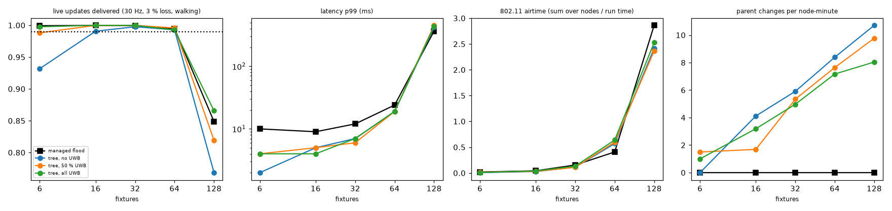

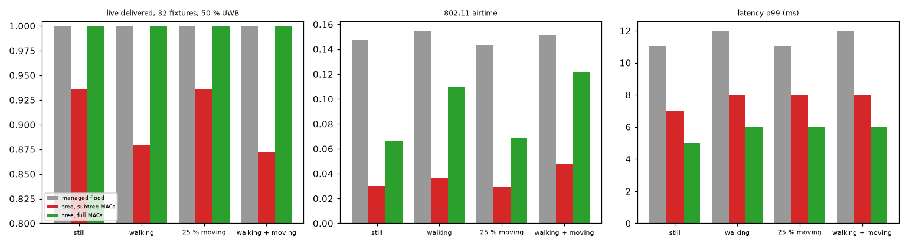

**Model limits.** `dist.rs` is a packet-level model, lighter than the full `meshsim` stack: no
crypto, queues or swarm pages. Its absolute live capacity is optimistic against §10.6, where
the full stack gave 32 fixtures no rate at ≥ 99 %. The comparisons between schemes are the
result; absolute rates are not. UWB is a link budget plus a fixed slot schedule (no
DW3000-specific MAC behaviour) until U1/U2 hardware exists.

**RAM on the C6:** `Tree` is 736 B (measured, `MESH_RAM_tree`), plus the relay cache (800 B
estimated). That is ~1.5 KB on top of the 15,472 B stack, and only on fixtures that run the
tree.

**Recommendation.**
- Flood up to ~16 fixtures, and the tree with full MACs from ~24–32. The root switches by
  member count and keeps the flood as the fallback.
- No relay suppression yet (T3 for 64+).
- UWB as the root's first tier where present.

**Owner decisions (2026-11-18, Q18–Q21) and what they changed.**

- **Automatic switch (Q18).** The root runs `tree::Selector`:
  - It moves to the tree at ≥ 24 members and back to the flood at ≤ 16, once the count has
    held past the threshold for 5 s.
  - Every data packet carries the mode the root chose for it. The tree is maintained in both
    modes (its fields ride on adverts), so a switch takes effect on the next packet.
  - In a 105 s membership ramp (8 → 30 → 20 → 14, then 15 ↔ 25 every 3 s), it switched exactly
    three times, and never on the oscillation that is shorter than the hold.
  - Delivery was 99.6 %, against 99.9 % flood-only and 99.6 % tree-only. 802.11 airtime was
    0.072, against 0.089 and 0.058.
  - A switch into the tree 5 s after a burst of joins costs ~1 % for ~15 s while the
    newcomers' parents settle. The tree-only run shows the same dip after the joins.
    Mitigation (T1): switch only once ≥ 90 % of members appear in relays' child reports.
- **Multi-hop UWB (Q20).** `TreeAd` carries the parent radio (flags bit 3). A relay forwards
  over UWB to children that joined it over UWB, and over 802.11 to the rest; a relay with
  only UWB children skips 802.11.
  - The UWB TDMA is a 4 ms superframe of four 1 ms slots: slot 0 the root's, slots 1–3 shared
    round-robin by UWB relays (up to 4 frames each).
  - Measured UWB depth is up to 4–6 hops at 64–128 fixtures.
  - With per-receiver MACs, multi-hop UWB saturates its slots. A 64-member update is 4 parts ×
    3 fragments, UWB utilisation reaches 0.5–0.6, and delivery drops 0.1–2 %.
  - With the broadcast authenticator (one 90 B packet, 2 fragments) it pays off: 802.11
    airtime falls 13–23 % (64: 0.105 → 0.091; 128: 0.303 → 0.232) at equal delivery
    (99.4–99.6 %), with UWB utilisation 0.10–0.31.
  - The tree objective already lets UWB chains form (weight 0.5 per hop), so no new rule
    was needed.
- **Every fixture caches (Q21).** `tree::RelayCache<4, 200>` is 828 B on the C6 (measured),
  plus `Tree` (736 B) and `Selector` (32 B): 1,596 B.
  - Repair requests reach back at most 3 reliable commands (p90 ≤ 1, 0–20 % loss, 32–64
    fixtures, 60 s runs).
  - So the cache needs (max age + 1) × packets per command entries. With one packet per
    command (≤ 19 recipients, or the authenticator), 4 entries answer every request.
  - The misses at 64 fixtures with per-receiver MACs come from 4-packet commands, which the
    authenticator removes from the live path.
  - Repairs are rare (≤ 136 requests per minute in a 64-fixture mesh at 20 % loss), because
    full MACs make any overheard copy count.

| Fixtures | Flood (per-receiver) | Tree, per-receiver MACs | Tree + authenticator (20 ms, d = 3) | Bytes per update |
| -------- | -------------------- | ----------------------- | ----------------------------------- | ---------------- |
| 32       | 100 % / p99 12 ms / 0.19  | 99.97 % / 6 ms / 0.107  | 99.98 % / 100 ms / 0.036          | 307 → 90         |
| 64       | 99.8 % / 27 ms / 0.71     | 98.6 % / 19 ms / 0.52   | 99.5 % / 102 ms / 0.095           | 563 → 90         |
| 128      | 66 % / 420 ms / 2.39      | 79 % / 381 ms / 2.06    | 99.4 % / 113 ms / 0.25            | 1,075 → 90       |

(delivered / latency p99 / 802.11 airtime; 30 Hz, 50 % UWB, multi-hop UWB, people walking.)

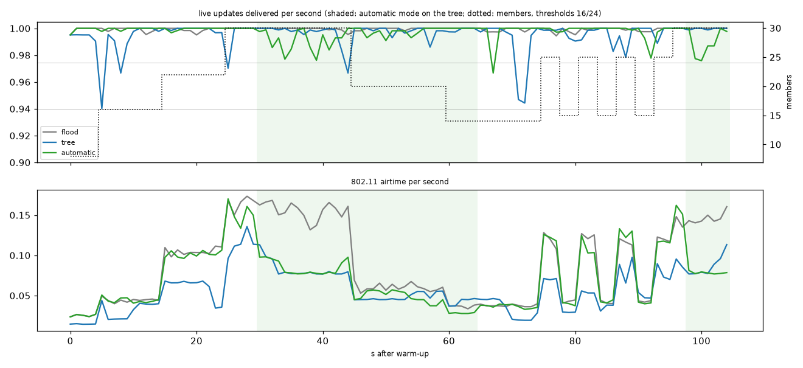

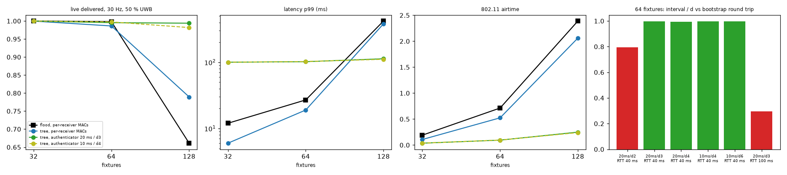

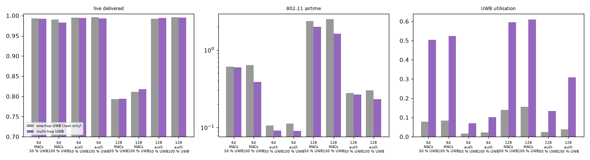

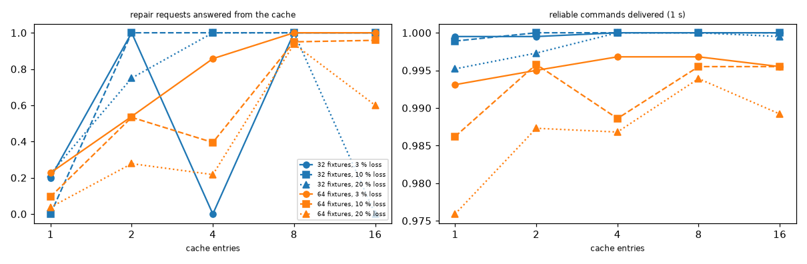

## 6. Time sync and apply_at across the mesh

### 6.1 Budget

`docs/design/synced-show.md` targets < 10 ms between fixtures. Across the mesh, the shares are:

| Source           | Target         | How                                                             |
| ---------------- | -------------- | --------------------------------------------------------------- |
| Mesh time offset | < 1 ms per hop | beacons, hardware RX timestamps                                 |
| Drift            | absorbed       | per-neighbour linear fit (the `DriftEstimator` method, in Rust) |
| Delivery spread  | hidden         | `apply_at` with a lead larger than the worst delivery           |
| Render phase     | one frame      | as today (not solved here)                                      |

### 6.2 Mesh time

Mesh time must not depend on any single peer (owner, 2026-11-17).

- Every `BEACON` carries the sender's estimate of mesh time at its TX instant (`t_mesh`). A
  receiver pairs it with the hardware RX timestamp (`RxMeta.rx_us`, §4.1). That gives one
  **sample per neighbour**: the neighbour's offset from this node's clock, with an error
  bound from timestamp jitter, the sender's own uncertainty and the fit residual.
- **Robust aggregation** (`firmware/mesh/src/timesync.rs`, wired in by M4):
  - Samples from all neighbours heard in the last window are intersected with Marzullo's
    algorithm. With `n ≥ 2f + 1` sources and at least `n - f` of them agreeing, up to `f`
    liars cannot move the estimate.
  - Without such a quorum the estimate falls back to the median at **low confidence**.
  - Per-peer rate is still fitted over a 5 min window, rejecting outliers by residual, like
    `TimeDiscipline`.
- **Steps and slews**:
  - A correction larger than 50 ms is applied as a step only at high confidence and with at
    least three agreeing peers.
  - Everything else slews, at most 500 ppm. A node that sees a single peer (low confidence)
    can be moved only 0.5 ms per second, which `MeshStatus` reports.
- **Effects keep running** whatever mesh time does. The renderer's clock never stops or
  waits; a correction only shifts where future `apply_at` deadlines land.
- No root is elected. A gateway with an app session does not get to define time either; it
  is one source among its neighbours.
- Error per hop: the TX instant is the time just before `ns_mac_send`, so queueing and pacing
  add jitter. Each beacon carries the previous beacon's measured TX-to-air correction if the
  hardware exposes a TX timestamp (M3a looks for one). Expect tens of µs per hop.
- **AP-anchored bonus**: members associated to one AP all hear its beacons, whose TSF is a
  common clock (reference-broadcast sync). The fit can use AP beacons as extra observations.

**M4 on hardware** ([mesh-m4.md](mesh-m4.md)): two-step completion stamps (no hardware TX
timestamp), two-way over the beacons, RX stamps on the MAC's µs counter (`0x600AD000`):
three C6s agree within 47 µs; a scheduled change lands within 0.76 ms (2 ms under BLE coex),
always on the same frame. The show epoch rides in the time beacon (outside the admin port).

### 6.3 Mapping the show clock

1. The app syncs with the gateway as today (`TimeSyncPing`/`Pong`, `web/src/net/clocksync.ts`)
   and sends the gateway `SetTimeBase{epoch_ms}` in the gateway's clock.
2. The gateway converts it to mesh time and floods `TIME_BASE{epoch_mesh_us, generation}`.
3. Each member converts mesh time to its own `millis()` and applies the epoch through the same
   internal path as `SetTimeBase`. The bridge's slews (≤ 2 ms steps) become new `TIME_BASE`
   generations, flooded the same way.
4. `apply_at_ms` is ms on that epoch, the same number on every member. So a relayed
   `SetUniforms{apply_at_ms}` lands on the same frame everywhere, unchanged.

Lead: `apply_at` must be later than the slowest delivery. One hop with relay delay is under
25 ms (0–3 virtual slots of 5 ms plus airtime); three hops under ~75 ms; a missed broadcast
plus one want-ack retry adds 1 s. The default lead stays the bridge's 150 ms for one or two
hops, and 300 ms when the target set is three hops out. A member that receives a change after
its `apply_at` applies it on arrival and counts it late (reported in `MeshStatus`).

### 6.4 Live updates: as fast as the airtime allows, smooth on every member

Live moves (fader drags, uncommitted uniforms) should feel immediate on every fixture (Q13).

**On the mesh** (`MeshStack::send_live`, M2):

- **Coalesced per frame.** A new live update replaces one not yet sent, so the mesh always
  carries the newest value at whatever rate its airtime allows. Live traffic never queues
  behind itself.
- **Compact and batched.** One packet carries several uniforms, each as uniform id + 16-bit
  value, plus a sequence number (8 B for two uniforms). Deltas against the last committed
  scene keep it small. The per-receiver MACs (8 B per member, §7.9) dominate the size, not
  the values.
- **Priority over bulk.** Live control relays at high priority; bulk is evicted first (§10.6).
- **Rate per mesh size.** The app offers updates at its UI rate (60 Hz or more); coalescing
  turns that into the rate the mesh carries.

**Measured** (meshsim, grid, mixed links, 5 % loss, people walking; offered 15–120 Hz):

| Nodes | Highest rate at ≥ 99 % delivered                         | ≥ 97 % delivered | What members receive at 120 Hz offered |
| ----- | -------------------------------------------------------- | ---------------- | --------------------------------------- |
| 6     | 15 Hz (99.7 %, adaptive)                                  | 60 Hz            | 112–116 updates/s                       |
| 16    | **45 Hz** (99.0 %, adaptive)                              | 60 Hz            | 82–107 updates/s                        |
| 32    | none: 98.7 % at 15 Hz is the best                         | 15 Hz            | 41–96 updates/s                         |

**On every member: interpolation on its own render clock** (`firmware/mesh/src/interp.rs`):

- Each live update is a keyframe that applies at `apply_at = sent + playout delay`, in mesh
  time (§6.2). The playout delay is 2.5 keyframe intervals, at least 33 ms: 83 ms at 30 Hz,
  56 ms at 45 Hz, 33 ms at 60 Hz and above.
- A member renders at 60 fps or more and samples each uniform at its render time:

| Uniform type             | Between keyframes                         | Past the last keyframe (loss)                                                   |
| ------------------------ | ----------------------------------------- | ------------------------------------------------------------------------------- |
| float (fader, speed)     | Catmull-Rom (Hermite); linear at the ends | keep its velocity for ≤ 1 interval, ease to a hold over the next; hold after   |
| colour                   | linear per channel (linear RGB)           | hold                                                                            |
| int, enum, bool, effect  | step at `apply_at`                        | hold                                                                            |

- **Smoothness** (a 0.5 Hz full-scale fader, rendered at 60 fps, error against the true
  motion delayed by the playout delay): wherever delivery is ≥ 97 % (14 of 36 runs), Hermite's
  RMS error has a median of 0.0004 of full scale and a worst case of 0.015. Linear is a median
  3× worse, and step a median 140×.
  With interpolation a 30 Hz mesh rate already renders as smooth motion at 60+ fps; the
  playout delay is the price.
- A track holds 8 keyframes (enough for the delay at 120 Hz).

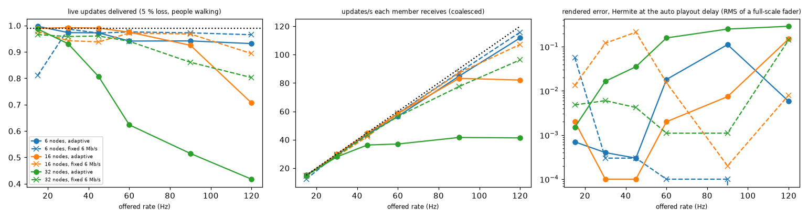

So the radiolarians (6 fixtures) can take 60 Hz live moves at ≥ 97 % and render them smoothly.
A 16-fixture install runs comfortably at 45 Hz. Past ~32 fixtures the per-receiver MACs are
the limit. Above 24 members live moves use the broadcast authenticator (§7.9, Q19).


## 7. Membership, groups and security

### 7.1 Three membership modes

The mode is a per-mesh setting the owner changes from the app at any time.

| Mode                            | Who can join                                                              | What a member gets                                                                         | Protection                                                              |
| ------------------------------- | ------------------------------------------------------------------------- | ------------------------------------------------------------------------------------------ | ----------------------------------------------------------------------- |
| **Open** (free association)     | Any Splanc device that is set to follow open meshes. No secret            | **Guest**: follows the mesh (time, scenes, effects, live uniforms). Cannot manage anything | Owner-signed state, a public "open" key for framing, rate limits (§7.4) |
| **Closed** (authenticated join) | A device that proves it holds the **site secret** (given at provisioning) | **Member**: controllable from the gateway, holds the mesh key                              | AES-CCM under the mesh key (§7.5)                                       |
| **Locked**                      | Only devices the owner approved, by device key                            | **Member**, on the allow-list                                                              | Mesh key; removal rotates it (§7.6)                                     |

Open mode runs **alongside** the closed traffic: the owner's members are still members under
the mesh key, and the mesh additionally publishes a follow stream that guests can read. Turning
open mode off stops the follow stream; guests fall away and members are untouched.

### 7.2 State on each device

Persisted in littlefs (one small file, written only on membership changes):

- mesh id, name, channel, mode, membership generation;
- members only: the mesh key and epoch, the previous key during a rotation (§7.6), the
  pairwise key from its join, and in locked mode the allow-list (≤ 64 device-key hashes);
- its own groups (≤ 8 ids);
- the **mesh owner public key** (P-256, §7.4), learned at join;
- a device setting, `mesh_follow`: `off` (default for a device already in a mesh) or `open`
  (follow any open mesh it hears; the setting a home-built fixture ships with).

### 7.3 Joining

| Path                | Modes          | How                                                                                                                                                                                                                                                                                                                                                                                                                                                                                 |
| ------------------- | -------------- | ----------------------------------------------------------------------------------------------------------------------------------------------------------------------------------------------------------------------------------------------------------------------------------------------------------------------------------------------------------------------------------------------------------------------------------------------------------------------------------- |
| **App-provisioned** | all            | The app talks to the device directly (BLE Improv at setup, or wss/BLE later) and sends `MeshJoin{mesh id, key, epoch, channel, mode, groups, owner public key}` over the trusted link. In locked mode this is also the approval: the app adds the device's key hash to the allow-list                                                                                                                                                                                               |
| **Site secret**     | closed         | A device provisioned with the site secret hears the mesh beacon and broadcasts `JoinRequest{node id, MAC, device public key, firmware, proof}`, with `proof = HMAC(site_secret, "join" ‖ beacon nonce ‖ node id)`. The beacon nonce stops replays of an old proof. Any member checks the proof, wraps the mesh key for the newcomer (ECDH between the two devices' P-256 keys, the per-device TLS keys of `docs/design/per-device-cert.md`, then HKDF and AES-CCM) and announces it |
| **Approval**        | closed, locked | A device without the secret (or any device, when locked) sends a `JoinRequest` without proof. Members forward it to the gateway; the app shows "New fixture nearby: admit?" One tap admits it (and, when locked, adds it to the allow-list)                                                                                                                                                                                                                                         |
| **Follow**          | open           | A device with `mesh_follow = open` hears an open mesh's beacon and starts following. It sends a `GuestHello{node id, device public key hash, firmware}` so the owner sees it in the app. No key exchange                                                                                                                                                                                                                                                                            |

The site secret is a 32-byte value the app creates per installation and hands to every device
it provisions. The C6 has an ECC accelerator; even in software one ECDH per join is a one-off.

### 7.4 Open mode: what guests can and cannot do

The point of open mode: someone shows up with a fixture they built, it joins and starts doing
the coordinated effects. A guest must be able to follow the show, and must never be able to run
it.

**Guests can:**

- take mesh time and the show epoch (`TIME_BASE`), so they land on the same frames;
- follow the open groups' scenes: the effect (fetching the blob), committed uniforms,
  brightness, crossfade;
- follow live uniform moves (fader streams) on open groups;
- relay follow-stream frames (more coverage for other guests);
- send `GuestHello` and a small status every 30 s.

**Guests cannot:** send `CONTROL` to anyone, change membership or groups, originate scenes,
effects or time, act as a gateway for management, or read member-to-member traffic (it is
under the mesh key, which guests don't have).

**How the follow stream is protected.** Guests hold no secret, so a symmetric key can't prove
anything to them. Two layers:

1. **Framing under a public open key**, `K_open = HKDF(mesh id, "open")`, using the same
   envelope (§5.1) with a reserved epoch. It gives integrity against corruption, not
   authenticity: anyone can compute it.
2. **Owner signatures on what lasts.** At mesh creation the app generates a mesh owner key pair
   (P-256; the private key stays in the app and the bridge, the public key goes to every member
   and is in the beacon). Scene commits, effect blob ids and `TIME_BASE` generations on the
   follow stream carry an ECDSA signature from the app; the gateway only relays them. A guest
   verifies them against the owner key it learned when it first followed (trust on first use,
   shown in the app as "following <mesh name>").
3. **Live moves are unsigned** (a signature per fader frame is too costly). Guests accept them
   only for the signed scene's effect, only within each uniform's manifest range, and only up to
   the rate limit. A forger can wiggle a guest's sliders between commits; the next signed commit
   puts it back. Members never act on open-key frames.

**Abuse limits:**

| Limit                                 | Value                                                                                                                                                             |
| ------------------------------------- | ----------------------------------------------------------------------------------------------------------------------------------------------------------------- |
| Guests tracked                        | 16, in their own tables (dedup, replay, status), so guests can't evict members' entries                                                                           |
| Per-guest traffic relayed or answered | ≤ 5 frames/s and ≤ 1 KB/s; excess is dropped and counted                                                                                                          |
| What members relay from guests        | only `GuestHello` and guest status, one hop                                                                                                                       |
| Blob size a guest will fetch          | ≤ `FX_MAX_BYTES` (4 KiB), only for a signed blob id                                                                                                               |
| Follow stream rate (owner side)       | live moves coalesced to ≤ 15 Hz on the open key                                                                                                                   |
| Getting out                           | the owner switches the mesh to closed or locked (below); guests stop following within one beacon interval and fall back to their own effect after 10 s of silence |

The open groups are chosen by the owner (default: the "all" scene). A guest follows a group
named in the beacon; it does not join groups itself.

### 7.5 Frame protection, counters and freshness (members)

Implemented in `firmware/mesh/src/{envelope,replay,security}.rs`.

- **AES-128-CCM** over every member frame (§5.1), keyed by `HKDF(mesh key, epoch, "frame")`
  salted with the mesh id. It reuses the netstack's CCM (`firmware/netstack/src/ccmp.rs`, on
  the C6's AES accelerator). M2 made that CCM generic over the tag length, streamed the AAD
  and compares tags in constant time; RFC 3610 vector #1 and an equivalence test with the old
  code cover it.
- **The counter never rolls over.** Each sender has a 64-bit logical counter. The nonce uses
  all 64 bits; the short header sends the low 32.
  - A receiver rebuilds the high bits from the highest counter it has seen from that sender
    (SRTP's rollover guess: the candidate nearest the last one). A wrong guess makes the
    nonce wrong, so the MIC fails. A guess can lose a frame; it can never accept a forged or
    replayed one.
  - Tests cover 2^32 boundaries in both directions, reboot jumps, and wrong guesses.
- **Persistence: blocks reserved ahead.**
  - The device persists a high-water mark (every counter below it may have been used) one
    block of 2^16 frames ahead. The next reservation is asked for when half the block is
    spent, so the write lands long before it is needed and nothing stalls.
  - At boot the counter jumps to the stored mark. A counter is never reused, and flash sees
    one small write per 65,536 frames plus one per boot.
- **Replay window, independent of time.** Per source, the receiver keeps the highest counter,
  a 32-frame bitmap and a *synced* flag: 16 B per source, 64 members = 1 KB. It checks before
  decrypting and commits only after the MIC verifies, so a forged frame cannot move the window.
  - **A source the receiver has no state for** (after a fresh join, or the receiver's own
    reboot) is learned from its next long header. That is only group-key authenticated, so
    the source is *unsynced*. Its security-relevant traffic (admin commands, membership,
    rekeys) is held until a **freshness exchange** syncs it: the receiver sends a nonce; the
    sender returns its current full counter, bound to the nonce by a MAC under their pairwise
    key (§7.9).
  - After a sync, only higher counters are fresh. A sync also undoes an insider who inflated
    a sender's counter with group-key frames to starve it.
  - As a fallback, receivers persist their high-water marks occasionally and restore them at
    boot as a floor.
- **MIC**: 8 B on 802.11; 4 B on UWB.
- This replaces the swarm's per-message HMAC for Splanc traffic.

### 7.6 Mode transitions and key rotation

| Transition                         | What happens                                                                                                                                    | Existing members                                     | Existing guests                                                                    |
| ---------------------------------- | ----------------------------------------------------------------------------------------------------------------------------------------------- | ---------------------------------------------------- | ---------------------------------------------------------------------------------- |
| open → closed                      | Follow stream stops; beacons stop advertising open                                                                                              | unchanged                                            | stop following; the app lists them as "former guests" with "Admit" (approval path) |
| closed → locked                    | The app shows the current members as the proposed allow-list; the owner confirms or unticks some. Then a **key rotation** to the listed members | listed: unchanged; unticked: dropped by the rotation | n/a                                                                                |
| locked → closed                    | Allow-list dropped; site-secret joins accepted again. No rotation needed                                                                        | unchanged                                            | n/a                                                                                |
| closed or locked → open            | The follow stream starts on the open groups                                                                                                     | unchanged                                            | new guests may follow                                                              |
| remove a member (closed or locked) | Key rotation without it, rotating the **site secret too**, plus an admin-signed revocation of its device key                                    | others: new key and site secret                      | n/a                                                                                |

**Rotation on removal** (`firmware/mesh/src/rekey.rs`; one broadcast, AES only on members):

1. The app, which holds the admin secret, picks a new mesh key **and a new site secret**. It
   signs a `RekeyOrder` with the admin key: mesh id, new epoch, a 16-byte commitment to the
   new keys, and the revocation list (device-key hashes of removed devices). It hands the
   order and the keys to its gateway.
2. The gateway picks a transport key `K_t` and encrypts the new keys under it once. The order
   plus the encrypted keys is a 185 B head. It then wraps `K_t` for every remaining member in
   its session roster under that member's cached pairwise key: **26 B per member** (node id +
   AES-CCM of 16 B + 8 B tag), 7 per packet. Removed members get no wrap.
3. A member with the head and its wrap unwraps `K_t`, decrypts, checks the commitment against
   the signed order (one ECDSA verify), installs the new keys **for receive only**, and acks
   under its pairwise key.
4. **Staged switch.** Everyone keeps sending under the old key, so members without the new one
   can still read everything, relays of the rekey included.
   - The gateway switches once every member has acked, or after 20 s.
   - Every other member switches as soon as it hears any frame under the new key. Only key
     holders can make one.
   - The old key stays accepted for 60 s after each node's switch.
   - The gateway re-sends the head and the wraps of members that have not acked once a
     second. A member re-acks only when a re-sent wrap still names it, which avoids an ack
     storm.
5. Members store the revocation list (8 entries) and refuse joins from revoked keys, even
   with a valid proof or allow-list entry.

Measured in meshsim:

| Fixtures         | Rekey message                | All acked | All sending under the new key |
| ---------------- | ---------------------------- | --------- | ----------------------------- |
| 6 (radiolarians) | 296 B in 2 packets           | 80 ms     | 0.8 s                         |
| 64 (8×8 grid)    | 1,860 B in 10 packets        | 11.1 s    | 11.7 s                        |

- **Spares and absent members.** Unjoined spares holding the old site secret can no longer
  join by proof: the epoch-1 key and the join proofs use the old secret. They need
  re-provisioning with the new secret, or an approval join.
- A member that was away during the rotation hears adverts at the new epoch. With the old
  site secret its proof fails, so it is listed for approval. A pairwise-MAC'd `RekeyRequest`
  that lets it recover without the app is staged for M7c.

### 7.7 Groups

- Group ids are u8 (0 = none). Names live in the app and the hub config; members store ids only.
- `AssignGroups{node, groups}` (membership port, authenticated) sets a member's groups,
  persisted.
- A `MeshControl` with a group target is broadcast; members not in the group drop it after
  decrypting the header. Scenes are per group (§5.6). In open mode the owner marks which groups
  guests follow.
- The hub/app may also target an ad-hoc list (≤ 8 ids) without creating a group.

### 7.8 How this relates to device trust

- The app still pins each device's certificate by MAC (`deviceTrust.ts`, `trust.ts`). A member
  reports its certificate hash in `MeshStatus` and `JoinRequest`; the app pins it at first sight
  and warns on a change, as for a direct connection. In locked mode the allow-list entry is that
  same device key.
- The app-to-gateway leg is TLS or BLE as today. Gateway-to-member traffic is protected by the
  mesh key, not TLS. A member trusts the gateway because the gateway holds the mesh key.
- The mesh owner key is new: it lives with the app's site data (backed up with it,
  `web/src/store/backup.ts`) and is copied to the bridge when one manages the site.

### 7.9 Administration: kiosk-style unlocking, insider-resistant authority

The radiolarians' mesh is **closed** (the site secret admits members), and administering it is
**unlocked with an admin secret, the way kiosk mode works**. Kiosk mode today
(`docs/design/kiosk-mode.md`):

- firmware: `firmware/player_app/kiosk_ffi.rs` (`lm_kiosk_gate` classifies every arm before
  any handler; `kiosk_unlock{secret}` unlocks only the connection that sent it, until it drops;
  `secret_eq` is constant time; a wrong secret locks unlocking out for 2 s), persisted in
  `/lfs/kiosk.cfg`;
- app: `web/src/halloween/kioskSecrets.ts` generates a 128-bit secret per device, keeps it in
  `localStorage` (`splanc.kioskSecrets.v1`), and `web/src/ui/screens/kioskSection.ts` offers
  "Copy owner secret"; the key is in the app backup (`web/src/store/backupFormat.ts`).

**The hole in the first draft.** The first draft used a shared HMAC admin key `K_admin` held
by every member. Every member could therefore verify, and so forge, admin commands; and any
holder of the group mesh key could impersonate any member. The design now gives no member a
key that can create authority.

**Who holds what** (`firmware/mesh/src/admin.rs`):

|                         | App and bridge                                                         | Gateway (any fixture an admin is connected to)       | Every member                                                           |
| ----------------------- | ---------------------------------------------------------------------- | ---------------------------------------------------- | ---------------------------------------------------------------------- |
| Admin secret (128 bit)  | yes (`splanc.meshAdmin.v1`, exportable: copy, QR, file, backup)        | no                                                   | no                                                                     |
| Admin signing key (P-256) | derived from the secret and the mesh id                              | no                                                   | no                                                                     |
| Admin public key        | yes                                                                    | yes                                                  | yes (provisioned, or delivered authenticated in the join wrap)         |
| Session grant           | signs it                                                               | presents and broadcasts it                           | verifies it once per session                                           |
| Pairwise keys           | no                                                                     | one per roster member (ECDH of device keys)          | one per gateway it has a session with                                 |

1. **Unlock = a signed session grant.**
   - The app signs "gateway G (its device key) may issue commands for session S until T".
     `mesh_unlock{grant}` unlocks only the connection that presented it, with kiosk's 2 s
     device-wide lockout on a bad one.
   - The gateway broadcasts the grant. Each member verifies the signature **once per
     session** and derives a pairwise key with G.
   - "Until T" is in mesh time; an expired grant is refused. A bad clock can only expire a
     grant early (denial), never extend authority, because the grant's T is signed.
2. **Freshness by challenge-response.**
   - Each member answers the grant with `Ack{session, its device key, nonce, MAC}`. The MAC is
     under the pairwise key, so it proves the member holds that device key.
   - G replies `Confirm{nonce, its current 64-bit counter, MAC}`.
   - From then on the member accepts only command sequences above the last one it accepted,
     and none more than 64 of G's frames below the confirmed counter.
   - A member with no session (fresh join, reboot) **holds** G's command, asks for the grant,
     syncs, and only then judges it. A command captured earlier is refused.
3. **Per-receiver MACs.**
   - Every admin-class packet (`CONTROL`, `MEMBERSHIP`, `SCENE`, `TIME_BASE`) carries, for
     each recipient, its node id and a 6-byte MAC under that recipient's pairwise key with G.
   - No other member holds those keys, so no member can forge, alter or redirect a command,
     even with the mesh key and its own session.
   - A packet carries at most `(payload − 13 − body) / 8` recipients (19 at a 20 B body), so
     larger targets take several packets.
4. **Member reports bound to device keys.** Grant acks, rekey acks and freshness replies are
   pairwise-MAC'd. `PendingJoin` (a member telling gateways about a joiner) is advisory: a
   forged one only adds a prompt to the app, and admission still needs the admin's command.

**Costs.**

| What                                     | Bytes                                    | CPU on the C6 (estimate; measure in M3a)                                    |
| ---------------------------------------- | ---------------------------------------- | --------------------------------------------------------------------------- |
| Session grant (once per admin session)   | 144 B, broadcast                         | 1 ECDSA-P256 verify + 1 ECDH per member: ~5–15 ms with the ECC accelerator (~60–120 ms in software); P4 ~2–6 ms |
| Ack / Confirm (once per member)          | 88 B / 31 B, unicast                     | 2 HMAC-SHA256 (tens of µs)                                                  |
| Per command                              | 13 B + 8 B per recipient: 61 B for 6, 141 B for 16, 4 packets for 64 | receiver: 1 HMAC over ~40 B + body (~20–40 µs, SHA accelerator); gateway: 1 per recipient (6: ~0.2 ms; 64: ~2 ms) |
| Per frame (envelope)                     | 22 B (short header), 26 B (long)         | AES-CCM of a 200 B frame: ~28 AES blocks, ~30–60 µs on the AES accelerator  |

The ECDSA figures are estimates. The C6's ECC accelerator does the P-256 point
multiplications; a verify is two of them plus MbedTLS overhead. M3a measures them on the bench.
The verify runs in the mesh task, once per session, never in the render task. It does not
touch effects as long as the render task keeps its higher priority on the single C6 core.

**Recovery.** USB console `mesh admin reset` clears the admin public key on that device; the
app re-provisions it. (As built in M7: `MESH LEAVE` erases the whole membership.)

**M7 on hardware** ([mesh-m7.md](mesh-m7.md)): the app's `mesh_admin` provisions, unlocks with
a signed grant, admits, revokes and ejects; the device key is the per-device TLS key; the
membership persists in littlefs and survives reboots. On three C6s: a closed mesh forms from
the site secret in 5.8 s, an unapproved fixture waits until admitted (then joins in 1.5 s),
an insider's envelope control and beacon epochs are refused, a revocation holds across a
reboot, and effects stay at 80 fps. A member's grant costs 53–55 ms of C6 CPU (ECDSA verify +
ECDH), the gateway's Ack 10 ms (ECDH), once per session. On a mesh with an admin key the show
epoch now travels as the session's signed `TIME_BASE`; beacons only gossip it.

**Threat model.**
- An attacker with a board extracts its device key and the mesh key. It can then act as that
  one member: read mesh traffic, send group-key data traffic, and receive commands addressed
  to it. It cannot command anyone, because the admin signing key exists only in the app and
  the bridge.
- A stolen phone or bridge holds the admin secret. Rotate it from another admin's app
  (staged as M9b).


**When crypto cost is paid** (Q11). Never per command, and never on the render path:

| When                                                           | Who pays                                                | What                                          |
| -------------------------------------------------------------- | ------------------------------------------------------- | --------------------------------------------- |
| An admin unlocks (the app presents a grant to a gateway)       | each member, once                                       | 1 ECDSA verify + 1 ECDH (C6 est. 5–15 ms)      |
|                                                                | the gateway, once per member Ack                        | 1 ECDH each                                   |
| The app switches gateway (a new grant to a new fixture)        | as at unlock                                            | as at unlock                                  |
| Grant renewal, before T                                        | each member, once                                       | 1 ECDSA verify (same session: no ECDH, no new keys, no Acks) |
| A member reboots or joins mid-session                          | that member, and the gateway once for its Ack           | 1 verify + 1 ECDH; 1 ECDH                      |
| Every command                                                  | each recipient                                          | 1 HMAC-SHA256 (tens of µs); no public-key work |

- **Off the render path.** Members queue grants that need a verify, and gateways queue Acks
  that need an ECDH (`MeshStack::run_crypto`). Firmware drains that queue from a
  low-priority task, below the render task and the netstack. A slow verify delays only the
  session's start; it never hitches a frame. Held commands wait for it.
  - The queue costs ~340 B on the C6: one pending grant and two pending Acks.
- **Renewal ahead of expiry.** The gateway raises `GrantRenewalDue` 10 min before T. The app
  (or the bridge) signs a renewal in the background, with the same session and a later T, and
  presents it. Members re-verify off the render path while the old grant is still valid.
  - A live show never waits on a renewal. In meshsim, 750 commands across two renewals and
    the original expiry: none missed, 20 crypto jobs in all.
- **Measure in M3a.** Until then the C6/P4 figures stay estimates.

**Broadcast authenticator for live updates (Q19, `firmware/mesh/src/tesla.rs`).**

Per-receiver MACs cost 8 B per member. Past ~20 members a live update takes several packets,
and at 128 members and 30 Hz the bytes alone saturate the air (§5.8). Large meshes need one
constant-size authenticator per packet, which must still keep insider resistance: a member,
which holds the mesh key and its own pairwise key, must not be able to forge a live update.

| Scheme                                    | Per packet           | CPU per packet (receiver)            | Insider-resistant                     | Latency                  | Verdict                         |
| ----------------------------------------- | -------------------- | ------------------------------------ | ------------------------------------- | ------------------------ | ------------------------------- |
| Per-receiver MACs (today, §7.9)           | 13 + 8 n B           | 1 HMAC                               | yes                                   | none                     | **Kept below 24 members**       |
| Group-key MAC                             | 8 B                  | 1 HMAC                               | **no**: any member forges             | none                     | No                              |
| ECDSA P-256 per packet                    | 64 B                 | 1 verify (C6 est. 5–15 ms)           | yes                                   | none                     | No: 15–45 % of a C6 at 30 Hz    |
| Ed25519 per packet                        | 64 B                 | 1 verify (no accelerator; est. 5–10 ms) | yes                                 | none                     | No: same CPU problem            |
| Signature amortisation (sign every k-th, hash-chain the rest) | 8–32 B + 64 B / k | 1 verify per k packets          | yes                                   | k packets                | Possible; loss breaks chains    |
| Hash-based one-time signatures (HORS etc.) | 0.3–1 KB            | tens of hashes                       | yes                                   | none                     | No: bytes                       |
| **TESLA (delayed key disclosure)**        | **30 B**             | **1 HMAC + ~3 hashes**               | **yes**, given a bound on the gateway's clock | **d intervals**  | **Chosen above 24 members**     |

**How TESLA works here.**
- **Key chain.** The gateway draws a one-way chain `K_N → … → K_0` (`K_i = F(K_{i+1})`,
  SHA-256 truncated to 16 B; N = 65,535 intervals of 20 ms, 21.8 min) and commits to `K_0`.
- **Tag and disclosure.** A packet sent in interval `i` carries an 8 B tag under a key
  derived from `K_i`. `K_i` is disclosed in every packet from interval `i + d` on (d = 3).
  The trailer is chain id, interval, tag, disclosed interval and key: 30 B.
- **Member side.** A member buffers a packet only if, by its own clock, `K_i` cannot be out
  yet (the security condition). When a later packet discloses the key, the member checks
  that it hashes back to a key it trusts, checks the tag, and delivers.
- **Why an insider cannot forge.** It learns `K_i` only once every member's window for
  interval `i` has closed. In meshsim an insider forging with a disclosed key reached 0 of 9
  members.
- **The clock bound comes from challenge-response, not mesh time.** Owner rule: replay
  protection must not depend on time. A member sends `TeslaMsg::Req` (a nonce) and records
  its local send time `t0`. The gateway answers `TeslaMsg::Sync`: the chain commitment, its
  interval and the offset into it, MAC'd under the session's pairwise key and bound to the
  nonce. The gateway's clock at local time `t` is then at most `gateway_at_reply + (t −
  t0)(1 + ρ)`, with ρ = 200 ppm.
  - An attacker who delays the Req or the Sync only makes the bound more conservative:
    packets fail the condition and are dropped, never wrongly accepted. There is a test for
    this.
  - No peer's clock is involved, and an eclipse of mesh time (§6.2) cannot open a forgery
    window.
- **Replays.** Rejected by the condition itself (an old interval's key is public) and by the
  per-chain sequence floor.
- **Per-receiver MACs stay below 24 members** (the same 24/16 hysteresis as the tree), for
  node-list targets, and for reliable commands, which are admin traffic and need no TESLA
  delay. A gateway falls back to them until its chain is built.

**Sizing d and the interval.** The condition needs `d · interval > (bootstrap round trip) +
(one-way latency)`.

| 64 fixtures              | d = 2, 20 ms | d = 3, 20 ms | d = 4, 20 ms | d = 4, 10 ms | d = 6, 10 ms | d = 3, 20 ms, 100 ms RTT |
| ------------------------ | ------------ | ------------ | ------------ | ------------ | ------------ | ------------------------ |
| delivered                | 79 %         | 99.5 %       | 99.4 %       | 99.75 %      | 99.7 %       | 29 %                     |
| latency p50 / p99        | 37 / 102 ms  | 69 / 102 ms  | 100 / 135 ms | 67 / 103 ms  | 69 / 102 ms  | 68 / 100 ms              |

- **The default is 20 ms and d = 3.** Latency is ~70 ms p50 and ~110 ms p99 at 32–128
  fixtures, which interpolation absorbs with a ~100 ms playout delay (§6.4).
- **A long bootstrap round trip is the failure mode.** For it:
  - a member repeats its challenge and keeps the tightest bound;
  - the gateway sizes `d` from the round trips members report (T4).
  The stack does neither yet; the sweep shows why both are needed.

**Costs.**
- **Bytes:** 30 B trailer + 8 B sequence; a 12 B update is 90 B on the air against 1,075 B at
  128 members.
- **CPU (host, measured):**
  - Seal: 9.7 µs (65 SHA-256 steps: one walk down a 64-key checkpoint segment, plus the
    disclosed key, which is usually memoised).
  - Verify: 1.4 µs (~3 hashes + 1 HMAC).
  - Chain build: 65,535 hashes (15 ms on the host), once per 21.8 min in the crypto task.
  - On the C6 that is ~2,000 hashes/s at the gateway and ~100 per member. M3a measures it with
    the other crypto costs.
- **RAM (C6, measured):** signer 1,488 B (16 + 64 checkpoints and 8 recent keys); verifier
  680 B (6 pending packets). `MeshStack` grows 15,472 → 17,768 B, since every fixture can be
  a gateway.

**Keeping live moves at 5–20 ms above 24 members (Q22): apply-then-verify.**

The owner did not accept ~70 ms. Options, simulated at 32/64/128 fixtures (30 Hz, people
walking, 50 % UWB, multi-hop):

| Option                                                        | Latency p50 / p99 (32 · 64 · 128)    | Delivered (32 · 64 · 128)  | Verdict |
| ------------------------------------------------------------- | ------------------------------------ | -------------------------- | ------- |
| Per-receiver MACs everywhere                                  | 2/6 · 5/19 · 38/433 ms               | 99.98 · 99.6 · 80.5 %      | No: fails at 128 (bytes) |
| TESLA verify-first, d = 3                                     | 67/101 · 69/102 · 70/113 ms          | 99.97 · 99.7 · 99.1 %      | Too slow |
| (b) TESLA verify-first, adaptive d (best-of-3 round trips)    | 100/133 · 100/135 · 102/142 ms       | 99.8 · 99.4 · 99.1 %       | No: d must cover real round trips; it settles at 4 × 20 ms |
| (c) Per-subtree MACs                                          | (§5.8)                               | 87–94 % at 32              | No: single path |
| (d) Per-receiver to the root's children, TESLA beyond         | low for 6–16 members, TESLA for the rest | —                      | No: the root has 6–16 children, so ≥ 75–90 % of members still wait |
| **(a) Apply-then-verify, adaptive d**                         | **1/4 · 3/9 · 4/32 ms**              | **99.97 · 99.67 · 98.95 %** | **Chosen** |

**Apply-then-verify** (`Verifier::early`, `StackConfig::live_early`, on by default):
- **Rendering.** A member renders a live update the moment it arrives, if it passes the
  security condition. It verifies the tag when the key is disclosed, `d` intervals later.
  Genuine updates are then confirmed silently.
- **A failed tag.** The update was forged. The member raises `Event::LiveRejected`, the app
  returns those uniforms to their last verified values, and the member verifies first
  (TESLA latency) for 10 s.
- **Bounds on what a forger can do:**
  - Provisional updates are ordered by interval, not sequence. A forger can claim only an
    interval in the safe window, never a future one (refused), so the next genuine update
    overwrites its value.
  - Live moves are bounded by the signed scene and each uniform's manifest range (§7.4), and
    the interpolator smooths them (§6.4).
  - Only live moves are applied early. Commands, scenes, membership and time stay verify-first
    or per-receiver.
- **Adaptive d (Q24)** still matters, but now it sets how long a forgery can stay up, not the
  latency. Members make three challenges per chain, keep the tightest bound, and report
  their best round trip in the Req; the gateway rebuilds its chain with a larger `d` when one
  needs it. Measured: `d` settled at 4 × 20 ms or 6–7 × 10 ms with one rebuild.

**What an insider can do with it**, measured with one member forging the current interval:

| Forging rate | Forged value on screen (p50 / max) | Member screen time showing a forgery | Side effect |
| ------------ | ---------------------------------- | ------------------------------------ | ----------- |
| 1 Hz         | 13–20 ms / 32–46 ms                | 0.2 %                                | Members stay in the cooldown: latency back to ~100 ms (verify-first) while it continues |
| 30 Hz        | 26 ms / 29–125 ms                  | 0.8 %                                | Also crowds the 6-slot verify buffer: delivery 68 % (an availability attack, like jamming) |

**In plain words.** Below 24 members nothing changes. Above 24, every fixture applies a
live move as soon as it hears it, and a few tens of milliseconds later checks that it really
came from the admin's gateway.
- **If someone inside the mesh** (a stolen or compromised fixture) forges one, the fake value
  shows for a moment (typically 20 ms, at most ~0.1 s) and is then undone. After that the
  fixtures stop trusting early updates for 10 s.
- **A forger can make lights twitch briefly, or slow live moves back to ~0.1 s,** for as long
  as it keeps trying.
- **It can never take control:** it cannot change scenes, commands or membership, or hold a
  value for longer than that moment.
- **Every attempt is detected** (`LiveRejected`). The admin sees it and removes the fixture
  (rotation, §7.6).

**Costs.** No new bytes; CPU as verify-first. RAM on the C6: verifier 656 B (one flag per
pending packet plus the cooldown); the stack's best-of-N state is 12 B; `MeshStack` stays at
17,768 B.

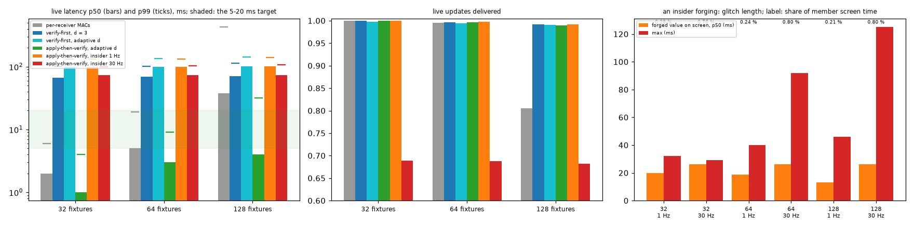

**Containing an insider that floods forged live moves (Q25, `firmware/mesh/src/forensics.rs`).**

Apply-then-verify bounds each forgery, but a persistent forger keeps members verifying first,
and at 30 Hz crowds their verify buffers: delivery falls to 68 % while it lasts. The goal:
detect and contain the forger, and never let one liar get an honest fixture blocked.

**Design: reports to the gateway, judged by quorum.**
- **Reports.** A member that verifies a forgery reports it to the gateway. The report is
  MAC'd under the pairwise session key, so every report is attributable. It says which
  neighbour the first copy came from, whether that neighbour's RSSI fit its usual level, and
  whether that neighbour is the member's tree parent.
- **Sampling.** Members report only forgeries whose interval key falls in a 1 in 8 sample.
  The gateway accepts only those (it holds the chain). So every member reports the same
  forgeries, the airtime is bounded, and nobody can flood the gateway's case table. The
  forger cannot avoid the sample: the key is unknown when it forges.
- **Provable lies.** The gateway recomputes each reported packet's tag. A report about a
  genuine packet is a provable lie and is dropped.
- **Suspects.** A neighbour is a suspect for one forgery if at least 2 side witnesses name it.
  A side witness's copy came from a neighbour at its usual RSSI that is not its parent; a
  forwarder's children prove nothing about where a forgery started.
- **Its own account can clear it.** That holds only if the upstream it names was seen sending
  the forgery by someone else, and following the upstream claims never leads back to it:
  - an honest relay names the injector and is cleared;
  - an injector that names a downstream relay is led back to itself;
  - an injector that names a node which never sent the packet has no witness for that claim.
- **Block and alert.** A fixture that is a suspect in 3 forgeries within 30 s is blocked:
  the gateway orders every member to drop all live packets under that id for 60 s, and alerts
  the admin. Only the admin removes a fixture (rotation, §7.6).

Measured: an insider forging at 30 Hz, 30 Hz live, 64 and 128 fixtures, the insider a leaf
or a busy relay.

| Containment                                        | Delivered (run) | Latency p50 | Insider blocked after | Honest fixtures blocked | Report airtime |
| -------------------------------------------------- | --------------- | ----------- | --------------------- | ----------------------- | -------------- |
| None                                               | 68 %            | 74 ms       | never                 | 0                       | 0              |
| Local only (each fixture blocks a neighbour after 3 forgeries) | 96–98 % | 8–35 ms | never (mesh-wide) | 95–584 (fixture, neighbour) pairs | 0 |
| Local + gateway quorum                             | 95–98 %         | 8–100 ms    | never: local blocks starve the quorum of evidence | 95–584 pairs | 0.1–0.8 % |
| **Gateway quorum (recommended)**                   | **95.5–96.1 %** | **5–16 ms** | **2.5 s**             | **0**                   | **0.4–0.85 %** |

- **Delivery** under the recommendation drops only during the 2.5 s before the block. After
  it, no forgery reaches anyone.
- **Local blocking is harmful.** An honest relay that forwards forgeries gets blocked by its
  neighbours. Local blocks also stop the forgeries before the gateway has enough evidence to
  name the forger, so the forger is never removed.
- **Attacks on the quarantine itself:**
  - *One liar fabricating reports:* never reaches the 2-witness quorum, so no block. Reports
    about genuine packets are counted as lies.
  - *Two colluders fabricating reports:* they can get an honest fixture a 60 s block. In
    20 s runs they blocked 3 relays in turn, and delivery stayed at 99.4 %. Removal still
    needs the admin.
  - *A forger spoofing a neighbour's id:* RSSI cannot tell two adjacent fixtures apart, so
    the gateway blocks the neighbour's id (1–3 honest fixtures for 60 s). The forgeries stop,
    because the order drops everything under that id. The admin alert names that fixture, so
    the admin must not confirm removal blindly.
  - *A slow forger (1 Hz):* blocked in 19 s (the 1 in 8 sample). Meanwhile it shows 0.25 % of
    screen time and keeps members verifying first.
- **RAM on the C6** (measured):
  - `LinkGuard` 352 B on every fixture: enforces orders, tracks 12 neighbours' RSSI.
  - `Forensics` 1,296 B on the gateway: 6 forgeries × 24 witnesses, 8 suspects.
  - Not yet wired into `MeshStack`: that needs the link-layer source and RSSI passed up
    through `swarm_net` (T5).

**In plain words.** If a fixture inside the mesh starts forging live moves, every other
fixture notices within a few tenths of a second and tells the gateway who handed it the fake.
- **Blocking:** when several independent fixtures point at the same one, three times, the
  gateway tells everyone to ignore its live moves for a minute and asks the admin to remove it.
  That takes about 2.5 s. Lights twitch for a moment before that, and live moves are normal
  again after.
- **One lying fixture** cannot get an innocent one blocked.
- **Two lying together,** or a forger impersonating a neighbour, can get an innocent fixture
  ignored for a minute. Nothing worse happens, because only the admin can remove a fixture.

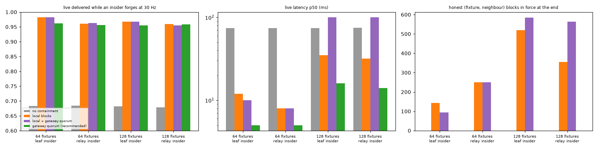

**What the admin sees (Q26, decided).** When the gateway blocks a fixture, the app first
shows the evidence and only then offers removal (rotation, §7.6). Nothing is removed
automatically. The gateway sends the app a `MeshQuarantine` event, and keeps the latest per
blocked fixture in `MeshStatus` so an app that connects later sees it too:

| Field              | Content                                                                                                                                                 |
| ------------------ | ------------------------------------------------------------------------------------------------------------------------------------------------------- |
| `node`, `key_hash` | The blocked fixture (node id, device-key hash: the app's device list names it)                                                                          |
| `blocked_at`, `until` | Mesh time the block started and ends (60 s; renewed if the forging continues)                                                                        |
| `forgeries`        | The forgeries it was a suspect in (≥ 3): each with its interval, the mesh time of the first report, and the witnesses                                  |
| `witnesses`        | Per forgery, each side witness: reporter node id, its RSSI-consistency flag, the report's mesh time. Only side witnesses count toward the quorum of 2   |
| `independent`      | Distinct reporters across all its forgeries (what the app headlines: "named by N fixtures, M times")                                                    |
| `own_account`      | What the blocked fixture itself reported for those forgeries: silent, or the upstream it named, and why that did not clear it (no witness, or the chain led back to it) |
| `protest`          | Whether the blocked fixture says it is being impersonated: frames under its id it did not send (T5), with their count and RSSI against its own        |
| `lies`             | Reports from any fixture that the gateway proved false (about genuine packets), by reporter: a liar shows up here                                       |

The app's view:
- **Headline:** "Fixture X sent forged live moves: named by N fixtures in M forgeries."
- **Details:** the witness list with timestamps, and the fixture's own account.
- **A protest:** if the fixture says it is being impersonated, the app says so prominently
  and suggests checking which fixture is near it, rather than removing it.
- **Actions:** "Remove fixture" (rotation) and "Keep" (the block lapses).

The gateway's `Forensics` keeps 6 forgeries × 24 witnesses, which covers this. The protest
field needs T5, since a fixture can only notice frames under its own id once the link-layer
source reaches the stack. Until then `protest` reads "unknown".

### 7.10 What remains unresolvable

- **An eclipsed node** (its only neighbours are malicious) can be **desynced and starved**.
  - Its mesh time moves at most 500 ppm on a single peer's word (0.5 ms per second).
  - Its traffic can be dropped, and it can be kept from syncing a session.
  - It **cannot be made to accept a forged or replayed command**. Commands need the gateway's
    per-receiver MAC, and freshness is counter-based, not time-based. Forged frames fail the
    MIC (outsiders) or the pairwise MAC (insiders).
- **A replay inside the freshness window right after a reboot.** A command captured at most
  64 of the gateway's frames before the member's sync (about 1 s while it streams control,
  up to about 30 s when idle) is accepted once.
- **Group-key data traffic** (status, replies, bulk) can be sent by any member under any
  source id, and an insider can inflate a sender's counter to starve it until the next sync.
  These are availability problems, not authority ones. Per-sender pairwise sync for non-gateway
  peers is staged for M7.
- **Node id ↔ device key binding is trust on first use** at each gateway (an Ack for a node id
  already bound to another key is refused and reported). An admin-signed roster certificate per
  member would close this; it is staged for M7.
- **Approval joins** trust the first wrap they receive (the joiner has no secret to check it
  against), as the app's device pinning does today.

## 8. Gateway: one connection, the whole mesh

### 8.1 New protocol arms

In `ledmapper.proto` (arm numbers from 99 up; the exact numbers are chosen in the PR):

```protobuf
message MeshTargets {
  repeated uint32 nodes = 1;   // empty and group == 0: all members
  uint32 group = 2;
  bool include_gateway = 3;    // dispatch locally too (default true for "all")
}

// ClientMessage arm: relay one ClientMessage to mesh members.
message MeshSend {
  uint32 op_id = 1;
  MeshTargets targets = 2;
  bytes inner = 3;             // an encoded ClientMessage from the allow-list (§5.4)
  bool want_reply = 4;         // collect per-member replies
  uint32 timeout_ms = 5;       // default 2000
}

// ServerMessage arm: the aggregated result of a MeshSend.
message MeshResult {
  uint32 op_id = 1;
  repeated uint32 acked = 2;
  repeated uint32 missing = 3; // no reply before the timeout
  repeated MeshMemberReply replies = 4;  // when want_reply: small replies only
}

// Membership and listing: GetMesh / MeshState (members, groups, mode, pending joins),
// CreateMesh, JoinMesh (direct), AdmitDevice, SetGroups, SetMeshMode, RotateMeshKey.
```

### 8.2 Behaviour

- **Fan-out**: the gateway checks the inner arm against the allow-list, dispatches locally if
  targeted (`lm_ws_dispatch`), and floods one `MeshControl`. One broadcast reaches every target;
  per-member unicast is only for a short explicit node list.
- **Replies**: each target sends `MeshReply` unicast to the gateway with the `op_id` and a
  status (ok, error code, or a small reply under 150 B). Large replies (`welcome`, effect
  uniforms of a big effect) are not relayed; the app uses `MeshStatus` and targeted `get_*`
  calls whose replies fit.
- **Aggregation**: the gateway collects replies for `timeout_ms` and returns one `MeshResult`.
  For live control (`seq` set, a fader stream) it does not wait: it acks the app on its own
  dispatch, like `ControlAck`, and reports stragglers in `MeshStatus`.
- **Listing**: the gateway keeps the latest `MeshStatus` of each member (64 × ~60 B ≈ 4 KB; on a
  C6 gateway this is the largest new RAM cost, so it may keep a compact 24 B subset instead).
  `GetMesh` returns it.
- **Any fixture is a gateway**: whichever one the app or bridge is connected to (owner's
  decision). There is no gateway role in the mesh itself; a fixture with no session is just a
  member, and two admins on two fixtures are two gateways at once.
- **P4 + C6 boards**: the C6 front end runs the mesh layer and forwards control for its own P4
  through the existing link (`frontend_link.cpp`), so a P4 fixture is a normal mesh member.

## 9. App and bridge UX

### 9.1 App

- **Device list**: members appear under the gateway: "via Lamp A · 2 hops · −61 dBm · seen
  3 s ago". Members are controllable like directly connected devices for everything in the
  allow-list. Features that need a direct link (mapping, video, debugger, OTA in Phase 1) show
  "connect directly".
- **Admin**: "Unlock" with the stored admin secret (automatic when this phone has it), "Export
  admin secret" (copy, QR, file) and "Import admin secret", as in the kiosk section.
- **Mesh screen** (Devices ▸ Mesh): mesh name, channel, mode (Open / Closed / Locked), members
  (status, firmware, heap, fps, time-sync error, last seen), pending join requests (Admit /
  Ignore), groups (create, rename, assign by multi-select), "Rotate key", "Leave mesh".
- **Targets**: the live-control and effect screens gain a target picker: this device, a group,
  all. `web/src/net/liveControl.ts` sends `MeshSend` instead of per-device sockets.
- **Setup**: "Create mesh" on the first fixture; every fixture provisioned afterwards (Improv)
  is joined with the site secret and the mesh key automatically. "Join this fixture" for one
  already set up.
- **Room**: room localization (`#/room`) is unchanged and enough for static installs. Its
  `group_capture` arming can later go over the mesh (one connection arms all), replacing the
  per-fixture connect-arm-disconnect fallback.

### 9.2 Bridge and agent

The radiolarians may run live shows from the bridge, so the bridge path is **Phase 1** (M8b).

- **How the bridge reaches a gateway in Phase 1.** Over IP, as today: the bridge opens one wss
  session to any fixture on the venue network (found by mDNS like any player), sends
  `mesh_unlock` with the imported admin secret, and addresses the others with `MeshSend`. At a
  site with no venue Wi-Fi the Pi bridge can host the Wi-Fi network the fixtures join (the
  mesh then runs on its channel). A bridge over BLE (BlueZ is already on the image for Improv)
  is possible later.
- `agent/src/hub.ts` gains a mesh route: a player reachable "via gateway G" is addressed with
  `MeshSend`. Tools (`set_uniforms`, `crossfade_to`, `set_brightness`, …) keep their signatures;
  `list_players` shows members with their gateway and hop count.
- The time discipline (`timesync.ts`) disciplines the gateway only; mesh time carries the rest
  (§6). `lead_ms` defaults follow §6.3.
- The bridge keeps one socket to the gateway instead of one per fixture, which also removes
  the two-TLS-slot pressure per device.

## 10. The radiolarians deployment: sizing

### 10.1 What we know

| Fact                                                                                                                           | Source                                                                       |
| ------------------------------------------------------------------------------------------------------------------------------ | ---------------------------------------------------------------------------- |
| **Up to 6 fixtures**                                                                                                           | owner                                                                        |
| Each fixture is an **ESP32-P4 with its C6 front end** (over SDIO), **driving WLED controllers over DDP**                       | owner; `docs/design/p4-c6-split.md`, `docs/design/p4-ethernet-ddp.md` (#478) |
| Fixture: a dodecahedron of 12 pentagonal panels, LEDs on concentric rings (105 per panel), **1260 LEDs**, three strings of 420 | `solver/src/scenario.rs` `dodecahedron_leds`, issue #479                     |
| Heavy and static after install; room localization places them                                                                  | owner                                                                        |
| **Not every site has Wi-Fi**: the app must reach the mesh over BLE as well as Wi-Fi                                            | owner                                                                        |

### 10.2 What that means for the design

- **The C6 front end is the mesh node; the P4 is the endpoint.** The C6 runs the netstack, the
  mesh layer, BLE and the gateway. Relayed control for its own fixture goes to the P4 through
  the link exactly like a wss or GATT frame (`frontend_link.cpp`, the §2.2 arm table of the
  split design). Effect blobs are assembled on the C6 (it has RAM to spare: the split design
  expects +60–100 KB of free heap) and forwarded to the P4 as one `SubmitEffect`.
- **Time base across the link.** The P4 owns the renderer clock and the time base; the C6 owns
  mesh time. The C6 keeps a C6↔P4 clock offset (a `time_sync_ping` round trip over SDIO every
  few seconds: sub-ms, symmetric) and converts `TIME_BASE` into the P4's clock before
  forwarding `SetTimeBase`. `apply_at_ms` is in time-base ms and needs no conversion.
- **BLE → mesh is Phase 1** (sites without Wi-Fi), so `kModeMesh` (radio up, no AP) is Phase 1
  too, and the BLE coex rules of §4.3 apply to whichever fixture the phone is connected to.
- **The WLEDs are on the P4's Ethernet** (owner). `p4-ethernet-ddp.md` drives WLED boards over
  the P4's own RMII PHY, with the P4 as a DHCP server for an "LED network". DDP never touches
  the C6's radio, so the C6 is free to sit on the mesh channel, and no fixture has to host a
  Wi-Fi network for its LEDs.
- **RF**: fixtures a few metres apart, line of sight, people moving between them, inside metal
  enclosures. The enclosure is the risk; §4.5 has the antenna options, the link budget and the
  measurement (R0) to do before the install.
- **OTA**: per-device OTA over Wi-Fi (the existing path) is enough for Phase 1. OTA over the mesh
  stays Phase 2.

### 10.3 Traffic for 6 fixtures

All fixtures in one venue are most likely one hop from each other; the hop limit stays 3.

| Traffic                                               | Size                | Rate                 | Airtime at 1 Mb/s (1 TX + ≤ 1 relay)  |
| ----------------------------------------------------- | ------------------- | -------------------- | ------------------------------------- |
| Beacons                                               | ~80 B frame         | 1 Hz × 6             | ~0.6 % of the channel                 |
| Status                                                | ~110 B frame        | every 10 s × 6       | < 0.1 %                               |
| Uniform fader stream                                  | ~150 B frame        | 30 Hz while dragging | ~1.5 ms × 2 × 30 ≈ 9 % while dragging |
| One effect push (4 KiB, `FX_MAX_BYTES` on the P4 too) | ~21 frames of 200 B | once                 | ~50 ms per hop; < 0.2 s to all        |
| Scene catch-up                                        | 2–6 packets         | per late joiner      | negligible                            |

At 6 Mb/s OFDM all of this costs about a fifth. Six fixtures leave the channel nearly idle; the
limit is the BLE gateway's share (§4.3), not the mesh.

### 10.4 RAM

The C6 front ends of the radiolarians have no render task and no LED buffers, so the mesh's RAM
is not a concern there. On a standalone C6 player it still matters at large LED configs.

Measured: each piece as a `.bss` static on the C6 (riscv32imac, `-c opt`, `nm -S` on
`//firmware/mesh:mesh_ram_probe`), at the 802.11 payload `P = 200`:

| Item                                                                          | M2 first draft | M2 review    | M2 now        |
| ----------------------------------------------------------------------------- | -------------- | ------------ | ------------- |
| `swarm_net` (queues 8 → 4; the custodian spill slot behind a feature, off)    | 12,648 B       | 9,360 B      | 9,128 B       |
| Envelope: keys, 64-bit counter, replay table (64 × 16 B)                      | 1,152 B        | 1,264 B      | 1,264 B       |
| Membership: state (804 B, persisted), pending joins, gateway's pending list   | 2,688 B        | 1,752 B      | 1,760 B       |
| Admin sessions (member) / gateway roster (16, pairwise keys)                  | —              | 200 / 608 B  | 200 / 608 B   |
| Rotation: gateway rekeyer / member side                                       | —              | 496 / 240 B  | 496 / 240 B   |
| Background crypto queue (a grant, two Acks, ~340 B), the pending live update (~60 B), hop, pacing and renewal state | — | — | ~590 B |
| **Whole `MeshStack` (gateway roster 16)**                                     | **17,232 B**   | **15,104 B** | **15,472 B**  |
| Open mode (feature `open_mode`, M7b)                                          | (included)     | +1,368 B     | **+912 B**    |

There is no heap. `tick()` also takes a caller-provided scratch of about 0.7 KB.

- The **gateway roster** grows with the mesh: 16 = 608 B, 64 = 1,952 B. A standalone C6
  player keeps 16; a P4 + C6 front end can keep 64 or more.
- **Open mode's budget is accepted** (Q16). The guest table was trimmed to 32-bit timestamps
  and an in-band empty marker (1,040 → 588 B), so open mode adds 912 B, within the 1.4 KB
  budget.
- The **custodian spill** (~230 B) is behind the `custodian_spill` feature, off on firmware
  (Q17). Host builds (Pi, meshsim) keep it.
- The background crypto queue (§7.9) is the price of never doing public-key work on the tick:
  ~340 B.
- Shrinking further means fewer `swarm_net` slots or a byte ring. That is the next lever if a
  C6 player needs it.

### 10.5 Minimum set that ships radiolarians

From the PR plan (§15):

- **R0 first**: the link budget measured in the real enclosure (§4.5), so antennas are settled
  before anything else depends on them;
- the ported mesh crate and the Splanc layer (M1, M2);
- the 802.11 backhaul with **mesh-only mode** and AP-anchored mode (M3a, M3);
- the **BLE gateway** with the coex rules of §4.3 (M3b);
- mesh time and `apply_at` across the mesh (M4);
- the gateway: uniforms, effect, crossfade, brightness, status (M5);
- the **front-end integration**: the C6 front end as mesh node, the P4 as endpoint (M5b);
- effect blobs and scene catch-up (M6);
- closed membership with self-configuration (site secret) and the kiosk-style **admin secret**,
  groups (M7);
- the app's member list, target picker, mesh screen, admin secret export/import (M8);
- the **bridge** reaching the mesh through one gateway (M8b);
- a HITL gate with P4 + C6 boards where the rigs have them, C6 players otherwise (M9a).

Firmware updates use per-device OTA over Wi-Fi. Locked mode, open mode (M7b), key rotation, the
IP backhaul and OTA over the mesh can follow the first install.

### 10.6 Mixed-capacity meshes: C6, P4 + C6, Pi

Meshes mix very different devices. A standalone C6 player has a tight heap. A P4 + C6 fixture
runs the mesh on the C6 front end but can keep deep queues on the P4, reached over the C6↔P4
SDIO link. A Raspberry Pi has effectively unlimited RAM, runs Linux, and may also be on the
LAN. The question was whether the mesh should exploit the difference instead of sizing
everyone for the weakest node, and which mechanisms earn their RAM. M2 built the mechanisms,
simulated them, and kept only what helps.

**What is in the code** (`firmware/mesh/src/stack.rs`, `firmware/mesh/swarm/src/mesh.rs`):

| Mechanism                                                                                  | C6 RAM          | Verdict from the sweeps                                                                                   |
| ------------------------------------------------------------------------------------------ | --------------- | --------------------------------------------------------------------------------------------------------- |
| Class (C6, P4, Pi) and relay credit in every advert                                        | ~100 B (8 neighbours) | **Keep**: picks bulk sources and page servers, sizes gateway rosters                                 |
| Small C6 queues (4 relay, 4 outbox) with a priority drop policy: bulk, then status, never control/time/membership/freshness first | saves 3.3 KB | **Keep**: control is never starved by bulk                                 |
| **Source pacing of bulk** (`send_bulk`: ≥ 20 ms between bulk packets, and only while neighbours advertise credit) | a few bytes | **Keep, the one that matters**: far-side delivery through a C6 cut vertex rises from 40–53 % to 69–89 % |
| Custodian spill: a P4/Pi keeps evicted bulk/normal relays in a deep store (P4 RAM over SDIO, 100 µs + 20 MB/s per transfer; Pi RAM), released while neighbours have credit | 0 on firmware (feature `custodian_spill`, off) | **Behind a feature, off by default** (owner, Q17): never exercised so far |
| Relay-delay bias by class (custodians relay bulk early, C6s late)                          | 0               | **Removed**: made a C6 cut vertex cancel the only relay toward the far side (3 % delivery)                |
| Page requests prefer custodians among equally advanced neighbours                          | 8 B             | Keep (harmless), but no measurable gain                                                                   |
| **Adaptive hop limit** (Q15): the diameter seen (own + neighbours' adverts) + 1, 2..=15; a probe flood at 15 once a minute per node | 6 B | **Keep**: a 32-node line goes from 20–40 % to 63 % (below) |

The **Pi** runs the same crates' std build (`//firmware/mesh`, feature `host`). The Backhaul
trait and the frame format are host-portable, and nothing blocks a std/Linux build.
- A Pi needs its own `DeviceKey` (its TLS key file), a real `Entropy` (getrandom), a
  file-backed `Flash` for the page protocol, and its `Backhaul` (nl80211 Public Action frames on
  the built-in radio, §4.1).
- In meshsim its radio is the measured built-in Broadcom path: one-way 5–27 ms (≈ 14 ms median,
  54 ms p99 RTT), 94 % per-hop broadcast delivery, ≤ 320 frames/s.
- A Pi bridging islands over IP is M10.

**Sweeps** (`firmware/mesh/meshsim/sweep/`: `main.rs` runs them, `plot.py` draws them; data in
`mesh/sweep.csv` (150 runs) and `mesh/stress.csv` (46 runs)). Frames carry the Public Action
header (+1 B, §4.1).

1. **Airtime, not queue RAM, limits live control.** 60 Hz control to every member (one
   flood, per-receiver MACs):

   | Nodes                 | 6     | 16   | 32   | 64   |
   | --------------------- | ----- | ---- | ---- | ---- |
   | 1 Mb/s DSSS, 60 Hz    | 100 % | 53 % | 18 % | 15 % |
   | 6 Mb/s OFDM, 60 Hz    | 100 % | 99 % | 91 % | 58 % |
   | 6 Mb/s OFDM, 30 Hz    | 100 % | 99 % | 97 % | 71 % |

   **Mesh frames default to 6 Mb/s OFDM** (meshsim's default now; M3 for the radio, after
   M3a checks the range through the enclosures). Live moves should be coalesced to ≤ 30 Hz
   on the mesh. Above 24 members, live moves use the broadcast authenticator (§7.9).

   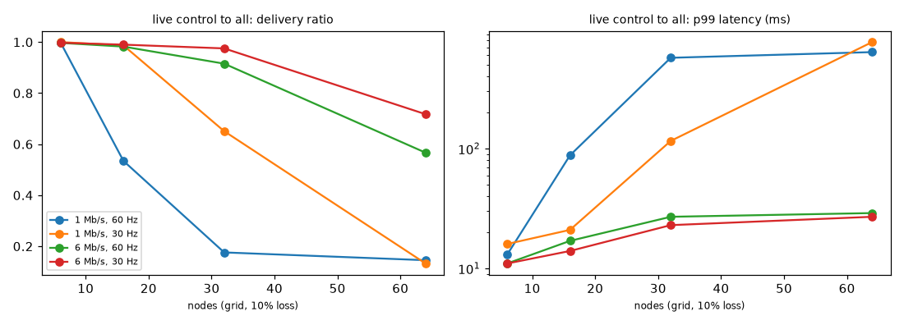

2. **Pull-based bulk (effect blobs, firmware, catch-up) does not need queue space.** Its pages
   live in flash, and requests pull them hop by hop. Through a C6 cut vertex (two clusters
   joined only by one standalone C6, 6 Mb/s), every run completed, and capacity awareness made
   no difference:

   | Image                                          | Time to all  |
   | ---------------------------------------------- | ------------ |
   | 4 KiB blob, 16 nodes (grid)                    | 1.0–1.7 s    |
   | 4 KiB blob, 64 nodes                           | 3.3–4.3 s    |
   | 256 KiB catch-up across the C6-only path       | 40–43 s      |
   | 256 KiB with 30 % one-way loss after the cut vertex | 86–99 s |
   | 256 KiB with churn (a node off the air 3 s in every 4 s) | 72–83 s |
   | 1.5 MB firmware                                | 350–366 s    |

   A custodian *source* (a Pi or P4 seeding the image centrally) helps more than any queue.

3. **Pushed bursts are where queues bite, and pacing is the fix.** Four 4 KiB blobs pushed as
   bulk floods (88 packets) through the C6 cut vertex:

   | Pushed as                                        | Far-side delivery | All nodes | Burst takes | 30 Hz control during it |
   | ------------------------------------------------ | ----------------- | --------- | ----------- | ----------------------- |
   | Unpaced (as fast as the outbox allows)           | 40–53 %           | 68–75 %   | 0.14–0.26 s | 96–98 %                 |
   | **Paced** (≥ 20 ms apart, credit-gated)          | **69–89 %**       | **84–94 %** | 1.7 s     | 91–94 %                 |

   - Credit in a 1 Hz advert is far too slow to throttle a burst that leaves in 140 ms. The
     pace itself is the backpressure.
   - With pacing, the custodian stores were never used, in any run: nothing but live control
     ever filled a C6's queue, and live control is never spilled (relayed late, it is worse
     than not at all: an early version that spilled it pushed 64-node p99 latency to 1.9 s).

   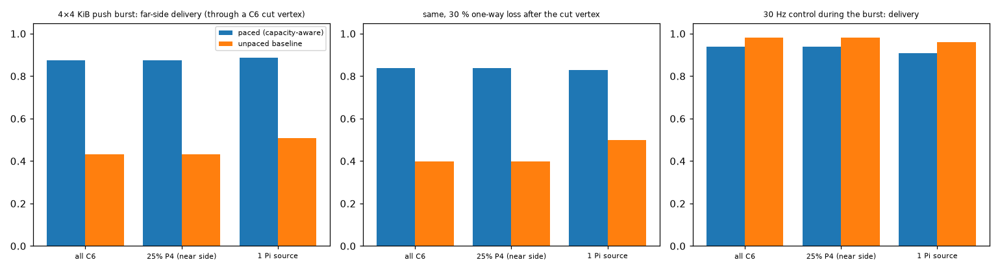

4. **The hop limit, not capacity, limits line and chain venues.**
   - A line of 32 fixtures 5 m apart is about 13 hops long at OFDM range. It reaches 20 / 31 /
     38 % of control at hop limits 3 / 5 / 7.
   - Clustered layouts with bridges plateau at ~55–59 %.
   - **Adaptive hop limit** (Q15, M2):
     - Every node records the most hops any packet took to reach it in the last 5 minutes.
       Adverts carry that diameter estimate, and each node takes the maximum of its own and
       its neighbours'.
     - Originations use estimate + 1, between 2 and 15 (the MeshPacket field's bound).
     - Every node floods a 1-byte probe at hop limit 15 once a minute, so far nodes are
       discovered even before anything reaches them.
     - Results at 32 nodes, 30 Hz control:

       | Layout    | Fixed 3 / 5 / 7     | Adaptive |
       | --------- | ------------------- | -------- |
       | Line      | 20 / 31 / 40 %      | **63 %** |
       | Grid      | 85 / 85 / 86 %      | 88 %     |
       | Random    | 96 / 99 / 97 %      | 97 %     |
       | Clustered | 54 / 60 / 57 %      | 58 %     |

       A line of 16 is reached end to end at limit 9 (27 of 30 commands, against 0 at a
       fixed 3).
     - The clustered layout is limited by its weak bridge links, not hops. A line longer than
       15 hops needs the IP backhaul (M10) or more bridges.

   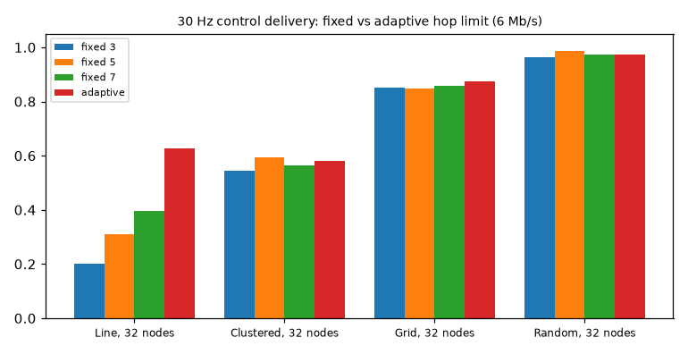

   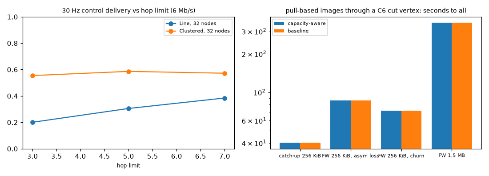

**Does capacity awareness earn its RAM?** Partly.
- The parts that cost almost nothing earn it: pacing, priority drop, and class adverts.
- The parts that cost RAM on every C6 do not, for the traffic Splanc has: the custodian spill
  slot (~230 B) was never used. Unless M6 chooses to push blobs as floods (it should pull
  pages, §5.5), the spill and custody path can go behind a feature, and the P4/Pi role reduces
  to: deep gateway rosters, bulk sources, and page servers.
- Open mode (M7b) needs 1.4 KB on the C6 when compiled in (§10.4).

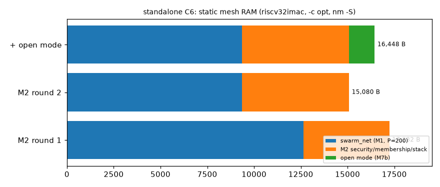

## 11. UWB backhaul (later)

- **Hardware**: no current Splanc board has UWB. The C6 boards, `splanc-mini` and the P4 + C6
  design (`docs/design/p4-c6-split.md`) have no UWB radio.
- **Board change**: add a Qorvo DWM3000 module (DW3110; what the swarm uses) or a QM33120 (two
  antennas, PDoA/AoA) on SPI, with IRQ, RST and WAKE: about 6 GPIOs. On the C6 that competes
  with LED outputs and the IMU pins (6, 7, 21 in `docs/design/sensor-core.md`), so it is a new
  board revision (the atopile boards under `hardware/`). On P4 + C6 boards the UWB part could
  hang off the P4 instead.
- **Rates**: 6.8 Mb/s PHY, 125 B frames. The swarm's TDMA gives each node ~2.5 ms of spare
  airtime per 30 ms superframe (~6 frames); its design estimate is ~19 KB/s per hop for pages,
  and it moved a 450 KB image to 3 nodes in ~3.5 min. Enough for control and effects, slow for
  Splanc's 2 MB images.
- **Software**: the swarm's TDMA, DS-TWR and radio loop are C++ in `apps/common/radio.cpp`; the
  driver is GPL-derived. A Splanc UWB backhaul implements `Backhaul` (§3.2) with TDMA driving
  `may_send`, and needs a C6 port of the driver.
- **What it adds**: ranging between every pair at ~20 Hz (§12), a backhaul on a different band
  from Wi-Fi and BLE (no coex), and µs-level time sync from DS-TWR timestamps.
- **As a distribution tier**: §5.8 uses UWB as the gateway's first hop to the L2 relays, with
  802.11 below them.

## 12. Ranging and realtime localization (later)

Not needed for radiolarians: their fixtures are static and the phone-based room localization
(`docs/design/multi-fixture-localization.md`) places them.

When moving fixtures matter:

- **Ranges** come from UWB DS-TWR (§11), or from the research track (§13).
- **Fusion** is `swarm_core`'s ESKF (`predict`, `update_range`, `update_aoa`, `update_gravity`,
  the `coop` rules). `docs/design/sensor-core.md` §2.2 found the full filter costs ~50 % of a C6
  at 100 Hz. Options: run it at a lower rate, run it on the P4, or run the position part on the
  bridge with ranges and attitude streamed from the fixtures. The attitude part already has a
  seam (`firmware/sensor/src/fusion.rs` `AttitudeFilter`).
- **Room frame**: fused positions update `FixturePose` (`set_fixture_pose`) so `led.room`
  effects follow a moving fixture; the room solver's result seeds the filter and anchors its
  frame.
- **Ranges as constraints**: even for static installs, inter-fixture ranges can check or refine
  the room solve (`web/src/geom/multiFixture.ts`) and catch a fixture that was moved.

## 13. Ranging over the C6's own radio (research track)

An independent track. Nothing in the mesh depends on it.

### 13.1 Stock BLE ranging on the C6: no

- Espressif's ESP-IDF v6.1 feature table for the ESP32-C6 controller lists **Channel Sounding:
  unsupported** and **AoA/AoD: unsupported**. The host stacks list Channel Sounding as
  experimental, but a host can't sound without a controller that supports it.
- What remains with the stock controller is RSSI: meter-level error indoors, worse with
  multipath and bodies. Usable for "which fixture is nearest", not for placement.
- Our BLE host (`firmware/blehost`) runs over the vendor controller's HCI, so it inherits these
  limits. The #166 bench work (memory note "amd-rig SDR BLE PHY RE") showed how far from-source
  BLE radio control is: the RF TX key is set in a timer ISR we could not trace, and from-source
  BLE transmission never radiated. A self-built BLE CS through the BLE controller is a dead end
  for now.

### 13.2 Wi-Fi FTM: a hardware RTT that our stack bypasses

The C6 supports 802.11mc FTM (initiator as a station, responder as an AP), with an erratum:
revisions v0.0 and v0.1 cannot be initiators (WIFI-9686). FTM is typically 1–2 m indoors. It
runs inside the vendor Wi-Fi stack, which our netstack replaces, so using it means either
reverse-engineering its fine timestamps or a vendor-stack ranging mode. Noted as a fallback,
not planned.

### 13.3 What a self-built CS needs

Bluetooth Channel Sounding has two measurements:

- **Phase-based ranging (PBR)**: the initiator sends an unmodulated tone on channel k; the
  reflector measures its phase, then sends a tone back that the initiator measures. The product
  of the two measurements cancels both LO phases, if each device's LO stays phase-continuous
  between its RX and TX on that channel. Stepping over up to 72 channels at 1 MHz (~78 MHz
  span) gives the distance from the slope of phase against frequency: unambiguous to ~150 m,
  with decimetre-level precision in line of sight.
- **Round-trip time (RTT)**: needs TX/RX timestamps at ns resolution. The C6's RX timestamp is
  in µs (300 m per tick), so RTT is out unless the FTM timestamp hardware is reverse-engineered.

So the question is whether the C6 can (a) emit a clean tone at 1 MHz steps, (b) capture
coherent I/Q of a received tone, and (c) keep LO phase across a TX/RX turnaround.

### 13.4 What the public reverse-engineering work gives us

- **Raw I/Q capture (RX)**: ESP-SDR (ESPARGOS, GPL-3.0) found an undocumented "dump engine" in
  the modem, used by Espressif's factory RF test (`librftest.a`, `adctrig`). It copies baseband
  samples into SRAM: signed 10-bit I and Q plus the gain index in each 32-bit word, at 80, 40 or
  16 MS/s, up to 16,380 samples (~205 µs at 80 MS/s). **The C6 is supported**: capture memory
  `0x40840000`, SRAM owner register `0x60095004`, dump control `0x600a9004`, lane select
  `0x600a9014` (their `main/targets/esp32c6/chip.h`). Tuning off the Wi-Fi grid goes through
  `phy_set_freq(mhz, offset_khz)`, so 1 MHz steps are possible. It needs the vendor PHY
  initialised, which our netstack already does before it takes over the MAC.
- **Tone TX**: the C6 PHY library has the RF-test tone functions (ESP-SDR calls
  `ram_stop_tx_tone`; the start counterpart is in the same library), and `espdr-tx` steers the
  PHY test tone in frequency and amplitude on the ESP32-S3 to transmit voice. ESPARGOS states
  that arbitrary, even phase-coherent, transmission is possible but does not publish it. I did
  not find public raw I/Q **write** for the C6; the owner mentions such work exists, so it is
  an open question (§17) where it lives and whether it covers the C6. A CW tone is all PBR
  needs, so the test tone may be enough.
- **Our own MAC/PHY work**: the netstack's register map (`firmware/netstack/src/regs.rs`) and
  the #166 bench (a C6 cabled to a HackRF One through 40 dB, with a demod oracle) are where the
  spikes run.

### 13.5 The real risks, after the I/Q path

With RX phase available, the risk moves to:

1. **Phase continuity across a turnaround.** PBR needs the LO phase on channel k to be the same
   when a device receives and when it transmits. ESP-SDR re-calibrates on each new frequency
   and waits 3 ms after selecting an LO. If the TX/RX switch re-locks the PLL or re-runs a
   calibration, the phase is random per step and PBR fails.
2. **LO and sample-clock coherence between two C6s.** Separate 40 MHz crystals (±10–40 ppm)
   give up to ~100 kHz of carrier offset at 2.4 GHz. Each step must estimate it from the
   captured tone (a 205 µs capture gives ~5 kHz bins; phase-slope refinement goes below) and
   the two devices' steps must be scheduled to µs-level (mesh time gives tens of µs).
3. **Capture length and step rate.** 16,380 samples per capture is enough for a tone. But each
   capture hands a whole SRAM block to the dump engine: ESP-SDR's C6 build reserves
   `0x40820000`–`0x40860000` (256 KB). A standalone C6 player has nowhere near that free. So
   on a C6 player this only works in a dedicated ranging mode, or on **P4 + C6 boards** where
   the C6 front end does not render and has the RAM.
4. **Hop latency.** With a 3 ms LO settle, 72 steps × 2 turnarounds is ~0.5 s per pair. Fine
   for static fixtures, too slow for tracking.
5. **The radio is shared** with the Wi-Fi link and BLE. A ranging session takes the radio
   off-channel; it must be scheduled like a background sweep.

### 13.6 Spikes

All on the amd-rig `c6-sdr` unit (memory note "amd-rig SDR BLE PHY RE": HackRF + C6 over
40 dB, reserved via `pi/hitl/harness/hitl_client.py`). The HackRF cannot inject into the C6's
RX at useful levels on that bench (found in #166), so S1's RX tests use a second C6 or a rewired
path.

| Spike   | Question                                                | Method                                                                                                                                   | Exit                                                   |
| ------- | ------------------------------------------------------- | ---------------------------------------------------------------------------------------------------------------------------------------- | ------------------------------------------------------ |
| **S1a** | Does the dump engine work in our image?                 | Port ESP-SDR's C6 capture into a bench-only image (`firmware/rangespike`, not the player). Capture known tones                           | Clean I/Q, measured noise and gain behaviour           |
| **S1b** | Can the C6 emit a stepped CW tone?                      | PHY test tone at 2402–2480 MHz in 1 MHz steps, observed on the HackRF                                                                    | Tone within ±50 kHz of plan, step time measured        |
| **S1c** | Is the LO phase continuous across TX→RX on one channel? | C6 transmits a tone, switches to RX and captures the HackRF's CW (or a second C6's); HackRF measures the C6 tone phase before the switch | Phase repeatable within 10° over 100 turnarounds       |
| **S2**  | Two-C6 PBR on a few channels                            | Two C6s through a splitter and coax of known lengths (0.5 m, 3 m) as ground truth; 5–10 channels; HackRF watches both tones              | Distance difference recovered within 20 cm             |
| **S3**  | Accuracy over the air                                   | Full 40–72 steps in a room vs a tape measure, and vs a DWM3000 pair from indoor_localization if available                                | Error, precision, time per pair, RAM cost; go or no-go |

Stop at the first failed exit. If S1c fails, the fallback is Wi-Fi CSI two-way phase on the
home channel (the C6 reports HE-LTF CSI through the vendor path) or RSSI, both much coarser.

## 14. Testing

### 14.1 Host simulation (Rust, no radio)

A `meshsim` crate in `firmware/mesh`:

- N nodes running the real `swarm_net` and the Splanc layer, over simulated backhauls: an
  802.11 model (CSMA with collisions, per-link loss and RSSI from a topology, 1 or 6 Mb/s
  airtime, BLE coex outages) and later a TDMA UWB model.
- Each node has a clock with ppm drift and an RX timestamp jitter model.
- Scenarios, as `rust_test`s:
  - flood delivery and latency on line, star and grid topologies up to 64 nodes and 3 hops;
  - `apply_at` skew: the frame at which each node applies a relayed change, < 2 ms across
    3 hops over a simulated hour;
  - effect blob to 32 nodes with 10 % loss; resume after a node restarts mid-transfer;
  - late joiner catches the scene; partition and heal;
  - closed join with and without the site secret; locked rejects unapproved devices; removal
    plus rekey; open guests follow signed scenes and cannot send control; a member
    offline during the rekey recovers;
  - replay and forgery attempts are dropped and counted.
- Golden vectors for the envelope, plus the swarm's own vectors ported with the code.

### 14.2 HITL

Rigs carry several C6s each (`pi/hitl`, multi-DUT reservations; see the memory notes on rig
USB power and shared-DUT gotchas).

| Test                 | DUTs                  | Checks                                                                                                                                                                                                         |
| -------------------- | --------------------- | -------------------------------------------------------------------------------------------------------------------------------------------------------------------------------------------------------------- |
| `mesh_smoke`         | 2                     | M3a's exit criteria; associated and mesh-only                                                                                                                                                                  |
| `mesh_gateway`       | 4                     | App-side client (harness) on one DUT's wss: `MeshSend` set_uniforms to all, `MeshResult` acks all; group targeting; status listing                                                                             |
| `mesh_effect`        | 4                     | Push a `.fxb`, every member runs it (serial log + `get_status` via the mesh)                                                                                                                                   |
| `mesh_apply_at_skew` | 2 analyzer-tapped + 2 | Extends `pi/hitl/harness/hitl_time_base_skew.py`: tapped DUTs reached only via the mesh; p99 skew < 10 ms + one frame                                                                                          |
| `mesh_ble_gateway`   | 3                     | Same as `mesh_gateway` with the gateway on BLE (coex)                                                                                                                                                          |
| `mesh_join_admin`    | 4                     | Self-configured closed join; a locked connection can't send `MeshSend`; `mesh_unlock` then control; a member cannot forge commands for other members; a replay after a member reboots is refused; bad-grant lockout. Locked mode and open guests in Phase 2 |
| `mesh_multihop`      | 4                     | Forced topology (a test-only neighbour deny-list in firmware), 3 hops                                                                                                                                          |
| `mesh_soak`          | 4                     | 2 h, fader streams every 5 min, heap minimum and render fps unchanged                                                                                                                                          |

Every failure attaches each DUT's serial log (the HITL logging standard). The shared rig AP
(flock #228) means associated tests compete for airtime; mesh-only tests do not need the AP.

### 14.3 Metrics

Reported by members in `MeshStatus` and collected by HITL: delivery ratio per port, latency per
hop (p50, p99), late `apply_at` count, time-sync error estimate, relay count per packet, airtime
share, free and minimum heap, render fps.

## 15. Staged PR plan

Phase 1 is the radiolarians critical path. Each PR is small and reviewable; spikes gate the
ones that depend on unknown hardware behaviour.

### Phase 1: application backhaul (ships radiolarians)

| PR      | Content                                                                                                                                                                                                                      | Gate                            |
| ------- | ---------------------------------------------------------------------------------------------------------------------------------------------------------------------------------------------------------------------------- | ------------------------------- |
| **R0**  | Link budget in the real radiolarian enclosure (§4.5): RSSI both ways at 1/3/5 m, people walking between, 4 orientations, BLE to a phone; antenna inside through the windows first, u.FL external as fallback. No code        | ≥ −70 dBm at the 1st percentile |
| **M0**  | This design                                                                                                                                                                                                                  | owner review                    |
| **M1**  | Port `swarm/net` + `swarm/proto` into `firmware/mesh/swarm/` with provenance (§3.1); the backhaul entry point, per-instance MTU, Splanc crypto backend; C6 + P4 + host builds and the swarm's tests and golden vectors in CI | ported tests pass               |
| **M2**  | `firmware/mesh`: `Backhaul` trait, envelope (AES-CCM via `ccmp.rs`, replay window), membership state, ports, `meshsim` with the first scenarios                                                                              | host tests only                 |
| **M3a** | Spike: vendor action frames TX/RX between two C6s (associated and not), RX vector RSSI + timestamp, unicast retries, BLE coex loss                                                                                           | §4.4 exit                       |
| **M3**  | `wifi_p2p` backhaul in the netstack transport; `kModeMesh` (radio up, no AP); channel rules (§4.2); mesh beacons; `mesh_smoke` HITL                                                                                          | M3a passed                      |
| **M3b** | BLE gateway: connection-interval request, narrowed coex window, mesh TX outside the BLE window (§4.3); `mesh_ble_gateway` HITL                                                                                               | Wi-Fi share ≥ 70 % with BLE up  |
| **M4**  | Mesh time (beacon fit) + `TIME_BASE` mapped to the existing time base; meshsim skew test; `mesh_apply_at_skew` HITL                                                                                                          | skew < 10 ms                    |
| **M5**  | Protocol arms (`MeshSend`, `MeshResult`, `GetMesh`/`MeshState`), gateway fan-out + aggregation, member dispatch allow-list, `MeshStatus`; `mesh_gateway` HITL                                                                |                                 |
| **M5b** | P4 + C6: the mesh on the C6 front end, relayed control forwarded over the link, C6↔P4 clock offset for `TIME_BASE`, effect blobs handed to the P4                                                                            | P4 + C6 bench run               |
| **M6**  | Blob kind on the page protocol + effect distribution + scenes and catch-up; `mesh_effect` HITL                                                                                                                               |                                 |
| **M7**  | Membership: closed mode (site secret, self-configuring formation, approval joins), the kiosk-style admin secret (`mesh_unlock` with a signed grant, per-receiver MACs, §7.9), groups; `mesh_join_admin` HITL                                            |                                 |
| **M8**  | App: member list via gateway, target picker in live control and effects, mesh screen, admin secret export/import (copy, QR, file, backup); the quarantine evidence view (Q26: `MeshQuarantine` from the gateway, witnesses, own account, protest; "Remove" and "Keep") | web unit tests + manual run; protest needs T5 |
| **M8b** | Bridge: hub mesh route (`hub.ts`) through one gateway, admin secret in the bridge config, `list_players` via gateways                                                                                                        | agent tests + bench run         |
| **M9a** | HITL gate: the multi-DUT suite in CI (`mesh_*`)                                                                                                                                                                              |                                 |

**What M2 delivered, and what it moved (2026-11-17).** M2 (#529 → #530 → #531, host tests and
`meshsim` only) contains:

- the envelope with 64-bit counters and replay windows (§7.5);
- insider-resistant administration: signed grants, freshness by challenge-response,
  per-receiver MACs (§7.9);
- rotation on removal with revocations (§7.6);
- the membership state machines;
- the mesh-time aggregation (§6.2, pure: M4 wires it in);
- the capacity classes and `swarm_net`'s queue sizing and drop policy (§10.6);
- `meshsim` with the capacity sweep.

The work it moves to later milestones:

| PR     | Added by M2                                                                                                                                                                                   |
| ------ | --------------------------------------------------------------------------------------------------------------------------------------------------------------------------------------------- |
| M3a    | Measure ECDSA-P256 verify and ECDH on the C6 and P4 (estimates in §7.9); measure 6 Mb/s OFDM range through the enclosures (§10.6)                                                            |
| M3     | Mesh frames at 6 Mb/s OFDM where range allows; the counter mark and replay marks in littlefs                                                                                                 |
| M3     | Per-node rate adaptation on hardware (heard counts in adverts, CCA busy time), tuned for heavy live load (§4.6)                                                                              |
| M4     | Wire `timesync` (robust aggregation, step and slew rules) into beacons and the show clock; live keyframes applied on mesh time with `interp` (§6.4)                                            |
| M5     | `send_live` behind the app's fader stream (compact batched uniforms); `mesh_unlock{grant}`, `GrantRenewalDue` to the app, `run_crypto` in a low-priority task                                |
| M7     | Firmware `DeviceKey` on MbedTLS (per-device TLS key); the app derives the admin signing key and signs grants and rekey orders; admin-signed member certificates (node id ↔ device key); per-sender pairwise freshness for non-gateway peers |
| M7b    | Open mode behind the `open_mode` feature (+1.4 KB on the C6 as written; −0.6 KB possible)                                                                                                     |
| M7c    | `RekeyRequest` for members absent during a rotation; closed ↔ locked transitions in the app                                                                                                   |
| M9b    | Rotate the site secret without a removal; rotate the admin secret (a lost phone or bridge)                                                                                                    |
| M10    | IP backhaul; a Pi bridging islands (§10.6)                                                                                                                                                     |

### Phase 2: open mode, hardening and reach

| PR  | Content                                                                                                                                                                                      |
| --- | -------------------------------------------------------------------------------------------------------------------------------------------------------------------------------------------- |
| M7b | Open mode: owner key + signed scenes/blobs/time, the follow stream under the open key, guest tables and rate limits, `mesh_follow` device setting, guests in the app; `mesh_open_guest` HITL |
| M7c | Locked mode (allow-list by device key), closed ↔ locked transitions, key rotation on removal                                                                                                 |
| M9b | Site-secret rotation; admin-secret rotation (the asymmetric admin key is in M2, §7.9)                                                                                                                     |
| M10 | IP backhaul (UDP on the LAN) to bridge islands on other APs                                                                                                                                  |
| M12 | `group_capture` arming over the mesh (one connection arms the room)                                                                                                                          |
| M13 | OTA over the mesh (page protocol with the firmware kind; Splanc's manifest, `docs/design/ota.md`)                                                                                            |
| M14 | Larger 802.11 bodies (up to ~1400 B) if measurements justify them                                                                                                                            |

### Phase 3 and research (deferred, independent)

| Track | Content                                                                             |
| ----- | ----------------------------------------------------------------------------------- |
| U1    | UWB board revision (DWM3000 or QM33120) — needs the owner's hardware decision       |
| U2    | UWB backhaul (TDMA, DS-TWR) behind `Backhaul`; C6 driver port                       |
| T1    | Distribution tree (§5.8) in `MeshStack`: `TreeAd` in adverts, relay rebroadcast, reliable NACK repair with the 4-entry `RelayCache`, `Selector` 24/16 (gate the switch on ≥ 90 % of members in child reports); `mesh_tree_repair` HITL (kill a relay). The tree, selector, cache and authenticator code is in #544 and its two follow-ups |
| T2    | The UWB first tier: the root's UWB data slot and per-node beacon slots on U2's TDMA; measured UWB link budget through the enclosures |
| T3    | Relay suppression for 64+ fixtures (a relay skips its rebroadcast when its children were all covered by copies it heard) and churn damping at 64–128 |
| T5    | Forgery containment in firmware (Q25): link-layer source and RSSI through `swarm_net` to the stack; `ForgeryReport` on the freshness port; `Forensics` at the gateway with the block order and the admin alert; spoof protests; `mesh_forgery_quarantine` HITL with an injecting DUT |
| T4    | Broadcast authenticator in firmware: chain build in the crypto task, apply-then-verify with `LiveRejected` wired to the uniform store (revert to last verified), best-of-N challenges and adaptive `d` (Q24, in the stack), C6 cost in M3a; `mesh_live_auth` HITL at 24+ DUTs (or the 6-fixture rig with lowered thresholds) |
| L1    | Ranges into the room solver as constraints                                          |
| L2    | IMU + range fusion (`swarm_core`), placement of the filter (C6 rate, P4, or bridge) |
| R1–R3 | §13.6 spikes S1a–S3 on the amd-rig                                                  |

## 16. Risks

| Risk                                                                                                             | Impact                         | Mitigation                                                                          |
| ---------------------------------------------------------------------------------------------------------------- | ------------------------------ | ----------------------------------------------------------------------------------- |
| Action-frame TX on our direct-submission path behaves differently from Auth/Assoc (rate, retries, no completion) | M3 slips                       | M3a spike first; pacing already exists                                              |
| RX vector timestamp not found or too coarse                                                                      | time sync worse                | fall back to loop-time stamping (jitter of the loop period) plus AP beacon TSF      |
| Mesh channel conflicts with multi-AP sites                                                                       | islands                        | prefer same-channel BSSIDs; IP backhaul (M10)                                       |
| Background sweeps make members deaf                                                                              | missed changes                 | skip sweeps while the mesh is healthy; `Away`; generation catch-up                  |
| BLE coex loses broadcasts at the gateway                                                                         | slower fan-out                 | relays and retries; HITL measures; a coex priority bump for mesh TX if needed       |
| C6 RAM at large LED configs                                                                                      | can't fit                      | measured 15.1 KB static (§10.4); fewer `swarm_net` slots or a byte ring if needed   |
| Live control saturates the channel at 1 Mb/s beyond ~8 fixtures (per-receiver MACs + floods)                      | lagging, lost live moves       | 6 Mb/s OFDM (default), ≤ 30 Hz coalescing, broadcast authenticator for big meshes (§10.6) |
| Pushed bulk overruns a constrained C6 cut vertex                                                                  | lost blob chunks               | pull pages (M6); pace pushed bulk (`send_bulk`, §10.6)                              |
| An eclipsed node (only malicious neighbours)                                                                      | desynced (≤ 500 ppm), starved  | cannot be made to accept forgeries or replays (§7.10); more neighbours              |
| ECDSA verify slower than estimated on the C6                                                                      | slow session start             | once per session, in the mesh task; measured in M3a                                 |
| The ported swarm code diverges from indoor_localization                                                          | fixes don't flow both ways     | provenance note; ported golden vectors; port fixes back by hand                     |
| Node-id collisions (u16 from MAC)                                                                                | misrouting                     | detect via full MAC in status; app reassigns                                        |
| Site secret leaks (a lost fixture holds it)                                                                      | closed mesh joinable           | lock the mesh after install; rotate the site secret from the app                    |
| Open mode abused (forged live moves, guest floods)                                                               | guests misbehave; airtime      | members ignore open-key frames; signed commits; guest rate limits; switch to closed |
| BLE gateway starves the mesh at short connection intervals                                                       | slow fan-out on BLE-only sites | ≥ 50 ms interval, narrowed coex window, TX outside it (§4.3)                        |
| Metal enclosures attenuate the mesh and the phone\'s BLE link                                                    | lost frames, BLE drops         | R0 measurement first; u.FL module + external antenna or a non-metal window (§4.5)   |
| The placeholder CID collides with a future CID assignee                                                          | foreign frames parsed as ours  | envelope magic + mesh id + MIC reject them; register a CID (Q4)                     |
| The research track fails (no phase continuity)                                                                   | no self-built ranging          | independent of the mesh; UWB remains the ranging path                               |

## 17. Open questions for the owner

Answered so far: fixture count (up to 6), board (P4 + C6, WLEDs on the P4's Ethernet over DDP),
BLE and Wi-Fi in, spacing and enclosures, self-configuration, OTA (per device for now), the
membership modes and the closed-plus-admin-secret model, any fixture as gateway, porting the
swarm code, and Splanc's own framing.

**Radiolarians:**

- **Q1. Answered (2026-11-17):** chip antenna plus a u.FL connector. Test first with the antenna
  inside the enclosure through its windows; an external antenna on the u.FL is the fallback (§4.5, R0).
- **Q2. Answered (2026-11-18):** the customer provisions on site, from the app. Fixtures ship
  unprovisioned; the first admin device creates the mesh (mesh id, site secret, admin key pair)
  and exports the admin secret for other administrators (§7.9).
- **Q3. Answered (2026-11-18):** the radiolarians venue has **no Wi-Fi**. Administration is
  BLE from a phone to any fixture (the gateway), or a Pi bridge that hosts its own AP on the mesh
  channel (measured: a Pi hosting the AP reached a C6 member at 97 %, `mesh-pi-transport.md`).
  Nothing in the mesh depends on an infrastructure AP; AP-anchored time (§6.2) is a bonus only.

**Framing:**

- **Q4. Answered (2026-11-18):** register an IEEE CID now (public listing, about US $880 one-time).
  The placeholder `0A 5C 4D` stays until the assigned CID arrives; the swap is one constant plus a
  protocol version bump.

**Security and admission:**

- **Q5.** (Answered 2026-11-17, superseded.) The admin key is now asymmetric: fixtures hold only its public half, so extracting a board no longer gives command authority (§7.9).
- **Q6. Answered (2026-11-18):** guests accept unsigned live moves on open groups, bounded as in
  §7.4 (the signed scene's effect only, within each uniform's manifest range, rate-limited); the
  next signed commit restores the state. Members never act on open-key frames.

**UWB and ranging (later tracks):**

- **Q8.** UWB hardware: DWM3000 (what the swarm has, single antenna) or QM33120 (angle of
  arrival)? On the C6 board, the P4 + C6 board, or both?
- **Q9.** Which public raw I/Q **TX** work did you mean for the C6? I found raw I/Q RX (ESP-SDR,
  which supports the C6) and PHY test-tone TX (shown on the S3), but no public C6 I/Q write.
- **Q10.** Is the self-built ranging meant for P4 + C6 boards only? The dump engine needs a whole
  SRAM block, which a C6 player rendering effects does not have (a C6 front end may).

**Answered 2026-11-17 (M2 review):**

- No counter rollover and no bigger frames: a 64-bit counter, low 32 bits on the wire, reserved
  in blocks (§7.5).
- Replay protection must not depend on time, and time must not depend on one peer (§6.2, §7.5).
- Insider resistance: signed grants and per-receiver MACs (§7.9).
- Removal rotates the mesh key and the site secret, and revokes the device key (§7.6).
- Mixed-capacity meshes: C6, P4 + C6, Pi (§10.6).

**New:**

**Answered 2026-11-17 (Q11–Q17):**

- **Q11.** Session crypto never blocks render. It runs in a low-priority task, and grants are
  renewed in the background ahead of expiry. When it is paid is spelled out in §7.9; the
  figures are measured in M3a.
- **Q12.** No fixed rate. Per-node adaptation, with pass criteria tied to R0 and the HITL
  scenarios (§4.6).
- **Q13.** Approved, as responsive as the airtime allows: coalescing, compact batches,
  priority over bulk, and on-device interpolation on mesh time (§6.4).
- **Q14.** Answered 2026-11-18 with Q19: TESLA on a challenge-response clock bound, above 24
  members (§7.9).
- **Q15.** Adaptive hop limit (§10.6).
- **Q16.** Open mode's budget accepted; trimmed to +912 B (§10.4).
- **Q17.** The custodian spill stays, behind the `custodian_spill` feature, off by default
  (§10.4, §10.6).

**Answered 2026-11-18 (Q18–Q21, the distribution tree):**

- **Q18.** Automatic: flood up to 16 members, tree from 24, 5 s hold in between
  (`tree::Selector`, §5.8).
- **Q19.** The broadcast authenticator is built: TESLA with a challenge-response clock bound,
  above 24 members; per-receiver MACs below (§7.9). 128 fixtures at 30 Hz now deliver 99.4 %.
- **Q20.** Multi-hop UWB: relays forward over UWB to their UWB children (§5.8). It cuts 802.11
  airtime 13–23 % with the authenticator.
- **Q21.** Every fixture may relay and caches 4 reliable packets (828 B, measured; tree state
  1,596 B in all).

**Answered 2026-11-18 (Q22–Q24):**

- **Q22.** Decided: adopt apply-then-verify for live moves above 24 members. It keeps live
  moves at p50 1–4 ms and p99 4–32 ms at 32–128 fixtures. A forging insider can show a fake
  value for ≤ ~0.1 s per attempt, then members verify first for 10 s (§7.9).
- **Q23.** Accepted: any fixture can be the gateway (~3.9 KB on the C6).
- **Q24.** Built: best-of-3 challenges, round trips reported, the gateway raises `d` with a
  new chain.

**New (2026-11-18):**

- **Q25.** Decided: adopt gateway-quorum auto-quarantine (§7.9).
  - **Detection:** a forger is blocked mesh-wide in 2.5 s, with no honest fixture blocked by
    one liar. Delivery under attack is 95.5–96 % (68 % without), at 0.4–0.85 % airtime.
  - **Residual:** two colluders, or a forger impersonating a neighbour, can get an honest
    fixture a 60 s block; only the admin removes a fixture.

**New (2026-11-18):**

- **Q26.** Decided: on a quarantine the app shows the evidence first, then offers removal:
  who reported, how many independent witnesses, timestamps, and whether the named fixture
  says it is being impersonated. The gateway sends `MeshQuarantine` (§7.9); the protest needs
  T5.

## 18. Sources

Splanc (files read): `firmware/netstack/DESIGN.md`, `firmware/netstack/src/{mac,coex,ccmp}.rs`,
`firmware/player_app/netstack_transport.cpp` (`tx_l2`, `tx_pace_*`, `netstack_loop`,
`scan_latch_ap`, `bgscan_*`), `firmware/player_app/wifi_scan.h`, `firmware/player_app/ffi.rs`
(`FX_MAX_BYTES`), `firmware/player_app/frontend_link.cpp`, `firmware/blehost/blehost.cpp`,
`shared/protocol/proto/ledmapper.proto`, `docs/design/{synced-show,ota,sensor-core,
multi-fixture-localization,p4-c6-split,ram-budget,hue-code-v2}.md`,
`web/src/net/{connectionRegistry,deviceTrust}.ts`, `agent/src/trust.ts`,
`solver/src/{scenario,regression_tests}.rs`, issue #479, `MODULE.bazel` (lighthouse, embedded).

indoor_localization @ `5a906e78`: `docs/swarm-network.md`, `docs/swarm-wire.md`,
`docs/uwb-landmarks.md`, `docs/uwb-sync-experiment.md`, `swarm/proto/swarm_wire.proto`,
`swarm/net/src/{mesh,net,update}.rs`, `swarm/net/BUILD.bazel`, `apps/common/{radio.cpp,
protocol.h,pins.h}`, `LICENSE`.

External:

- Espressif, ESP-IDF v6.1 ESP32-C6 "Major Feature Support Status" (controller: Channel
  Sounding and AoA/AoD unsupported):
  <https://docs.espressif.com/projects/esp-idf/en/release-v6.1/esp32c6/api-guides/ble/ble-feature-support-status.html>
- Espressif, ESP-IDF v6.1 ESP32-C6 "ESP Host Major Feature Support Status" (Channel Sounding
  experimental on the hosts):
  <https://docs.espressif.com/projects/esp-idf/en/release-v6.1/esp32c6/api-guides/ble/host-feature-support-status.html>
- Espressif, ESP32-C6 erratum WIFI-9686 (FTM initiator):
  <https://docs.espressif.com/projects/esp-chip-errata/en/latest/esp32c6/03-errata-description/esp32c6/wifi-ftm.html>
- Espressif, ESP32-C6 Wi-Fi security and roaming (FTM roles):
  <https://docs.espressif.com/projects/esp-idf/en/v6.0/esp32c6/api-guides/wifi-driver/security-and-roaming.html>
- ESPARGOS, ESP-SDR (raw I/Q capture, per-chip registers, C6 support):
  <https://github.com/ESPARGOS/esp-sdr>, <https://espargos.net/espsdr/>
- RTL-SDR.com, "Various Projects Independently Find Hidden SDR Capabilities in ESP32
  Microcontrollers" (espdr-tx test-tone TX on the S3):
  <https://www.rtl-sdr.com/various-projects-independently-find-hidden-sdr-capabilities-in-esp32-microcontrollers/>
- ESP32 open MAC project: <https://esp32-open-mac.be/posts/0005-the-road-ahead/>
- FTM accuracy survey (arXiv 2509.03901): <https://arxiv.org/pdf/2509.03901>
