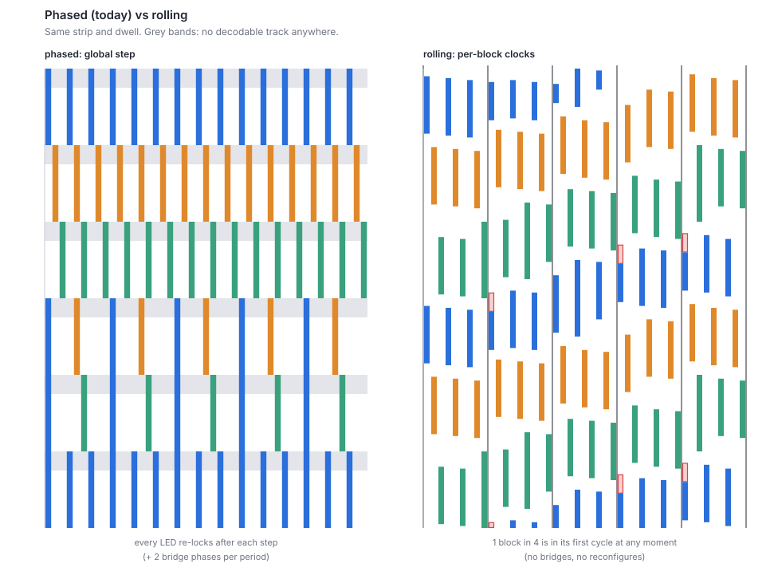
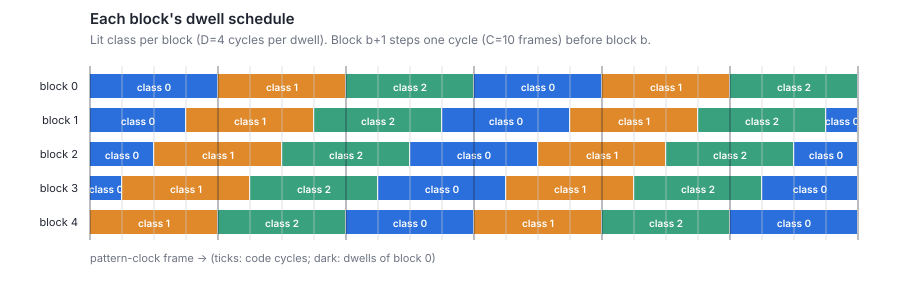
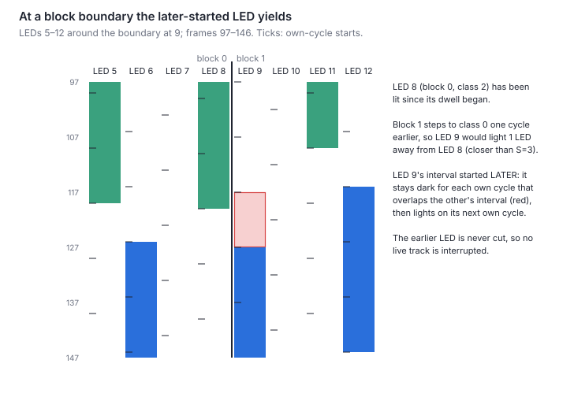
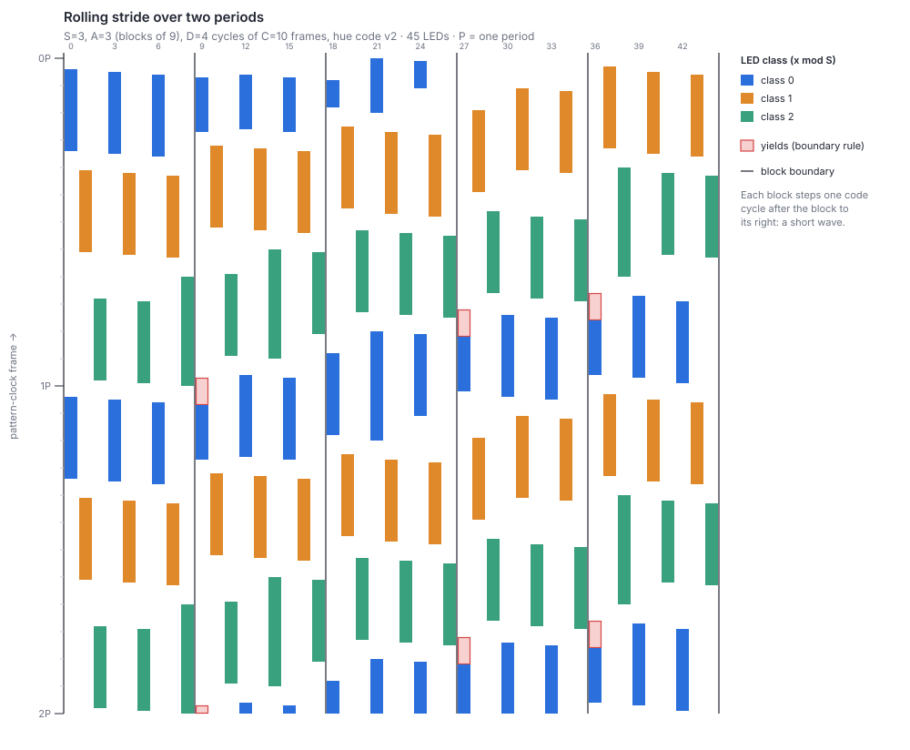
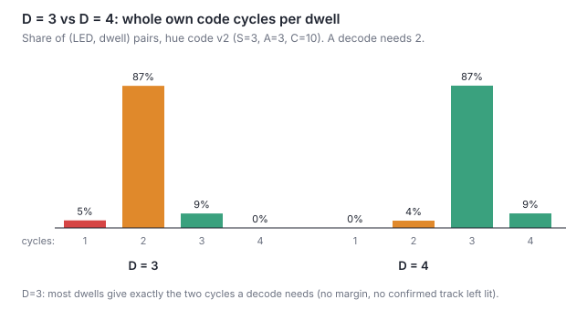

# Rolling stride: diffuse capture with live tracks at every moment

Status: implemented (kernel, protocol, players, phone). Follows #555
(adaptive diffuse detector, negotiated exposure and bit rate). Owner
decisions: D-173 (the later-started block yields, implemented as specified);
D-174 and D-175 (the dwell length and the bridge phases) were left to the
analysis below, which picks **D = 4** and **no bridges**. An interactive
explainer of the pattern accompanies the PR.

## Problem

Strided capture ([strided-capture.md](strided-capture.md)) lights a sparse,
spaced-out subset of LEDs per **phase** and rotates the phase. The phone
drives the rotation: every few seconds it sends `configure { stridePhase }`.
The lamp restamps its pattern epoch, and the phone rebuilds its decode
pipeline (`applyReconfigure` in `web/src/ui/screens/capture.ts`).

A phase change is global. Every lit LED goes dark in the same frame, a
disjoint class lights up, and every track and decoder state is thrown away.
That breaks a hue code v2 goal: **some LEDs should hold a valid,
solvable track at every moment**. v2 staggers each LED's code cycle
(`stagger_phase`) so sync and decode events spread over time. The global
phase step undoes that, with a dead gap at every step while the pilot
re-locks and cycles re-confirm.

Measured on the DemoPixieLamp (250-LED diffused rope, stride 3, Pixel 10 Pro
Fold, #555 build, v2 code): the decoder resets on every phase change
(`reneg` climbs, `cyc` and the pilot lock `k` go back to 0). Decodes then land
only in the second half of each about-4-second dwell.

## Goals

1. **Live tracks at all times.** At every frame, a steady fraction of the lit
   LEDs is mid-dwell: they have been lit long enough to have decoded, and will
   stay lit long enough to decode again.
2. **Spacing is never violated.** No two simultaneously lit LEDs are closer
   than `S` (the stride spacing, the diffuser knob) in LED index.
3. **Full coverage.** Every LED is lit for whole code cycles of its own, often
   enough to decode and confirm (`confirmCycles = 2`).
4. **No reconfigures for striding.** The lit schedule is a pure function of
   (LED, pattern-clock frame). The lamp and the phone compute it with the same
   kernel function, so striding never restamps the epoch or rebuilds a decoder.
   Only real rate or alphabet changes do.
5. **Registration still works.** The co-observation graph (LEDs seen in the
   same frames) stays connected with a small diameter, so the bundle
   adjustment holds one rigid fixture together.

## Design



*The same 45-LED strip under the phased schedule (left: a global step every
dwell, two bridge phases per period, a re-lock band after every step) and the
rolling one (right). Drawn by `img/rolling-stride/make_figures.py` from the
kernel's pinned fixture.*

### Blocks with their own clocks

LED `x` belongs to **class** `x mod S`. The strip is cut into **blocks** of
`B = A·S` LEDs (`A` = anchor density, clamped up to 3 as before). Inside a
block exactly one class is lit at a time, so its lit LEDs are exactly `S`
apart. The block holds a class for a **dwell** of `W = D·C` frames (`D` code
cycles of `C` frames), then steps to the next: `0, 1, …, S−1, 0, …`. Every LED
is lit for one dwell per **period** of `S·D` cycles.

Block `b`'s dwell `k` spans frames `[k·W + σ_b, (k+1)·W + σ_b)` and lights
class `k mod S`, with the block's clock shift

```
σ_b = (−b·C) mod S·W          (rolling_block_shift)
```

so **block `b+1` steps one code cycle before block `b`**: a short wave
travelling toward LED 0. Any `D` neighbouring blocks spread their steps evenly
over the dwell, so wherever the camera looks, one block in `D` is starting a
dwell and the rest are mid-dwell.



The draft proposed golden-ratio shifts (`frac(b·φ)·W`). Those spread the
steps too, but they leave neighbouring blocks 0.38 or 0.62 of a dwell apart,
which is what the boundary rule then has to pay for (next section). The
prototype (`proto/rolling.py` in the PR's working notes) measured it on 90
LEDs, S = 3, C = 10, v2, over eight periods:

| Block shifts | D | LEDs that starve (< D−1 own cycles in every period) | worst LED, own cycles per two periods |
| --- | --- | --- | --- |
| golden ratio | 4 | 8 of 90 | 0 |
| golden ratio, offsets chosen so neighbours never invert except at the wrap | 4 | 2 | 2 |
| golden ratio + shifting the block grid every period | 4 | 0 | 3 (and 1-cycle dwells at every grid shift) |
| **one-cycle wave** | 4 | **0** | **4** |

### Dwells aligned to each LED's own cycle (v2)

Under v2, LED `i` runs its cycle rotated by `stagger_phase(i)` (of its coded
id, `i + codeOffset` in a group capture). An LED is lit from the first
own-cycle start at or after its dwell opens to the last own cycle that ends
before it closes: `D−1` whole cycles, or `D` when the phases happen to line
up. A track is never cut mid-cycle. Under v1 own cycles are global cycles,
and since `σ_b` is a whole number of cycles every LED gets all `D`.

### Spacing at block boundaries (D-173)

Within a block spacing holds by construction. Across a boundary, block `b`'s
last lit LED and block `b+1`'s first are `S + o_{b+1} − o_b` apart, which is
less than `S` whenever `o_{b+1} < o_b`. With the wave, `b+1` runs at most one
class ahead of `b`, so that happens only at the wrap (`b` still at class
`S−1`, `b+1` already back at 0), for at most one cycle, and only for one pair
of LEDs: the last LED of `b` and the first of `b+1`.

**Rule (owner decision):** when two candidates less than `S` apart in
different blocks would be lit together, the one whose lit interval started
**later** yields. It stays dark for every own cycle of its own that overlaps
the other's interval, and lights again on its next own cycle. The earlier one
is never interrupted, so no live track is cut. Ties go to the lower index.
The kernel evaluates the rule from both LEDs' clocks, so it stays a pure
function and the lamp and the phone agree. Only LEDs within `S−1` of a block
boundary pay for the neighbour check.



Cost: only the first LED of a block ever yields, by at most one own cycle,
and only when its own-cycle phase overlaps (on the 90-LED strip, 4% of
dwells). Every LED gets at least `D−1` whole own cycles per dwell except
those, which get at least `D−2`. The kernel's property tests pin both bounds,
exhaustively over `S ∈ {2,3,4,6}`, `A ∈ {0,3,4}`, `D ∈ {2,3,4}`, v1 and v2.



### Dwell length: D = 4 (D-174)

Under v2, a dwell of `D` cycles gives an LED `D−1` whole own cycles almost
always (87% of dwells at either D; the rest get `D`, or `D−2` at a yield).
The decoder (`cv/staggerDecoder.ts`) needs **two** agreeing cycles to confirm
an id (`confirmCycles = 2`), and holds the first record until the second
arrives.



- **D = 3** leaves exactly two cycles for 87% of dwells: one missed window
  (frame drops run at about 25% at 60 fps today, see #555's handoff) loses the
  dwell's whole yield, and the confirmation lands as the LED goes dark, so
  almost no confirmed track is ever lit. 5% of dwells (the yields) get one
  cycle and cannot decode at all.
- **D = 4** leaves three cycles: one cycle of margin, and a lit LED carries a
  confirmed id for its whole third cycle. The kernel test
  `rolling_d4_keeps_most_lit_leds_past_their_first_cycle` pins that at every
  frame of a 600-LED strip at least half of the lit LEDs are past their first
  own cycle (measured 60–64%; on short strips of 30–90 LEDs the worst frame
  is 38–60%, against 11–40% at D = 3).
- Cost: a period is `S·D` cycles, 4.8 s instead of 3.6 s at S = 3 and 0.4 s
  cycles (40 ms bits, 4 symbols, 250 LEDs).

Per LED and code cycle, with a per-cycle decode probability `p`, the yield
is `2p²/(3S)` records at D = 3 and `(3p − 3p(1−p)²)/(4S)` at D = 4: at
`p = 0.8` and S = 3 that is 0.14 against 0.19, and D = 4 is ahead for every
`p` (D = 3 wastes one cycle in three, D = 4 one in four). The link simulator agrees (table below). D is a wire parameter
(`dwellCycles`); the phone asks for 4.

### Registration without bridges (D-175)

Phased coverage phases light one class everywhere, so two LEDs of different
classes are only ever seen together through the `S−1` bridge phases. Rolling
mode has no phases: neighbouring blocks sit at different classes all the
time, so every frame co-observes LEDs of several classes across the strip
and the co-observation graph is connected, with a small diameter, by
construction. A bridge in rolling mode would also have to be a global switch,
which is exactly the reconfigure the design removes.

The solver confirms it: `solver/src/regression_tests.rs`
`a_rolling_stride_registers_without_bridges` solves the same synthetic
capture (60-LED coil, S = 3, 30 s) phased with bridges and rolling without,
and requires the rolling map to be non-degenerate, to measure at least 57 of
60 LEDs, and to be within 1.5× of the phased map's aligned RMS error (see the
PR for the numbers). **Rolling mode has no bridge phases.**

## Wire and code changes

| Piece | Change |
|---|---|
| Kernel (`firmware/pattern/src/lib.rs`) | `RollingStride`, `rolling_block_shift`, `rolling_interval`, `stride_lit_rolling(led, seq, spec, &rs)`: allocation-free, integer-only, `seq` = absolute pattern-clock frame. `stride_lit` stays for phased mode. Golden `testdata/golden_stride_rolling.json` (lit mask per frame over two periods, four geometries incl. v1 and a group offset); wasm/C ABI `pk_stride_lit_rolling`, `pk_stride_rolling_dwell`. |
| Protocol | `StartMappingOptions` and `ConfigureOptions` gain `stride_mode` (`"phased"` / `"rolling"`) and `dwell_cycles`; `CodeParams` echoes both (only for a rolling stride, so phased replies are byte-identical to before). Players advertise the `stride_rolling` welcome feature; one without it runs phased and its reply says so, like `hue_stagger_pilot`. JSON schemas, the generated TS/Pydantic types and `web/src/gen/ledmapper_pb.ts` follow. |
| Player (`firmware/player`) | `pattern_color(led, seq)` now takes the ABSOLUTE frame (it reduces it modulo the cycle for the code), masks with `stride_lit_rolling` in rolling mode and ignores `stride_phase`. A caller passing a reduced cycle frame still gets the same colours for every non-rolling capture. The C6/P4 frame loop (`main.cpp`) passes `seq` and redraws on every new `seq`; `pi/player_rs` passes `seq`. Both advertise `stride_rolling`. |
| Phone (`capture.ts`) | `start_mapping` asks for `strideMode: "rolling"`, `dwellCycles: 4` whenever the player advertises the feature (even for a run that starts dense: the mode sticks across the configures that turn striding on). While `codeParams.strideMode` is rolling there is no phase rotation and no stride configure; the HUD shows decoded-id coverage. `?stride=phased` forces the old schedule. Per-channel capture's stage switch goes through the same path; `stageLitRolling` mirrors the mask, and a stage's progress is already its decoded-id coverage (`stageCoverage`). |
| Rate negotiation | `D` is in code cycles, so it follows the negotiated bit period. A real rate or alphabet change still restamps the epoch, which restarts the schedule. |

## Test results

- Kernel: golden + property tests (`//firmware/pattern:pattern_unit_test`,
  `:golden_stride_test`): spacing at every frame, whole own cycles, one run
  per period, `D−1`/`D−2` bounds, the one-cycle wave, the decoded share at
  D = 4, clamping, group offsets, far-future frames.
- Player: `firmware/player/tests/session.rs`
  `rolling_stride_only_when_advertised_and_masks_by_absolute_frame`.
- Phone: `web/tests/rollingStride.test.ts` (wasm vs the golden frame for
  frame; request/echo helpers; per-channel mask; the link simulation below).
- Solver: `a_rolling_stride_registers_without_bridges`.

LINK_SIM_TABLE

## Follow-ups

- Hand-held DemoPixieLamp maps, phased vs rolling, at the negotiated rate
  (and the HITL scanner rigs once built).
- The diffuse servo (handoff item B) settles LED brightness at phase
  boundaries; in rolling mode there are none, so it should settle in the
  probe and change brightness rarely.
