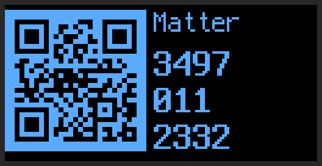
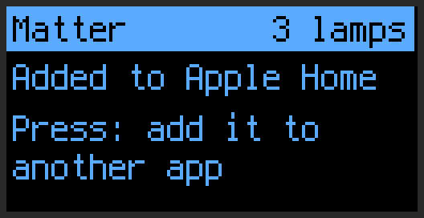

# Splanc lamps in Apple Home and other Matter apps

The **Splanc bridge** includes a **Matter bridge**. Matter is the smart-home standard that Apple
Home, Home Assistant, Amazon Alexa, Samsung SmartThings and Google Home all use. You add the
bridge to your smart-home app **once**. Every Splanc lamp the bridge finds then appears as a
dimmable light, including lamps you add later.

```text
Apple Home / Home Assistant / Alexa / SmartThings
        │  Matter, on your home network (no cloud)
        ▼
  Splanc bridge (Pi, or any always-on computer)
        │  the Splanc app protocol
        ▼
  your Splanc lamps
```

What each lamp can do in your smart-home app:

| In the app  | On the lamp                                                                             |
| ----------- | --------------------------------------------------------------------------------------- |
| On / off    | The lamp turns on or off, with the ON/OFF transition you set in the Splanc app.         |
| Brightness  | The lamp's brightness (the same master dimmer as in the Splanc app).                    |
| Its state   | A tap on the lamp's lid, or a change in the Splanc app, shows up in the smart-home app. |
| Its name    | The lamp's name in the Splanc app, with its room: _Coil (Bedroom)_.                     |
| Unreachable | Shown when the bridge can't reach the lamp (it is unplugged, or off your Wi-Fi).        |

Effects, colours and saved looks stay in the Splanc app: Matter has no way to describe a Splanc
effect. Colour control from the smart-home app is planned. If you use Home Assistant, the
[Splanc integration for Home Assistant](home-assistant.md) also lets you pick saved looks.

On/off needs lamp firmware with the **power** feature (the touch lid and the ON/OFF
transitions). On older firmware, "off" sets the brightness to 0 and "on" brings the last
brightness back. Update the lamp from the Splanc app to get real on/off.

## What works with which app

The Splanc bridge is **not Matter-certified** yet. It identifies itself with the Matter test
vendor ID, so some apps warn before adding it:

| App                      | Works?               | Notes                                                                                                                                 |
| ------------------------ | -------------------- | ------------------------------------------------------------------------------------------------------------------------------------- |
| **Apple Home** (iOS 18+) | Yes                  | iOS says **Uncertified Accessory**. Tap **Add Anyway**. Remote control and automations need a home hub (HomePod or Apple TV).         |
| **Home Assistant**       | Yes                  | Through its **Matter** integration (it adds a Matter server). Or use the [Splanc integration](home-assistant.md) instead.             |
| **Amazon Alexa**         | Not tested by us yet | Alexa is reported to accept uncertified devices. Needs an Echo that is a Matter controller.                                           |
| **Samsung SmartThings**  | Not tested by us yet | Needs a SmartThings hub or a Matter-capable SmartThings device.                                                                       |
| **Google Home**          | **No** (for now)     | Google only lets **certified** Matter devices into normal accounts. Use Home Assistant's Google Assistant link meanwhile (see below). |

We are working on certification. Until it is done, Splanc does not claim "Works with" any of
these platforms.

## What you need

- A **Splanc bridge** on the same network as your lamps: the Splanc Bridge box, a Raspberry Pi you
  set up yourself ([Set up a Splanc bridge on a Raspberry Pi](../pi-bridge.md)), or any always-on
  computer (see [Build your own bridge](#build-your-own-bridge)).
- Your smart-home app's **hub** where it needs one (a HomePod or Apple TV for Apple Home away from
  home; an Echo for Alexa; a SmartThings hub).
- **IPv6** turned on in your router. It is on by default almost everywhere; Matter needs it on
  your local network, not on the internet.

## 1. Find the bridge's Matter code

The bridge has its own Matter pairing code. It is different from the cloud pairing code (the
`ABCD-EFGH` one) and it doesn't expire.

- **OLED screen:** move the joystick to the **Matter** page (right after **Scan to pair**). It
  shows a QR code and the 11-digit code, like `3497-011-2332`.
- **HDMI screen:** while no cloud pairing code is up, the page shows **Add to your smart home
  (Matter)** with the code and the QR code.
- **Over SSH:** `splanc-bridge matter-pair` prints the code.



## 2. Add the bridge in your app

**Apple Home:** tap **+** ▸ **Add Accessory**, and scan the QR code on the bridge's screen (or
tap **More options** and type the 11 digits). When iOS says **Uncertified Accessory**, tap **Add
Anyway**. Pick a room for the bridge. Each lamp then shows up as a light; give each one its own
room in the Home app.

**Home Assistant:** go to **Settings ▸ Devices & services ▸ Add integration ▸ Matter**. Home
Assistant installs its Matter server the first time. Then add the bridge from the **Home
Assistant Companion app** on your phone (**Settings ▸ Devices & services ▸ Devices ▸ Add device ▸
Add Matter device**) and scan the QR code. The lamps appear as lights under one **Splanc Bridge**
device.

**Amazon Alexa:** in the Alexa app, tap **Devices ▸ +** ▸ **Add Device ▸ Other ▸ Matter**, then
scan the QR code or type the code.

**SmartThings:** tap **+** ▸ **Add device ▸ Scan QR code**.

Once the bridge is added, the OLED's Matter page says **Added to** and the app's name, and the
code is hidden.



## 3. Add it to a second app

Matter lets several apps control the same lamps (for example Apple Home and Home Assistant).
There are two ways to add the bridge to another app:

- In the first app, use its **share** or **pairing mode** option (Apple Home: the bridge's
  settings ▸ **Turn On Pairing Mode**). It gives you a new code for the other app.
- On the bridge, go to the OLED's **Matter** page and **press the joystick**, or run
  `splanc-bridge matter-pair` over SSH. The bridge shows its code again for 15 minutes.

## One controller at a time

A Splanc lamp talks to one app at a time. When you open the Splanc app and use a lamp, the app
takes over, and you can work on effects and maps without any lag. Meanwhile:

- turning the lamp on or off from your smart-home app still works (the bridge takes the lamp
  back when the Splanc app has been idle for 15 seconds);
- the smart-home app may show the lamp's old state for a few minutes. The bridge checks the lamp
  again within 1 to 10 minutes, and at once when you control the lamp from the smart-home app.

Use one smart-home path per lamp: either the Matter bridge, or the Home Assistant integration
talking to the lamp directly, not both.

## Remove the bridge from your apps

Remove it in each app as usual (Apple Home: the bridge's settings ▸ **Remove Bridge**). To make
the bridge forget **every** app at once, run `splanc-bridge matter-reset --yes` over SSH. The
lamps and the cloud pairing are not affected, and the bridge shows a code again.

To turn the Matter bridge off, put `SPLANC_MATTER=0` in `splanc-bridge.conf` on the card's boot
partition ([Changing settings later](../pi-bridge.md#changing-settings-later)).

## Google Home

Google Home accepts only Matter devices that the Connectivity Standards Alliance has certified.
Until the Splanc bridge is certified:

- **With Home Assistant:** add your lamps to Home Assistant (with the Matter bridge or the
  [Splanc integration](home-assistant.md)), then expose them to Google with Home Assistant's
  **Google Assistant** integration (Home Assistant Cloud, or the manual setup).
- **Developers only:** a Google Home Developer Console project with a Matter integration for
  vendor ID `0xFFF1` and product ID `0x8001` lets the members of that project add the bridge to
  their own home. This is a developer tool, not a way to share the lamps with your household.

## Build your own bridge

The Matter bridge is part of the free, open Splanc bridge software. You don't need to buy the
Splanc Bridge box.

**On a Raspberry Pi** (Pi 5, 4, 3 B/B+/A+, or Zero 2 W): follow
[Set up a Splanc bridge on a Raspberry Pi](../pi-bridge.md). The Matter bridge is on by default.
An OLED HAT is optional but handy, because it shows the Matter code; without one, use the HDMI
page or `splanc-bridge matter-pair` over SSH. The Splanc Bridge box is a Pi 3 A+ with the
Waveshare 1.3" OLED HAT in a case: the same image, the same software.

**On Raspberry Pi OS or any Linux computer:** install the bridge service with
`curl -fsSL https://splanc.io/bridge/install.sh | sudo sh` (see the Pi guide). The Matter bridge
starts with it.

**On any always-on computer** (Linux, macOS, Windows, Node.js 20 or newer):

```sh
npx -y https://splanc.io/agent/splanc-agent.tgz bridge
# in another terminal:
npx -y https://splanc.io/agent/splanc-agent.tgz bridge-ctl status       # "matter": the code + QR payload
npx -y https://splanc.io/agent/splanc-agent.tgz bridge-ctl matter-pair  # pairing again, for another app
```

Things to check on a computer you set up yourself:

- It is on the **same network** (the same subnet, no client isolation) as the lamps and the
  smart-home hub.
- The firewall lets in **UDP 5540** (Matter) and **UDP 5353** (mDNS). Use another port with
  `--matter-port <port>` if 5540 is taken.
- In Docker, use **host networking** (`--network host`): Matter's discovery doesn't cross a
  Docker bridge network.
- The bridge keeps its Matter identity and the apps it was added to under `matter/` in its
  state directory (`--state-dir`; by default `~/.local/state/splanc`, or
  `$SPLANC_BRIDGE_STATE_DIR`). Back it up, or you will need to add the bridge to your apps
  again.

## Troubleshooting

| What you see                                          | What to do                                                                                                                                              |
| ----------------------------------------------------- | ------------------------------------------------------------------------------------------------------------------------------------------------------- |
| The app can't find the bridge after scanning the code | Make sure the phone is on the same Wi-Fi as the bridge (not a guest network) and IPv6 is on in your router. A Pi 3 or Zero 2 W only sees 2.4 GHz Wi-Fi. |
| The Matter page says **Matter is off**                | `SPLANC_MATTER=0` is set in `splanc-bridge.conf`: remove the line.                                                                                      |
| The Matter page shows an error                        | Usually another program uses UDP port 5540. `splanc-bridge logs` shows the details.                                                                     |
| A lamp is **Not Responding** / unreachable            | The bridge can't reach the lamp: check that it is powered and on the Wi-Fi (the bridge's **Fixtures** page shows a red dot for it).                     |
| A lamp shows the wrong on/off state for a while       | Someone is using it in the Splanc app (see [One controller at a time](#one-controller-at-a-time)). It catches up within minutes.                        |
| A new lamp doesn't show up                            | The bridge looks for new lamps every 5 minutes. Make sure the lamp is on the same network.                                                              |
| Google Home refuses the bridge                        | Expected until the bridge is certified: see [Google Home](#google-home).                                                                                |
