# Set up a Splanc bridge on a Raspberry Pi

A **Splanc bridge** is a small always-on computer on your home network that connects your
Splanc fixtures to the Splanc cloud relay. With it, the app (or an AI agent in the cloud) can
reach your lights from anywhere, not only from the same Wi-Fi. A Raspberry Pi makes a good bridge.
It runs with no keyboard or mouse, and it shows its pairing code and status on two screens:

- a TV or monitor plugged into its HDMI port;
- a small OLED add-on board (optional).

Setting one up takes about 10 minutes and **no terminal**: the **Splanc Bridge Flasher** app
downloads the Splanc bridge system, asks for your Wi-Fi, and writes it all to a microSD card. You
put the card in the Pi, power it on, and read the pairing code off its screen.

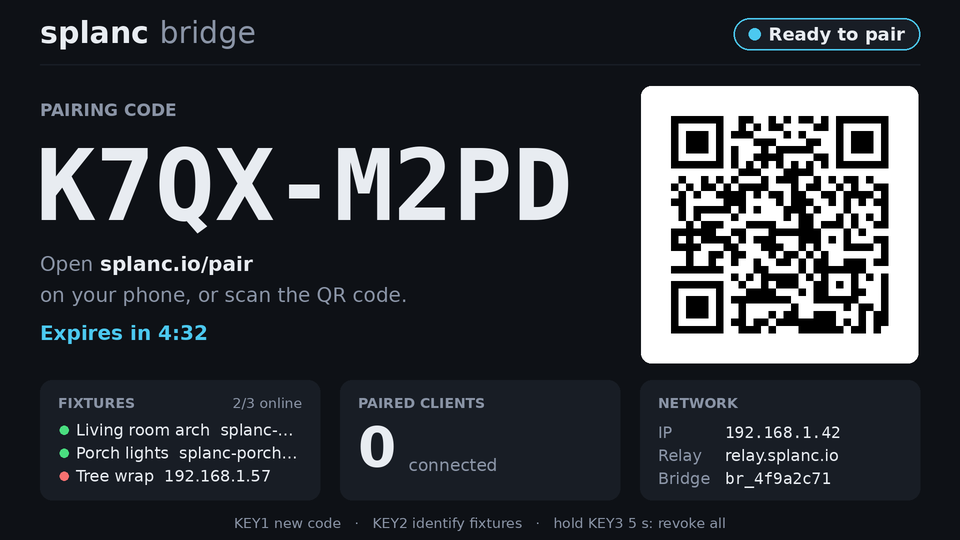

## What you need

| Item                       | Notes                                                                                                                                                                                                                                                                                                         |
| -------------------------- | ------------------------------------------------------------------------------------------------------------------------------------------------------------------------------------------------------------------------------------------------------------------------------------------------------------- |
| Raspberry Pi               | **Pi 5** or **Pi 4** (or Pi 400) recommended. A Pi 3 (B, B+, A+) or Pi Zero 2 W works too.                                                                                                                                                                                                                    |
| Power supply               | The official supply for your model (USB-C 5 V 3 A for a Pi 4; 5 V 5 A for a Pi 5).                                                                                                                                                                                                                            |
| microSD card               | 4 GB or larger. Everything on it is erased.                                                                                                                                                                                                                                                                   |
| Network                    | Wi-Fi or Ethernet, on the **same network as your fixtures**. A Pi 3 or Zero 2 W only sees 2.4 GHz Wi-Fi.                                                                                                                                                                                                      |
| HDMI screen (optional)     | Any TV or monitor. A Pi 4/5 needs a micro-HDMI cable; a Zero 2 W needs mini-HDMI.                                                                                                                                                                                                                             |
| OLED HAT (optional)        | **Waveshare 1.3inch OLED HAT** (128×64, SH1106, with a 5-way joystick and three keys; e.g. Amazon B07VCYTPRK). It plugs onto the Pi's 40-pin header, so it needs no wiring or soldering. A Zero 2 W needs a version with the header already soldered on ("WH"). Leave the HAT's factory SPI setting as it is. |
| A computer with an SD slot | A Mac, Windows PC or Linux PC (a USB card reader is fine), to run the Splanc Bridge Flasher.                                                                                                                                                                                                                  |

You need at least one of the two screens to read the pairing code from the Pi.

## 1. Get the Splanc Bridge Flasher

Download it from the newest **Splanc bridge** release on
[the releases page](https://github.com/fughilli/splanc/releases) (the releases named "Splanc
bridge …", tagged `pi-bridge-v…`):

| Your computer               | File                                                    |
| --------------------------- | ------------------------------------------------------- |
| Mac with Apple silicon (M…) | `Splanc-Bridge-Flasher-<version>-mac-arm64.dmg`         |
| Mac with an Intel processor | `Splanc-Bridge-Flasher-<version>-mac-x64.dmg`           |
| Windows                     | `Splanc-Bridge-Flasher-<version>-win-x64.exe`           |
| Linux                       | `Splanc-Bridge-Flasher-<version>-linux-x86_64.AppImage` |

The app isn't code-signed yet, so the first time you open it your computer asks you to confirm:

- **macOS:** open the `.dmg` and drag **Splanc Bridge Flasher** into **Applications**. Open it;
  macOS says it "cannot be opened" or "could not verify" it. Click **Done** (or **OK**), open
  **System Settings ▸ Privacy & Security**, scroll down to the message about Splanc Bridge
  Flasher and click **Open Anyway**, then **Open**. You only do this once.
- **Windows:** run the `.exe`. If **Windows protected your PC** appears, click **More info**, then
  **Run anyway**. It installs for your user and opens.
- **Linux:** in your file manager, right-click the `.AppImage` ▸ **Properties** ▸ **Permissions**,
  tick **Allow executing file as program**, then double-click it.

## 2. Write the card

Put the microSD card in your computer and open the flasher.

1. **Pi**: choose your Raspberry Pi model. The flasher always offers the newest Splanc bridge
   release.

   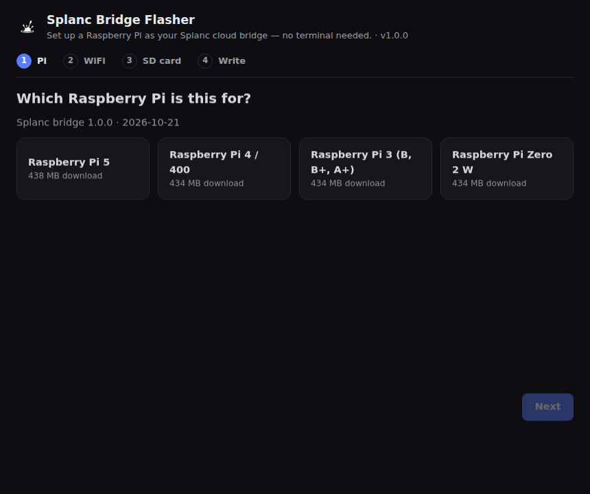

2. **WiFi**: type your Wi-Fi name and password, and check the **WiFi country** (it sets which
   channels the Pi may use). Tick **Hidden network** if your network doesn't broadcast its name,
   or **No WiFi** if you'll plug in an Ethernet cable. You can also give the Pi a name; it then
   shows up on your network as `<name>.local` (the default is `splanc-bridge.local`).

   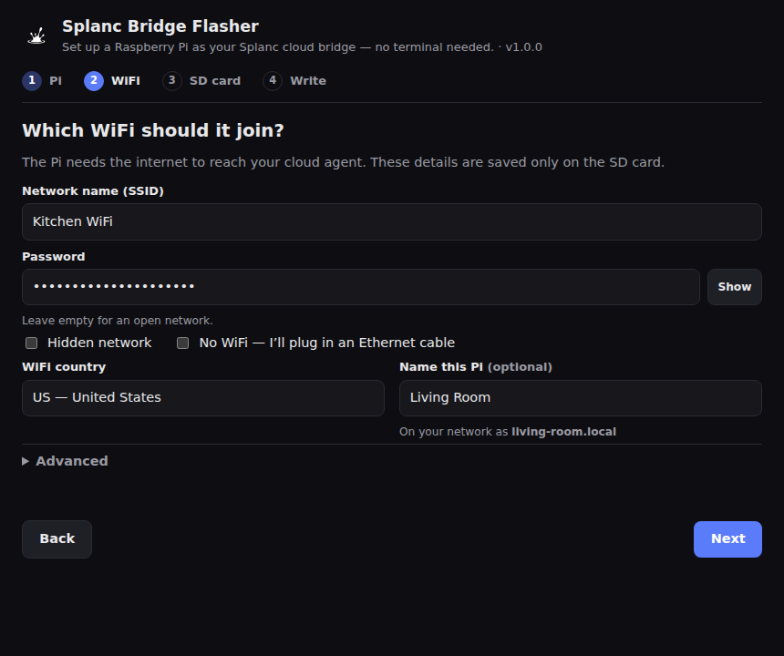

   The Wi-Fi details go only onto the card. On its first boot the Pi moves the password into its
   own protected storage and deletes it from the card.

3. **SD card**: pick your card. Only removable disks are listed, never your computer's own
   drive, and the flasher asks again if a disk looks too big to be an SD card. Click
   **Erase and write**, confirm, and enter your computer's password when it asks (writing a card
   needs it).

   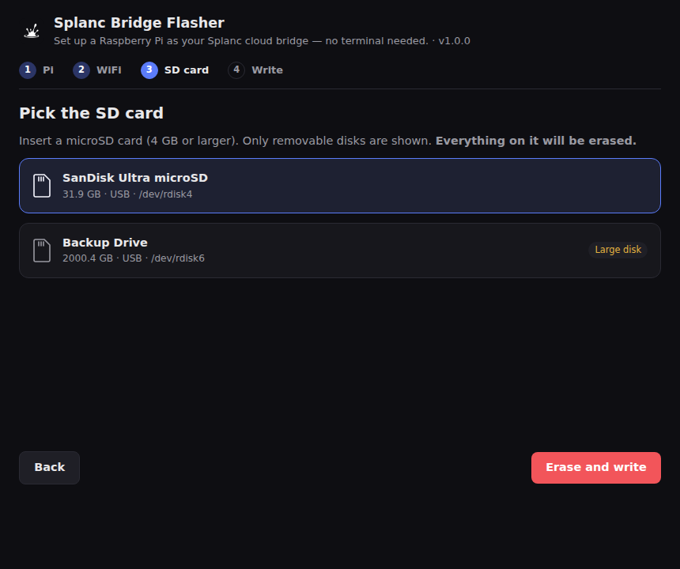

4. The flasher downloads the image (about 450 MB, checked against its published checksum),
   writes the card, **reads it back to check every byte**, and saves your Wi-Fi settings onto it.
   This takes a few minutes. Keep the card in until it says it's ready.

   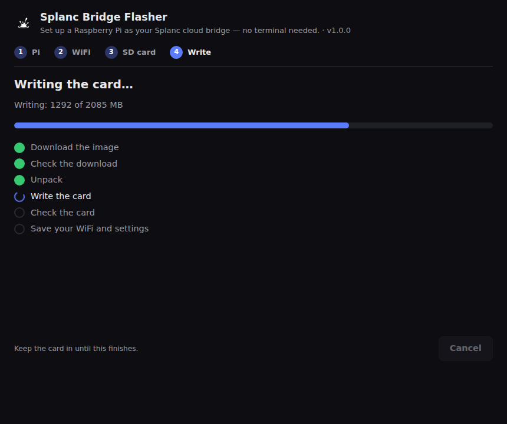

   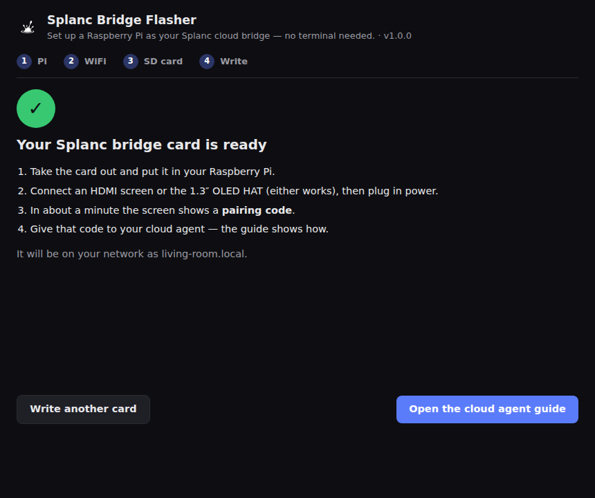

On Windows, a message may offer to format a drive on the card: choose **Cancel**. That drive is
the Pi's system partition, which Windows can't read.

## 3. Boot the Pi

With the Pi unplugged, fit the OLED HAT onto its header if you have one, and plug in the HDMI
screen if you use one. Insert the card and connect power. Within a few seconds the screens show
the Splanc logo with a moving "loading" row of lights and what the Pi is doing (Starting…,
Connecting…, Starting bridge…). In about a minute they show **Ready to pair** with a code like
`ABCD-EFGH`. (The first boot takes a little longer: the Pi grows its file system to fill the
card.)

The bridge starts by itself every time the Pi powers on. It finds your fixtures on the network by
itself.

## 4. Pair

To use the bridge from a cloud AI agent (Claude, ChatGPT, …), follow
[Use Splanc from a cloud agent](guides/cloud-agent.md): you give the agent the relay address and,
when it asks you to sign in, type the code from the Pi's screen.

The code expires after a few minutes. Press **KEY1** on the HAT for a fresh one.

## What the screens show

**HDMI**: a full-screen status page, which updates by itself. While a code is waiting to be used,
the page shows:

- the code, in large letters;
- a QR code of the pairing link;
- how long until the code expires.

After pairing, it shows how many clients are connected. Along the bottom are:

- **Fixtures**: the players the bridge found, with a green or red dot for online or not;
- **Paired clients**: the apps and AI connectors paired with this bridge, each with a green dot
  when it is in use (a live session, or a call in the last 10 minutes) and how long ago it was
  last used;
- **Network**: the Pi's address, the relay and the bridge ID.

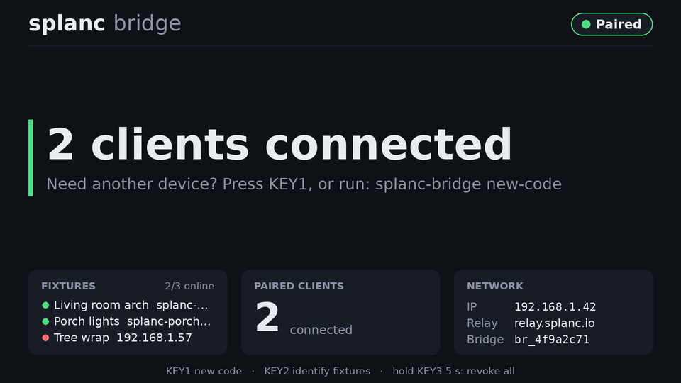

**OLED HAT**: from power-on it shows the Splanc logo animation and the loading progress
(on the SD image; on Raspberry Pi OS a two-second logo when the screen service starts), then
slides to six pages, which rotate every 8
seconds:

1. **Home**: the state, the pairing code in large letters, the short pairing link, the time left
   and the number of clients.
2. **Scan to pair**: a QR code of the pairing link.
3. **Fixtures**: every player the bridge knows, in a list that scrolls. Each row shows ● for
   connected, ○ for found but idle, ◐ for reconnecting, or × for unreachable, and on the right
   the frame rate (or, for an unreachable one, how long ago it was last heard from).
4. **Network**: the IP address, the relay, the number of connected clients and the bridge ID.
5. **Clients**: every paired client (an AI connector such as Claude or ChatGPT, the Splanc app on
   a phone, or a personal token), oldest first. Each row shows ● when the client is in use (a
   live session open, or a call in the last 10 minutes) or ○ when it isn't, and on the right how
   long ago it was last used: `now`, `40s`, `5m`, `2h`, `3d` or `never`. The title shows how many
   are in use out of how many are paired.
6. **Updates**: the system and the Splanc software, each with its version and `new` when an
   update is available, and **Check for updates**. See [Updates](#updates).

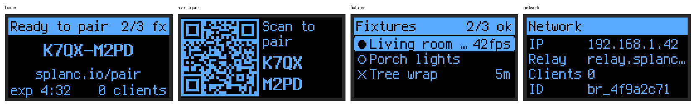

On the **Fixtures** page, move the joystick up and down to pick a fixture and press it to open
that fixture's details:

- its state (connected, idle, reconnecting or unreachable) and, when unreachable, why;
- when the bridge last heard from it ("12 s ago");
- its IP address (link-local addresses are marked "LL"), its ID (MAC address) and firmware
  version;
- its room and its LED count. When no channel has a count set, the count comes from the
  fixture's map, marked "(map)";
- the running effect, when the bridge knows it;
- its latest performance numbers: frame rate (and whether the effect is lagging), the share of
  the frame budget used, overruns, free heap, and how old those numbers are. They come from
  the last time an agent measured an effect (`measure_effect`) or from the fixture's own
  reports. "no data yet" means nothing has measured it since the bridge started.

Move the joystick up and down to scroll the details. Push it left, or press it, to go back to the
list. The details stay open while you look at them, and go back to the list after 5 minutes
without a press. If the fixture disappears from the bridge's list while it is open, the screen
goes back to the list.

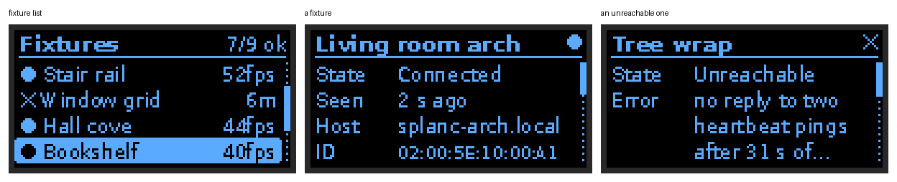

On the **Clients** page, move the joystick up and down to pick a client and press it to open its
details: what kind of client it is, when it was last used and added, whether it is in use now,
and its ID (the same ID `splanc-bridge clients` prints). A name too long for the title is
spelled out in full first.

To unpair just that client, hold **KEY3** in its details for 5 seconds, then press **KEY3** again
on the confirm screen, which names the client. Its access ends at once: its tokens stop working,
and an open app session closes. The other clients stay paired. Any other key, or 10 seconds of
waiting, cancels. (Held anywhere else, **KEY3** still revokes every client.)

The Clients page can also show:

- **No paired clients**: nothing is paired. Press **KEY1** for a pairing code.
- **Client list needs a relay update**: the relay this bridge uses is older than this feature.
  The bridge and the clients still work, and **KEY3** revoke-all still works; only the list and
  revoking one client wait for the relay update.
- **offline** in the title: the relay can't be reached, so this is the last list it sent.
  Revoking a client needs the relay, so it fails until the bridge is back online.

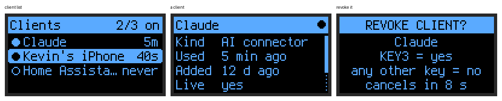

Every change of screen slides: pages slide sideways, a fixture's details slide in over the list
and back out, and the highlight in the list glides. A press during a slide takes effect at once.

To protect the OLED from burn-in, it behaves as follows:

- the image moves by one pixel every minute;
- the screen dims after 2 minutes without a button press or a change;
- the screen turns off after 30 minutes, but only while no pairing code is showing.

Any key wakes it. That first press only wakes the screen and does nothing else.

### States

| Shown as           | Meaning                                                                                                 |
| ------------------ | ------------------------------------------------------------------------------------------------------- |
| Waiting for bridge | The bridge service isn't running yet (or has stopped).                                                  |
| Starting           | The bridge is starting up.                                                                              |
| Offline            | The bridge can't reach the relay (no internet). Fixtures on your network still work from the local app. |
| Not paired         | No app is paired, and no code is showing. Press **KEY1** for a code.                                    |
| Ready to pair      | A pairing code is waiting to be used.                                                                   |
| Paired             | One or more apps are paired.                                                                            |
| Error              | The bridge reported a problem; the message is on screen.                                                |

## OLED HAT buttons

| Button                                             | Action                                                                                                                                                                     |
| -------------------------------------------------- | -------------------------------------------------------------------------------------------------------------------------------------------------------------------------- |
| **KEY1**                                           | Get a new pairing code.                                                                                                                                                    |
| **KEY2**                                           | Identify fixtures (every fixture flashes so you can tell them apart).                                                                                                      |
| **KEY3**, held for 5 seconds                       | Revoke all clients. A progress bar fills while you hold. Then a confirm screen appears: press **KEY3** again to confirm. Any other key, or 10 seconds of waiting, cancels. |
| **KEY3** in a client's details, held for 5 seconds | Revoke just that client, with the same progress bar and confirm screen.                                                                                                    |
| Joystick right / down                              | Next page. On the **Fixtures** and **Clients** pages, down picks the next item instead.                                                                                    |
| Joystick left / up                                 | Previous page. On the **Fixtures** and **Clients** pages, up picks the previous item instead.                                                                              |
| Joystick press                                     | Back to the home page. On the **Fixtures** and **Clients** pages, it opens the picked item.                                                                                |
| In a fixture's or client's details                 | Up / down scroll. Left or press go back to the list.                                                                                                                       |

**KEY1** works from every screen: it goes to the home page so you can see the new code.

After a joystick press, the pages stop rotating for 30 seconds. They don't rotate while a
fixture's or client's details are open.

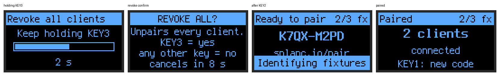

## Updates

The bridge never updates itself without asking. It looks for updates on its own (the Splanc
software about two minutes after it boots and then daily, the system every few hours) and only
tells you when one is available: the HDMI page shows **Update available** in its title bar, with
the new version, the one running now, what it is and what installing it involves, and the OLED's
**Updates** page shows `new` next to it. Nothing is downloaded until you confirm.

There are two kinds of update, installed separately:

- **System**: the Pi's operating system, the screens and everything else on the card. A few
  hundred MB at most (often much less: only what changed is downloaded). Installing it restarts
  the Pi: about two minutes without the bridge; your fixtures keep playing. If the new system
  doesn't come up healthy within five minutes, the Pi goes back to the previous one by itself.
  Only updates signed by Splanc are accepted.
- **Agent**: the Splanc bridge software. About 1 MB, checked against its published checksum.
  Installing it restarts the bridge (a few seconds); the previous version stays on the card.

Your pairings and Wi-Fi networks are kept either way.

**To check now**: on the OLED, go to **Updates** (joystick left from the home page), pick
**Check for updates** and press the joystick. After a few seconds the screen says **Up to date**
or which update is new.

**To install**: on the **Updates** page, pick **System** or **Agent** and press the joystick. The
details show the version running now, the new one, its download size, what installing it does
and when the bridge last checked. Press **KEY3**: the screen asks **INSTALL UPDATE?**; press
**KEY3** again to install, or any other key to cancel (it also cancels by itself after 10
seconds). The screen then shows the progress: downloading (with a percentage), verifying,
installing and, for a system update, restarting and the health check afterwards. The bridge
keeps working while an update downloads; only the final restart interrupts it.

If an install fails (a lost connection, a download that doesn't check out), the screen says what
went wrong and **KEY3** retries it. An update that was already downloaded and checked installs
straight away. Over SSH: `splanc-bridge updates` shows the same, `splanc-bridge check-updates`
checks now, `sudo splanc-bridge update` installs the agent update and `sudo splanc-system-update
apply` the system update (see [For power users](#for-power-users)).

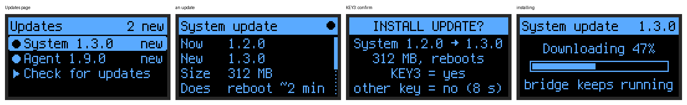

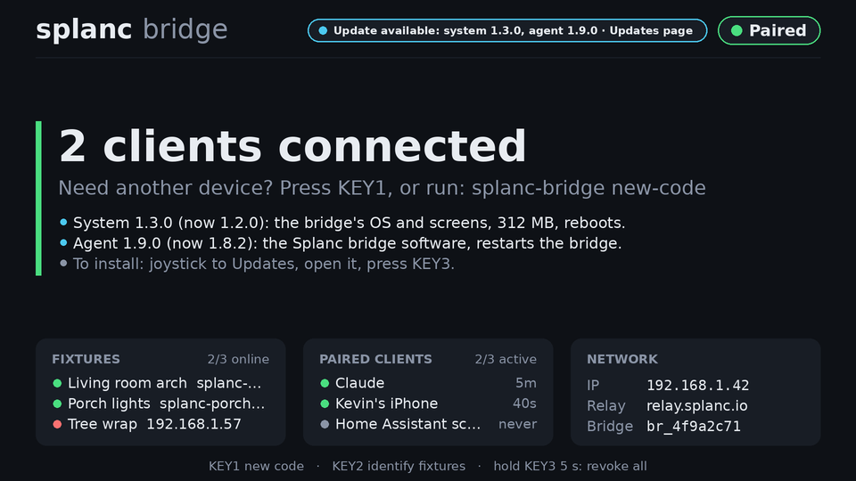

Writing the card again with the flasher also works, but starts fresh: you pair your agents again
afterwards.

## Changing settings later

Put the card in your computer: its boot partition (it may be called `FIRMWARE` or `bootfs`) has a
file **`splanc-bridge.conf`** you can edit with any text editor. The Pi reads it every time it
boots.

| Setting                    | What it does                                                          |
| -------------------------- | --------------------------------------------------------------------- |
| `HOSTNAME=splanc-bridge`   | The Pi's name on your network (`<name>.local`).                       |
| `WIFI_COUNTRY=US`          | Two-letter country code for Wi-Fi channels.                           |
| `SPLANC_RELAY=`            | The relay to use (empty: Splanc's).                                   |
| `OLED=auto`                | The OLED HAT: `auto`, `spi`, `i2c` or `off`.                          |
| `OLED_ROTATE=2`            | `0`–`3`, in steps of 90°. Use `0` if the OLED picture is upside down. |
| `SPLANC_DISPLAY_HDMI=auto` | The HDMI status page: `auto` or `off`.                                |
| `SPLANC_AUTO_UPDATE=1`     | `0` stops the background checks for updates (checking by hand works). |

To put the bridge on another Wi-Fi network (a venue, a new router), use the Splanc app on your
phone, the same way you add a fixture: **Add device over Bluetooth**, choose the network, then
pick the bridge (it shows up under its name, `splanc-bridge` unless you renamed it) in the
Bluetooth list. The bridge saves the network next to the ones it already knows and joins it; it
then joins whichever known network is in range by itself. Sending a network it already knows
updates that network's password. If the bridge can't join, the app says so and the bridge keeps
its saved networks as they were. A paired bridge stays paired. You can also write the card again
with the flasher (that resets the bridge, so you pair again).

## Troubleshooting

**The card doesn't appear in the flasher**: make sure it's inserted all the way and shows up on
your computer. Card readers built into some laptops count as internal on macOS; use a USB card
reader instead.

**macOS: "macOS blocked raw disk access"**: open **System Settings ▸ Privacy & Security ▸ Full
Disk Access**, turn on **Splanc Bridge Flasher** (add it with **+** from Applications if it isn't
listed), quit and reopen the flasher, and write again.

**"What was read back from the card differs from the image"**: the card or the card reader is
faulty, or the card is a counterfeit that reports more space than it has. Try another card.

**The download fails or is "damaged"**: check your internet connection and try again. The
flasher refuses any image whose checksum doesn't match the published one.

**The Pi never shows up on the network / stays "Offline"**: check the Wi-Fi name and password
(they are case-sensitive) and the country, and that a Pi 3 or Zero 2 W is near a 2.4 GHz network.
Write the card again with the right details. Ethernet always works without settings.

**The HDMI screen stays black or shows a login prompt**: make sure the screen was plugged in when
the Pi booted (or reboot it with the screen connected).

**The OLED stays dark or the picture is upside down**: check the HAT is seated on all 40 pins;
for an upside-down picture set `OLED_ROTATE=0` in `splanc-bridge.conf`. If you changed the HAT's
resistors to I2C, set `OLED=i2c`.

**The screen says "has no bridge yet. Install the agent update"**: the card has a Splanc release
from before the cloud bridge existed. Connect the Pi to the internet, then on the OLED go to
**Updates**, open **Agent** and press **KEY3** twice (or run `sudo splanc-bridge update` over SSH).
It then shows a pairing code.

**No fixtures found**: the Pi must be on the same network as the fixtures. Guest Wi-Fi networks
often isolate devices from each other, and some mesh systems block the multicast traffic that
discovery uses. Try Ethernet, or put the Pi and the fixtures on the main network.

## For power users

### SSH

The bridge image has no password login at all. To log in, paste your SSH public key into the
flasher's **Advanced ▸ SSH public key** box (or put it in `authorized_keys` on the card's boot
partition). Then `ssh root@splanc-bridge.local` works, and `splanc-bridge status`, `new-code`,
`identify`, `revoke-all`, `clients`, `revoke`, `logs`, `updates`, `check-updates`, `update`,
`restart` and `version` are available, plus `splanc-system-update status|scan|check|apply|logs`
for system updates. Running `update` or `splanc-system-update apply` installs right away: that is
your confirmation. (`splanc-system-update check` downloads and installs too, but waits for a
confirmation if an app is connected through the bridge.)

### Install on Raspberry Pi OS instead

If you'd rather keep a Raspberry Pi OS install you manage yourself, the same bridge and screens
install with one command. Flash **Raspberry Pi OS Lite (64-bit)** with Raspberry Pi Imager
(**Edit Settings**: hostname `splanc-bridge`, your user and Wi-Fi, and **Enable SSH**), boot it,
then from your computer:

```sh
ssh yourname@splanc-bridge.local
curl -fsSL https://splanc.io/bridge/install.sh | sudo sh
```

The installer installs a pinned Node.js and the Splanc bridge (checking each download against its
published checksum) and the screen service, switches on the OLED HAT's SPI interface and starts
everything. Options go after `sh -s --`:

| Option                       | Effect                                                                                       |
| ---------------------------- | -------------------------------------------------------------------------------------------- |
| `--oled auto\|spi\|i2c\|off` | OLED HAT mode. `auto` is the default: it finds the HAT by itself. `off` skips the SPI setup. |
| `--relay URL`                | Use a different relay. By default, the bridge uses its built-in relay.                       |
| `--no-start`                 | Install without starting the services.                                                       |

Manage it over SSH:

```sh
splanc-bridge status            # state, code, fixtures, clients
splanc-bridge new-code          # a fresh pairing code
splanc-bridge identify          # flash every fixture
splanc-bridge revoke-all        # unpair every client (asks first)
splanc-bridge clients           # paired clients: ID, kind, last used, added, name
splanc-bridge revoke <ID>       # unpair one client (asks first; the ID's first few characters do)
splanc-bridge logs              # recent logs; add -f to follow
sudo splanc-bridge restart
sudo splanc-bridge update       # install the latest release now
sudo splanc-bridge config       # edit settings, then restart
sudo splanc-bridge uninstall    # remove it (add --purge to also delete settings and pairing data)
```

On Raspberry Pi OS, updates are still automatic (daily, sha256-checked; `SPLANC_AUTO_UPDATE=0` turns
them off), unlike the SD image, which asks first. Settings
are in `/etc/splanc-bridge/bridge.env` (the same keys as `splanc-bridge.conf` above) and your
pairing data in `/var/lib/splanc-bridge`. The installer writes:

- `/opt/splanc-bridge/`: a pinned Node.js, the Splanc agent bundle (the current and the previous
  version), and a Python environment for the screens (`luma.oled`, `luma.core` and `segno`,
  pinned by hash in `pi/bridge/display/requirements.lock`; Pillow, gpiozero, lgpio and spidev
  from apt);
- systemd units `splanc-bridge.service`, `splanc-display.service` and
  `splanc-bridge-update.timer`, running as the `splanc` system user;
- `/etc/splanc-bridge/bridge.env` and `/usr/local/bin/splanc-bridge`;
- `/boot/firmware/config.txt`: `dtparam=spi=on`, plus pull-ups on the HAT's key pins
  (`gpio=6,19,5,26,13,21,20,16=pu`), skipped with `--oled off`.

The HDMI page takes over console 8: with a keyboard, <kbd>Ctrl</kbd>+<kbd>Alt</kbd>+<kbd>F1</kbd>
gets a login prompt and <kbd>Ctrl</kbd>+<kbd>Alt</kbd>+<kbd>F8</kbd> returns to the page. If a
screen plugged in after boot isn't detected, add `video=HDMI-A-1:1920x1080@60D` to the end of the
line in `/boot/firmware/cmdline.txt`.

Developer notes (the image, the flasher, the bridge contract, tests) are in
[`pi/bridge/README.md`](../pi/bridge/README.md).
