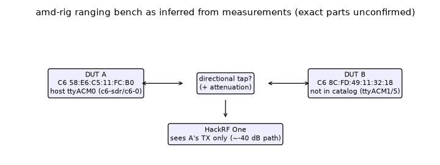
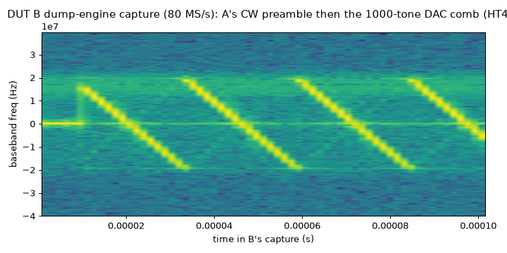
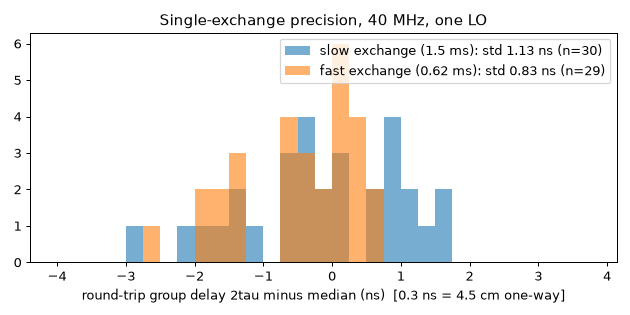
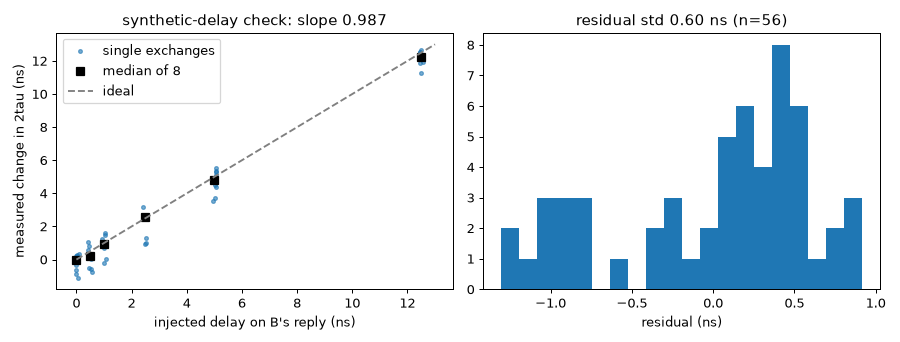
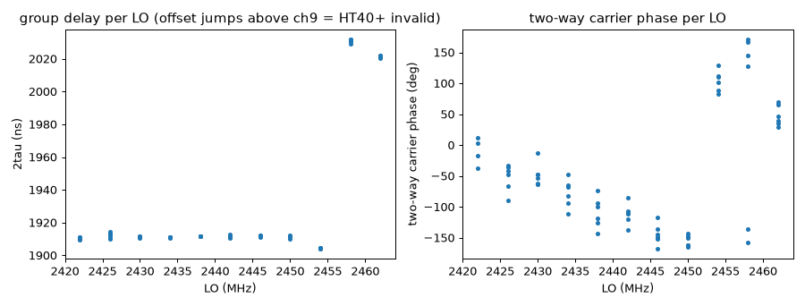
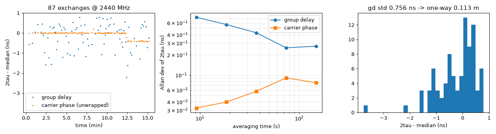
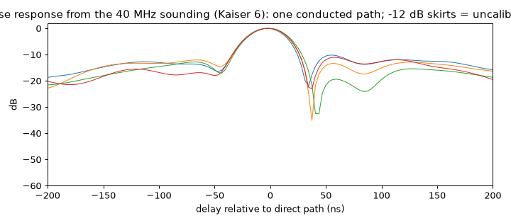
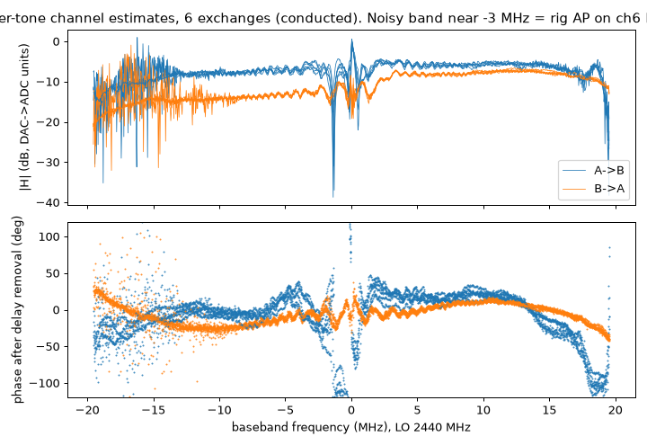
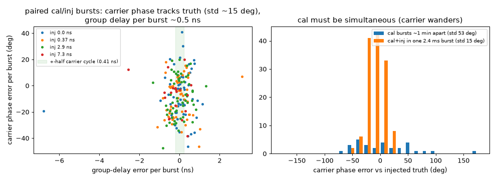
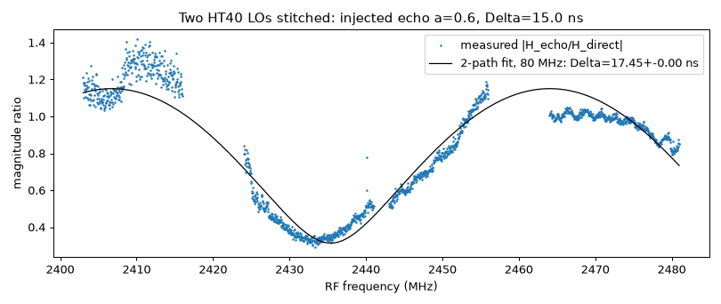

# Channel sounding and ranging between two ESP32-C6s (research track)

Status: research results from the amd-rig bench, 2026-11-17. Bench firmware
`firmware/chsound`, host pipeline `tools/chsound`. Raw captures and the experiment scripts
stay outside the repo (agent host `/workspace/.claude/chsound/`). This answers the mesh
design's §13 spikes S1a–S2 (`docs/design/mesh.md` on `agent/mesh-design`) and goes further,
because the owner asked for the best ranging the C6 radio can do, not for BLE Channel
Sounding conformance.

## 1. Summary

- **Both raw I/Q directions work on the C6 from our own firmware.** RX: the modem dump engine
  captures 10-bit I/Q at 80, 40, 26.7 or 16 MS/s, up to 16 380 samples (205 µs at 80 MS/s).
  TX: the modem's DAC playback engine plays an arbitrary host-uploaded waveform at 80 MS/s,
  looped, from the same SRAM bank. Both were checked against a HackRF One and against the
  other C6.
- **We don't need tone-by-tone hopping.** In HT40 mode the TX and RX analog filters pass a
  flat ~40 MHz (−20…+18 MHz). One 100 µs capture of a 1000-tone multitone gives 1000 channel
  samples at 39 kHz spacing. That beats a BLE-CS-style single-tone PBR sweep on every axis
  here: no 72 retunes (each retune costs 0.24 ms plus a random LO phase), and the
  measurement airtime is 0.6 ms per two-way exchange.
- **Measured precision (conducted, one LO, one exchange):** round-trip group delay `2τ`
  std **0.76–0.83 ns**, which is **11–12 cm one-way**. Averaging floors at ~0.26 ns
  (**4 cm**, ~1 min). No drift over 15 min. Synthetic delays of 0.5–12.5 ns injected into the
  reply waveform are recovered with slope 0.987 and 0.12 ns rms on medians (§6.3).
- **LO phase survives the TX↔RX turnaround** when the PLL is not retuned. The two-way
  carrier phase (LO phases cancel) repeats to **13–30° per exchange** (33 ps of `2τ`,
  **~5 mm one-way**). That makes a mm-level _relative_ displacement tracker. It drifts
  thermally (~0.4 ns of `2τ` in 15 min), and its 0.41 ns integer ambiguity can't be fixed
  from today's 0.26 ns group-delay floor (§6.5, §8).
- **What limits it:** the 80 MHz sample clock wanders against the crystal and the RF LO by
  about 1 ns over milliseconds (§7.1). Group delay sees this wander. The carrier phase does
  not. So: keep exchanges short, average, and use carrier phase once the group delay is good
  enough to fix its integer.
- **Round 2 (§12):** tight 2.4 ms bursts hold the carrier phase to 2–15°. With the
  calibration taken _inside_ the burst, the carrier integer is resolved from ~35–60 bursts:
  synthetic delays of 0, 0.37 and 2.90 ns come back within **+9 ± 3 ps** (≈1.3 mm one-way,
  with a calibratable +9 ps bias). Group delay alone averages to ±0.08 ns (1.2 cm). Two HT40
  LOs stitch to an 80 MHz span that shows a 15 ns echo a single 40 MHz shot cannot.
- **Not a player feature yet.** The engines need whole 128 KB SRAM blocks while they run,
  and the exchange takes the radio for ~1 ms with interrupts off (§9). This fits a bench
  image, a P4+C6 front end, or a dedicated ranging mode. It does not fit a heap-starved
  C6 player as is.

## 2. Rig

amd-rig (`http://amd-rig:8087`, unit `c6-sdr`). Measured, not read from a parts list:

| Item              | What we found                                                                                                                                                                                                                                            |
| ----------------- | -------------------------------------------------------------------------------------------------------------------------------------------------------------------------------------------------------------------------------------------------------- |
| DUT A             | C6 `58:E6:C5:11:FC:B0` = catalog `c6-0`, host `/dev/ttyACM0`                                                                                                                                                                                             |
| DUT B             | C6 `8C:FD:49:11:32:18`, host tty varies (`ttyACM1`, `ttyACM5` after a re-enumeration). **Not in any catalog**: the phone catalog calls it the "spare". The privileged `c6-sdr` env sees every `/dev/ttyACM*`, so it is reachable while holding `c6-sdr`. |
| HackRF            | sees A's transmissions strongly (CW at the strongest power: ~54 dB over the floor at LNA 8 / VGA 10) and **none of B's**, at any power. This matches #166's "directional TX tap": the HackRF hangs off a coupler on A's port.                            |
| A ↔ B            | strong conducted coupling both ways (vendor CW at max power gives rms 35–51 LSB at RX gain index 20). B→A is ~4 dB weaker than A→B.                                                                                                                      |
| Leakage           | the rig AP (`amd-rig-ap`, ch 6, 2437 MHz, 20 dBm) leaks into the conducted path: visible near −3 MHz at LO 2440, and enough to fire a plain power trigger.                                                                                               |
| Not on this bench | the other two C6s (`c6-a` …FC:D8, `c6-b` …83:C8) belong to the phone bench (`:8088`); we don't touch them.                                                                                                                                               |

Open: the attenuator values and whether there is a splitter or a coupler. Ask the owner (§11).



## 3. What the C6 radio offers, and what we picked

| Capability                                                              | Result on the C6                                                                                                                                                                                                                                             | Used?             |
| ----------------------------------------------------------------------- | ------------------------------------------------------------------------------------------------------------------------------------------------------------------------------------------------------------------------------------------------------------ | ----------------- |
| Dump engine RX (`0x600a9004`, bank `0x40840000`)                        | works; 80/40/26.7/16 MS/s confirmed by cycle stamps (32070/64086/96056/160088 CPU cycles for 16 000 words); RF-positive sample = bits 19:10 + j·bits 9:0                                                                                                     | yes               |
| Capture into another block                                              | owner `0x200` → block 1 (`0x40820000`); owner bit 16 → +64 KB in the block; `0x600` writes **both** blocks                                                                                                                                                   | yes (block 1)     |
| DAC playback engine TX (`0x600a900c`)                                   | works, 80 MS/s, loop; orientation bits 9:0 + j·bits 19:10 (mirror of RX). Needs the chain keyed (`phy_tx_tone(1,0,pwr)`) and tone EN cleared. Reads the block the owner register selects (same bit-16 offset rule as capture).                               | yes               |
| Vendor CW (`phy_tx_tone` in our libphy; `wifiscwout` is not in our SDK) | works; pwr arg is an attenuation index (0 = strongest, 20 ≈ −20 dB)                                                                                                                                                                                          | preamble          |
| Analog bandwidth                                                        | HT20: ±10 MHz. HT40 (`esp_wifi_set_channel(ch, ABOVE)` then `phy_set_freq`): flat −20…+18 MHz. RX LPF `0x67:4/5 = 0` widest. The LO stays at the requested frequency in HT40.                                                                                | HT40              |
| IQ estimator (`0x600a0470…`)                                            | works as a power/mean detector; **freezes while the chain is force-keyed** (needs a vendor unkey, `phy_tx_tone(0)`+RX front end, to run again)                                                                                                               | preamble detector |
| TX gating by `FE_FORCE 0x600a0910`                                      | TX off/on in µs (28 dB), DAC keeps running                                                                                                                                                                                                                   | tried, see §7.3   |
| PLL-only retune `phy_set_freq`                                          | 0.24 ms; randomises LO phase (e04: 116° circular std vs 24° without retune)                                                                                                                                                                                  | hops              |
| Wi-Fi FTM / OFDM CSI                                                    | vendor-stack only; our netstack bypasses it. Our scheme measures the same thing (RTT + per-subcarrier phase) with full control                                                                                                                               | no                |
| RTT timestamps                                                          | the CPU cycle counter (6.25 ns) stamps every engine trigger; the engine starts track the stamps (stamp jitter of 12.5–25 ns did not show up in the result). Sub-sample timing comes from the tone phases. So the "RTT" and the sounding are one measurement. | yes               |

**Scheme.** A two-way, wideband, periodic-multitone exchange (§4) with:

- 1000 tones at 39.0625 kHz (period P = 2048 samples = 25.6 µs at 80 MS/s), ±19.5 MHz,
  Newman phases, peak 300 of 511 DAC LSB;
- a vendor-CW preamble so the peer can find the burst (a DC-compensated narrowband IQE
  detector; plain power triggers fire on ambient Wi-Fi);
- the capture covering the CW→comb switch, which pins the waveform epoch and removes the
  25.6 µs period ambiguity;
- every trigger stamped with the CPU cycle counter.

## 4. Two-way model

Each board has one crystal; its LO, DAC, ADC and CPU clocks all share one fractional error
ε. Let δ = ε_A − ε_B, which we fit per capture from the tone grid (it is also the CFO:
CFO = δ·f_c; A−B ≈ +61.3 ppm on this pair, which is +150 kHz at 2.44 GHz).

1. A starts its comb at epoch e_A (stamp of the DAC start, A's clock). B captures it.
   Per-tone phasors are evaluated at the **receiver-clock** tone frequencies
   (f_c + kΔ)(1+δ) − f_c, divided by the known tone amplitudes S_k, giving H_B(k).
2. The delay D_B (in B's capture, B's clock) is the IFFT peak over the uniform tone grid,
   refined by a weighted least-squares phase slope. The period branch is fixed by the
   observed onset: arrival_B = y_B + D_B + j·T_P nearest the onset.
3. B replies the same way. A gets arrival_A.
4. `Tround = arrival_A − e_A` (A's clock) and `Treply = e_B − arrival_B` (B's clock).

```text
2τ = Tround − Treply − δ·Treply          (the δ term: 61 ppm × 0.6 ms ≈ 37 ns, so it matters)
φ  = arg H_B(f=0) + arg H_A(f=0) + 2π·δ̄·f_c·(D_B + I_A)
```

I_A is A's interval from its epoch to its capture start. δ̄ is δ averaged from both captures.
φ is the two-way carrier phase: the LO phases cancel, and what remains is −2π(f_A+f_B)τ plus
fixed TX/RX path phases. Both results contain fixed hardware offsets (§6.4).

`tools/chsound/twoway.py` implements this. `cspipe.py` holds the DSP.

## 5. Firmware (`firmware/chsound`)

Arduino-ESP32 3.3.10 image with the vendor Wi-Fi brought up (NULL mode, promiscuous, for
calibration) and SRAM blocks 1+2 reserved with `SOC_RESERVE_MEMORY_REGION` (the image ends
at `0x4081f3e0`). The host drives it over the USB console. The core is a **timed sequence
interpreter**: `seq <ops>` runs a list of ops with interrupts off, stamps each trigger with
the cycle counter, and prints the stamps:

| Op                                                  | Meaning                                                                                        |
| --------------------------------------------------- | ---------------------------------------------------------------------------------------------- |
| `K<pwr>` / `V` / `U`                                | vendor key (CW) / vendor unkey + RX front end, DAC left running / same with DAC stop           |
| `T` / `Z`                                           | tone EN off (DAC path) / restore                                                               |
| `L<n>` `D<n>` `X<n>` `d`                            | tile the uploaded waveform into the bank / start DAC (tile if needed) / start DAC as is / stop |
| `C<n>[,div]` `Y<n>[,div]` `M0`                      | capture (into block 2 / under the current owner) / copy capture to block 1                     |
| `O<bits>` `F<v>` `W<a>,<v>` `G<idx>` `P<mhz>[,khz]` | SRAM owner, FE_FORCE pair bits, raw write, forced RX gain, PLL-only retune                     |
| `A<us>` `B<us>` `E…` `N<thr>,<to>`                  | wait until t0+us / until detection+us / power detect / narrowband (CW) detect                  |

The exchange programs are in `twoway.py` (`PREP`, `A_PROG`, `B_PROG`).

## 6. Results

### 6.1 Raw I/Q

- **RX** (e02): a CW from A seen by B tuned 1 MHz above lands at −850 kHz, and tuned 1 MHz
  below at +1150 kHz. The sign is consistent, so the RF-positive orientation is as stated.
  The rates match the cycle stamps.
- **TX** (e03, e07b): the HackRF sees a host-uploaded tone at bin 128/2048 at +5.039 MHz (+39 kHz is
  A's CFO against the HackRF). LO leakage is −29 dBc. The same image plays through `dac`,
  `seq D` and uploaded masters.
- **Bandwidth** (e08, e09): HT40 on both boards gives −22…+20 MHz at ±5 dB, about 30 dB over
  the floor per tone at gain index 20.



### 6.2 Precision, one LO

| Exchange                                      | Airtime | n    | 2τ std                     | one-way  |
| --------------------------------------------- | ------- | ---- | -------------------------- | -------- |
| slow (vendor unkey/key, DAC re-tiled, 1.5 ms) | 1.5 ms  | 29   | 1.03 ns                    | 15 cm    |
| fast (DAC loaded once, 0.62 ms)               | 0.62 ms | 23   | 0.75–0.83 ns               | 11–12 cm |
| fast, back-to-back bursts of 6 at one LO      | 0.62 ms | 6×11 | 0.14–0.8 ns (median ~0.35) | 2–12 cm  |

The carrier phase two-way sum gave 13.2° circular std (slow exchange, n=29) and 15–23° per LO
in the hop run. 2.9° appeared once, on a short run.



### 6.3 Validation with known delays

There was no way to change cables remotely, so the known delays are synthetic: B's reply
waveform is pre-delayed by d (a per-tone phase ramp, so fractional samples are exact). The
measured 2τ must move by exactly d.

| Injected d (ns)           | 0    | 0.5   | 1.0   | 2.5   | 5.0   | 12.5   | 0 (repeat) |
| ------------------------- | ---- | ----- | ----- | ----- | ----- | ------ | ---------- |
| median Δ2τ (ns), n=8 each | 0.00 | +0.26 | +0.97 | +2.61 | +4.84 | +12.27 | +0.11      |

A least-squares fit over all 56 exchanges gives a slope of 0.987 and a residual std of 0.60 ns
(single exchanges). Over the 7 medians the residual rms is 0.12 ns. The 0 ns point repeated
after ~4 minutes shifted by +0.1 ns. The chain is linear to ~1–2 % (the slope error is
probably the filter group-delay ripple seen by a shifted waveform), with no offset jumps.
This checks every step after the DAC, but not the physical propagation term. A real cable or
attenuator change is still owed (§11).



### 6.4 LO hopping

Eleven LOs from 2422 to 2462 MHz (the ±19.5 MHz comb stays inside 2400–2483.5), six
exchanges each (e23). Group delay per LO: 1910.7–1912.4 ns for LOs up to 2450 (spread
±0.9 ns: filter group-delay ripple, to calibrate per LO). It then jumps: 1904 ns at 2454,
then +120 ns at 2458/2462. HT40-above is not valid
above ch 9, so the vendor falls back to another filter setting. Re-run with HT40-below for
LO ≥ 2452 (now the default in `twoway.py`): every LO from 2442 to 2462 lands at
1911.1–1913.0 ns, with 0.14–0.37 ns within-LO scatter (4 back-to-back exchanges each).
The carrier phase falls about 36° per
4 MHz across the LOs. That slope is the RF phase delay (~25 ns round trip, dominated by the
boards' RF chains and filters, not the cable). With calibration it gives a third,
independent range observable.



### 6.5 Drift

87 exchanges at 2440 MHz over 15 min, one every ~9 s (8 more missed the preamble, 8 %):

|                      | single exchange                    | Allan dev at 8 exchanges (~75 s) | drift over 15 min                      |
| -------------------- | ---------------------------------- | -------------------------------- | -------------------------------------- |
| group delay 2τ       | 0.76 ns (11 cm one-way)            | 0.26 ns (4 cm), flattening       | 0.004 ns/min (none)                    |
| carrier phase, as 2τ | 0.033 ns (21° circ.; 5 mm one-way) | 0.09 ns (rising)                 | −0.025 ns/min (≈ −0.9 cycle in 15 min) |

Group delay averages roughly as 1/√N to ~0.26 ns, and then the sample-clock wander floors it.
The carrier phase is very quiet exchange-to-exchange but drifts slowly (thermal: the RF phase
delay of the two boards' chains). So:

- **Absolute range** comes from the group delay: 11 cm per exchange, ~4 cm averaged over a
  minute. It has no visible drift, so one calibration holds.
- **Relative motion** comes from the carrier phase, unwrapped over time: ~5 mm noise per
  exchange, valid while the motion between exchanges stays below λ/4 (3 cm), with a slow
  drift to recalibrate against the group delay.
- **Fixing the carrier integer** (absolute mm ranging) needs group delay at ~0.07 ns. That
  is below the 0.26 ns floor measured here. §8 says what would get there.



### 6.6 Channel impulse response



One conducted path. The −12 dB skirts come from the uncalibrated TX/RX filter response
(magnitude ripple and the band edges). A per-LO calibration of H (divide by the
zero-distance response) is the next step before using the CIR for multipath work.



## 7. Limits, with evidence

### 7.1 Sample-clock wander (the dominant group-delay error)

- Two captures of A's free-running comb, 0.4 ms apart on B: epoch residual std 0.28 ns (e14,
  unimodal).
- A restarting its DAC 2.7 ms later: ±0.9 ns, bimodal, with the two states ~1.8 ns apart (e14).
- DAC kept running and TX gated off and on for 5 ms: still ±1 ns (e17). Over the same gap
  the carrier phase moved only ±30°, which is 34 ps.

So the 80 MHz sample timing wanders against the crystal and the RF LO by about a nanosecond
over milliseconds, in steps comparable to one 480 MHz BBPLL cycle (2.08 ns). The LO does not.
**Consequences:** shorter exchanges help (1.5 ms → 0.62 ms took 1.03 → 0.8 ns). The carrier
phase is the precision observable.

### 7.2 Integer ambiguity of the carrier phase

The carrier phase gives 2τ modulo 0.41 ns. Fixing the integer needs group delay to about
0.07 ns (6σ). Single-exchange 0.8 ns needs ~130 independent exchanges averaged, or
back-to-back bursts (0.3 ns → ~20), or wide-lane combinations across LOs (two LOs 40 MHz
apart give a 25 ns ambiguity with σ ≈ 1.3 ns, so they are too noisy alone). Within-burst
precision is what makes this practical. See §8.

### 7.3 Things that did not work, or bit us

- **IQ estimator frozen while keyed.** `phy_tx_tone(1)` stops the IQE until a vendor
  unkey + RX front end (`V`/`U`). A register diff of FE/AGC/LPCON between the two states
  (e21) did not find a register-level fix. So the RX side uses the vendor unkey (~140 µs).
- **Owner switching with a running DAC.** The DAC reads whatever block the owner selects. If
  the capture block is selected, the DAC plays the capture back into its own receiver
  (feedback, rms 170 LSB). So the DAC is stopped while receiving and restarted per burst.
- **Ambient Wi-Fi** fires power triggers. The fix is the narrowband CW-preamble detector with
  DC removal. Its baseline must be taken before the peer starts.
- **Interrupt watchdog** (300 ms): any `seq` with interrupts off must stay well under that,
  or the board reboots and loses HT40, gain and the waveform.
- **USB-CDC**: base64 dumps occasionally lose a character (the pipeline retries). Holding the
  port open across a chip reset re-enumerates the C6 as a new `ttyACM` (the daemon now looks
  ports up by USB serial and closes before resetting).
- **Preamble misses**: ~10–20 % of exchanges time out on B's detector (PA ramp at key-up,
  baseline timing). A failed exchange is detected and retried.

## 8. Error model and achievable accuracy

Per exchange (40 MHz, conducted, SNR ~30 dB per tone):

| Term                                        | Size                                              | Fix                                    |
| ------------------------------------------- | ------------------------------------------------- | -------------------------------------- |
| thermal / estimation                        | ~0.03 ns (CRLB for 1000 tones at 20–30 dB)        | —                                      |
| capture-start vs stamp                      | ~0.2 ns                                           | —                                      |
| sample-clock wander over the exchange       | 0.5–1 ns, grows with exchange length              | shorter exchanges; average             |
| δ error × Treply                            | < 0.02 ns                                         | δ fitted per capture                   |
| hardware offset (TX+RX chains, both boards) | ~1911 ns constant per LO, ±1 ns ripple across LOs | per-LO calibration at a known distance |
| filter phase ripple across the band         | ±30°                                              | per-LO H calibration                   |
| carrier phase per exchange                  | 13–30° (15–34 ps of 2τ)                           | average; needs the integer from gd     |

Measured ranging performance (conducted, after calibration):

- **Single exchange** (group delay, 0.6 ms airtime): σ ≈ 11–12 cm.
- **Averaged**: ~1/√N down to σ ≈ 4 cm (0.26 ns, ~8 exchanges here). Below that the
  sample-clock wander sets a floor.
- **Carrier-phase tracking**: ~5 mm per exchange for relative motion, with thermal drift of
  ~0.025 ns/min of `2τ` to recalibrate.

Further gains, roughly in order of payoff:

1. **On-device DSP and fast bursts.** Exchanges a few ms apart scattered 0.14–0.3 ns (e23)
   instead of 0.76 ns 9 s apart. A burst of 16 exchanges in ~20 ms, averaged, should reach
   ~0.1 ns. That is close to fixing the carrier integer.
2. **Measure the sample-clock wander instead of suffering it.** Each board could loop its
   own TX into its RX (a calibration capture) inside the exchange to reference DAC vs ADC
   timing. Or the BBPLL/APLL could be locked or characterised so the ~2 ns steps are
   predictable.
3. **Wider synthesized bandwidth.** Stitch HT40 shots at 2422/2462 (80 MHz) for multipath
   resolution. For precision the group-delay span is already enough. Calibrate H per LO.
4. **More SNR.** Not the limit in conducted tests (thermal CRLB ~0.03 ns). Over the air at
   range it will matter: longer captures (16 k samples), power index 0, coherent averaging
   across periods.
5. **External hardware**, if the owner wants absolute mm: a shared reference clock between
   fixtures removes the wander. UWB (DW3000) gives ~2–5 cm per shot anyway.

Over the air, multipath will dominate. 40 MHz resolves paths ~7.5 m apart; stitching the
LO hops (80 MHz) halves that. The CIR in §6.6 is the tool for that.

## 9. Rate, airtime and coexistence

- **Airtime** per two-way exchange: ~0.62 ms (A: 120 µs CW + 150 µs comb; B: 130 µs CW +
  150 µs comb; turnaround ~140 µs each). The radio is busy ~0.9 ms per exchange, including
  waiting for the peer.
- **Rate now** is host-limited (~3 s per exchange: two 64 KB captures over USB-CDC, Python
  DSP). On-device processing (period-average 4×2048 → one 2048-point fixed-point FFT, the C6
  has no FPU) is a few ms, so ~100 exchanges/s per pair is plausible. With 11 LOs × a burst,
  that is a full-band measurement in ~0.2 s.
- **Coexistence with the netstack:**
  - The exchange takes the radio off the AP channel for ~1 ms (two retunes, and HT40 needs
    the vendor channel API). Our MAC must be paused and the Wi-Fi channel restored after.
    That is the same shape as the netstack's background scan.
  - The engines own whole 128 KB SRAM blocks while they run (1 + 2 here). On a C6 player that
    means moving every DMA buffer (LED RMT/PARLIO, Wi-Fi) and anything touched from ISRs out
    of those blocks for the window. Today's player heap does not allow that (24 KB floor at
    2048 LEDs). **A P4+C6 board (C6 as the radio) can run it as is.**
  - Interrupts are off for ~1–2 ms per exchange. Effects keep rendering (LED DMA keeps going
    if its buffers are outside the engine blocks); a frame or two may be late. Nothing reboots.

## 12. Round 2: tight bursts, carrier-integer resolution, hop stitching

Firmware v14 adds: long `seq` programs (up to ~300 ops), the DAC waveform tiled into the
upper 64 KB of block 2 (`H`, DAC owner `0x10400`), a second waveform in block 1 (`J`, owner
`0x200`), and `Q<slot>` to copy each capture into a block-1 slot.

### 12.1 Tight bursts

A burst is one CW-preamble sync followed by 4–5 two-way exchanges, one every 600 µs.
Captures stay on chip and are read out afterwards, so a whole burst takes ~2.4–3 ms on air.
Results (`experiments/e32_pairs.py`, analysis `e33`):

- **Carrier phase within a burst: 2–15° circular std** (it was 21° for exchanges 9 s apart).
  Between bursts a minute apart it wanders ±50°: the "thermal drift" of §6.5 is really a
  random walk on a ~minute scale.
- **Group delay per exchange inside a burst: still 0.3–0.6 ns.** The noise is not slow
  wander. It is per-exchange engine-start jitter: the DAC restart is bimodal by ±0.9 ns
  (e14), and each burst exchange restarts the DAC. The carrier phase is immune to it,
  because a baseband shift doesn't move the f = 0 intercept.
- **Preamble misses:** 3/28, 4/74, 10/89 and 14/133 bursts (5–11 % per burst), retried
  automatically. Since one sync covers 4–5 exchanges, that is ~1–3 % per exchange, down
  from 8–20 %.

### 12.2 Absolute ranging with resolved carrier phase (synthetic delays)

The carrier phase pins `2τ` to ~10 ps, modulo 1/f_c = 0.41 ns. Its slow wander means the
calibration must be taken simultaneously with the measurement. So B alternates two waveforms
inside every burst: the normal one (even exchanges, the reference) and one pre-delayed by d
both at baseband and at the carrier (odd exchanges). That is exactly what a real extra path
length d on the B→A leg would do. Per burst: Δgd = gd(odd) − gd(even),
Δφ = φ(odd) − φ(even). The integer comes from the median Δgd (σ ≈ 0.08 ns over 35–60
bursts spread across 5 LOs, 2422–2462 MHz). Then `d = (−Δφ/2π + k)/f`.

| Injected d | Bursts | Group delay only  | **Carrier-resolved** | Error                   |
| ---------- | ------ | ----------------- | -------------------- | ----------------------- |
| 0          | 53     | +0.104 ± 0.076 ns | **+0.0085 ns**       | +8.5 ps                 |
| 0.37 ns    | 54     | +0.274 ± 0.079 ns | **+0.3798 ns**       | +9.8 ps                 |
| 2.90 ns    | 59     | +2.832 ± 0.077 ns | **+2.9090 ns**       | +9.0 ps                 |
| 7.30 ns    | 19     | +7.095 ± 0.144 ns | +6.9001 ns           | −400 ps (wrong integer) |

- With ≥35 bursts the integer is right every time. The result then has a common **+9 ps
  bias** (calibratable) and ±2–3 ps statistical error. That is **~1.3 mm one-way including
  the bias, ~0.4 mm after it**.
- With 19 bursts and a −0.2 ns group-delay bias (the 1–2 % group-delay scale error of §6.3
  grows with d), the integer slips by one. **Reliable integer fixing needs the group delay
  unbiased to ≲0.1 ns**: calibrate the group-delay scale, or use more bursts.
- Cost: ~50 bursts × 2.4 ms ≈ 0.12 s of airtime. Wall clock today is ~4 min, because each
  burst ships 8 × 24 KB over USB and the Python DSP is slow.



### 12.3 Hop stitching (80 MHz) and multipath

Two HT40 LOs (2422 and 2462 MHz; HT40-below at ≥ 2452) tile 2402–2481.5 MHz. In paired
bursts, B's odd exchanges carry an injected two-path channel (direct + 0.6 × echo at 15 ns).
The per-tone magnitude ratio |H(echo)/H(direct)| shows the expected 1/15 ns = 67 MHz ripple
across the stitched band. That ripple is not resolvable in one 40 MHz shot: the single-LO
fits give Δ = 21.2 ns or a degenerate a. A two-path fit over the 80 MHz stitched span gives
a = 0.57, Δ = 17.5 ns (truth 0.6, 15 ns). The residual bias comes from per-side (±f
baseband) distortion of the reply: the edges of each 40 MHz segment step. The image/IQ
imbalance of the TX path is the likely cause, and it needs a per-LO two-sided calibration
before the stitched CIR is metrology-grade.



### 12.4 What was not done, and why

- **On-device DSP (~100 exchanges/s): not implemented.** The C6 has no FPU. The plan is to
  period-average 4×2048 → one 2048-point Q15 FFT → tone phasors → slope, a few ms per
  capture, plus a ~40 B result per exchange instead of 48 KB of captures. Airtime already
  allows ~1600 exchanges/s; today's rate (~1 exchange/s) is the USB link and host Python.
- **Self-measured TX→RX turnaround: not implemented.** The C6 cannot capture its own keyed
  TX (§7.3). The DAC→ADC leakage with the PA off is real: rms 170 LSB of feedback when the
  DAC plays the capture block. So a device can see its own DAC epoch in its own ADC samples.
  The missing piece is a memory layout in which the DAC keeps playing a reference waveform
  while the capture lands elsewhere: every owner setting that maps the capture away also
  remaps the DAC read pointer (§6, e15/e16). That is the experiment to run next, because it
  would remove the per-exchange DAC-restart jitter that now limits the group delay.

## 10. Reproduce

`tools/chsound/README.md`. Short version: hold `c6-sdr`, flash
`//firmware/chsound:esp32c6_flashbundle` to both C6s, start `csd.py` on the rig, then
`twoway.Sounder(Bench()).exchange()`.

## 11. Open questions for the owner

1. Exact rig wiring between A, B and the HackRF (attenuator values, coupler or splitter)?
   Can someone add a switchable cable or attenuator step (for example 0.5 m and 3 m) for a
   physical-delay check, and/or a second HackRF tap on B?
2. Add DUT B (`8C:FD:49:11:32:18`) to the `c6-sdr` composite in `catalog-sdr.json`, so the
   ranging bench is a proper reservable unit?
3. Is the target a P4+C6 front end (fits as is) or a C6 player (needs an SRAM layout change
   and a ranging mode)?
4. GPL/AGPL: the register facts come from GPL-3.0 projects (ESP-SDR, esp-sdr-zephyr); our code
   is written from the documented facts, not copied. Fine with the AGPL repo?
