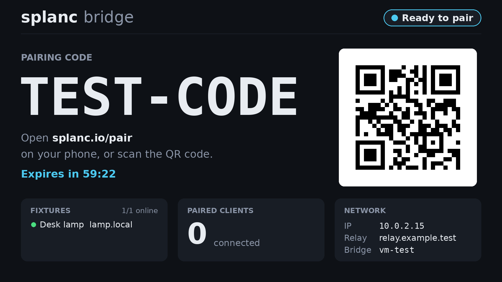
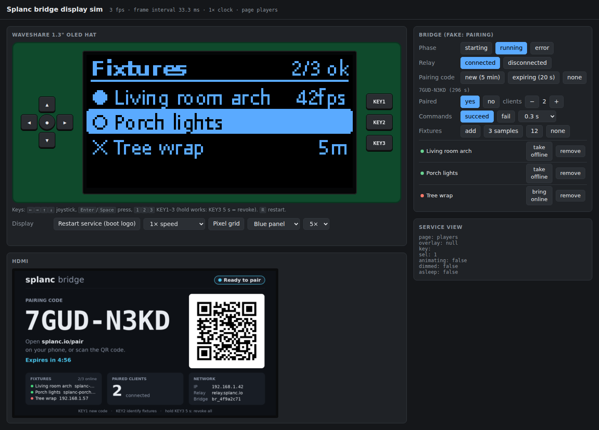

# pi/bridge: the Raspberry Pi "Splanc bridge" appliance

A Pi on the user's LAN runs `splanc-agent bridge` headless. Its pairing code and status appear on
HDMI and on a Waveshare 1.3" OLED HAT, and the HAT's keys drive the bridge. The end-user guide is
[docs/pi-bridge.md](../../docs/pi-bridge.md). This file covers how the appliance is built.

There are two ways onto a Pi, sharing the display service and the bridge contract below:

- **The SD image + flasher (primary, no terminal).** `image/` is a NixOS SD image per board, built
  and released by CI on `pi-bridge-v*` tags. `flasher/` is the **Splanc Bridge Flasher** desktop
  app that downloads it, takes the Wi-Fi settings and writes the card. See
  [The SD image](#the-sd-image) and [The flasher](#the-flasher).
- **`install.sh` on Raspberry Pi OS (power users).** One `curl | sudo sh` onto an existing Pi OS
  install. See [Delivery](#delivery).

```text
image/                      the NixOS SD image (flake.nix) — see "The SD image"
flasher/                    Splanc Bridge Flasher (Electron + Python sidecar) — see "The flasher"
install.sh                  the Pi OS installer (POSIX sh). Ships in the agent bundle, and on splanc.io
bin/splanc-bridge           the on-Pi CLI (status/new-code/identify/revoke-all/logs/update/...)
bin/splanc-bridge-run       ExecStart of splanc-bridge.service (pinned Node + bundle)
systemd/                    splanc-bridge.service, splanc-display.service, update .service/.timer
display/splanc_display/     the screen service (Python)
  status.py                   status.json contract -> Status (lenient), file watcher
  control.py                  control.sock client
  ui.py                       OLED/button state machine (pages, fixture list + detail menu,
                              KEY3 hold+confirm, dim/sleep, boot hand-off)
  anim.py                     easing, gliding values, scene slides (retarget, never queue)
  boot.py                     loads the pre-rendered boot animation (boot_frames.bin)
  render_hdmi.py              1920x1080-grid status page, scaled to any framebuffer
  render_oled.py              128x64 1-bit pages, fixture list/detail, slides + overlays
  fb.py                       /dev/fb0 writer (RGB565/XRGB8888, stride), VT 8 takeover
  hat.py                      SH1106 via luma.oled, gpiozero DC/RST adapter, keys, detection
  main.py                     the service loop (HDMI on its own thread)
  ctl.py                      CLI backend for status + commands
  fake_bridge.py              stand-in bridge for tests and demos
display/requirements.lock   hash-pinned pure wheels (luma.core, luma.oled, segno)
tests/                      pytest suite + installer_test.sh
tools/render_gallery.py     PNGs of every screen (+ boot/menu GIFs), for review and for the docs
tools/gen_boot_frames.py    the boot animation from web/public/icons/splanc.svg -> 1-bit frames
                            (a build step: //pi/bridge:boot_frames, and the image's splancPy)
```

## OLED frame pacing

The SH1106 takes a full frame as 8 pages of 128 bytes (plus 3 command bytes each): 1048 bytes,
about 1 ms on the wire at the 8 MHz SPI clock (`hat.py`), or ~25 ms over I2C at 400 kHz
(~95 ms at the Pi's default 100 kHz). On a desktop-class core, rendering a frame takes
0.25–0.6 ms (a slide reuses both screens' images: ~0.02 ms) and luma's 1-bit packing ~0.23 ms;
a Pi 3 / Zero 2 W core is roughly 10–15x slower, so a frame costs ~5–10 ms there, plus a few ms
of spidev/GPIO calls. `main.py` measures the real cost (render + push, EWMA) and draws animation
frames at `max(1/30 s, cost / 0.5)`: at most 30 fps, and never more than half a core. Slides last
120–250 ms (`anim.py`), so a Pi shows 4–7 frames per slide. Nothing is drawn while nothing moves
(the loop polls at 10 Hz and redraws once a second for the "12 s ago" texts), a press wakes the
loop at once, and `splanc-display.service` runs at `Nice=10` with idle I/O priority, below the
bridge.

## The bridge contract

The bridge is the agent bundle's `splanc-agent bridge`. This code depends only on this interface:

- **Status file:** `/run/splanc-bridge/status.json` (`SPLANC_BRIDGE_STATUS`), written atomically:

  ```json
  {"v":1,"state":"starting|offline|unpaired|pairing|paired|error","relay":"<url>",
   "bridge_id":"…","pairing":{"code":"ABCD-EFGH","expires_at":<unix s>,"url":"<redeem url>"}|null,
   "clients":<int>,"players":[{"name":"…","host":"…","ok":true}],"lan_ip":"…",
   "error":"…"|null,"updated_at":<unix s>}
  ```

- **Control:** `/run/splanc-bridge/control.sock` (`SPLANC_BRIDGE_CONTROL`). It takes
  newline-delimited JSON (`{"cmd":"new_pairing_code"}`, `{"cmd":"revoke_all"}` or
  `{"cmd":"identify"}`) and answers `{"ok":true,...}` or `{"ok":false,"error":"…"}`.

The display must keep running whatever the file says. Reads are lenient, so unknown states and
fields render instead of crashing. A missing file shows as "Waiting for bridge"; that is also
what happens when the bridge stops, because systemd removes its `RuntimeDirectory`. The pairing
code is shown only while `expires_at` is in the future.

## Delivery

- **Bundle:** `//agent:bundle` packs `:bundle_files` as `pi-bridge/` and copies `install.sh` to
  `site/bridge/install.sh`. splanc.io's `stage-agent.mjs` already copies `site/` verbatim, so
  `https://splanc.io/bridge/install.sh` appears with the first `firmware-v*` release that has
  this directory. splanc.io needs no change.
- **Installer:** fetches `https://splanc.io/agent/latest.json` and downloads the bundle it names,
  checking the sha256. It then installs `pi-bridge/` from inside that same verified bundle. The
  one-liner itself is only a bootstrap.
- **Node:** v22 LTS, pinned with in-script sha256s. Node 24 has no armv7l build, and v22 covers 32-bit
  Pi OS on a Zero 2 W or Pi 3. The architecture comes from `dpkg --print-architecture`, because a
  32-bit OS on a Pi 4/5 still reports `uname -m` = aarch64.
- **Python:** a venv with `--system-site-packages`.
  - From apt: compiled packages built for the board (`python3-pil`, `-cbor2`, `-smbus2`,
    `-spidev`, `-gpiozero`, `-lgpio`).
  - From the lockfile: the three pure wheels, with `pip --isolated --require-hashes --no-deps
--only-binary :all:`. `--isolated` skips Pi OS's piwheels index, whose rebuilt wheels have
    different hashes.
- **Updates:** `splanc-bridge-update.timer` runs daily and calls `splanc-bridge update --auto`.
  That downloads and verifies the new bundle, then runs _the new bundle's_ `install.sh --upgrade`,
  which keeps the settings and the previous version.
- **Pi 5:** GPIO goes through gpiozero (lgpio factory), including the DC/RST lines luma needs.
  `hat.GpioAdapter` replaces luma's default RPi.GPIO, which fails on the RP1. lgpio writes notify
  files in its working directory, so the unit sets `LG_WD`.

## The SD image

`image/flake.nix` builds one NixOS image per board (`image-pi5`, `image-pi4`, `image-pi3`,
`image-zero2w`) from nvmd/nixos-raspberrypi at the same pins as `pi/provisioning` and td-deploy
(through sbc-deploy, the commit `//MODULE.bazel` uses), so the RPi kernels built for those images
come from the fugstudio Cachix. It doesn't use sbc-deploy's `mkSbcSystem`, which bakes in a
live-deploy SSH key and tailscale; it takes the board modules and sbc-deploy's `sbc-base` (mDNS,
NetworkManager, lean firmware) and adds:

```text
image/nix/bridge.nix        the appliance: users, splanc-bridge / splanc-display services,
                            agent self-update timer, optional SSH, read-mostly tuning
image/nix/flash-config.nix  splanc-flash-config.service: applies the flasher's boot-partition files
image/nix/improv.nix        splanc-improv.service: Improv-over-BLE WiFi provisioning from the phone app
image/nix/rpi.nix           Pi bits: SPI + I2C + key pull-ups in config.txt, gpiochip perms, image name
image/nix/lean.nix          size trims (no docs, rescue tools, nixpkgs source, ModemManager, gtk3)
image/nix/packages.nix      agent bundle (agent-pin.json), Python env (luma from requirements.lock,
                            lgpio from its sdist), the display package with its vendored fonts
image/nix/system-update.nix full-system OTA: splanc-system-update timer/service, the boot-time
                            health check + rollback (splanc-system-update-confirm), panic/watchdog
image/nix/system-update-rpi.nix  Pi 5 tryboot mode + FAT generation limit
image/nix/vm-test.nix       QEMU smoke test (generic aarch64 VM, same appliance modules)
image/nix/vm-test-ota.nix   QEMU test of the system OTA (A -> B, bad keys, health-check rollback)
image/splanc_image/         on-device Python: bootconfig.py (boot-partition settings),
                            selfupdate.py (verified agent bundle updates), improv.py +
                            wifi_profiles.py (Improv WiFi provisioning, saved networks),
                            sysupdate.py (system OTA), nixcache.py (cache layout),
                            sysrelease.py (CI: release assets)
image/agent-pin.json        the agent bundle baked into the image (version, url, sha256)
image/ota-public-keys.txt   Nix public keys a system update must be signed with
```

- **First boot, every boot:** `splanc-flash-config` runs before NetworkManager and avahi. It
  sets the hostname and Wi-Fi country from `/boot/firmware/splanc-bridge.conf`, moves
  `system-connections/*.nmconnection` into NetworkManager (root, 0600) and deletes them from the
  FAT partition, writes the other settings to `/run/splanc-flash/bridge.env` for the services, and
  merges `authorized_keys` (sshd only starts if there are keys; there are no passwords).
- **WiFi from the phone (Improv over BLE):** `splanc-improv` (started when a Bluetooth adapter
  appears, advertising for as long as it runs, like the LED Mapper Pi's `sbc-improv`) is the Pi
  player's Improv GATT service (`pi/provisioning/nix/improv`, reused as is) with a bridge-specific
  join: a fresh scan every time (never a "same credentials" no-op; an SSID no sweep sees is tried
  as hidden), then the network is stored as a NetworkManager keyfile rendered by the flasher's own
  `render_nmconnection` (byte-identical to a flash-time profile, root 0600 in
  `/etc/NetworkManager/system-connections`), **added** next to the known networks
  (`splanc-wifi`, `splanc-wifi-2`, ...) and deduplicated by SSID (same SSID: replaced in place,
  same file/id/uuid), and joined with `nmcli connection up`. Joined: the phone gets
  `http://<wifi ip>/#splanc-bridge` (the app then tells the user to pair rather than adding a
  player). Not joined: the store is rolled back, the previous network is re-joined and the phone
  gets UNABLE_TO_CONNECT. BlueZ + bless/bleak/dbus-fast add about 28 MB
  (uncompressed) to the closure (Python and ICU are already there).
- **The agent:** the image bakes the bundle named in `agent-pin.json` (a `firmware-v*` release
  asset, sha256-pinned). `splanc-agent-update.timer` (2 min after boot, then daily) runs
  `selfupdate.py` as the `splanc-update` user: it fetches `splanc.io/agent/latest.json`, checks the
  bundle's sha256, unpacks it safely (plain files under one top directory only) into
  `/var/lib/splanc-agent/agent/<ver>`, flips `current`, keeps the previous version and restarts the
  bridge. The bridge runs as `splanc` and can only read that directory. A bundle older than the
  bridge (no `bridge` command) puts an explanatory error on the screens until an update arrives.
- **State:** `/var/lib/splanc-bridge` (bridge identity `bridge.json`, hub config) and
  `/var/lib/splanc-agent` survive reboots; the journal is in RAM, `/tmp` is tmpfs and `/` is mounted
  `noatime`. A fully read-only root wasn't worth it: the first boot grows the root partition and
  registers the Nix store, so it would need an overlay.
- **System updates:** over the air, see [System updates](#system-updates). Writing a newer image
  still works but resets the bridge identity (agents pair again).
- **Boards:** Pi 5 (bcm2712 kernel) and Pi 3 / Pi 4 / Zero 2 W (one shared bcm2711 kernel, so they
  cost one kernel build between them). All four ship; the Zero 2 W (512 MB) gets zram swap.

Build and test locally (aarch64 Linux with Nix; the images need a few GB of store):

```sh
nix build ./pi/bridge/image#image-pi5 -L          # result/sd-image/splanc-bridge-pi5.img
nix build ./pi/bridge/image#checks.aarch64-linux.vm -L   # needs the kvm system feature
# Without KVM: build the driver and run it outside the sandbox (QEMU falls back to TCG)
nix build ./pi/bridge/image#checks.aarch64-linux.vm.driver && ./result/bin/nixos-test-driver
```

The VM test copies out the HDMI page the display service rendered inside the VM (against a stub
bridge, with the relay from the flash-time settings):



CI (`.github/workflows/pi-bridge-image.yml`) builds every board on pushes to main that touch
`pi/bridge/**` (validation + Cachix warm-up), and on a `pi-bridge-v*` tag builds, measures
(closure top-25 + raw/compressed size, failing above 1 GB compressed), compresses with
`zstd -19` and attaches `splanc-bridge-<board>-<ver>.img.zst` + `.sha256` to the release, along with
the flasher installers. Agents decide when to cut a tag (the workflow header says how).

### System updates

Everything in the image (kernel, systemd units, the display code, NetworkManager config, a new
service) updates over the air as a whole NixOS generation, the way `nixos-rebuild boot` + reboot
would. The agent bundle keeps its own faster path (above): it ships more often than images, needs
no reboot, and a system update doesn't touch `/var/lib/splanc-agent`.

**Release (CI).** Three steps in `.github/workflows/pi-bridge-image.yml`, so that only one small
job ever sees the signing key:

1. `image` (every run, per board, environment `CI`): copies the system closure into an
   **unsigned** `file://` binary cache and flattens it once as a dry run (the step summary shows
   asset count and MB). On a `pi-bridge-v*` tag push it uploads the cache as a run artifact
   (`syscache-<board>`, ~480 MB, kept 1 day). It never has the key.
2. `ota-sign` (only `pi-bridge-v*` tag pushes; environment **`Bridge release`**, the only place
   `BRIDGE_NIX_SIGNING_KEY` exists): no repo build, just a sparse checkout of
   `splanc_image/` + `ota-public-keys.txt`, Nix, and the artifacts. It refuses a key whose public
   half isn't in `ota-public-keys.txt`, signs every path of each closure with `nix store sign`
   (against the `file://` cache, `--recursive` from the toplevel) and flattens them with
   `sysrelease.py --require-key` (which refuses any unsigned path) into the `ota-signed` artifact.
3. `ota-publish` (after the image release is out): uploads only that signed output.

The signer takes the build's own artifacts rather than re-fetching the closures from Cachix: it
signs exactly the bytes this run built, needs no aarch64 runner or Cachix access, and doesn't
extend the key's trust to whatever else can push to the cache. The result, with no other
infrastructure:

```text
pi-bridge-ota-vX.Y.Z (prerelease)   <filehash>.nar.zst  one per store path, shared between boards
                                    bridge-system-<board>-X.Y.Z.json  manifest: every narinfo (signed),
                                                                      the toplevel, the NAR base URL
pi-bridge-ota (prerelease, fixed)   bridge-system-<board>.json        pointer: version, toplevel,
                                                                      manifest URL + sha256
```

A plain HTTP binary cache needs a `.narinfo` per store path, and a GitHub release holds at most
1000 assets: the Pi 5 closure is 616 store paths (598 distinct NARs, 480 MB zstd, 1.26 GB
unpacked), all four boards together ~650 NARs. So the narinfos travel together in the manifest
(~0.5 MB) and only the NARs are separate assets (each well under the 2 GiB asset limit; the
largest, the Pi 5 kernel, is 116 MB). CI fails the OTA publish (not the image release) above 990
assets. Without the secret (or on anything but a tag push) nothing is signed or published, and no
job fails.

**Device (`splanc-system-update.timer`, every 15 min; checks the channel every ~6 h).**

1. Fetch the pointer; nothing to do if it names the running system or one that failed here before.
2. Fetch the manifest (sha256 from the pointer), compute the closure, ask Nix which store paths are
   missing, check there's room (else drop old generations + GC), download only those NARs and
   check each against its narinfo's FileHash/FileSize. A small change is a few MB; a nixpkgs bump
   is most of the 480 MB.
3. `nix store verify --no-contents --sigs-needed 1` with **only** the keys in
   `ota-public-keys.txt`: every path of the closure must be signed by one of them. Then
   `nix copy --from file://...` imports it (Nix checks each NAR's signed NarHash). The imported
   system must be a bridge system for this board. Nothing so far touches the running system.
4. Wait while an app is connected through the bridge (`clients` in status.json; at most 3 days),
   then: `nix-env -p /nix/var/nix/profiles/system --set <new>` (sbc-deploy's `deploy_live` does
   the same), install the boot entry and reboot. A failure here puts the old profile + boot entry
   back.
5. On the next boot `splanc-system-update-confirm` waits (5 min max) for the health check: the
   health units (`splanc-bridge`, `splanc-display`, `NetworkManager`, plus any a module adds to
   `splancBridge.systemUpdate.healthUnits`) active and up for 30 s without a restart, a default
   route if there was one before, boot finished. A unit that was already failing on the old system
   doesn't count. Pass: keep current + previous generation, GC the rest. Fail: previous
   generation back as the boot default, the new one remembered as bad, reboot.

**Boot modes.** Reboot (not a live `switch`): kernel and initrd changes need it anyway, the health
check then tests exactly what boots next time, and rollback is clean. Downtime is one reboot; the
fixtures keep playing (they don't depend on the bridge), only remote control pauses.

- **Pi 5, `tryboot`:** the firmware boots `nixos/default/` straight from the FAT partition. The
  updater leaves that (and `config.txt`) on the old system, has the old system's installer add
  `nixos/<N>-default/` for the new generation, writes `tryboot.txt` (the new `config.txt` with
  `os_prefix=nixos/<N>-default/`) and reboots with `reboot "0 tryboot"`: the firmware uses it for
  that one boot only. Only a passing health check makes the new system the default. So anything
  that stops the new system before the commit (kernel panic → `panic=10`, stage-1 failure →
  `boot.panic_on_fail`, a hang → the 15 s hardware watchdog, a power cut) boots the old system
  again, which notices and rolls back. The FAT partition keeps one older generation (default +
  newest, ~50 MB each) because the default of four would fill the 256 MB partition.
- **Pi 3 / Pi 4 / Zero 2 W, `reboot`:** U-Boot/extlinux has no one-shot entry, so the new
  generation is the default before the reboot. Rollback needs the new system to reach the health
  check; a system that can't boot at all can't roll itself back (choose the previous entry on the
  U-Boot console, or reflash).

**Signing key.** `ota-public-keys.txt` (committed) is baked into the image; the secret key lives
only in the `BRIDGE_NIX_SIGNING_KEY` secret of the GitHub environment `Bridge release`, which only
`pi-bridge-v*` tags may deploy to. Setup (repo **Settings → Environments**):

1. **New environment** → name `Bridge release` → **Configure environment**.
2. **Deployment branches and tags** → **Selected branches and tags** → **Add deployment branch
   or tag rule** → Ref type **Tag**, name pattern `pi-bridge-v*` → **Add rule**. (Optionally also
   **Required reviewers**, to approve each release's signing by hand.)
3. **Environment secrets** → **Add environment secret** → name `BRIDGE_NIX_SIGNING_KEY`, value =
   the whole secret key file (`splanc-bridge-1:...`).
4. **Environments → `CI`** → delete `BRIDGE_NIX_SIGNING_KEY` there if it was added (also check
   **Secrets and variables → Actions** for a repository-level copy, and delete that too).

`ota-sign` refuses to sign if the key's public half isn't listed in `ota-public-keys.txt`.
Whoever controls the `pi-bridge-ota` channel can point bridges at any release
signed with the key, including an older one; re-pointing is also how a bad release is rolled back:

```sh
gh release download pi-bridge-ota-v1.2.0 -p 'bridge-system-pi5-1.2.0.json'
PYTHONPATH=pi/bridge/image python3 -m splanc_image.sysrelease pointer \
  --manifest bridge-system-pi5-1.2.0.json --out bridge-system-pi5.json \
  --manifest-url https://github.com/fughilli/splanc/releases/download/pi-bridge-ota-v1.2.0/bridge-system-pi5-1.2.0.json
gh release upload pi-bridge-ota bridge-system-pi5.json --clobber
```

On the bridge: `splanc-system-update status` (state, last result, staged/pending update),
`sudo splanc-system-update check` (check now; installs when idle), `... apply` (install now even if
an app is connected), `... logs`. `SPLANC_AUTO_UPDATE=0` in `splanc-bridge.conf` turns the
automatic checks off, as for the agent. Progress goes to `/run/splanc-system-update/status.json`
(`state`: downloading, verifying, staged, installing, rebooting, confirming, committing,
rolling_back, idle, failed, disabled) for the screens to show.

## The flasher

`flasher/` is adapted from td-deploy Studio's flasher (same author, MIT): an Electron window
(`electron/`) and a Python sidecar (`sidecar.py`, JSON lines over stdio) frozen with PyInstaller.

```text
flasher/splanc_flasher/releases.py  newest non-prerelease pi-bridge-v* release; download, sha256 check
                                    (the .sha256 asset, cross-checked with GitHub's digest), zstd unpack
flasher/splanc_flasher/disks.py     removable disks only (per-OS parsers of diskutil / Get-Disk / lsblk)
flasher/splanc_flasher/flash.py     re-check the disk, elevated write, then mount the boot partition as
                                    the user and write the settings
flasher/splanc_flasher/rawwrite.py  the privileged worker: write, read back + compare, progress file
flasher/splanc_flasher/elevate.py   osascript admin prompt / UAC PowerShell (offline -> write -> online
                                    + drive letter) / pkexec
flasher/splanc_flasher/bootfiles.py splanc-bridge.conf + the NetworkManager keyfile
flasher/packaging/                  PyInstaller spec, build_app.sh (macOS, Linux), build_app.ps1 (Windows)
flasher/tools/                      demo.js + screenshots.sh: the window in each state, for the docs
```

Safety: only removable media is ever listed (internal, virtual, system/boot, read-only disks and
disks holding a mounted system path are filtered out), the target is re-checked right before
writing, an image larger than the card is refused, disks over 256 GB need a second confirmation,
and the written card is read back and compared before the settings go on.

The keyfile writes the SSID as NetworkManager's byte list (`ssid=72;111;109;101;`), which is
unambiguous for every SSID (a plain `ssid=123` would be read as one byte), and escapes the PSK as a
GLib key-file string. The VM test feeds NetworkManager a profile the flasher rendered for an
SSID/PSK full of `;`, `\`, `#`, `=`, leading/trailing spaces and non-ASCII, and checks `nmcli`
reads them back exactly.

Run it from source (Python 3.14, or 3.11+ with `zstandard`, plus Node 22):

```sh
cd pi/bridge/flasher/electron && npm ci && npx electron .   # uses ../sidecar.py
```

Signing: none of the signing secrets exist yet, so macOS builds are ad-hoc signed and Windows
builds unsigned (users confirm once; docs/pi-bridge.md says how). To sign, add repository
secrets `MAC_CSC_LINK` + `MAC_CSC_KEY_PASSWORD` (Developer ID Application .p12, base64) and
`APPLE_ID` + `APPLE_APP_SPECIFIC_PASSWORD` + `APPLE_TEAM_ID` (notarization), and/or
`WIN_CSC_LINK` + `WIN_CSC_KEY_PASSWORD` (Authenticode .pfx, base64); the workflow picks them up.

## Development

```sh
bazel test //pi/bridge/...                                 # display, installer, image, flasher tests
bazel run //pi/bridge:render_gallery -- /tmp/gallery       # every screen as PNG
bazel run //pi/bridge:render_gallery -- --docs "$PWD/docs/img/pi-bridge"

# Live loop without a Pi: the fake bridge + the real service writing PNGs
cd pi/bridge/display
python3 -m splanc_display.fake_bridge --dir /tmp/fb --cycle 5 &
SPLANC_BRIDGE_STATUS=/tmp/fb/status.json SPLANC_BRIDGE_CONTROL=/tmp/fb/control.sock \
  python3 -m splanc_display.main --hdmi png:/tmp/fb/hdmi.png --oled png:/tmp/fb/oled.png

# Interactive simulator: the same, with the HAT's keys in a browser (below)
bazel run //pi/bridge:sim                                  # open http://127.0.0.1:8737/

# On a Pi, before a release carries pi-bridge/: the published agent + this checkout's display
sudo sh pi/bridge/install.sh --source pi/bridge
```

### Display simulator (no Pi needed)

`splanc_display/sim.py` runs the real display service (`main.App`: the menu, slides and list
animations at their real frame pacing, the boot logo, the status watcher and the control client)
with only the hardware mocked at its seams: a 128x64 1-bit OLED device in place of luma's SH1106,
gpiozero-shaped buttons in place of the HAT's keys (press and release, so KEY3's 5 s hold works),
and an in-memory HDMI framebuffer. A local web page shows the panel scaled up next to the HDMI
page, streams each frame as the service draws it, and has the HAT's joystick and KEY1–3 as
buttons and on the keyboard (arrows, Enter/Space, 1/2/3; `R` restarts the service so the boot
logo plays again). A clock-rate menu slows everything down (0.25x) to inspect transitions.



On a Mac without Bazel (Python 3.9+; Pillow and segno are the only dependencies, and the boot
logo is rendered from `web/public/icons/splanc.svg` on the fly):

```sh
python3 -m venv /tmp/splanc-sim && /tmp/splanc-sim/bin/pip install pillow segno==1.6.6
cd pi/bridge/display && /tmp/splanc-sim/bin/python -m splanc_display.sim   # http://127.0.0.1:8737/
```

`--bridge fake` (the default) drives `fake_bridge` through a model of the real bridge's state
(phase, relay connected/disconnected, pairing code incl. one about to expire, paired clients,
commands failing or slow, fixtures added/removed/taken offline); every knob is on the page, so
every screen and state is reachable. `--bridge real` runs the actual `splanc-agent bridge`
against a local `splanc-agent relay` it starts (no account needed; fixtures are whatever it
discovers on your LAN, and "stop relay" shows the offline path). It needs the agent built:
`bazel build //agent:mcp`, or `--agent path/to/splanc-agent.mjs`. Other flags: `--push-ms 15`
adds per-frame cost (a slow Pi's SPI push: the service then lowers its frame rate as it would
there), `--speed 0.25`, `--hdmi-size 1280x720`, `--host 0.0.0.0` to open it from a phone,
`--fonts NAME` to start in a font set.

### Fonts

Every screen draws only with fonts vendored in `display/splanc_display/fonts/`, each family with
its licence, and `SOURCES.txt` recording the upstream release URL and sha256 they came from plus
the sha256 of each file (checked by `display_test`). The agent bundle, the NixOS image, the sim,
`render_gallery` and the tests all read these same files, and nothing looks in system font
directories, so a missing file is an error rather than a silent fallback.
`SPLANC_DISPLAY_FONT_DIR` is an explicit override (same layout). `tools/vendor_fonts.py`
regenerates the directory (`pip install fonttools` first). It is deterministic, and it subsets
DejaVu (HDMI and the `dejavu` OLED set) to Latin, Greek, Cyrillic and symbols, keeping hinting
so 1-bit rendering is unchanged.

The OLED has named **font sets** (`splanc_display/fonts.py`). Each maps the screen's text roles
(title, body, status line, pairing code, the QR page's code, fixture values) to a font and size.
The bitmap fonts are BDF files read directly, because Pillow's `.pil` format holds only 256
glyphs; characters a font lacks are drawn from DejaVu. Each set's line heights come from its
glyphs, and the layout adapts to them: header rule, row centring, value column and stacking.
`test_font_sets.py` renders every page and state in every set and fails on text that leaves
its box or touches other text.

| Set                | Sizes                                                              | Licence                        |
| ------------------ | ------------------------------------------------------------------ | ------------------------------ |
| `dejavu` (default) | DejaVu Sans 9-10 px, 14 px status, Mono Bold code (TrueType)       | Bitstream Vera / public domain |
| `spleen`           | 6x12 (titles double-struck), 8x16 status, 12x24 code, 5x8 fallback | BSD-2-Clause                   |
| `terminus`         | 6x12 (titles double-struck), 8x16 bold status, 12x24 bold code     | OFL-1.1                        |
| `misc-fixed`       | X11 6x12, 6x13B titles, 9x15B status, 10x20 code                   | public domain                  |
| `cozette`          | 6x13 (titles double-struck), code at 2x                            | MIT                            |

Title variants of the two favourites (the rest of each set unchanged). A set's `title_style` is
`bold` (a bold face, real or double-struck), `tracked` (double-struck with extra spacing) or
`inverse` (the regular face, dark on a lit title bar that also carries the right-hand info):

| Set                  | Titles                                                            |
| -------------------- | ----------------------------------------------------------------- |
| `terminus-tracked`   | 6x12 double-struck with +1 px tracking, so letters keep their gap |
| `terminus-14b`       | the real bold 8x14 (header 2 px taller; long titles ellipsize)    |
| `terminus-inverse`   | regular 6x12 on a lit bar                                         |
| `misc-fixed-7x13b`   | the real bold 7x13B                                               |
| `misc-fixed-inverse` | regular 6x12 on a lit bar                                         |

Try them live in the sim (dropdown, `F` cycles, "All sets" shows the current screen in each),
on a Pi with `SPLANC_OLED_FONTS=terminus` in the service environment, or as one comparison
sheet: `bazel run //pi/bridge:render_gallery -- --font-sets /tmp/fontsets.png` (`--font-set
NAME` renders the whole gallery in one set; `--sets a,b,c` limits a sheet to some sets, and
`--titles PATH.png` draws just the title rows at 8x to judge letter spacing). Changing the
default is one line: `DEFAULT_SET` in `fonts.py`.

`tests/test_luma_gpiozero.py` exercises the real luma.oled and gpiozero (mock pins). It is skipped
under Bazel, which has neither; run it in a venv that has the lockfile plus `gpiozero`, as below.

## What is tested where

| Covered                                                                                                                                                                                                                | How                                                                                                                                                |
| ---------------------------------------------------------------------------------------------------------------------------------------------------------------------------------------------------------------------- | -------------------------------------------------------------------------------------------------------------------------------------------------- |
| Status parsing, watcher, button state machine (KEY1/2, KEY3 hold → confirm → revoke, paging, dim/sleep)                                                                                                                | `display_test` (pytest, fake clock and dispatcher)                                                                                                 |
| Fixture menu (list scroll, detail, back, fixtures appearing/vanishing), slide timing and interruption, boot hand-off, frame pacing                                                                                     | `display_test` (`test_menu.py`, `test_anim.py`, `test_app.py`; fake clock)                                                                         |
| Fixture detail text (missing fields, long names, IPv4/link-local/IPv6, unreachable), boot frames (built file, SVG rasterizer)                                                                                          | `display_test` (`test_fixture_detail.py`, `test_menu_render.py`)                                                                                   |
| HDMI + OLED rendering of every state and overlay, at several framebuffer sizes                                                                                                                                         | `display_test`; PNGs go to the test's `outputs.zip`                                                                                                |
| Framebuffer ioctl parsing, RGB565/XRGB packing, stride, VT takeover                                                                                                                                                    | `display_test` (faked ioctls on a regular file)                                                                                                    |
| Buttons → socket → bridge → status → screens                                                                                                                                                                           | `display_test` end to end against `fake_bridge` (real AF_UNIX socket)                                                                              |
| luma.oled SH1106 over SPI with the gpiozero DC/RST adapter; gpiozero Buttons                                                                                                                                           | `test_luma_gpiozero.py` with gpiozero MockFactory and a fake spidev, on Bookworm's versions (Python 3.11, Pillow 9.4, gpiozero 2.0.1, cbor2 5.4.6) |
| Installer: install, upgrade, prune, settings kept, sha256/no-pi-bridge refusals, I2C, uninstall/purge                                                                                                                  | `installer_test` (fake root)                                                                                                                       |
| Real downloads: latest.json → bundle sha256, pinned Node tarball sha256, venv + hash-locked pip                                                                                                                        | manual dry run into a fake root, with the display then run against the fake bridge                                                                 |
| Image: boot-partition settings parsing/validation, keyfile move off the FAT partition, SSH key merge                                                                                                                   | `//pi/bridge/image:image_py_test`                                                                                                                  |
| Image: self-update (sha256, hostile tarballs, rollback by publishing an older version, pruning)                                                                                                                        | `//pi/bridge/image:image_py_test`                                                                                                                  |
| Image: Improv WiFi: phone-app RPC bytes -> Pi codec -> keyfile byte-identical to the flasher's (tricky SSIDs/PSKs), add vs dedupe, fresh scan + join, hidden fallback, rollback on failure                             | `//pi/bridge/image:image_py_test` (fake nmcli)                                                                                                     |
| Image: boots; flash config applied; bridge on the baked bundle, then self-updated onto a newer one with the flash-time relay; NetworkManager reads the flasher's tricky keyfile exactly; HDMI page renders; CLI        | `checks.aarch64-linux.vm` (QEMU, generic aarch64; CI `vm-test` job)                                                                                |
| Image: Improv-stored networks read back exactly by NetworkManager; real-nmcli failed join leaves the store untouched; no BT adapter, no service                                                                        | `checks.aarch64-linux.vm`                                                                                                                          |
| Image: every board evaluates and builds; config.txt has SPI/I2C/pull-ups; size budget                                                                                                                                  | CI `image` job (and `nix eval` locally)                                                                                                            |
| Flasher: disk filtering, raw write + read-back, progress protocol, elevation wrappers, keyfile/conf rendering round-tripped through the image's parser, release lookup, download + checksum + unpack, sidecar protocol | `//pi/bridge/flasher:flasher_test`; again on each OS before packaging                                                                              |
| Units                                                                                                                                                                                                                  | `systemd-analyze verify` with Bookworm's systemd 252 (clean), plus `security --offline`                                                            |
| Shell                                                                                                                                                                                                                  | shellcheck (prek)                                                                                                                                  |

Not yet verified on hardware:

- the physical SH1106 panel: orientation (`OLED_ROTATE=2` is derived from the scan-direction
  registers in Waveshare's driver), contrast and burn-in behaviour;
- key debounce on real switches;
- `/dev/fb0` scanout under KMS on a Pi 3/4/5;
- the VT 8 switch;
- apt on real Pi OS;
- the Pi 5 RP1 GPIO path;
- Improv over BLE on the bridge: advertising/GATT via BlueZ on the Pi's UART Bluetooth, a phone
  provisioning it, and a real `nmcli connection up` onto a WiFi network (the GATT side is the LED
  Mapper Pi's unchanged service);
- the SD image booting on real Pi 3/4/5/Zero 2 W hardware (CI builds it and the VM test runs the
  same appliance modules, but QEMU can't run the Pi firmware);
- the flasher writing a real card on macOS, Windows and Linux (the installers are built and their
  frozen sidecar is smoke-tested in CI; the elevated write paths are unit-tested only).
